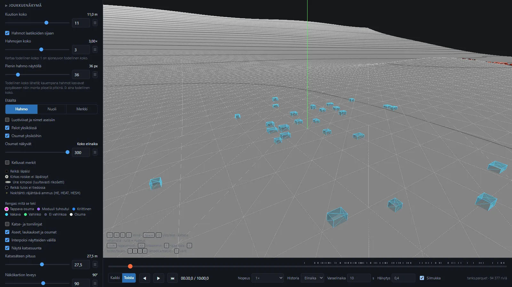

# Hahmot päällekkäin (laatikkotoisto)

Pieni elokuva: yksi hahmo jokaiselle henkilölle, joka liikkuu ajan kuluessa ja jonka perässä on jälki.

Tilaa kutsutaan tilapalkissa nimellä **Hahmot päällekkäin**. Tämä sivu oli aiemmin nimeltään "laatikkotoisto", koska ennen hahmoja jokainen henkilö oli laatikko; "hahmotoisto" ja "laatikkotoisto" tarkoittavat samaa. **Hahmot päällekkäin** -tilalla ei ole numeronäppäintä: valitse se tilapalkista. Se piirtää yhden hahmon (tai laatikon) jokaiselle [henkilölle](glossary.md), joka liikkuu [aikajanalla](timeline.md), ja valinnaisesti katsesäteet ja jäljet. Se on toistoa, ei tiheyttä: *kuka oli missä, milloin*. Tarvitaan henkilösarake; ilman aikasaraketta jokainen näyte piirretään kerralla.

## Käyttö {#how-to-use-it}

1. Lataa data, jossa on henkilösarake ja aikasarake.
2. Valitse **Hahmot päällekkäin** tilapalkista.
3. Vaihda aikajana **Toistoon** ja paina toistoa (`K`).
4. Avaa **Joukkuenäkymä** muuttaaksesi **Jäljen pituus**, hahmon koko tai katsesäteet.

Tässä tilassa ei piirretä lämpöä, ja mukautuva spritebudjetti on joutilaana.

Oletuksena jokainen henkilö piirretään hahmona siitä, mitä hän on, eikä laatikkona – katso [Hahmot](figures.md), mikä hahmo yksikölle annetaan, ja [Ottelun toisto](match-replay.md) nimiöistä, seurantakamerasta, kahden yksikön välisestä mittauksesta ja tapahtumaluettelosta.

## Joukkuenäkymä-paneeli {#the-team-viewer-panel}

Näkyy tässä tilassa lämpöpaneelien sijaan.

| Säädin | Oletus | Alue (säätörulla) | Merkitys |
|---|---|---|---|
| **Hahmot laatikoiden sijaan** | päällä | | Jokainen henkilö hahmona siitä, mitä hän on: jalan kulkeva sotilas, panssarivaunu tai ilma-alus, jonka data nimeää. Se, mistä data ei kerro mitään, pysyy laatikkona. |
| **Hahmon koko** | 1× | | 1× on todellinen koko. |
| **Pienin hahmo näytöllä** | 36 px | 0 = aina todellinen koko | Todellinen koko lähellä; kauempana hahmot kasvavat, jotta ne pysyvät näin monta pikseliä pitkinä. |
| **Aseet, laukaukset ja osumat** | päällä | | Lennossa olevat aseet savun kanssa, jäljet, osumat, iskut ja tappot. Osumasta päätellyt jäljet ovat katkoviivoja. |
| **Kuution koko** | yksikön koko tai laajuus / 500 latauksessa | 0,05–200 m, logaritminen (5000) | Kunkin laatikon särmän pituus. Katso [yksikön koko](sessions-persons-groups.md#entity-size). |
| **Interpoloi näytteiden välillä** | päällä | | Saman henkilön kahden näytteen välillä laatikko sijoitetaan suhteessa niiden väliin. Ei koskaan istuntorajan yli. |
| **Näytä katsesuunta** | päällä | | Säde jokaisesta laatikosta henkilön katsesuuntaan (tarvitsee [katsesarakkeet](axes-units-and-time.md#look-direction)). |
| **Katsesäteen pituus** | yksikön koko × 4, tai laajuus / 200 latauksessa | 0,5–500 m, logaritminen (20 000) | Näkyy, kun katsesuunta on päällä. |
| **Jäljen pituus** | 8 s | 0–300 s (86 400); 0 = pois | Sekunteja historiaa, joka piirretään kunkin henkilön perään. |
| **Piirrä jokainen raakanäyte** | pois | | Laatikko jokaista tallennettua näytettä kohden ikkunassa yhden interpoloidun laatikon sijaan henkilöä kohden. Alinäytteistetään, jotta pysyy interaktiivisena. |

Paneelin vihjeet selittävät, että interpolointi ja jäljet yhdistävät näytteitä vain yhden istunnon sisällä, ja kun latauksessa on [yhteisiä nimiä](sessions-persons-groups.md#names-worn-by-several-things-at-once), kuinka monta nimeä piirretään yksittäisinä näytteinä.

## Toistettava istunto {#the-session-being-played}

Kun on istuntosarake, sivupalkin yläreunan **Istunto**-valitsin ([Istunnot](sessions-persons-groups.md#the-session-picker)) päättää, mikä ottelu toistetaan. Vilkkain valitaan latauksessa. Vain tämän istunnon rivit tulevat laatikoiksi ja jäljiksi, ja aikajana kulkee tämän istunnon välin yli eikä koko aineiston yli. *Kaikki istunnot* toistaa kaikki istunnot yhtä aikaa, eikä niitäkään yhdistetä istuntojen välillä.

## Mitä piirretään milloin {#what-is-drawn-when}

[`TrackCursor`](https://github.com/Holdi601/3DHeat/blob/main/src/data/tracks.ts):

**Elävät laatikot** (Toisto-tila, raakanäytteet pois). Jokaiselle näkyvälle henkilölle hänen viimeisin näytteensä toistokohdassa tai sitä ennen:

- Jos henkilöllä on seuraava näyte, se on samassa istunnossa, ja nimi ei ole yhteinen, laatikko sijoitetaan kahden näytteen väliin ajan suhteessa, kiertokulma interpoloidaan lyhyempää kautta ja nyökkäyskulma lineaarisesti (kun *Interpoloi* on päällä).
- Muuten laatikko pysyy viimeisessä näytteessä aikajanan **Varaelinaika** -ajan (oletus 10 s) ja poistetaan sitten, jotta poistetut pelaajat eivät jää roikkumaan.

**Kaikki-tila** ei välitä toistokohdasta ja piirtää jokaisen välin näytteen laatikkona.

**Raakanäytteet** piirtää laatikon jokaista tallennettua näytettä kohden ikkunassa: *Väli* ikkunahistorialla, muuten kaiken toistokohtaan asti. Enintään 65 536 laatikkoa; kun näytteitä on enemmän, joka *k:s* piirretään.

**Jäljet** (kun jäljen pituus on yli 0 eikä raakanäytteitä piirretä): viiva jokaisen henkilön peräkkäisten näytteiden välillä viimeisten *jäljen pituus* sekuntien ajalta toistokohtaan asti, häipyen 80 %:n peittävyydestä läpinäkyväksi iän mukaan. Jälki pysähtyy istunnon vaihtuessa, eikä sitä piirretä yhteisille nimille. Enintään 131 072 kärkeä; kun niitä on enemmän, rivejä ohitetaan tasaisesti.

**Kuka näkyy:** henkilö piilotetaan, kun hänen joukkueensa on poistettu valinnasta [Joukkueet-luettelossa](teams-list.md) (hänen joukkueensa on ensimmäisen rivinsä joukkue), kun joukkuesuodatin sulkee hänet pois, tai kun [Kohteet](entities.md)-paneelissa on valinta, joka ei sisällä häntä. Sarakesuodattimet [eivät koske](filters.md) laatikoita.

## Värit {#colours}

Yksi sävyperhe joukkuetta kohden ja yksi sävy jäsentä kohden, joten vilkaisu kertoo, kummalla puolella joku on ([`teamMemberColor`](https://github.com/Holdi601/3DHeat/blob/main/src/render/colors.ts)). Joukkueiden sävyt kiertävät kiinteässä kymmenen värin luettelossa – sininen, punainen, vihreä, meripihka, violetti, syaani, magenta, limetti, oranssi, indigo – ja joukkueen jäsenet jakautuvat kirkkauteen 42–76 % ja kylläisyyteen 90–65 %.

## Huomautuksia {#notes}

- Hahmot päällekkäin rakentaa hahmonsa uudelleen vain, kun jokin muuttuu; joutilas kuva piirtää viimeisimmät uudelleen.
- [Tilastopeitteen](performance-and-stats.md) *Kuutiot*-rivi laskee ruudulla olevat laatikot.
- Hahmot päällekkäin piirtää samaan kohtaukseen kuin kenttä, joten [syvyysterävyys](camera.md#depth-of-field) sumentaa laatikot mutta ei koskaan lämpöä.
