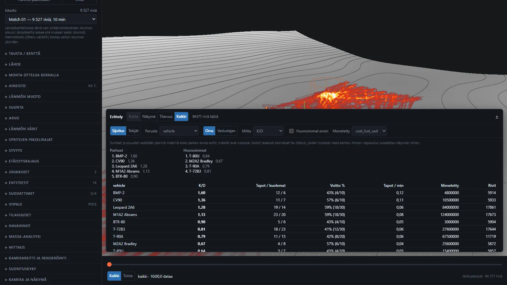
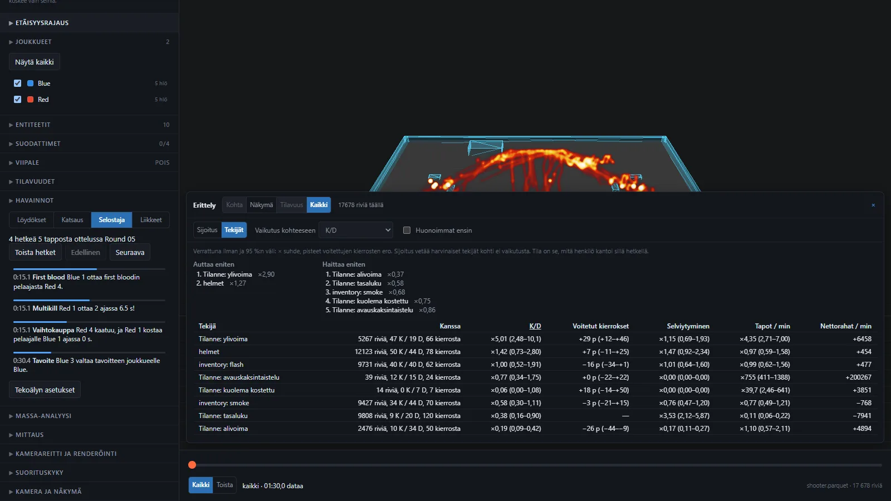

# Erittely: kuka ja mikä pärjää parhaiten missäkin

**Erittely** vastaa yhteen kysymykseen: tässä paikassa, mikä ajoneuvo, pelaaja tai ase pärjää parhaiten? Käytä sitä löytääksesi panssarivaunun, joka voittaa sillalla, tai nähdäksesi, auttaako kypärän käyttö todella.

Se järjestää paikassa tapahtuvat asiat (valitun kohdan, näkymän, tilavuuden tai kaiken näkyvän) minkä tahansa luokan mukaan ja mittaa jokaisen tilatekijän ilman ja kanssa.

## Kokeile {#try-it}

1. Lataa ottelu, jossa on tappoja ja kuolemia, ja avaa **Tilavuudet**.
2. Piirrä tilavuus paikan ympärille, josta välität, ja valitse se.
3. Paina **Erittely...** kohdassa Tilastot.
4. Kohdassa **Peruste** valitse *Ajoneuvo*, ja mittariksi *K/D* (tappoja kuolemaa kohden).
5. Lue luettelo, paras ensin. Paina **Huonoimmat ensin** kääntääksesi sen. Napsauta nimeä suodattaaksesi näkymän sen mukaan; napsauta uudelleen vapauttaaksesi sen.

## Avaa se {#open-it}

| Mistä | Alue, josta se alkaa |
|---|---|
| **Erittely...** [Tilavuuksissa](volumes.md) (Tilastot) | valittu tilavuus |
| **Erittely tässä** kohdan valintakortilla, kun olet napsauttanut pistettä | pallo tuon pisteen ympärillä (**Säde**, oletus 3 % datan koosta) |
| **Erotus**-jakopaneeli | näkymä |

Otsikko vaihtaa aluetta: **Kohta**, **Näkymä** (mitä kamera näki viimeisellä laskennalla; **Laske uudelleen** siirron jälkeen), **Tilavuus** (valitse yksi) tai **Kaikki**. Se laskee taustalla; tilarivi kertoo, kuinka monta riviä alueella on.

## Järjestys {#ranking}

Valitse, mitä järjestetään, ja mittari:

| Mittari | Mitä se on |
|---|---|
| A, B | rivit kummallakin puolella erotuskarttaa, jaettuna samalla tavalla kuin lämpö ne jakaa |
| A / B, A - B, A / (A + B) | kaksi kerrosta toisiaan vastaan |
| K/D | tappoja suhteessa kuolemiin |
| Voitto % | voitetut kierrokset (tai ottelut), kun data kertoo voittajan |
| Tappoja / min | läsnä olevia tappoja minuutissa (liikenäytteiden väleistä) |
| Ansaittu, Menetetty, Nettoraha | `earn_*`- ja `cost_*`-sarakkeiden summat; valitsin valitsee valuutan |

Tappot, kuolemat, läsnäolo, voitot ja raha lasketaan jokaisesta rivistä, jonka näkymä näyttää paikassa, erotuksen kummaltakin puolelta tai ilman puolta.

Suhteet ja nopeudet vedetään kohti koko paikan arvoa, kun luvut ovat pieniä, joten 2 tappoa yhdestä elämästä ei nouse kärkeen. Luvut näkyvät niiden vieressä.

Voit järjestää ryhmien, pelaajien ja otteluiden mukaan, minkä tahansa luokkasarakkeen mukaan (ajoneuvo, ase, puoli, ostotyyppi, agentti tai varustus), minkä tahansa numerosarakkeen mukaan alueittain (panssari, varustuksen arvo), aseen sarakkeen **luokan** mukaan (kivääri, tarkka-ampuja, konepistooli, pistooli...) ja sen mukaan, kuinka monta **apuvälinettä** luettelosarake, kuten `inventory`, sisältää.

**Oma** järjestää rivin oman arvon mukaan. **Vastustajan** järjestää toisen osapuolen arvon mukaan: uhrin aseen tapossa, tappajan aseen kuolemassa (vaatii sarakkeen `other` / `victim`, joka nimeää heidät).

## Tilanne sillä hetkellä {#state-at-the-time}

Rivin arvo on sen oma, ellei rivi kirjaa sitä (tapahtumarivi ilman varusteita) tai kyseessä on kuolema (jonka aseen sarake voi nimetä tappajan aseen); silloin se on se, mitä sama henkilö kantoi viimeksi aiemmin ottelussa.

## Tekijät: kanssa ja ilman {#factors-with-against-without}

Vaihda **Järjestyksestä** **Tekijöihin**, valitse **Vaikutus kohteeseen** ja lue *Auttaa eniten* ja *Haittaa eniten*:

Jokaisen tekijän vaikutus K/D:hen, voitettuihin kierroksiin, selviytymiseen (minuuttia kuolemaa kohden), tappoihin minuutissa ja nettorahaan minuutissa, 95 %:n luottamusvälillä: suhteet x:nä, voitetut kierrokset pistemääräerona. Järjestys vetää jokaisen arvion kohti vaikutuksettomuutta oman epävarmuutensa verran, joten harvinainen tekijä tarvitsee selvän vaikutuksen päästäkseen korkealle; näytetty väli on vetämätön.

Data, jossa on kierroksia, lisää lähitaistelun **tilanteet** ([Lähitaistelu ja kierrokset](close-quarters.md)), jotka lasketaan kerran aineistoa kohden: *sokaistu* (rivin `state_flashed`, tai vihollisen välähdys 15 m:n päässä viimeisen 3 s:n aikana), *kuolema vaihdettiin*, *avauskaksintaistelu* sekä *miehiä yli*, *tasaiset luvut* tai *miehiä alle* (oman puolen elossa olevat pelaajat vihollista vastaan). Kuolema lasketaan siihen tilanteeseen, jossa sen uhri oli juuri ennen sitä.

Yhdessä kulussa mitataan enintään 256 tekijää.

## Kehittäjille {#for-developers}

### Pienten otosten vetäminen {#pulling-small-samples}

Järjestysarvo on `(n + m*r0) / (d + m)`: `n` ja `d` ovat lukuja, `r0` on koko paikan suhde ja `m` on sen ennakkoarvon paino.

### Muuntimen kirjoittajille: tekijäsarakkeiden nimeäminen {#for-converter-authors-naming-factor-columns}

Muunnin lisää tekijän nimeämällä sen sarakkeen:

| Sarake | Tekijä |
|---|---|
| `state_<name>` numero | päällä, kun ei nolla (`state_scoped`, `state_suppressor`) |
| `state_<name>` luokka | yksi tekijä arvoa kohden (`state_ammo` = AP, HE...) |
| `active_<name>` | sama, asialle, joka on kytketty päälle tai käytetty äskettäin: kyky, ultimate, laite, vahvistus (`active_ult`, `active_stim`) |
| luettelosarake (`inventory`, `loadout`, `perks`, `abilities`, `attachments`, `modules`, `buffs`, `debuffs`, `upgrades`, tai `state_`/`active_`-nimi, joka päättyy `s`-kirjaimeen) | yksi tekijä arvon `a\|b\|c` kohdetta kohden |
| jo yleiset varustelliput (`helmet`, `defuser`, `armor`, `scoped`, `airborne`, `duck`, `flashed`...) | päällä, kun ei nolla |
| `ammoType`, `shellType`, `ammoName` | viimeksi ammuttu kierros |

Tulokset: 0/1-sarake `won` (rivin puoli voitti kierroksen tai ottelun) ja sarake `round`. Raha: `earn_<currency>` ja `cost_<kind>_<currency>`; pelkkä tulo lajin mukaan (`earn_round_cs2`, muuntimen tarkat kierrospalkkiot) korvaa vain kustannusmallin tulon kyseisestä lajista (`round` kattaa myös istutukset ja purkamiset), ja malli hinnoittelee loput.

Kartoitus lataa nämä sarakkeet itse tiedoston omien luettelojen rinnalla: jokaisen `state_*`-, `active_*`-, `won`-, `round`- ja luettelosarakkeen, paitsi ne, jotka Parquet-tiedoston tilastot näyttävät pitävän yhtä arvoa koko ajan (jokainen ladattu sarake on 4 tavua per rivi).
