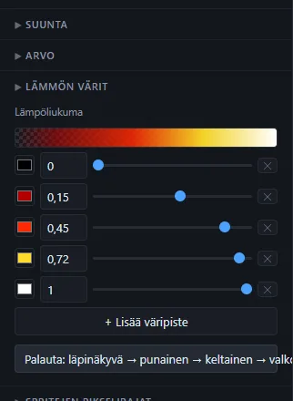

# Väri ja valotus

Nämä säätimet päättävät, mikä määrä lämpöä saa minkäkin värin. **Kyllästymispiste** on se lämpömäärä, joka lasketaan kuumimmaksi, eli valkoiseksi.

## Pikakorjaukset {#quick-fixes}

- Kaikki on valkoista: nosta **Kyllästymispiste**, tai paina **Automaattinen valotus kentästä**.
- Mitään ei näy: laske **Kyllästymispiste**, tai paina **Automaattinen valotus kentästä**.
- Näkyy vain muutama yksittäinen piste: käännä **Vähimmäislämpö** ylemmäs.

Jokainen tämän sivun säädin vaikuttaa siinä vaiheessa, kun lämpö muutetaan väriksi. Kun vedät mitä tahansa niistä, kuva piirtyy heti uudelleen, eikä **kertymä koskaan käynnisty uudelleen**.

## Kyllästymispiste {#saturation-point}

**Kyllästymispiste** (osiossa Lämmön muoto): kertynyt lämpö, joka vastaa värikaistan yläpäätä (lineaarisella *Lineaarinen*-vasteella; muista vasteista katso alempaa). Logaritminen liukusäädin 0,1–4000, kahva ulottuu 10 000 000 asti, koska kertynyt lämpö kasvaa rivimäärän mukana. Oletus 24. Joka kerta kun sivu latautuu, lasketaan ensin **analyyttinen arvio** ja sen jälkeen arvo **mitataan** kuvasta.

Väärä arvo erottaa lämpökartan tyhjästä (tai valkoisesta) ruudusta, eikä arvoa voi päätellä luotettavasti. Telemetria kerääntyy niin voimakkaasti yhteen – synnyinpaikkaan, oviaukkoon tai ahtaaseen kohtaan – että huipun ja keskiarvon suhde vaihtelee kymmenkertaisesti eri aineistojen ja kulmien välillä.

## Automaattinen valotus {#auto-exposure}

**Automaattinen valotus kentästä** mittaa kentän, jonka varjostin todella tuotti. Se jättää tyhjät pikselit pois, ottaa valaistujen pikselien 98. persentiilin ja sijoittaa sen 85 prosentin kohtaan matkasta kyllästymispisteeseen. Näin värikaistan yläpää jää todellisille huipuille.

Paneeli näyttää tekstin *mitattiin X % kuvasta; 98. persentiili R sijoitettiin lähelle liukuvärin yläpäätä*. *Kyllästyvä*-vasteella arvo, joka on 85 % kyllästymispisteestä, osuu noin 69 %:iin värikaistasta eikä 85 %:iin.

Se myös ajautuu **automaattisesti**:

- 8 piirretyn kuvan jälkeen, kun aineisto on ladattu;
- 8 kuvan jälkeen, kun [suodattimet](filters.md) muuttuvat (jos jokainen sijainti suodatetaan sadaksi tapahtumaksi, tiheys muuttuu kertaluokkia);
- 8 kuvan jälkeen, kun vaihdetaan pistelämmön ja [viivalämmön](line-heat.md) välillä tai muutetaan, mitä reittejä viivalämpö piirtää, koska viiva jättää paljon vähemmän lämpöä per näyte kuin sprite.

Kun mitään ei ole valaistu, automaattinen ajo jättää kyllästyksen ennalleen. Painike palaa analyyttiseen arvioon ja kertoo *ei valaistua mitattavaa — käytettiin analyyttistä arviota*.

### Seuraa näkymää {#follow-the-view}

**Seuraa näkymää** (osiossa Lämmön muoto, oletuksena päällä) mittaa valotuksen uudelleen aina, kun kamera pysähtyy. Näin alue, jolle lennät, käyttää koko värikaistaa eikä koko kartalle mitattua asteikkoa. Pienet muutokset jätetään huomiotta, ja asteikko liukuu hyppimisen sijaan. Se toimii neljässä lämmön tilassa, ei kuvan päällä olevassa hahmonäytössä.

Poista valinta, jos haluat lukita asteikon ja verrata paikkoja samalla asteikolla. Myös kyllästymispisteen vetäminen käsin lukitsee sen.

## Tiheysvaste {#density-response}

**Tiheysvaste** – miten *k* (lämpö / kyllästymispiste) kuvautuu värikaistalle:

| Vaste | Kaava | Käyttö |
|---|---|---|
| **Kyllästyvä** (oletus) | t = 1 - e^(-k) | Lähestyy värikaistan yläpäätä vähitellen, samalla tavalla kuin päällekkäiset läpinäkyvät spritet. Mikään ei koskaan leikkaudu tasaiseksi valkoiseksi, joten se on turvallinen oletus tuntemattomalle aineistolle. |
| **Lineaarinen** | t = k | Ainoa kuvaus, jossa sama väri tarkoittaa samaa määrää. Käytä sitä, kun vertaat kahta aineistoa tai kahta aikaikkunaa. |
| **Log** | t = log₂(1 + 7k) / 3 | Tiivistää pitkän hännän, joten yksi äärimmäinen kuumapiste ei enää litistä kaikkea muuta värikaistan pohjalle. Nostaa harvoja alueita. |

## Vähimmäislämpö {#minimum-heat}

**Vähimmäislämpö** (oletuksena pois, 0–100 %): jokainen pikseli, jossa on lainkaan lämpöä, nostetaan vähintään tähän kohtaan värikaistalla. Käännä se ylös ja spriten sädettä alas, niin näet, **missä jotain on koskaan tapahtunut**. Yksittäiset datapisteet näkyvät selvästi eivätkä jää juuri läpinäkyvän yläpuolelle. Pidä se pois päältä, kun arvioit tiheyttä, sillä se litistää värikaistan pohjan tarkoituksella. Kynnysarvo (k > 0,0001) pitää todella tyhjät pikselit tyhjinä.

## Värikaistan muokkain {#the-ramp-editor}

Osiossa **Lämmön värit**. Sen otsikko kertoo, mihin kaistaa käytetään: *Lämpöliukuma* kohdassa Lämpö ja Viivat, *Positiivinen (lisäävät joukkueet)* kohdassa Erotus, *Peittävyysliukuma (väri tulee ryhmästä)* kohdassa [Joukkuelämpö](team-heat.md), jossa käytetään vain sen alfaa.



Yläreunan palkki esikatselee kaistaa. Sen alla on yksi rivi jokaiselle väripisteelle:

| Osa | Merkitys |
|---|---|
| Värinäyte | Pisteen väri (selaimen värinvalitsin). |
| Numero | Pisteen paikka kaistalla, 0–1 (0 = ei lämpöä). |
| Liukusäädin | Pisteen peittävyys, 0–100 %. |
| ✕ | Poistaa pisteen; ei käytössä, kun jäljellä on vain kaksi. |

**+ Lisää väripiste** lisää pisteen puoliväliin kahden viimeisen pisteen väliin, ja siinä on viimeisen pisteen väri ja peittävyys. **Palauta: läpinäkyvä → punainen → keltainen → valkoinen** palauttaa oletuksen.

Pisteet voi antaa missä järjestyksessä tahansa; ne järjestetään, kun kaista rakennetaan. **Alfa** on se, mikä sekoittaa lämmön kohtaukseen, ja siksi oletuskaistan nollapää on täysin läpinäkyvä.

### Oletuskaistat {#the-default-ramps}

| Paikka | Positiivinen (Lämpö, Viivat, Erotus +) | Negatiivinen (Erotus −) |
|---|---|---|
| 0,00 | musta, alfa 0 | musta, alfa 0 |
| 0,15 | rgb(180, 0, 0), alfa 0,55 | rgb(0, 170, 60), alfa 0,55 |
| 0,45 | rgb(255, 40, 0), alfa 0,85 | rgb(0, 190, 200), alfa 0,85 |
| 0,72 | rgb(255, 220, 40), alfa 0,95 | rgb(40, 80, 255), alfa 0,95 |
| 1,00 | valkoinen, alfa 1 | rgb(170, 60, 255), alfa 1 |

## Kameran liikkuessa {#while-the-camera-moves}

Kun kamera liikkuu, kertyminen alkaa alusta joka kuvassa. Kun **Piirrä jokainen rivi joka kuvassa** on päällä (oletus), jokainen liikkuva kuva on silti tarkka. Kun se on pois päältä, liikkuva kuva näyttää yhden otantaan perustuvan arvion – kirkkaampia, painotettuja klönttejä – joka tasoittuu oikeaksi kuvaksi, kun lopetat liikkumisen. Tämä on odotettua; katso [Kertyminen](accumulation.md).

## Kehittäjille {#for-developers}

### Yhdistelyvaihe {#the-composite-pass}

Kun lämpö on kertynyt, jokaisen pikselin arvo muutetaan väriksi yhdessä yhdistelyvaiheessa ([`COMPOSITE_FS`](https://github.com/Holdi601/3DHeat/blob/main/src/render/webgl2/shaders.ts)). Vaiheet ovat:

```
k = |lämpö| / kyllästymispiste
t = vaste(k)                            rajataan välille 0..1
jos vähimmäislämpö > 0 ja k > 0,0001:  t = vähimmäis + (1 - vähimmäis) × t
väri, alfa = kaista(t)                  (negatiivinen kaista, kun lämpö < 0, vain Erotus)
pikseli = sekoita(kuva, väri, alfa)
```

### Analyyttinen arvio {#the-analytic-estimate}

**Analyyttinen arvio** ([`estimateSaturation`](https://github.com/Holdi601/3DHeat/blob/main/src/data/calibrate.ts)) olettaa, että rivit jakautuvat datan X-Z-alueelle. Keskilämpö = rivit × (π r² / alueen pinta-ala) × 1/3 × keskustan voimakkuus (1/3 on lineaarisen kaltevuuden keskiarvo levyllä). Tätä kerrotaan oletetulla huippu-keskiarvo-suhteella 25. Tulos rajataan välille 0,1–1 000 000. Sen ei tarvitse olla muuta kuin kertaluokan tarkkuudella oikein.

### Mittaus {#metering}

[`exposure.ts`](https://github.com/Holdi601/3DHeat/blob/main/src/render/exposure.ts):

1. lämpökohde luetaan takaisin GPU:lta, otanta enintään 40 000 arvoon;
2. tyhjät pikselit (lämpö ≤ 0,0001) hylätään – suurin osa lämpökentästä on tyhjää, ja jos ne otettaisiin mukaan keskiarvoon, kaikki jäisi liian tummaksi, kuten valotusmittari, joka osoittaa mustaa taustaa;
3. valaistujen pikselien 98. persentiili on vertailuarvo;
4. kyllästymispisteeksi tulee vertailuarvo / 0,85, joten vertailuarvo on 85 % matkasta kyllästymispisteeseen ja värikaistan yläpää jää todellisille huipuille.

### Väritaulukko {#the-colour-table}

Kaista paistetaan 256 × 2 RGBA-taulukkoon (positiivinen kaista ensimmäisellä rivillä, negatiivinen toisella) ([`buildColorLut`](https://github.com/Holdi601/3DHeat/blob/main/src/render/colors.ts)). Värit interpoloidaan lineaarisessa valossa ja tallennetaan sRGB:nä; peittävyys interpoloidaan lineaarisesti.
