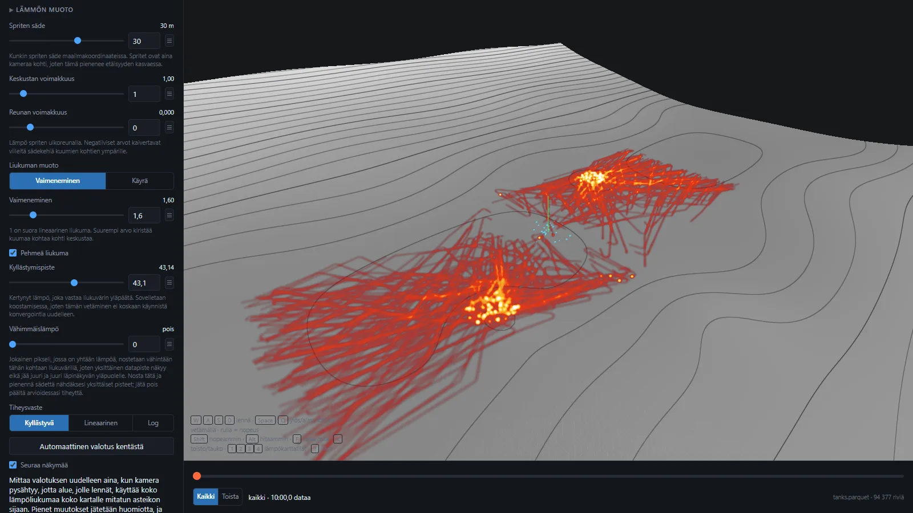
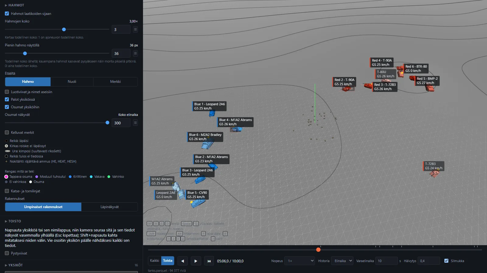

# Esimerkkidata: kokeile katselinta viidessä minuutissa



Ei omaa dataa vielä? Tietovarasto tekee sitä. Kaikki siinä on keksitty: laakso, piha ja otteluita kolmella keksityllä pelityylillä, joiden pelaajat ovat nimeltään *Blue 1* tai *Red 3*. Kaikki tämän sivuston kuvat on otettu sillä.

## Tee se {#make-it}

```bash
node tools/demo-data.mjs
```

Tämä kirjoittaa kansioon `tools/.shots/demo/`:

| Tiedosto | Mitä se on |
|---|---|
| `demo-valley.glb` | 12 km laakso kahdella mäellä ja kylällä, 3D-kenttänä |
| `demo-yard.glb` | 160 m muurattu piha rakennuksineen, 3D-kenttänä |
| `tanks.parquet` | 10 panssarivaunuottelua, 8 vastaan 8: liikkuminen, laukaukset, osumat paikkoineen rungossa, palot, tappot, raadot, tornin suuntaus, voittajat |
| `tanks/match-NN.parquet` | samat ottelut, yksi tiedosto kutakin, [monta ottelua kerralla](many-matches.md) varten |
| `air.parquet` | 4 vastaan 4 ilmataistelu ohjuksilla, soihduilla, tappoineen ja ohilaukauksineen |
| `shooter.parquet` | 12 kierrosta 5 vastaan 5 jalkaisin: laukaukset, tappot, pommin asennus, ansaitut ja käytetyt rahat, kypärät ja apuvälineet |
| `mass/` | kansio pieniä `.3dheat`-otteluita, [massa-analyysiin](mass-analysis.md) |
| kierrossarja | kaksi kierrosta yhdellä autolla keksityllä radalla, [Kisa-analyysiin](race-analysis.md) |

Jokainen taulukko nimeää sarakkeensa omassa alatunnisteessaan, joten se latautuu ilman mitään määritystä.

## Kokeile {#try-it}

1. Käynnistä katselin (Windowsissa `start.bat`, tai muilla järjestelmillä kerran `npm install` ja sitten `npm run dev`) ja avaa `http://127.0.0.1:5273/`.
2. **Tausta / kenttä → 3D-malli…** ja valitse `demo-valley.glb`.
3. **Lähde → Tiedostot…** ja valitse `tanks.parquet`.
4. Paina `F` sovittaaksesi kuvan dataan. Näet kymmenen ottelun [lämmön](heat.md).
5. Kokeile tilapalkkia: **Erotus** (Blue vastaan Red), **Joukkuelämpö**, **Viivat**.
6. Avaa **Havainnot** (Lämpökartta-sivupalkissa): se löytää paikat, joissa ammuttiin, osuttiin ja tuhottiin paljon enemmän kuin muualla, kahden mäen ympärillä.
7. Avaa **Ottelu**-välilehti. Valitse kohdassa **Toiston ottelut** *Match 01*, ja paina aikajanalla **Toista**: [toisto](match-replay.md).



Ampujapeliä varten lataa `demo-yard.glb` ja `shooter.parquet`. Ilmataistelua varten lataa `air.parquet`. Hahmot näkyvät helpommin, kun **Hahmojen koko** on 4. Se on liukusäädin Lämpökartta-sivupalkin **Joukkuenäkymä**-paneelissa.

## Kuvakaappaukset {#the-screenshots}

Sivuston kuvat tehdään tästä datasta skriptillä, millä tahansa katselimen kielellä:

```bash
node tools/demo-data.mjs
HEAT3D_FIGURE_PACK=none npx vite --port 5321 --strictPort --host 127.0.0.1   # PowerShell: $env:HEAT3D_FIGURE_PACK="none"; npx vite ...
node tools/docs-shots.mjs --lang en
```

Kuvakaappauspalvelin toimii ilman paikallista hahmopakettia, joten näkyy vain julkinen hahmoluettelo. Kuvat menevät kansioon `docs/assets/img/<lang>/`. Katso [Dokumentaation ylläpito](maintaining.md).
