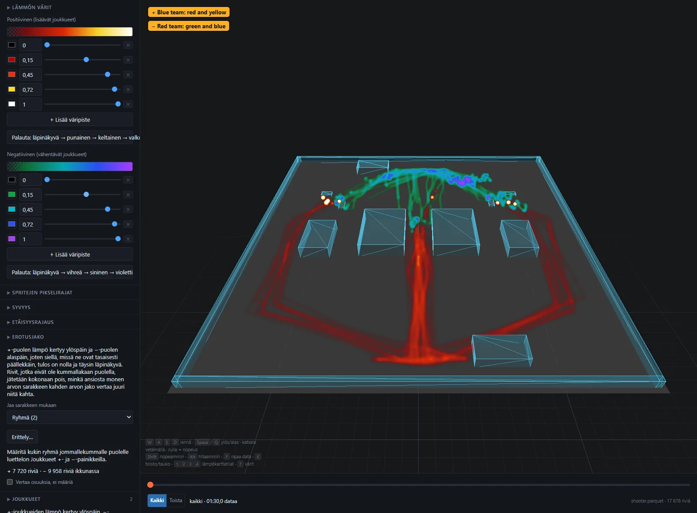

# Erotus

Punainen, missä joukkue A oli enemmän. Vihreä-sininen, missä joukkue B oli enemmän. Ei mitään, missä ne olivat yhtä paljon.

**Erotus** (näppäin 2) on etumerkillinen lämpö. Yhden joukon rivit lisäävät lämpöä, ja toisen joukon rivit vähentävät sitä. Missä kaksi joukkoa menevät tasan, tulos on nolla ja täysin läpinäkyvä. Missä toinen joukko hallitsee, se näkyy sen puolen väreinä. Oletuksena **+**-puoli on lämmin (läpinäkyvä → punainen → keltainen → valkoinen) ja **−**-puoli kylmä (läpinäkyvä → vihreä → sininen → violetti).

## Käyttö {#how-to-use-it}

1. Paina `2` (tai valitse **Erotus** tilapalkista).
2. Avaa **Erotusjako** sivupalkista.
3. Valitse, mukaan mitä **Jaa sarakkeen mukaan**: yleensä *Ryhmät*.
4. Aseta yksi ryhmä (tai arvo) **+**-puolelle ja toinen **−**-puolelle.
5. Lue värit: lämmin tarkoittaa +-puolta, kylmä −-puolta. Paneeli varoittaa, jos jollakin puolella ei ole rivejä (katso [Viestit, joita voit nähdä](#messages-you-may-see)).

*Mitkä* kaksi joukkoa ovat koko kysymys. Jako voi siksi perustua mihin tahansa säilytettyyn sarakkeeseen, ei vain ryhmiin. Rivit, jotka eivät kuulu **kumpaankaan** puolelle, **jätetään pois**. Niitä ei lasketa nollaksi. Tämä tekee siitä, että jako useiden arvojen välillä vertaa juuri näitä kahta. Se myös yhdistyy [suodattimiin](filters.md). Suodata ensin yhteen karttaan ja jaa sitten se version mukaan.

Tila tarvitsee kaksi puolta: ryhmäsarakkeen, jossa on vähintään kaksi ryhmää, tai jaon sarakkeen, joka on säilytetty suodatusta varten. Datassa, jossa on alle kaksi ryhmää, lataus aloittaa sarakejaolla. Ensin tulee usean tiedoston latauksen *Source file* -sarake. Muuten ensimmäinen kategoriasarake, jossa on kaksi arvoa. Jos sitäkään ei ole, käytetään ensimmäistä numeerista saraketta, jolla on jakso. Siksi *vertaa kahta latausta* toimii myös datalla ilman ryhmiä. Vain data, jossa ei ole kumpaakaan, jättää tilan pois käytöstä. Samoin tehdään, jos sarakejaossa toisella puolella ei ole mitään.

## Erotusjako-paneeli {#the-difference-split-panel}

Näkyy Erotus-tilassa lämpöpaneelien alapuolella.

**Jaa sarakkeen mukaan** tarjoaa:

| Vaihtoehto | Näkyy nimellä | Jakosääntö |
|---|---|---|
| Ryhmät | *Ryhmä (N)* (kun ryhmäsarake on olemassa) | Jokainen ryhmä +-, −- tai kumpaankaan puolelle, asetettuna [Joukkuelistassa](teams-list.md) |
| Kategoriasarake | *sarake (N arvoa)* | Arvot +-, −- tai kumpaankaan puolelle |
| Numeerinen sarake | *sarake (numeerinen)* | Arvoväli kummallekin puolelle |
| Alkuperätiedosto | *Source file - compare two loads* (kun useita tiedostoja on ladattu) | Tiedostot +-, −- tai kumpaankaan puolelle |

Tarjolla ovat vain sarakkeet, jotka on säilytetty kohdassa *Säilytä suodatusta varten* latauksen aikana.

### Vertaa osuuksia, ei määriä {#compare-shares-not-counts}

**Vertaa osuuksia, ei määriä** (oletus pois päältä) painottaa kumpaakin puolta yhdellä jaettuna sen omalla rivimäärällä. Puoli, jossa on viisi kertaa enemmän rivejä, ei siis voita pelkillä luvuilla. Väri näyttää silloin, missä kumpikin puoli on suhteellisesti yleisempi. Käytä sitä, kun kahdella puolella on hyvin eri määrä dataa, esimerkiksi kaksi eripituista istuntoa.

### Viestit, joita voit nähdä {#messages-you-may-see}

Paneeli varoittaa, kun kuva ei ole todellinen erotus:

| Viesti | Merkitys |
|---|---|
| *N + / M −* (tai *N + / M − / K käyttämättä*) | Kuinka monta arvoa on kummallakin puolella (ja kumpaakaan puolta ei). |
| Ikkunan alueella ei ole yhtään riviä **+**-puolella | Piirretään vain **−**-puoli. Siirrä aikajanan ikkunaa tai vaihda jakoa. |
| Ikkunan alueella ei ole yhtään riviä **−**-puolella | Piirretään vain **+**-puoli. |
| Kummallakaan puolella ei ole arvoa | Erotus ei piirrä mitään. Aseta vähintään yksi arvo **+**- tai **−**-puolelle. |
| *sarake* ei voi jakaa näin | Valittu sarake ei sovi jakoon. Valitse sarake uudelleen. |
| Jakosarake ei mahtunut GPU-muistiin N / M rivilohkossa | Näitä rivejä ei piirretä. Nosta GPU-budjettia kohdassa Suorituskyky → Resurssibudjetit tai lataa vähemmän rivejä. |

### Ryhmittäin {#by-group}

Paneeli vain osoittaa [Joukkuelistaan](teams-list.md), jossa jokaisella ryhmällä on **+**- ja **−**-painike. Jokaisessa latauksessa ryhmien ensimmäinen puoli (pyöristettynä ylöspäin) asetetaan +-puolelle ja loput −-puolelle. **Jaa tasan** Joukkuelistassa tekee saman uudelleen. Ryhmä, joka ei ole kummallakaan puolella tai joka on piilotettu valintaruudullaan, ei vaikuta mitenkään.

### Kategoria-arvoittain {#by-category-values}

| Osa | Merkitys |
|---|---|
| `a + / b − / c unused` | Kuinka monta arvoa on kummallakin puolella ja kumpaakaan puolta ei. |
| **Tyhjennä** | Asettaa jokaisen arvon kumpaankaan puoleen. |
| Arvoluettelo | Jokainen arvo painikkeineen **+** ja **−** (napsauta aktiivista uudelleen, niin se poistuu puolelta). Tyhjä arvo näkyy nimellä *(puuttuu)*. |
| Rajan huomautus | Vain 200 ensimmäistä arvoa luetellaan: *Näytetään 200 ensimmäistä N arvosta. Näin leveä sarake kannattaa ensin kaventaa suodattimella, tai jakaa väleittäin, jos sen arvot ovat järjestyksessä.* |

Sarakkeen valinta asettaa sen ensimmäisen arvon +-puolelle ja toisen −-puolelle. Kun kummallakaan puolella ei ole yhtään arvoa, jako palautuu ryhmiin eikä näytä tyhjää kehystä. *Source file* toimii samoin, yksi arvo tiedostoa kohti. Näin verrataan kahta vientiä, kahta testiajoa tai kahta versiota.

### Väleittäin {#by-range}

| Osa | Merkitys |
|---|---|
| Vihje | Sarakkeen pienin ja suurin arvo. |
| **Positiivinen väli (+)**, **alku** / **loppu** | Rivit, joiden arvo on tällä välillä, molemmat päät mukaan lukien, lisäävät. |
| **Negatiivinen väli (−)**, **alku** / **loppu** | Tämän välin rivit vähentävät. |
| **Jaa keskikohdasta** | Asettaa + välille [pienin, keskikohta] ja − välille [keskikohta, suurin]. Tämä tapahtuu myös, kun sarake valitaan. |

Arvo, joka on molemmilla väleillä, lasketaan +-puolelle. Välien ei tarvitse kattaa saraketta. Arvot, jotka eivät ole kummallakaan välillä, jätetään pois. *Kaksi ensimmäistä minuuttia vastaan kaksi viimeistä* on väliltä tehty jako aikamaisella sarakkeella.

## +:n osuus: voittokartta {#share-of--the-win-rate-map}

**Erotus** / **+:n osuus** paneelin yläosassa valitsee, mitä piirretään. *+:n osuus* värittää jokaisen paikan +-puolen osuudella siellä olevista kummankin puolen riveistä, verrattuna samaan osuuteen kaikesta näytetystä: lämmin sen yläpuolella, kylmä alapuolella, ei mitään, missä se on sama, eikä mitään, missä paikassa on liian vähän rivejä. Kun voitetut erät ovat +:lla ja hävityt −:lla, se on voittokartta; **Erävoittojen osuus** ja **Ottelovoittojen osuus** asettavat sen yhdellä painalluksella, kun datassa on [tulossarakkeet](data-formats.md#outcome-columns). Katso [Voittojen osuus](win-rate.md).

## Värit {#colours}

**Lämmön värit** -osio näyttää tässä tilassa kaksi väriasteikkoa: **Positiivinen (lisäävät joukkueet)** ja **Negatiivinen (vähentävät joukkueet)**. Kummallakin on oma palautuspainike (*Palauta läpinäkyvä → punainen → keltainen → valkoinen*, *Palauta läpinäkyvä → vihreä → sininen → violetti*). Yhdistelmä ottaa nettolämmön itseisarvon [kyllästyspisteen ja vasteen](colour-and-exposure.md) kautta. Se valitsee negatiivisen asteikon, kun netto on alle nollan. Katso [Väri ja valotus](colour-and-exposure.md#the-ramp-editor).

Käytä *Lineaarista* tiheysvastetta, kun erotuksen koko on tärkeä. Se on ainoa vaste, jossa sama väri tarkoittaa samaa määrää.

## Kehittäjille {#for-developers}

Jokainen rivi saa merkin +1, -1 tai 0 kärkipiste-varjostimessa ([`POINT_HEAT_VS`](https://github.com/Holdi601/3DHeat/blob/main/src/render/webgl2/shaders.ts)). Nolla hylkää rivin ennen kuin yhtään fragmenttia piirretään.

- Ryhmittäin merkki tulee 4 096 merkinnän ryhmätaulukosta, johon indeksoidaan rivin ryhmätunnus. Ryhmätunnus kulkee rivin sijaintitexelin neljännessä kanavassa.
- Kategorioittain merkki tulee toisesta 4 096 merkinnän taulukosta, joka täytetään kullekin kategoria-arvolle. Rivin arvo luetaan sarakkeen suodatustexturesta. Taulukon lopun ylittävä arvo hylätään molemmilla taustaosilla.
- Väleittäin rivin arvoa verrataan kahteen väliin.

Jaon muuttaminen käynnistää kertymän alusta.

**Piilotetut ryhmät pysyvät piilossa kaikilla jaoilla.** Sarakkeen mukaan jaettaessa ryhmätaulukko ei enää kanna merkkejä. Siinä on 1 näytetylle ryhmälle ja 0 piilotetulle ([`frameSignTables`](https://github.com/Holdi601/3DHeat/blob/main/src/render/filterTables.ts)). Molemmat taulukot tulevat varjostimeen yhdessä: WebGL2:ssa kahtena rivinä yhdessä merkkitekstuurissa, WebGPU:ssa kahtena puoliskona yhdessä tallennuspuskurissa. Rivi piirretään vain, kun sen ryhmä on näkyvissä *ja* sen sarakkeen arvo on jollakin puolella. Joukkuelistassa ruksimatta jätetty ryhmä tai Ottelu-välilehden puolifokuksen ulkopuolelle jäänyt ryhmä ei siis vaikuta, miten erotus jaetaan.
