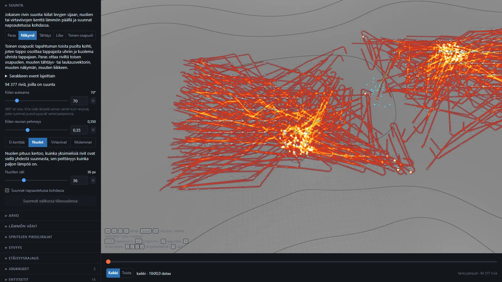

# Suunnattu lämpö

Tavallinen lämpö kertoo, **missä** asiat tapahtuvat. Suunnattu lämpö kertoo myös, **mihin suuntaan**: mihin suuntaan ihmiset katsoivat, tähtäsivät, liikkuivat tai missä taistelun toinen puoli oli.

Tavallinen sprite on täysi ympyrä (360 astetta). Kun **Kiilan aukeama** on 70 astetta, sama sprite muuttuu kapeaksi kiilaksi, joka osoittaa rivin suunnan, ja lisää saman kokonaislämmön.

## Käyttö {#how-to-use-it}

1. Lataa data, jossa on suunta (katso [Mikä antaa riville suunnan](#what-gives-a-row-a-direction)).
2. Valitse tilapalkista **Lämpö**, **Erotus** tai **Joukkuelämpö**.
3. Avaa **Suunta**-osio sivupalkissa.
4. Valitse **lähde** (mitä suuntaa käytetään) ja kytke piirto päälle:
   - laske **Kiilan aukeama** alle 360°:n piirtääksesi jokaisen rivin kiilana, joka osoittaa sen suunnan, ympyrän sijaan;
   - valitse **Kenttä** piirtääksesi nuolia tai virtaviivoja lämmön päälle;
   - ruksaa **Suunnat napsautetussa kohdassa** ja napsauta lämpöä saadaksesi kyseisen kohdan polaarikaavion.

Tilarivi kertoo, kuinka monella rivillä on suunta valitusta lähteestä.

## Asetukset {#settings}

| Asetus | Oletus | Mitä se tekee |
|---|---|---|
| Lähde: **Parhaat**, **Näkymä**, **Tähtäys**, **Liike**, **Toinen osapuoli** | Parhaat | Mikä suunta kullakin rivillä on. *Parhaat* ottaa riviltä toisen osapuolen, muuten tähtäyksen, muuten näkymän, muuten liikkeen. |
| **Tapahtumalajeittain** | kuten yllä | Eri lähde kullekin tapahtumalajille, esimerkiksi *Toinen osapuoli* tapoille ja *Näkymä* sijainneille. Näkyy, kun datassa on tapahtumasarake, jossa on enintään 40 arvoa. |
| **Kiilan aukeama** | 360° | 360° on tavallinen ympyrä (pois). Pienempi on kapeampi kiila. Kiila lisää yhtä paljon lämpöä kuin sen ympyrä, joten summat ja erotukset pysyvät vertailukelpoisina. |
| **Kiilan reunan pehmeys** | 0,35 | 0 on terävä kiila, 1 pehmeä viuhka. |
| **Kenttä**: Ei kenttää, Nuolet, Virtaviivat, Molemmat | Ei kenttää | Nuolet: nuolen pituus kertoo, kuinka yksimielisiä siellä olevat rivit ovat suunnasta, ja peittävyys kertoo, kuinka paljon lämpöä siellä on. Nuolet näkyvät vain siellä, missä on lämpöä. |
| **Nuolten väli** | 28 px | Etäisyys nuolten välillä näytöllä. |
| **Animoi virtaviivat** | päällä | Virtaviivat virtaavat, kun tämä on päällä. |
| **Suunnat napsautetussa kohdassa** | pois | Napsauta lämpöä nähdäksesi siellä olevat suunnat (alla). |
| **Suunnat valitussa tilavuudessa** | | Sama kaavio kaikelle valitun [tilavuuden](volumes.md) sisällä. |

## Polaarikaavio kohdassa {#the-polar-chart-at-a-spot}

Kun **Suunnat napsautetussa kohdassa** on päällä, napsauta lämpöä. Pisteen lähellä olevat rivit (1,5 spritesäteen sisällä) kerätään 24 viipaleen ruusuksi, joista kukin on 15°:

- **oranssit** terälehdet: lähtevät suunnat (mihin rivit osoittavat);
- **siniset** terälehdet: saapuvat suunnat (mistä ne tulivat);
- terälehden **pinta-ala** kasvaa sen määrän mukana; nuoli näyttää pääsuunnan;
- kaavion alla olevat viivat antavat pääsuunnan, kuinka vahvasti rivit ovat yhtä mieltä (R, 0–1), hajonnan asteina ja rivien määrän.

0° on kaaviossa ylhäällä, eli maailman −Z (pohjoinen Tacview-tallenteissa). Kohta merkitään myös 3D-näkymään nuolella ja renkaalla.

## Mikä antaa riville suunnan {#what-gives-a-row-a-direction}

| Lähde | Tarvitaan datassa |
|---|---|
| Näkymä | kiertokulmasarake (kartoitettu katsesuunnaksi): `yaw`, `heading`, `azimuth`, `view_yaw`, `rot_z` |
| Tähtäys | lukuparit, kuten `aim_x`/`aim_y`, `shot_x`/`shot_y`, `fire_x`/`fire_y`, `hit_dir_x`/`hit_dir_y` (valinnainen `…_z`) |
| Liike | ei mitään lisää: askel saman henkilön edellisestä näytteestä (enintään 10 s aiemmin, sama istunto) |
| Toinen osapuoli | sarake, joka nimeää tapahtuman toisen puolen (`other`, `victim`, `target`, `killer`, `attacker`, `shooter`, `other_player` ...), jonka arvot ovat henkilöiden nimiä; tappo osoittaa tappajalta uhriin, kuolema uhrilta tappajaan |

## Vinkit {#tips}

- Kiilat tarvitsevat näytöllä jonkin verran kokoa; muutaman pikselin alla ne piirretään taas ympyröinä.
- Käytä *Toinen osapuoli* -lähdettä tapporiveillä nähdäksesi **mistä** taistelut voitettiin, ja *Näkymä*-lähdettä sijaintiriveillä nähdäksesi **minne ihmiset katsovat**.
- **Erotuksella** kahden puolen kiilat osoittavat omiin suuntiinsa, joten kiistetyt tulilinjat erottuvat.
