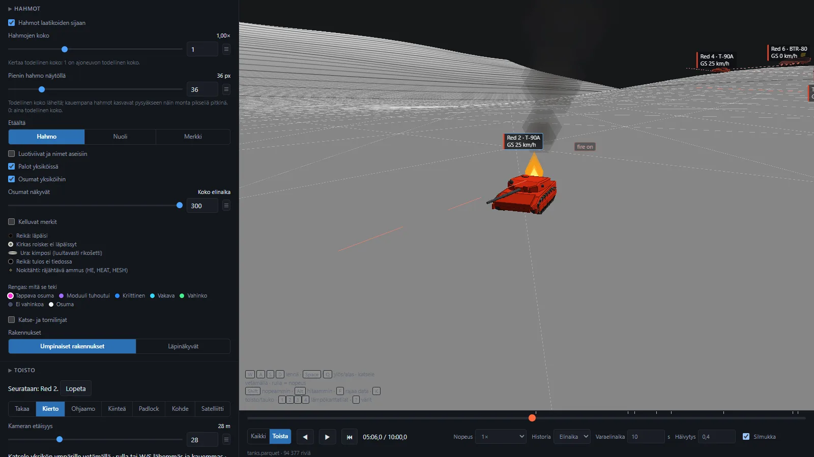

# Hahmot

**Hahmo** on pieni 3D-malli siitä, mikä yksikkö todella on: panssarivaunu, suihkukone, laiva tai sotilas. [Toisto](match-replay.md) piirtää jokaisen yksikön hahmonaan todellisessa koossa tavallisen laatikon sijaan.

Katalogissa on noin 2 000 nimettyä ajoneuvoa, lentokonetta, laivaa, asetta ja sotilasta. Katselija rakentaa ne itse.

## Mitä katalogissa on {#what-is-in-the-catalogue}

| Ala | Esimerkkejä |
|---|---|
| Ihmiset | sotilas seisomassa, kyykyssä tai vatsallaan; tarkka-ampuja, panssarintorjunta, lääkintä, miehistö |
| Maa | panssarivaunut, jalkaväen taisteluajoneuvot, ilmatorjunta, tykistö, kuorma-autot ja autot, junat ja raitiovaunut |
| Ilma | hävittäjät, maahyökkäyskoneet, pommikoneet, kuljetuskoneet, helikopterit, kaksitasokoneista nykyaikaisiin suihkukoneisiin |
| Meri | sotalaivat luokittain, lentotukialukset, sukellusveneet, veneet, kauppalaivat |
| Aseet | ohjukset, raketit, pommit, torpedot, valaisu- ja häivytyspatruunat |
| Merkit | savu-, välähdys- ja palokranaatit, asetetut pommit, liput, lähtöpisteet, reittipisteet |
| Lähitaistelu | sotilaat suojaliiveissä rynnäkkökiväärin, konepistoolin, haulikon, DMR:n, LMG:n, pistoolin tai kilven kanssa; droonit, kamerat, piikkilanka, kilvet, seinien vahvistus, barrikadit, murtopanokset, ansat, ikkunat, kranaatit, purkulaite |

## Miten hahmot tehdään {#how-the-figures-are-made}

- **Rakennettu julkaistuista mitoista.** Useimmat hahmot tekee katselijan oma hahmorakentaja julkisista luvuista: pituus, leveys, korkeus, tiepyörät, torni ja tykki, siivet ja häntä. Muoto viritetään sen jälkeen julkisia valokuvia, piirustuksia ja julkaistuja mittoja vasten. Minkään pelin malleja ei käytetä.
- **Ilmaiset mallit.** Muutama hahmo käyttää ilmaisia 3D-malleja (CC0 tai CC BY), kun ne ovat todenmukaisempia. Joskus ne yhdistetään rakennettuun runkoon. CC BY -teosten tekijät mainitaan sivulla [Hahmojen tekijänoikeudet](figure-credits.md). CC0-teoksissa mainintaa ei vaadita, eikä niitä siellä luetella.
- Jokaisesta hahmosta on täysi, karkea ja kaukainen versio (yksityiskohtatasot, LOD), joten tuhansia voidaan piirtää kerralla.

## Mikä hahmo yksikölle annetaan {#which-figure-a-unit-gets}

Katselija katsoo datan omia sarakkeita:

1. **Nimet**: sarakkeet nimeltä *Name*, *Vehicle*, *Unit*, *Unit type*, *Model*, *Aircraft*, *Plane*, *Tank*, *Ship*, *Craft*, *Loadout*, *Kit* tai *Figure* verrataan katalogiin. Vertailu tehdään tarkasti, noin 4 000 aliaksen kautta (useiden pelien yksikkötunnisteet), pisimmän tunnetun alun perusteella (`F-16C_50` on F-16C) tai lyhimmän hahmonimen perusteella, joka alkaa samalla.
2. Nimeä, jonka hahmo ei sovi yksikön **tyyppiin**, ei käytetä (kuorma-auto nimeltä *Typhoon* ei ole hävittäjä).
3. **Tyypit**: sarakkeet nimeltä *Type*, *Class*, *Kind*, *Category*, *Icon*, *Role* tai *Domain* antavat luokkahahmon: Tacview-tunnisteet (`Air+FixedWing`, `Ground+Heavy+Armor+Vehicle+Tank`, `Sea+Watercraft+Warship`, `Weapon+Missile`), karttakuvakkeet tai tavalliset sanat (tank, helicopter, infantry).
4. Data, jossa ei ole kumpaakaan, on ihmisten dataa: jokainen on sotilas.

Helpoin tapa saada oikeat hahmot on siis `vehicle`-sarake oikeilla nimillä tai `type`-sarake Tacview-tunnisteilla.

**Yksikköni näkyy laatikkona tai sotilaana.** Lisää `vehicle`-sarake oikealla nimellä tai `type`-sarake Tacview-tunnisteella. Vie hiiri yksikön päälle nähdäksesi, mikä nimi täsmäsi. Data, jossa tällaiset sarakkeet ovat, mutta joka ei kerro yksiköstä mitään, jättää sen laatikoksi. Data, jossa ei ole kumpaakaan, piirretään sotilaina.

## Lähitaisteluhahmot (Rainbow Six Siege) {#close-quarters-figures-rainbow-six-siege}

Taulukot, jotka on kirjoitettu kuten Rainbow Six Siegen toistonlukijan taulukot (sarakkeet `operator`, `pawn`, `primaryClass`, `side`), saavat omat hahmonsa:

- **Pelaajat** ovat operaattorinsa: Jokaisella 78 operaattorista on oma hahmonsa, noin 1,8 m pitkä, omissa vaatteissaan – kaksi tai kolme väriä takille, housuille ja varusteille heidän tavallisen julkisen ulkonäkönsä mukaan (musta, oliivi, hiekka, kaupunkiharmaa, valkoinen, laivastonsininen, punaisin, oransein tai sinivihrein varustein) – ja omilla muodoillaan, kolmanneksen todellista suurempina siellä, missä niiden pitää näkyä ylhäältä: päähine (kypärät, visiiri tai raskas kypärä, lippalakit, pipot, baretit, leveä boonie-hattu tai turkislakki, huput, huivit, hiukset), kasvot (suojalasit, kaasunaamari, silmälasit, naamio, parta, kolmilinssiset suojalasit), kevyt, keskiraskas tai raskas ruumiinrakenne (raskaat leveitä, isoin olkalevyin ja kauluksin), pitkä takki tai puku, ghillie-asu, se mitä he kantavat selässään (vasara, panoksia, drooneja, säiliöitä, polttoainesäiliö, laukaisuputki, varsijousi, paneeleita, häirintälaite, kilpi) tai käsivarressaan (laukaisin, metallikäsivarsi), oma kilpi (korkea kilpi, mellakkakilpi, kilpi valoilla) ja korostusväri olkapäillä. He pitelevät pääaseensa luokkaa. Operaattori, jota katselija ei tunne, on tavallinen sotilas suojaliivissä joukkueen värissä.
- **Puoli** näkyy vaatteista erillään: rengas maassa jokaisen operaattorin alla, **meripihkanvärinen hyökkäykselle, vaalea syaani puolustukselle**, joukkueen väri sen sisällä, sekä käsivarsi- ja päänauhat samassa värissä. Sarake `stance` (seisoo, kyyristyy, makaa) antaa heille asennon. Ilman sitä he seisovat.
- **Erotettavissa toistoetäisyydeltä:** Kun hahmot piirretään 48 pikselin korkuisina ylhäältä ja viistosti kolmen neljänneksen kulmasta, jokainen saman puolen operaattoripari eroaa selvästi värin tai muodon perusteella (katselijan testit tarkistavat tämän).
- **Nimilaput** kertovat pelaajan ja sillä hetkellä pelatun operaattorin sekä operaattorin roolin symbolina: ✸ kova murtaja, ⚒ pehmeä murtaja, ➤ sisääntulija, ✦ tappaja, ✚ tuki, ⬟ kilpi, ◉ tiedustelu, ◇ joustava, ↺ sivustan vartija, ⚓ ankkuri, ✕ ansoittaja, ⇄ kiertelijä, ↯ välineiden torjunta, ▣ murtautumisen torjunta.
- **Droonit** ovat heitettävä kaksipyöräinen drooni, halkaisijaltaan noin 30 cm. Jokainen on oma jälkensä, joka on nimetty omistajansa mukaan (”Ash · drone 2”).
- **Asetetut välineet** seisovat siellä, mihin ne laitettiin, siitä hetkestä erän loppuun, kukin sen hahmona, mitä se tekee: kamera, piikkilanka, avattava kilpi, murtopanos, kovan murron panos, pieni tarrapanos, lattia-ansa, claymore laukaisulaserineen, yksisuuntainen ikkuna, panssarilevy, kranaatti, kaasusäiliö, häirintälaite, anturi, laserportti, tarvikelaatikko. Yksi hahmo kelpaa jokaiselle välineelle, joka tekee saman työn. Väline, jonka lajia data ei kerro, on pieni laite, jossa on valo.
- **Purkulaite** seisoo siellä, mihin se asetettiin, 45 sekuntinsa ajan.

Jokaisesta droonista ja välineestä tulee oma jälkensä, kun tiedosto ladataan, joten pelaajan oma hahmo pysyy hänen kehossaan. Operaattorit ovat yksinkertaistettuja muotoja heidän julkisten kuvaustensa ja kuviensa mukaan (mitä he pukevat päälleen, laite, joka on heidän kykynsä), ja välineet on muotoiltu sen mukaan, mitä ne tekevät. Kaikki nämä ovat katselijan omia malleja esineen todellisessa koossa (claymore noin 22 cm leveä, oven kokoinen paneeli 1 m × 2,1 m), eivät pelin malleja.

## Asetukset {#settings}

Toiston sivupalkin osio **Hahmot** asettaa koon, pienimmän koon näytöllä, sen mihin kaukaiset yksiköt muuttuvat (hahmo, nuoli, symboli) ja niihin piirretyt efektit. Katso [Ottelun toisto](match-replay.md#figures). Savu, tuli ja muut ajastetut efektit: [Hahmot hahmopeitenäkymässä](figure-replay.md).

## Valinnainen paikallinen hahmopaketti {#an-optional-local-figure-pack}

Voit pitää omalla koneellasi valinnaisen oman hahmopaketin. Sen hahmot korvaavat katalogin hahmot samoilla nimillä. Paketti ei ole koskaan osa repositoriota tai julkaistua versiota. Ilman sitä mitään ei muutu.
