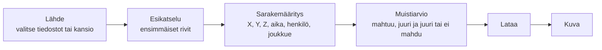

# Datan lataaminen

Ennen kuin 3DHeat voi piirtää mitään, se tarvitsee taulukon. Jokainen rivi kertoo, missä jokin oli ja, jos tiedät, milloin ja kuka. Tämä osio näyttää, miten tiedostosta tulee kuva. Ei vielä dataa? Kokeile [esimerkkidataa](demo-data.md).

**Tee tämä nyt:**

1. Avaa Lämpökartta-sivupalkissa **Lähde** ja paina **Tiedostot…** (tai pudota tiedosto tai kansio pudotusalueelle).
2. Katso **Sarakemääritys**: ruudut ovat yleensä jo täynnä.
3. Tarkista, että **Muistiarvio** sanoo *mahtuu*.
4. Paina **Lataa**.

Kaikki, mitä Lämpökartta-välilehti näyttää, tulee yhdestä **aineistosta**: taulukosta, jonka rivillä on sijainti ja valinnaisesti aika, henkilö, ryhmä, istunto, katselusuunta ja mikä tahansa määrä lisäsarakkeita suodattamista varten. Tämä osio selittää, miten aineisto tehdään.

## Tiedostoista kuvaan {#the-path-from-files-to-picture}

1. **Valitse tiedostot** **Lähde**-paneelissa: yksi tiedosto, useita, kansiopuu tai pudottamalla. Parquet, CSV, Tacview, GPS-radat ja muut hyväksytään; kattava luettelo on kohdassa [Tietomuodot](data-formats.md#files). Katso [Tiedostojen lataaminen](loading-files.md).
2. **Esikatselu.** Valinnan ensimmäinen tiedosto avataan: sen sarakenimet, sen ensimmäiset 50 riviä, sarakkeet, jotka näyttävät numeerisilta, ja (Parquet) kunkin sarakkeen looginen tyyppi sekä tiedoston omat lukuohjeet, `heat3d`-alatunnisteen merkintä.
3. **Automaattinen määritys.** Sarakkeet liitetään rooleihin: X, Y, Z, aika, henkilö, istunto, ryhmä, katselusuunta, ja muutama pidetään suodattamista varten. Jokainen arvaus näkyy **Sarakemääritys**-paneelissa, ja sitä voi muuttaa. Katso [Sarakemääritys](column-mapping.md) ja [Akselit, yksiköt ja aika](axes-units-and-time.md).
4. **Laskeminen.** Jokaisen tiedoston rivimäärä luetaan (Parquetin alatunnisteista tarkasti, CSV:stä arvioiden), joten paneeli voi kertoa ennen latausta, kuinka paljon muistia lataus tarvitsee ja mahtuuko se. Jos ei mahdu, se ehdottaa joka *N*:nnen rivin lataamista. Katso [Muisti ja rajat](memory-and-budgets.md).
5. **Lataa.** Taustatyö jäsentää jokaisen tiedoston vain liitetyt sarakkeet. Useita tiedostoja käsitellään kerralla, enintään [jäsentimen säikeiden](memory-and-budgets.md#parser-threads) rajaan asti, ja ne yhdistetään valinnan järjestyksessä yhdeksi aineistoksi: yksi yhteinen henkilö-, ryhmä- ja istuntosanasto kaikissa tiedostoissa, yhteinen aikanollakohta ja kaikki rivit aikajärjestyksessä. Katso [Istunnot, henkilöt ja ryhmät](sessions-persons-groups.md).
6. **Lähetys.** Pääsäie ilmoittaa "Lähetetään N riviä näytönohjaimelle" yhden kehyksen ajan ja pakkaa rivit näytönohjaimen muistiin näytönohjaimen rajoissa. Katso [Näytönohjaimen muistin pysyvyys](gpu-memory.md).
7. **Ensimmäinen kuva.** Kamera sovittaa datan kuvaan, hahmon säde ja kyllästys asetetaan datan laajuuden ja rivimäärän mukaan, ja 8 piirretyn kehyksen jälkeen kyllästys mitataan itse kuvasta ([Väri ja valotus](colour-and-exposure.md)).

## Vaatimukset, tarkistetaan ennen latausta {#requirements-checked-before-a-load}

| Tarve | Mitä tapahtuu ilman sitä |
|---|---|
| **Vähintään kaksi X:ää, Y:tä tai Z:aa** | Lataus evätään. Kun kaksi on, kolmas akseli on 0 ja data piirretään tasaisena tasona 3D-näkymään. Sitä ylhäältä katsottu karttalämpö tarvitsee. |
| Aikasarake | Valinnainen. Ilman sitä aikajana poistetaan käytöstä, näkymä pysyy tilassa **Kaikki**, ja sivupalkki kertoo sen. |
| Henkilösarake | Valinnainen. Tarvitaan [hahmon peittokuvaan](box-replay.md) (hahmo jokaiselle henkilölle), [viivalämpöön](line-heat.md) (kunkin henkilön kulkema reitti), interpolointiin, jälkiin ja **Elinaika**-historiaan. |
| Ryhmäsarake | Valinnainen. Tarvitaan [joukkuelämpöön](team-heat.md) ja [erotus](difference.md)-tilaan (vähintään kaksi ryhmää). |

Tila, jota ladattu data ei tue, on harmaana tilapalkissa. Kun osoitat sitä, kerrotaan syy.

## Ilman omaa dataa {#without-your-own-data}

**Aineisto**-paneelissa (**Lähde**-paneelin alla) on [synteettinen generaattori](synthetic-generator.md), joka tuottaa taistelu-royalen muotoisen aineiston mistä tahansa koosta. Se sopii katselimen kokeiluun ja siihen, mitä kone kestää.

## Tämän osion sivut {#pages-in-this-section}

- [Tiedostojen lataaminen](loading-files.md) - valitsimet, kansiot, vetäminen ja pudottaminen, usean tiedoston yhdistäminen, liikedatatiedostojen sääntö, edistyminen ja peruuttaminen
- [Sarakemääritys](column-mapping.md) - jokainen määrityspaneelin kenttä, miten automaattinen määritys arvaa, `heat3d`-vihjeet
- [Akselit, yksiköt ja aika](axes-units-and-time.md) - ylösakseli, käännökset, yksikkökerroin, aikayksiköt, katselusuunta
- [Istunnot, henkilöt ja ryhmät](sessions-persons-groups.md) - mitä kukin tekee, rajat, yhteiset nimet, kohteen koko, Aineisto-paneeli
- [Synteettinen generaattori](synthetic-generator.md)
- [Muisti ja rajat](memory-and-budgets.md) - muistin jalanjälkimalli, mahtumistarkistus, harventaminen, lajitteluraja, resurssirajat
