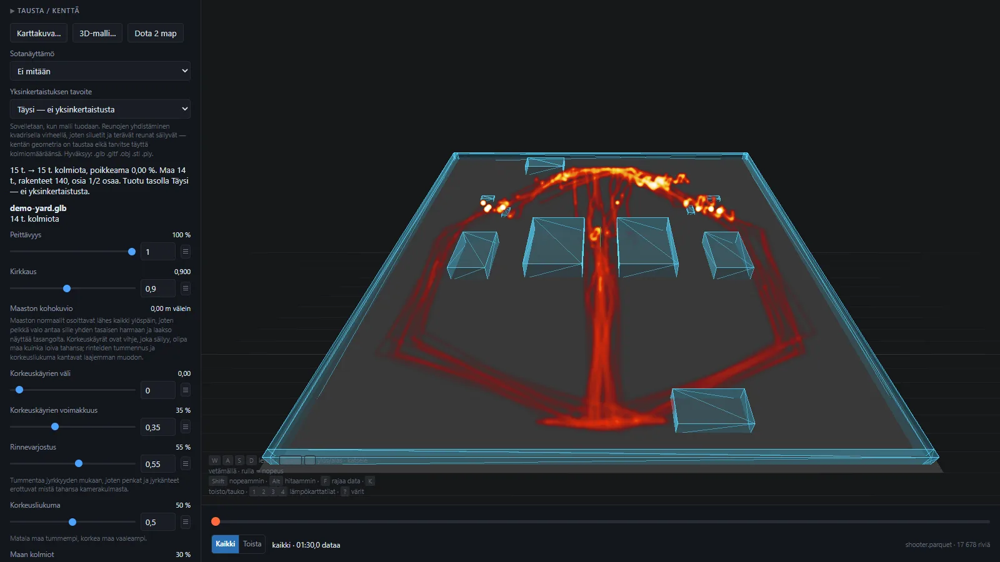
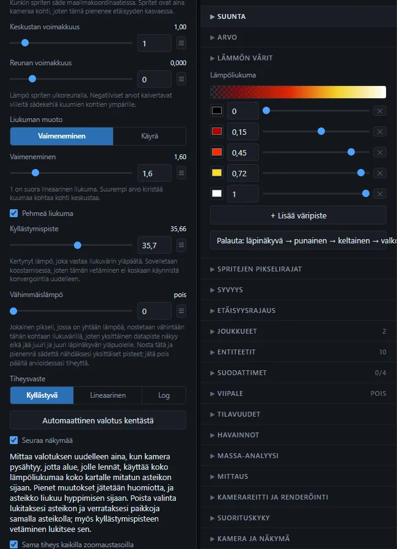

# Lämpö

Lämpö maalaa paikat, joissa tapahtui paljon: punaista siellä, missä tapahtui vähän, ja valkoisen kuumaa siellä, missä tapahtui paljon. Se vastaa kysymykseen "missä tämä tapahtuu ja kuinka paljon".

**Lämpö** (näppäin 1) on oletustila. Jokainen näkyvä [rivi](glossary.md) lisää kameraa kohti käännetyn pyöreän [spriten](glossary.md); päällekkäiset spritet summautuvat liukulukupuskuriin; summa kuvautuu väriliuskan läpi – oletuksena läpinäkyvä → punainen → keltainen → valkoinen – ja piirtyy kohtauksen päälle.

Kuva näyttää ampujakierroksen lämmön rakennuksilla varustetulla kentällä: kuumat kohdat ovat huoneissa ja portailla, eivät vain maassa.

## Käyttö {#how-to-use-it}

1. Lataa data ja paina `1` (tai valitse **Lämpö** tilapalkista).
2. Jos kaikki on valkoista tai tyhjää, paina **Automaattinen valotus kentästä** osiossa **Lämmön muoto**.
3. Muuta **Spriten säde** -arvoa, kunnes naapuripisteet yhdistyvät nauhoiksi: pienempi näyttää yksittäisiä kohtia, suurempi alueita.
4. Avaa **Lämmön värit** vaihtaaksesi värejä, tai **Syvyys** antaaksesi kukkuloiden ja seinien piilottaa lämmön niiden taakse.

Samat paneelit muokkaavat [Eroa](difference.md), [Joukkuelämpöä](team-heat.md) ja [Viivalämpöä](line-heat.md); ne eroavat siinä, mitä lisätään (merkillinen, värillinen tai viivoja pitkin), eivät siinä, miten.

## Paneelit ja niiden oletukset {#the-panels-and-their-defaults}

Jokainen säädin selitetään omalla sivullaan; Tiedot-sarake linkittää siihen. Liukusäätimien vieressä on kirjoituskenttä ja vetokahva (pieni ote oikealla: vedä ylös tai alas; pitemmälle vedettäessä nopeammin; Shift hienosäätöön). Jos liukusäätimen rata päättyy ennen todellista rajaa, kahva voi työntyä sen yli tässä annettuun *säätörullan kattoon* asti. Arvot, joissa lukee *latauksessa*, lasketaan uudelleen jokaiselle uudelle datalle.

### Lämmön muoto (auki) {#heat-shape-open}

| Säädin | Oletus | Alue (säätörullan katto) | Tiedot |
|---|---|---|---|
| **Spriten säde** | 6 m; latauksessa laajuus / 120 | 0,05–2000 m, logaritminen (50 000) | [Spriten muoto](sprite-shape.md#sprite-radius) |
| **Keskustan voimakkuus** | 1 | 0–10 (1000) | [Spriten muoto](sprite-shape.md#centre-and-edge-intensity) |
| **Reunan voimakkuus** | 0 | -2–10 (1000) | [Spriten muoto](sprite-shape.md#centre-and-edge-intensity) |
| **Liukuman muoto** | *Vaimeneminen* | *Vaimeneminen* / *Käyrä* | [Spriten muoto](sprite-shape.md#ramp-shape-falloff-or-curve) |
| **Vaimeneminen** (vain Vaimeneminen) | 1,6 | 0,1–8 (64) | [Spriten muoto](sprite-shape.md#falloff) |
| **Pehmeä liukuma** (vain Vaimeneminen) | päällä | | [Spriten muoto](sprite-shape.md#falloff) |
| Käyrämuokkain (vain Käyrä) | *Pehmeä* esiasetus | | [Spriten muoto](sprite-shape.md#the-curve-editor) |
| **Kyllästymispiste** | 24; latauksessa arvio, sitten mitattu | 0,1–4000, logaritminen (10 000 000) | [Väri ja valotus](colour-and-exposure.md#saturation-point) |
| **Vähimmäislämpö** | pois (0) | 0–100 % | [Väri ja valotus](colour-and-exposure.md#minimum-heat) |
| **Tiheysvaste** | *Kyllästyvä* | *Kyllästyvä* / *Lineaarinen* / *Log* | [Väri ja valotus](colour-and-exposure.md#density-response) |
| **Automaattinen valotus kentästä** | | painike | [Väri ja valotus](colour-and-exposure.md#auto-exposure) |
| **Seuraa näkymää** | päällä | | Mittaa valotuksen uudelleen aina, kun kamera pysähtyy, joten alue, jolle lennät, käyttää koko värikaistaa. Pienet muutokset jätetään huomiotta, ja asteikko liukuu. Poista valinta tai vedä **Kyllästymispistettä**, niin asteikko lukittuu ja paikkoja voi verrata yhdellä asteikolla. [Väri ja valotus](colour-and-exposure.md#follow-the-view) |
| **Sama tiheys kaikilla zoomaustasoilla** | päällä | | Väri tarkoittaa samaa rivimäärää maan pinta-alaa kohden, olitpa kuinka lähellä tahansa. Sprite, jonka pikselirajat suurentavat (kaukana) tai pienentävät (lähellä), säilyttää lämmön, minkä todellinen koko lisäisi, joten kuva, joka valotettiin kaukaa, ei häivy, kun lennät siihen. Pois päältä rajattu sprite lisää täyden painonsa rajatussa koossaan. [Spriten muoto](sprite-shape.md#pixel-clamps) |
| **Litistä maatasolle** | pois | | [Spriten muoto](sprite-shape.md#flatten-onto-ground-plane) |

### Lämmön värit (suljettu) {#heat-colours-closed}

| Säädin | Oletus | Tiedot |
|---|---|---|
| Ryhmien värinäytteet ja **Värierottelu** (vain Joukkuelämpö) | 1,4 | [Joukkuelämpö](team-heat.md) |
| **Lämpöliukuma** -muokkain (*Positiivinen (lisäävät joukkueet)* Erotuksessa, *Peittävyysliukuma* Joukkuelämmössä) | läpinäkyvä → punainen → keltainen → valkoinen | [Väri ja valotus](colour-and-exposure.md#the-ramp-editor) |
| **Palauta: läpinäkyvä → punainen → keltainen → valkoinen** | | |
| **Negatiivinen (vähentävät joukkueet)** -liuska (vain Erotus) | läpinäkyvä → vihreä → sininen → violetti | [Erotus](difference.md#colours) |

### Spritejen pikselirajat (suljettu) {#sprite-pixel-clamps-closed}

| Säädin | Oletus | Alue (säätörullan katto) | Tiedot |
|---|---|---|---|
| **Pienin pikselisäde** | 1 px | 0–16 (512) | [Spriten muoto](sprite-shape.md#pixel-clamps) |
| **Suurin pikselisäde** | 96 px | 2–1024, logaritminen (8192) | [Spriten muoto](sprite-shape.md#pixel-clamps) |

### Syvyys (auki) {#depth-open}

| Säädin | Oletus | Tiedot |
|---|---|---|
| **Piilota maaston taakse** | päällä | [Syvyys ja leikkaus](depth-and-culling.md#hide-behind-terrain) |
| **Geometrian taakse piilotettu** | 0,8 (*80 % himmeämpi*) | [Syvyys ja leikkaus](depth-and-culling.md#hidden-behind-geometry) |

### Etäisyysrajaus (suljettu) {#distance-culling-closed}

| Säädin | Oletus | Alue (säätörullan katto) | Tiedot |
|---|---|---|---|
| **Lähiraja** | pois (0) | 0,5–5000 m, logaritminen; radan alin kohta = pois (200 000) | [Syvyys ja leikkaus](depth-and-culling.md#distance-culling) |
| **Kaukoraja** | pois (0) | 1–200 000 m, logaritminen; alin = pois (10 000 000) | [Syvyys ja leikkaus](depth-and-culling.md#distance-culling) |
| **Leikkaa tasolla** | päällä | | [Syvyys ja leikkaus](depth-and-culling.md#distance-culling) |
| **Leikkaa myös kenttä** | päällä | | [Syvyys ja leikkaus](depth-and-culling.md#distance-culling) |

Näppäimet: `[` ja `]` työntävät kaukorajan sisään ja ulos, `\` kytkee sen ([Syvyys ja leikkaus](depth-and-culling.md#keyboard)).

### Suunta ja Arvo {#direction-and-value}

Lämmön muodon alapuolella on kaksi osiota lisää. **Suunta** piirtää jokaisen rivin kiilana ja lisää nuolia: katso [Suunnattu lämpö](directional-heat.md). **Arvo** painottaa lämpöä sen mukaan, mitä kukin rivi maksoi tai ansaitsi: katso [Arvopainotus](value-weighting.md).

## Mitä tallennetaan {#what-is-saved}

Yllä olevia lämpöasetuksia ei tallenneta istuntojen välillä: sivun lataaminen uudelleen palauttaa oletukset. Selaimeen tallennetaan kaksi asiaa: viimeisin toistonopeus (`heat3d.speed`, katso [Aikajana](timeline.md)) ja [hahmo päällekkäin -näkymän](box-replay.md) kaukaisten hahmojen asetukset (merkkityyli, koko, osumamerkit ja niin edelleen). Samoin kieli, [käännetyt maailmanakselit](camera.md#invert-world-axis), kisa-välilehden muistetut autojen nimet ja [kenttäkirjasto](level-library.md). Koko luettelo on sivulla [Tallennetut asetukset](ref-settings-storage.md).
