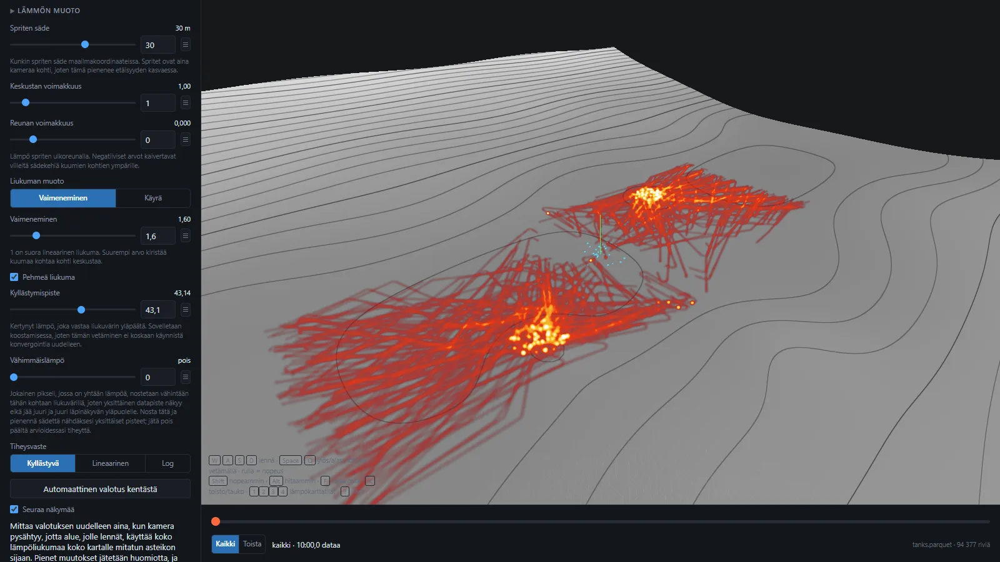
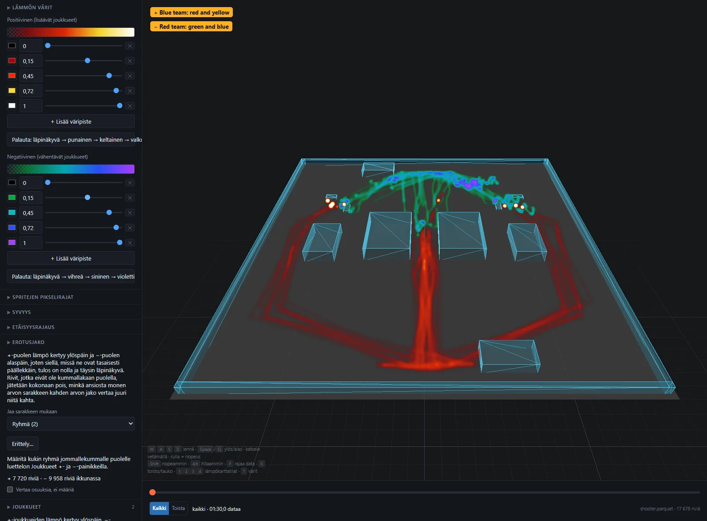
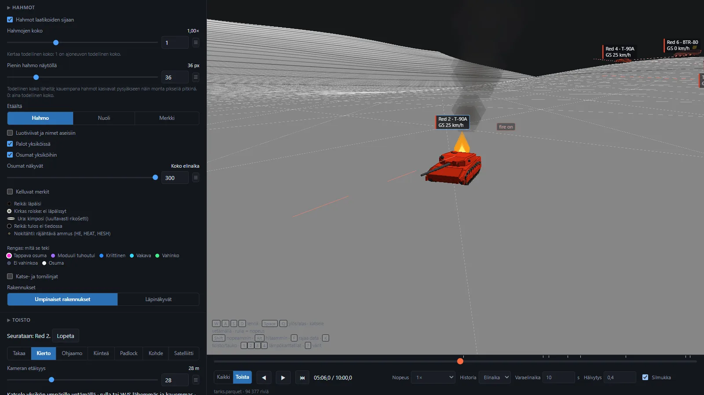
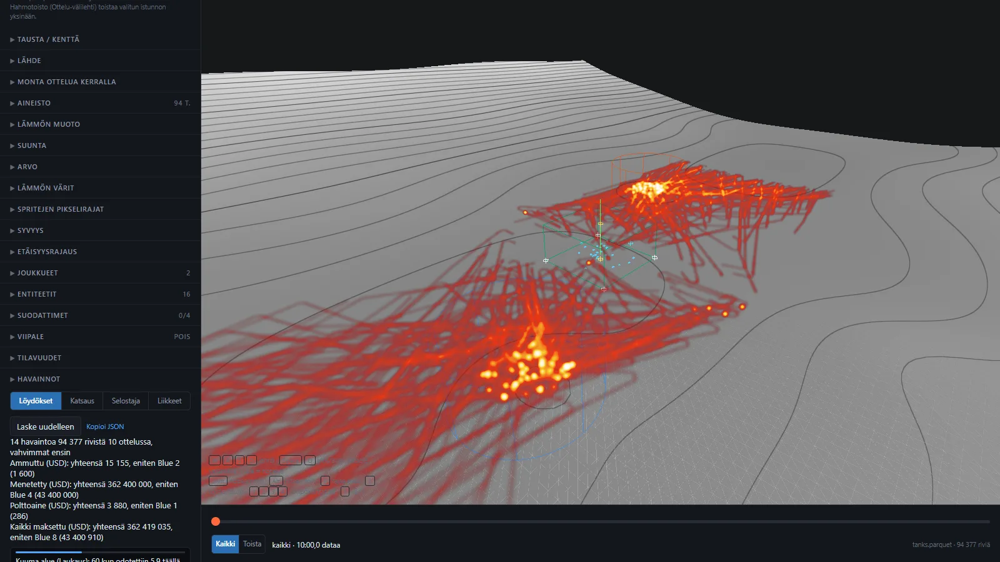
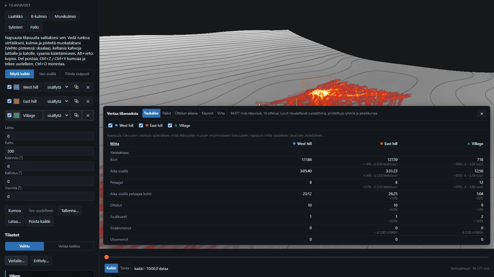
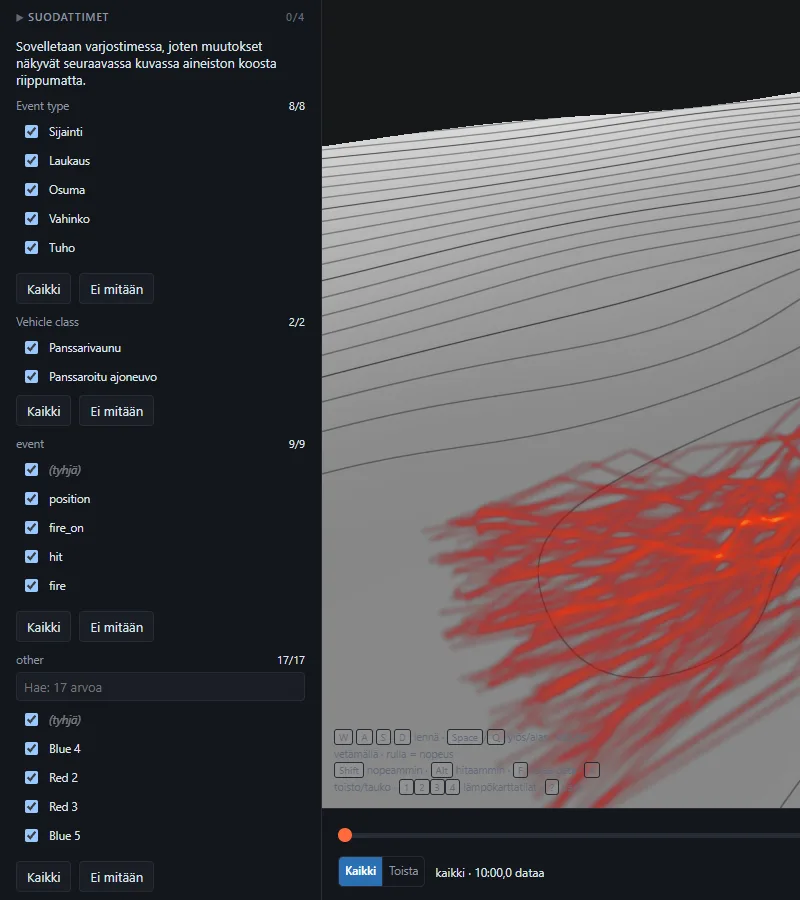
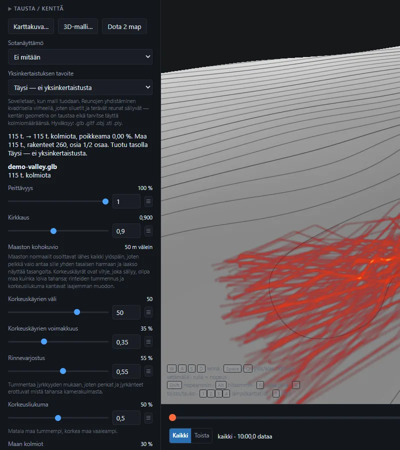

# 3DHeat

3DHeat näyttää, missä asiat tapahtuivat pelissä: missä pelaajat liikkuivat, taistelivat ja kaatuivat. Se näyttää ne hehkuvina väreinä, joiden läpi voit lentää, tai pieninä 3D-hahmoina, jotka toistavat ottelun.

Lataa sijainnit: CSV, Parquet, Tacview-tallenteet, muunnetut toistot, yksi tiedosto, kansio tai tuhansia otteluita. Näet ne **lämpökarttana, jonka läpi voit lentää**, **hahmoina, jotka toistavat ottelun**, viivoina pitkin reittejä, joita ihmiset kulkivat, tai yhtenä joukkona toista vastaan. Se löytää itse, mikä erottuu. Se toimii kokonaan selaimessasi. Mitään ei lähetetä mihinkään.



**Uusi täällä?** Tee [esimerkkidata](demo-data.md) ja seuraa sen seitsemää vaihetta. Jokainen tämän sivuston kuva on otettu sillä.

## Mitä se tekee {#what-it-does}

| | |
|---|---|
|  | **[Lämmön tilat](heat-modes.md)** - lämpö, [erotus](difference.md) (punainen siellä, missä toinen puoli oli enemmän, vihreä-sininen siellä, missä toinen puoli oli), [joukkuelämpö](team-heat.md), [viivalämpö](line-heat.md); [suuntalämpö](directional-heat.md) kiiloilla, nuolikentillä ja napakaavioilla; lämpö [painotettuna arvolla](value-weighting.md): mitä aseet, ajoneuvot ja polttoaine maksavat. |
|  | **[Ottelun toisto](match-replay.md)** - jokainen yksikkö [hahmona](figures.md) siitä, mitä se on, NATO- tai venäläiset merkit kaukana, ohjuksia ja jäljitteitä, osumamerkit, raadot, palot, tornit, tavoitteet, Tacview-tyyliset kamerat ja taktinen näyttö; [monta ottelua kerralla](many-matches.md). |
|  | **[Havainnot](insights.md)** - vahvat asemat, vaaralliset maastot, synnytysloukut, pullonkaulat ja silmään pistävät pelaajat, löydettynä ja järjestettynä todisteineen; kirjallinen katsaus, halutessasi valitsemasi tekoälyn kirjoittama; selostaja yhdelle ottelulle; [tietolinssi](knowledge.md). |
|  | **[Tilavuudet](volumes.md)** - piirrä laatikoita, prismoja, sylintereitä ja palloja, suodata niiden mukaan, laske niiden sisällä tapahtuva, vie data ja vertaile paikkoja rinnakkain; [erittely](breakdown.md) siitä, kuka ja mikä menestyy paikassa parhaiten. |
|  | **[Suodattimet](filters.md)** - tapahtumatyypin, pelaajan tai tekoälyn, ajoneuvoluokan, arvon tai minkä tahansa sarakkeen mukaan näytönohjaimessa, minkä kokoisella datalla tahansa. |
|  | **[Kentät](levels.md)** - karttakuvat, 3D-kentät, jotka on tehty [datatyökaluilla](#related-repositories), yksinkertaistus ja [maailmatausta](world-backdrop.md) todellisella maastolla lentodatalle. |

Lisäksi: [Kisa-analyysi](race-analysis.md) -välilehti kilpailupelien kierroksille, [Ottelu](match-analysis.md) -välilehti Counter-Strike 2:n ottelukoosteille, [Taktiikkataulu](tactics-board.md) suunnitelmille kentällä, [osumaanalyysi](hit-analysis.md) ajoneuvoittain, [massa-analyysi](mass-analysis.md) tuhansista otteluista, [kameraradat ja video](camera-path-and-video.md), [40 kieltä](languages.md) ja [metriset tai imperiaaliset yksiköt](settings.md).

## Välilehdet {#the-tabs}

Välilehdet ovat sivupalkin yläosassa, nimen, yksiköiden ja kielivalikon alapuolella.

| Välilehti | Mihin se on |
|---|---|
| **Lämpökartta** | Mikä tahansa sijaintitaulukko: lämmön tilat, hahmot päällekkäin, suodattimet, tilavuudet, havainnot, kentät, mittaus ja video. |
| **Kisa-analyysi** | Kaksi tai useampi kierros samalta radalta: missä aikaa menetetään, miksi ja mitä pitää muuttaa. |
| **Ottelu** | Ottelun hahmotoisto ja Counter-Strike 2 -ottelujen yhteenvedot. |
| **Taktiikka** | Suunnitelmat kentällä: hahmot, reitit, heitettävät apuvälineet, alueet ja muistiinpanot vaiheittain, jotka voi toistaa. |
| **Ajoneuvot** | Missä kukin yksikkö osui, kuka osui ja millä. |

## Asennus ja käynnistys {#install-and-run}

### Windows, helpolla tavalla {#windows-the-easy-way}

Tietovaraston juuressa on kolme eräajotiedostoa.

| Tiedosto | Mitä se tekee |
|---|---|
| `start.bat` | Käynnistää katselimen. Löytää Node.js:n, vaikka se ei ole `PATH`-polulla (se etsii kansioista `%ProgramFiles%\nodejs`, `%ProgramFiles(x86)%\nodejs` ja `%LOCALAPPDATA%\Programs\nodejs`). Jos Node.js puuttuu, se tarjoaa LTS-version asentamista komennolla `winget install -e --id OpenJS.NodeJS.LTS`. Ensimmäisellä kerralla se kysyy ennen riippuvuuksien lataamista (noin 300 Mt kansion sisään kohteeseen `node_modules\`, ei mihinkään järjestelmänlaajuisesti). Se ei käynnisty, jos portti 5273 on jo varattu, vaan ohjaa käyttämään `restart.bat`-tiedostoa. Kun kansio on git-kopio ilman paikallisia muutoksia ja uudempi versio on olemassa, se kysyy, päivitetäänkö (Y/N; jos vastausta ei tule 60 sekunnissa, se pitää tämän version; katso [Päivitykset](updates.md)). Sitten se käynnistää kehityspalvelimen osoitteessa `http://127.0.0.1:5273/` ja avaa selaimen. **Ikkuna on palvelin**: jätä se auki, sulje se tai lopeta painamalla Ctrl+C. |
| `restart.bat` | Suorittaa ensin `stop.bat quiet`-komennon ja sitten `start.bat`-tiedoston. Tarvitaan vain, kun `vite.config.ts` on muuttunut, lisäät riippuvuuden tai palvelin on jumittunut. Lähdekoodin muutokset päivittyvät heti. |
| `stop.bat` | Pysäyttää sen, mikä kuuntelee porttia 5273. Prosessi tunnistetaan prosessitunnuksella, joka löytyy `netstat`-komennolla, ei koskaan ohjelman nimellä, joten koneen muut Node.js-prosessit jäävät rauhaan. Odottaa noin kaksi sekuntia, että pistoke vapautuu. Argumentilla `quiet` se ei pysähdy lopussa. |

### Käsin (mikä tahansa käyttöjärjestelmä) {#by-hand-any-os}

```bash
git clone --recursive https://github.com/Holdi601/3DHeat.git
cd 3DHeat
npm install
npm run dev      # http://127.0.0.1:5273
```

Kansio `exporters/` sisältää erilliset datatyökalut git-alimoduuleina, joista kukin on oma tietovarastonsa. Tavallisen kloonauksen jälkeen aja `git submodule update --init`. Katselin itse ei tarvitse niitä toimiakseen. Kansio `exporters/ext/` sisältää valinnaiset muuntimet (War Thunder, World of Tanks, World of Warships, Squad-toistot; DCS- ja IL-2-kartat). Ne on pidetty erillään, jotta yhden ongelma ei vaikuta muihin.

Mikään näistä ei sisällä pelidataa: kentät, kartat ja tallenteet tehdään omalla koneellasi työkaluilla, omista peleistäsi.

### npm-komennot {#npm-scripts}

| Komento | Mitä se ajaa |
|---|---|
| `npm run dev` | Vite-kehityspalvelin portissa 5273, sidottuna osoitteeseen `127.0.0.1`. |
| `npm run build` | Tyyppitarkistus (`tsc --noEmit`) ja tuotantopaketti kansioon `dist/`. |
| `npm run preview` | Palvelee tuotantopaketin. |
| `npm run typecheck` | Pelkkä tyyppitarkistus. |
| `npm test` / `npm run test:watch` | Yksikkö- ja integraatiotestit (vitest). |
| `npm run smoke` | Ajaa oikean sovelluksen headless Chromiumissa ja tarkistaa, että kankaalla on datan värisiä pikseleitä; kuvakaappaukset menevät kansioon `tools/.smoke/`. Vaatii, että kehityspalvelin on käynnissä. |
| `npm run smoke:f16` | Sama testisarja, mutta `?heat=f16`-parametrilla, joka pakottaa puolitarkkuuskertymisen käyttöön (katso [Puolitarkkuuskertyminen](half-float-accumulation.md)). |
| `npm run bench` | Sisäänluvun suorituskykytesti; kirjoittaa tiedoston `tools/.smoke/ingest-bench.json`. |
| `npm run test:heavy` | Testit, jotka tarvitsevat suuria oikeita datatiedostoja; ne ohittavat itsensä, jos tiedostoja ei ole. |
| `npm run inspect -- <file.parquet>` | Tulostaa Parquet-tiedoston skeeman ja muutaman rivin (`tools/inspect-parquet.mjs`). |

### Mitä kehityspalvelin lisää {#what-the-dev-server-adds}

Katselin on staattinen verkkosivu, mutta kehityspalvelin (katso `vite.config.ts`) lisää kaksi paikallista reittiä, joita `dist/`-kansion staattisessa julkaisussa ei ole:

- `/__host/memory` kertoo koneen asennetun ja vapaan RAM-muistin sekä, jos se pystyy lukemaan, näytönohjaimen muistin (komennolla `nvidia-smi` tai Windowsissa näyttösovittimen rekisterimerkinnästä). Tämän ansiosta [muistirajat](memory-and-budgets.md) käyttävät oikeita lukuja selaimen rajoitettujen arvausten sijaan.
- `/__heat3d/update` tarkistaa, onko kopio jäljessä, ja voi päivittää sen eteenpäin ([Päivitykset](updates.md)).

Palvelin sitoutuu vain osoitteeseen `127.0.0.1`, joten kumpaakaan reittiä ei saavuteta verkosta. Avaa se osoitteessa `http://127.0.0.1:5273`: `localhost` voi ratketa IPv6-silmukkaosoitteeseen `::1`, jossa mikään ei kuuntele. Palvelin ei lähetä COOP/COEP-otsakkeita: katselimessa ei käytetä `SharedArrayBuffer`-rakennetta, ja työntekijät luovuttavat datansa siirtämällä, mikä ei vaadi niitä.

## Selaimen ja näytönohjaimen vaatimukset {#browser-and-gpu-requirements}

- **Selain, jossa on WebGPU tai WebGL2.** WebGPU kokeillaan ensin (Chromessa ja Edgessä se on). Ilman sitä käytetään WebGL2-taustaohjelmaa. WebGL2:n on tarjottava `EXT_color_buffer_float` (piirtäminen liukulukutekstuureihin), muuten katselin näyttää: "Cannot initialise the renderer." Katso [Kaksi taustaohjelmaa](backends.md). Katselinta kehitetään ja testataan Chromiumilla; muut selaimet eivät ole vahvistettuja.
- **Laitteistokiihdytys päällä.** Kun selain piirtää suorittimella (SwiftShader, llvmpipe, Microsoftin perusnäytönohjain ja vastaavat), sivupalkin yläreunassa näkyy punainen banneri, joka kertoo siitä ja kertoo korjauksen. Katso [Ohjelmistopiirron tunnistus](software-rendering.md).
- **Erillinen näytönohjain auttaa, mutta ei ole pakollinen.** Molemmat taustaohjelmat pyytävät suorituskykyisen sovittimen. Näytönohjaimelle mahtuvan datan määrä on budjetti, jonka näet ja jonka voit muuttaa ([Muisti ja rajat](memory-and-budgets.md)).
- **Valinnaiset ominaisuudet** käyttävät lisää selainrajapintoja: videon piirto vaatii WebCodecs `VideoEncoder`-rajapinnan VP9- tai VP8-koodekilla ([Kamerapolku ja video](camera-path-and-video.md)); kenttien verkkojen yksinkertaistus vaatii WebAssemblyn; kansioiden pudottaminen käyttää File and Directory Entries API -rajapintaa; kenttäkirjasto käyttää IndexedDB:tä; peliohjaimet käyttävät Gamepad API:a.

## Dokumentaatiokartta {#documentation-map}

**Aloita**: [Esimerkkidata](demo-data.md) · [Datan lataaminen](getting-data-in.md) ([tiedostojen lataaminen](loading-files.md), [sarakemääritys](column-mapping.md), [akselit, yksiköt ja aika](axes-units-and-time.md), [istunnot, henkilöt ja ryhmät](sessions-persons-groups.md), [Tacview](tacview-acmi.md), [muuntimet](converters.md), [.3dheat](container.md), [muisti ja rajat](memory-and-budgets.md))

**Katso**: [Lämmön tilat](heat-modes.md) ([lämpö](heat.md), [hahmon muoto](sprite-shape.md), [väri ja valotus](colour-and-exposure.md), [syvyys ja piilotus](depth-and-culling.md), [erotus](difference.md), [joukkuelämpö](team-heat.md), [viivalämpö](line-heat.md), [laatikkotoisto](box-replay.md), [suuntalämpö](directional-heat.md), [arvopainotus](value-weighting.md)) · [Aikajana](timeline.md) · [Kentät](levels.md) ([karttakuvat](map-images.md), [3D-kentät](model-levels.md), [ulkoasu](level-appearance.md), [kirjasto](level-library.md), [maailmatausta](world-backdrop.md), [sen lähteet](world-backdrop-sources.md)) · [Kamera](camera.md) ([peliohjain](gamepad.md), [näppäimet](keyboard-reference.md)) · [Kamerapolku ja video](camera-path-and-video.md)

**Analysoi**: [Suodattimet ja työkalut](filters-and-tools.md) ([suodattimet](filters.md), [joukkueet](teams-list.md), [kohteet](entities.md), [viipale](slice.md), [mittaus](measure.md), [tilavuudet](volumes.md), [erittely](breakdown.md)) · [Havainnot](insights.md) ([tietolinssi](knowledge.md)) · [Massa-analyysi](mass-analysis.md)

**Toisto**: [Ottelun toisto](match-replay.md) · [Monta ottelua kerralla](many-matches.md) · [Hahmot](figures.md) ([hahmot päällekkäin -näkymässä](figure-replay.md), [tekijät](figure-credits.md)) · [Tacview-vastaavuus](tacview-parity.md) · [Osumaanalyysi](hit-analysis.md)

**Muut välilehdet**: [Kisa-analyysi](race-analysis.md) ([menetelmä](race-analytics.md), [muut pelit](other-games.md)) · [Ottelun analyysi](match-analysis.md) · [Taktiikkataulu](tactics-board.md) ([nopeudet](tactics-speeds.md))

**Katselin**: [Sanasto](glossary.md) · [Asetukset, yksiköt ja näppäimet](settings.md) · [Kielet](languages.md) · [Päivitykset](updates.md) · [Piirron sisäiset](rendering-internals.md) ([taustaohjelmat](backends.md), [kertyminen](accumulation.md), [otanta ja rajat](sampling-and-budgets.md), [puolitarkkuus](half-float-accumulation.md), [näytönohjaimen muisti](gpu-memory.md), [ohjelmistopiirto](software-rendering.md), [suorituskyky ja tilastot](performance-and-stats.md)) · [Tietomuodot](data-formats.md) · [Viite](reference.md) · [Dokumentaation ylläpito](maintaining.md)

## Liittyvät tietovarastot {#related-repositories}

Katselin lukee dataa; nämä työkalut tekevät sen. Jokainen on oma julkinen tietovarastonsa (MIT) omine ohjeineen. Mikään niistä ei sisällä pelidataa: kentät, kartat ja tallenteet tehdään omalla koneellasi omista peleistäsi.

| Tietovarasto | Mitä se tekee | Hyödyllinen |
|---|---|---|
| [3DHeat-GameFiles](https://github.com/Holdi601/3DHeat-GameFiles) | Lukee ratoja ja kenttiä pelien julkaisemista arkistoista (Forza Horizon, BeamNG, Assetto Corsa Rally; Unreal-, Unity-, Frostbite- ja Source 2 -lukijat) glTF-muotoon | 3D-kenttä lämmön tai toiston alle |
| [3DHeat-GameCapture](https://github.com/Holdi601/3DHeat-GameCapture) | Tallentaa kierrostelemetrian racing-pelien julkaisemista liittymistä ja rakentaa kenttiä pelivideosta | kierroksia Kisa-analyysiin; kenttä, jos tiedostoja ei voi lukea |
| [3DHeat-UnrealExporter](https://github.com/Holdi601/3DHeat-UnrealExporter) | Unreal Editor -liitännäinen, joka vie kentän yhtenä glTF-tiedostona | omien Unreal-projektien kentät |
| [3DHeat-CS2](https://github.com/Holdi601/3DHeat-CS2) | Counter-Strike 2 -demot lämpötaulukoiksi ja ottelun yhteenvedoiksi, CS2-kartat geometriaksi | CS2-lämpö, toistot ja Ottelu-välilehti |
| [3DHeat-Watcher](https://github.com/Holdi601/3DHeat-Watcher) | Tallentaa pelaamisesi taustalla pelien julkaisemasta datasta: telemetria, pelitilaliitännät, lokit, toistot | omat tilastot ilman käsityötä |
| [3DHeat-Ext-WarThunder](https://github.com/Holdi601/3DHeat-Ext-WarThunder) | War Thunder -toistot (`.wrpl`) taulukoiksi: ilma- ja maareitit, laukaukset, osumat, tappot, tornit, tavoitteet | War Thunder -toistot, osumamerkit ja havainnot |
| [3DHeat-Ext-WoT](https://github.com/Holdi601/3DHeat-Ext-WoT) | World of Tanks -toistot taulukoiksi: jokaisen ajoneuvon sijainti, kuolemat ja tappot | World of Tanks -lämpö ja toistot |
| [3DHeat-Ext-WoWs](https://github.com/Holdi601/3DHeat-Ext-WoWs) | World of Warships -toistot taulukoiksi: jokaisen laivan sijainti ja upotukset | World of Warships -lämpö ja toistot |
| [3DHeat-Ext-Squad](https://github.com/Holdi601/3DHeat-Ext-Squad) | Squad-palvelimen demot taulukoiksi: jokaisen pelaajan sijainti, joukkue ja ryhmä | Squad-lämpö ja toistot |
| [3DHeat-Ext-DCS](https://github.com/Holdi601/3DHeat-Ext-DCS) | DCS World -maastot omasta asennuksesta kentiksi: maa, tiet, kaupungit, lentokentät, pellot, vesi | DCS- ja Tacview-tallenteet niiden oikealla maastolla |
| [3DHeat-Ext-IL2](https://github.com/Holdi601/3DHeat-Ext-IL2) | IL-2 Great Battles -kartat kentiksi | IL-2-tallenteet niiden kartalla |

## Lähdekoodin rakenne lyhyesti {#source-layout-briefly}

| Kansio | Sisältö |
|---|---|
| [`src/data/`](https://github.com/Holdi601/3DHeat/tree/main/src/data) | Tiedostojen valinta, CSV- ja Parquet-sisäänluku, automaattinen sarakemääritys, validointi, muistimalli, aineiston rakentaja, mallien jäsennys, luokittelu, yksinkertaistus, kenttäkirjasto |
| [`src/render/`](https://github.com/Holdi601/3DHeat/tree/main/src/render) | Kehysluuppi (`engine.ts`), otanta, molemmat taustaohjelmat, kamera, peliohjain, mittaus, kamerapolku, videon tallennus |
| [`src/state/`](https://github.com/Holdi601/3DHeat/tree/main/src/state) | Sovelluksen tila (`store.ts`) kaikkine oletuksineen, toimialueen tyypit (`types.ts`), hahmon käyrä |
| [`src/ui/`](https://github.com/Holdi601/3DHeat/tree/main/src/ui) | Sivupalkin paneelit, aikajana, peittokuvat |
| [`src/race/`](https://github.com/Holdi601/3DHeat/tree/main/src/race), [`src/match/`](https://github.com/Holdi601/3DHeat/tree/main/src/match) | Kisa-analyysi- ja Ottelu-välilehdet |
| [`src/i18n/`](https://github.com/Holdi601/3DHeat/tree/main/src/i18n) | Käännökset |
| [`src/insights/`](https://github.com/Holdi601/3DHeat/tree/main/src/insights) | Havainnot: tunnistimet, katsaus, selostaja, tekoälyntarjoajat, tietolinssi |
| [`src/mass/`](https://github.com/Holdi601/3DHeat/tree/main/src/mass) | Massa-analyysi useista otteluista |
| [`src/volumes/`](https://github.com/Holdi601/3DHeat/tree/main/src/volumes) | Tilavuudet, niiden tilastot, vienti ja vertailu |
| [`src/breakdown/`](https://github.com/Holdi601/3DHeat/tree/main/src/breakdown) | Erittely ja tekijät |
| [`src/overlay/`](https://github.com/Holdi601/3DHeat/tree/main/src/overlay) | Monen ottelun peittokuva |
| [`src/figures/`](https://github.com/Holdi601/3DHeat/tree/main/src/figures) | Hahmoluettelo ja sen rakentaja |
| [`src/vehicle/`](https://github.com/Holdi601/3DHeat/tree/main/src/vehicle) | Osumaanalyysi (Ajoneuvot-välilehti) |
| [`src/tactics/`](https://github.com/Holdi601/3DHeat/tree/main/src/tactics) | Taktiikkataulu |
| [`src/world/`](https://github.com/Holdi601/3DHeat/tree/main/src/world) | Maailmatausta |
| [`src/units/`](https://github.com/Holdi601/3DHeat/tree/main/src/units) | Mittayksiköt |
