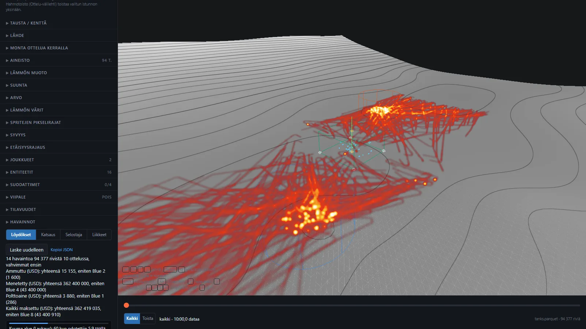
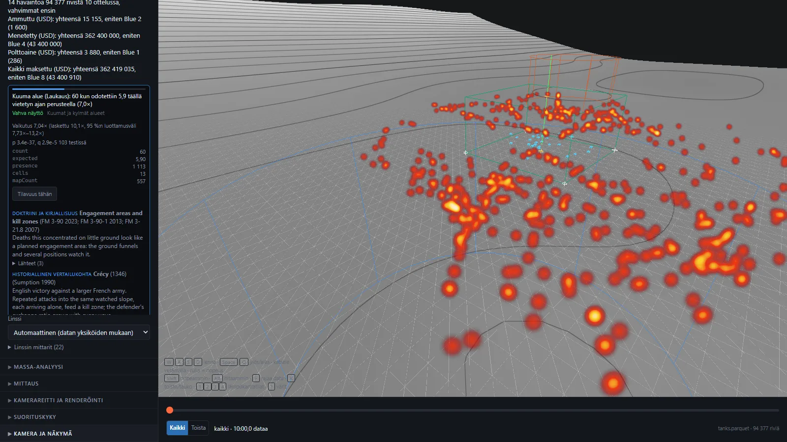
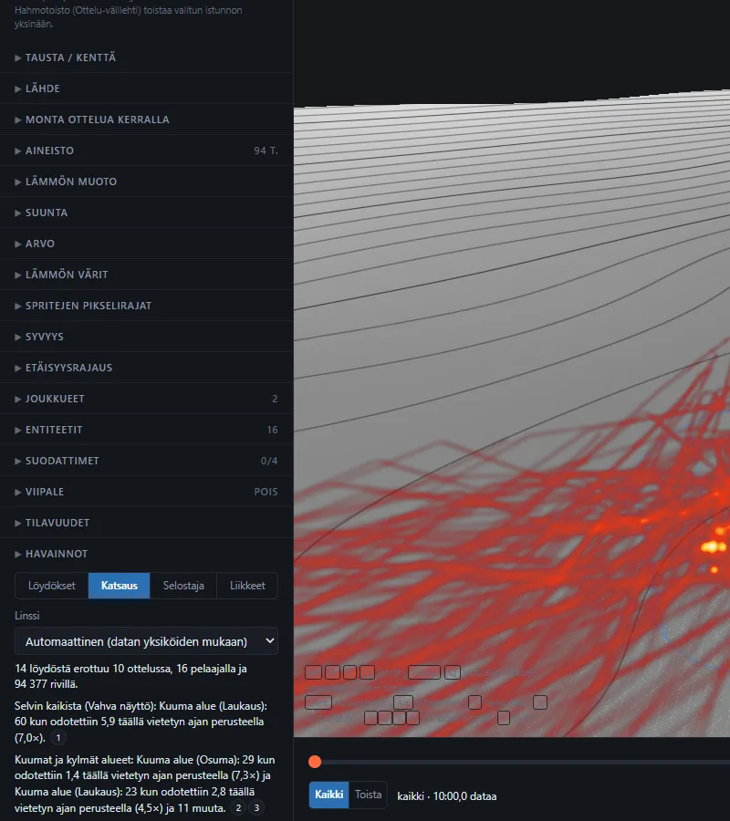
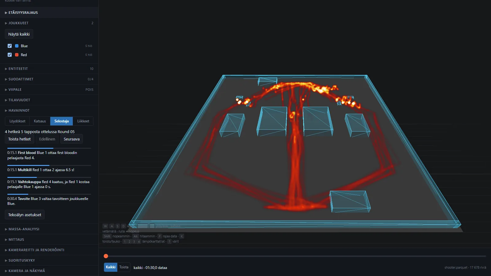

# Havainnot

**Havainnot** etsii ladatusta datasta, mikä erottuu: vahvat asemat, vaaralliset maastot, synnytysloukut, pullonkaulat, pelaajat, jotka ovat selvästi muiden yläpuolella. Se kertoo vahvimmat ensin todisteineen. Sen avulla opit minuutissa, missä ottelu voitettiin tai hävittiin. Sen jälkeen se voi kirjoittaa katsauksen, ja yhdessä toistossa se voi toimia selostajana, joka hyppää suurten hetkien kohdalle.

Kaikki lasketaan selaimessasi. Mikään ei poistu koneeltasi, ellet kytke päälle ulkoista tekoälyä (katso [Ulkoinen tekoäly](#external-ai)).

**Havainnot**-osio on Lämpökartta- ja Ottelu-välilehtien sivupalkissa. Siinä on kolme välilehteä: **Löydökset**, **Katsaus** ja **Selostaja**.

## Löydökset {#findings}

1. Lataa data ja avaa **Havainnot**. Paina **Etsi havaintoja** ("Lasketaan… n %" näyttää edistymisen).
2. Lue luettelo. Jokaisessa löydöksessä on vahvuuspalkki, lause, näytön laatu (*Vahva näyttö*, *Hyvä näyttö* tai *Jonkin verran näyttöä*), tunnistin, joka sen löysi, ja ajoneuvoluokka siellä, missä se on olennainen.
3. **Napsauta löydöstä**: katselin käyttää sen suodattimia, lentää kameran paikkaan, hyppää ajankohtaan ja avaa yksityiskohdat: vaikutuksen 95 %:n välillä, p- ja q-arvot, lasketun näytön ja **Tilavuus tähän** -painikkeen, joka piirtää [tilavuuden](volumes.md) paikan ympärille.
4. **Palauta suodattimet** palauttaa omat suodattimesi. **Kopioi JSON** kopioi koko raportin.

Laskenta käyttää nykyisiä suodattimia, piilotettuja ryhmiä ja valittua ottelua koko aikavälillä. Kun muutat suodattimia myöhemmin, huomautus kertoo siitä; paina **Laske uudelleen**.

Luettelon yläosan rivit (esimerkiksi rahasummat) tiivistävät koko datan ennen löydöksiä.

### Tunnistimet {#the-detectors}

| Tunnistin | Mitä se löytää | Tarvitsee datassa |
|---|---|---|
| **Valta-asemat** | Paikat, joissa tappo-kuolema-suhde on paljon parempi kuin muualla kartalla, sekä *turvallinen maasto*, jossa harva kuolee käytettyä aikaa kohden | tappo- ja kuolematapahtumat |
| **Kuumat ja kylmät alueet** | Paikat, joissa tapahtumatyyppi (laukaukset, osumat, valtaukset ...) tapahtuu paljon enemmän tai vähemmän kuin siellä vietetty aika ennustaa | tapahtumasarake |
| **Avoin maasto ja suoja** | Kuolemat avoimessa maastossa lähellä kentän geometriaa, ja hitaus nopeaa liikettä vastaan | kuolemat; 3D-kenttä geometriaosaan |
| **Spawnit** | Vahvat spawnit, spawn-ansat, turvalliset spawnit, aika ensimmäiseen kosketukseen | aika ja henkilöt |
| **Luokka paikan mukaan** | Ajoneuvoluokka tai pelaajat tekoälyä vastaan, jotka menestyvät paljon paremmin tai huonommin alueella | tappot sekä ajoneuvoluokka tai pelaaja/tekoäly-sarake |
| **Pelaajat** | Pelaajat, jotka tappavat tai kuolevat paljon enemmän tai vähemmän kuin muut samassa luokassa | henkilöt ja tappot |
| **Pullonkaulat ja sivustat** | Pullonkaulat (paljon enemmän ylityksiä kuin ympäröivä maa) ja sivustareitit (harvoin käytettyjä, mutta johtavat tappoihin) | henkilöt |
| **Arvo** | *Kallis maasto* ja *Ansaitseva maasto* | [arvosarakkeet](value-weighting.md) |

Tunnistimet, joita data ei voi ajaa, luetellaan alareunassa syineen.

### Miten löydökset järjestetään {#how-findings-are-ranked}

Jokaista paikkaa tai ryhmää verrataan muuhun karttaan (tarkat binomi- tai nopeustestit). Väärien löydösten osuus pidetään 5 %:ssa (Benjamini-Hochberg). Sattuma voi näyttää kuviolta; tämä pitää väärät hälytykset vähäisinä: näytettyjen löydösten joukossa odotetaan enintään noin yksi kahdestakymmenestä sattumaksi. Vähäisistä tapahtumista syntyvät vaikutukset vedetään kohti "ei vaikutusta" ennen järjestämistä. Luettelossa on enintään 60 löydöstä, ja jokaiselle tunnistimelle varataan muutama paikka kärkipäästä.

## Katsaus {#debrief}

**Katsaus**-välilehti kirjoittaa löydökset lyhyeksi tekstiksi: johdanto, selkein löydös, yksi taktiikasta, yksi tasapainotuksesta, loput tunnistimittain ryhmiteltyinä ja kuinka moni nojaa heikompaan näyttöön. Jokaisessa kappaleessa on numeroidut painikkeet, jotka näyttävät sen löydökset. **Kopioi teksti** kopioi sen.

Sisäänrakennettu kertoja toimii offline-tilassa, kielelläsi. Sen yläpuolella oleva **Linssi**-valitsin (katso [Tietolinssi](knowledge.md)) päättää, mihin kirjallisuuteen kappaleet viittaavat.

### Ulkoinen tekoäly {#external-ai}

**Tekoälyn asetukset** antaa valitsemasi tekoälymallin kirjoittaa katsauksen sen sijaan:

| Asetus | Merkitys |
|---|---|
| **Palveluntarjoaja** | Anthropic (Claude), OpenAI (ChatGPT), OpenRouter, Ollama (paikallinen), LM Studio (paikallinen), llama.cpp-palvelin (paikallinen) tai mikä tahansa OpenAI-yhteensopiva päätepiste |
| **Perus-URL**, **Malli** | Palveluntarjoaja täyttää; **Listaa mallit** kysyy palvelimelta |
| **API-avain** | Lähetetään vain perus-URL-osoitteeseen. Ei koskaan kirjata, ei koskaan tallenneta näkymiin, vientiin tai `.3dheat`-tiedostoihin. Useimmat paikalliset palvelimet eivät tarvitse sitä. |
| **Muista avain tässä selaimessa** | Oletuksena pois: avain unohtuu, kun sivu suljetaan |
| **Käytä ulkoista tekoälyä** | Oletuksena pois |
| **Lähetä pelaajien nimet** | Oletuksena pois: pelaajat lähetetään nimellä P1, P2 ... |

Kirjoita sitten halutessasi kysymys ja paina **Kirjoita tekoälyllä**. Lähetetään vain löydökset ja niiden luvut, ei koskaan datasi rivejä. Vastaus virtaa sisään, ja viitatut löydökset muuttuvat painikkeiksi.

## Selostaja {#caster}

Yhdelle **ottelulle** (valitse yksi, jos useita on ladattu) **Selostaja** löytää hetket, jotka kannattaa katsoa: ensimmäinen tappo, monitappot, vaihtokaupat, ratkaisevat tilanteet, tavoitteiden käännökset, paluut, silmään pistävät pelaajat, pitkät laukaukset.

- Napsauta hetkeä: näkymä vaihtuu toistoon, hyppää juuri sitä edeltävään kohtaan, lentää sinne ja seuraa pelaajaa.
- **Toista hetket** toistaa jokaisen loppuun asti ja siirtyy eteenpäin; **Edellinen** / **Seuraava** siirtyvät hetkien välillä.
- Kun ulkoinen tekoäly on päällä, **Tekoälyn selostus** kirjoittaa selostuksen hetkiluettelosta (tyypit, ajat, nimet tai peitenimet, joukkueet, luokat, etäisyydet).

Se tarvitsee henkilöt ja tappo- tai kuolema-tapahtumat (tai valtaukset); `other`- tai `victim`-sarake mahdollistaa vaihtokaupat ja pitkät laukaukset.

## Tietolinssi {#knowledge-lens}

Löydöstä voi lukea vakiintuneen tiedon **linssin** kautta: sotilasoppi, ilma- ja merisota, kaupunkioperaatiot, pelisuunnittelu ja e-urheilu (tai *Auto*, jonka datan yksiköt valitsevat). Avattu löydös näyttää silloin lähimmän **oppi- ja kirjallisuus**-merkinnän ja **historiallisen rinnakkaisuuden** viitteineen. **Linssin mittarit** laskee kirjallisuuden mittareita datasta (Lanchesterin sovitukset, vaihtosuhteet, voimasuhteet, tulialueet, avainmaasto, vaihtokaupat, aloitteellisuus). Katsaus ja tekoälyn kehote sisältävät ne. Kaikki siitä: [Tietolinssi](knowledge.md).

Linssin mittarit mittaavat myös, miten pelaajat käyttäytyvät joukkona ja ryhmänä: linjautuminen ja kiertely, reittien ohjaaminen, kaistat ja jäljet, tungos, johtajat ja seuraajat, jäljessä tulijat, murtumispiste tappioiden alla, riski menetetyn elämän jälkeen, putket, ostojen yhteneväisyys ja vastaus saapuvaan tulitukseen. Kukin verrataan omaan nollamalliinsa: [Joukkokäyttäytyminen](collective-behaviour.md).

## Datasta, joka saa havainnot toimimaan {#data-that-makes-insights-work}

- sijainnit, joissa on **aika**, **henkilö** ja **joukkue**-sarake;
- **tapahtuma**-sarake tappoineen ja kuolemineen (`kill`, `death`) sekä muut (`hit`, `fire`, `capture` ...);
- **vastapuoli**-sarake (`other`, `victim`) vaihtokauppoja ja suuntia varten;
- **ajoneuvo**- tai **tyyppi**-sarake luokkia varten; `ai`-sarake pelaajia vastaan tekoälyä;
- **istunto** / **ottelu** / **kierros**-sarake, kun ottelut on useita.

[Esimerkkidatassa](demo-data.md) on kaikki nämä.
