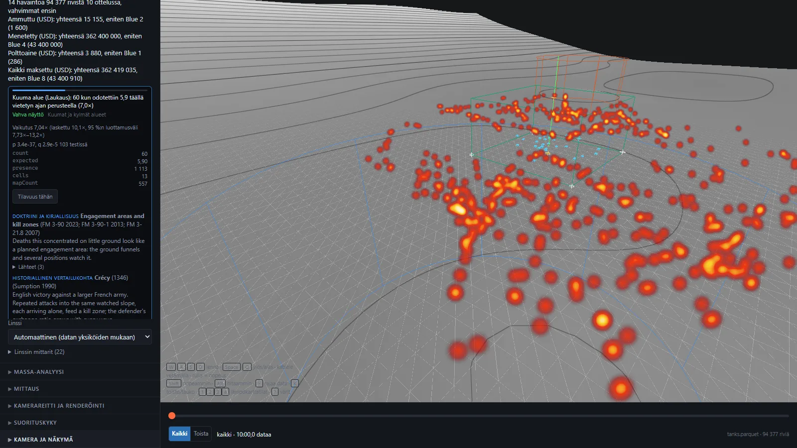

# Tietolinssi

Kun [Havainnot](insights.md) löytää jotakin, tämä osa selittää sen sotahistorian, pelisuunnittelun ja urheiluanalyysin ajatuksilla. Se kertoo myös kirjan tai tutkimuksen, josta ajatus tulee. Käytä sitä oppiaksesi, *miksi* kuvio on tärkeä, eikä vain sitä, että se on olemassa.

## Kokeile {#try-it}

1. Lataa data ja avaa **Havainnot**, ja paina sitten **Etsi havaintoja**.
2. Napsauta havaintoa avataksesi sen.
3. Lue **Doktriini ja kirjallisuus** ja **Historiallinen vertailukohta**. Täydet lähdeviitteet ovat taitettuina niiden alla.
4. Vaihda **Linssi** (esimerkiksi *Sotadoktriini*), niin näet saman havainnon toisen kirjallisuuden kautta.

## Miten se toimii {#how-it-works}

Havaintopaneeli arvioi havaintonsa kuten ammattianalyytikko: sotadoktriinin ja operaatiotutkimuksen, historiallisten taisteluiden sekä pelisuunnittelun, pelitason suunnittelun ja analytiikan kirjallisuuden kautta. Se tekee tämän offline, katselimen kuratusta tietopohjasta. Kun ulkoinen malli kirjoittaa katsauksen, se saa saman aineiston.

## Mitä paneeli näyttää {#what-the-panel-shows}

- **Linssi** valitsee kirjallisuuden, jonka kautta havainnot luetaan: *Auto* (valitaan datan yksikkötyyppien mukaan: lentokoneet, laivat, maa-ajoneuvot, jalkaväki), *Sotadoktriini*, *Ilmataistelu*, *Meri*, *Kaupunkitaistelu*, *Pelisuunnittelu ja tasapaino*, *E-urheilu*. Valitun linssin ulkopuoliset merkinnät jätetään pois.
- Jokainen avattu havainto näyttää lähimmän **doktriini- ja kirjallisuus**-merkinnän ja lähimmän **historiallisen vertailukohdan**. Täydet lähdeviitteet ovat taitettuina niiden alla.
- **Linssin mittarit** luettelee operaatiotutkimuksen mitat, jotka lasketaan samoista riveistä (alla). Jokaisen mitan kohdalla on sen merkitys ja kirjallisuus.
- **Katsaus** lisää rivejä johtavista havainnoista ja linssin mittareista: "Doktriini ja kirjallisuus: ..." ja "Historiallinen vertailukohta: ...". Jokaisessa on tekijä-vuosi-viitteet ja lähdeluettelo sen alla taitettuna.
- **Kirjoita tekoälyllä** lähettää raporttiin tärkeimmät merkinnät (tiivistelmä, opetus, niihin liittyvät havainnot, täydet lähdeviitteet). Se pyytää mallia viittaamaan niihin tunnuksella, esimerkiksi `{concept.lanchester-square}`, eikä käyttämään muita lähteitä.

Nimiöt on käännetty. Itse tieto on englanniksi.

## Linssin mittarit {#lens-metrics}

Lasketaan havaintotyöntekijässä samalla rivikierroksella kuin ilmaisimet (`src/insights/lensMetrics.ts`). Mitta jätetään pois, jos data ei kanna sitä.

| Mitta | Mitä se mittaa | Tarvitsee |
|---|---|---|
| Lanchesterin sovitus | Kunkin puolen tappiot 20 s:ssa regressoituna molempien puolten elossa olevaan voimaan (Poisson, kvasi-todennäköisyyden virheet). Eksponentit vihollisen ja oman voiman kohdalla testataan neliölakia (tarkka tuli) ja lineaarista lakia (alueen tuli) vastaan | aika, joukkueet, tappot ja kuolemat |
| Vaihtosuhde | Tappoja kuolemaa kohti puolen ja paikan mukaan. Osuus kuolemista kaikkein tappavimmalla maa-alueella, joka pitää 5 % käytetystä ajasta, verrattuna osuuteen, jonka pelkkä sattuma antaisi näin monella kuolemalla. Kuolemien Gini ajan suhteen. Kuolemanopeuksien Moranin I | tappot ja kuolemat |
| Paikallinen voimasuhde | Omat ja viholliset yksiköt elossa tappojen kantaman sisällä (kantama asetetaan datasta: kaksi kertaa mediaanietäisyys lähimpään viholliseen). Tappojen osuus paikallisesti ylivoimaiselta puolelta ja sen ylivoima siihen nähden, mitä pelkät luvut ennustavat | aika, joukkueet, henkilöt |
| Tulikentät | Näkölinjat tiheimmille tappopaikoille 2,5D-esteiden pinnalla (ratageometria seinän korkeuteen asti tai kävelty maa) verrattuna keskimääräiseen paikkaan. Näkymän ja tappo-osuuden järjestyskorrelaatio | sijainnit; ladattu kenttä terävöittää mittaa; ei ilmalle |
| Energiatila | Ominaisenergia (korkeus plus se korkeus, minkä nopeus voi ostaa) ilmatappajille ja ilmauhreille, vertailtuna Mann-Whitneyn tunnusluvulla | lentokoneluokat, aika, korkeus |
| Avainmaasto | Kuinka usein kukin paikka kuuluu ottelun kolmeen tiheimpään tappopaikkaan | useita otteluita |
| Keskinäinen tuki (vaihdot) | Kuolemat, joihin joukkuetoveri vastaa tappamalla, tappojen kantaman ja 5 s:n sisällä | aika, joukkueet |
| Ensimmäinen isku | Yhteenotot (tapot ryhmiteltyinä otteluittain, 20 s hiljaisuuden mukaan ja kolmen yhteenoton kantaman mukaan), jotka voittaa puoli, joka teki ensimmäisen osuman | aika, joukkueet |
| Salvo-malli | Hughesin salvoyhtälö sovitettuna 20 s:n jaksoihin, joissa laivat ovat kosketuksessa. Laivoja saatetaan toimintakyvyttömiksi hyökkääjää kohti ja pelastetaan puolustajaa kohti. Lanchesterin sovitus pelkille laivoille | laivaluokat, aika, joukkueet |
| Taistelutehokkuus | Tappoja yksikkötuntia kohden kummallakin puolella toiminnassa ja kahden suurimman arvon suhde (taistelutehokkuusarvo Dupuyn merkityksessä) 95 %:n välillä. Myös kunkin puolen osuus tappoista, kun paikalliset luvut ovat tasan | aika, joukkueet |
| Yhteenottoetäisyydet | Lähimmän vihollisen etäisyys tapoissa, laukaisuissa ja kunkin elämän ensimmäisessä laukauksessa (havainnosta yhteenottoon), yksikkötyypeittäin | aika, joukkueet; laukaisut, kun data sisältää ne |
| Tappoketju | Sekuntit tappajan viimeisestä laukaisusta tappoon ja sen ensimmäisestä laukauksesta taistelussa tappoon | aika; laukaisut tai tulitapahtumat |
| Keskittyminen tai hajautuminen | Jokaisessa 20 s:n jaksossa kahden suurimman puolen leviäminen ja tiukemman puolen osuus tappoista | aika, joukkueet |
| Lennot | Kummankin puolen osalta: lennot (lentoonlähdöt tai lentokoneiden synnyt), laskut, menetetyt lentokoneet ja tappot lentokoneella. Menetysnopeus ja tappoja lentoa kohden | lentokoneluokat; lentoonlähdöt tai synnyt |

Datassa, jossa on kierroksia, on lisäksi lähitaistelun ja e-urheilun mittoja: kierroksen voittotodennäköisyys, toimintojen arvo, avausjaksot, vaihdot, kurkkaaja vs. pitäjä, tähtäys, ristituli, apuvälineet, miesetu, viime hetken voitot, asetelmat, asennuksen jälkeinen vaihe, kuolemanloukut ja pelaajan vaikutus. Katso [Lähitaistelu ja kierrokset](close-quarters.md).

Radat ja joukkueet lisäävät joukkokäyttäytymisen mittoja. Ne tulevat joukkotieteestä, joukkoliikkeestä, käyttäytymistaloudesta ja sotapsykologiasta: linjautuminen ja kiertely, reittien laumautuminen, kaistat ja jäljet, ruuhkautuminen, johtajat ja seuraajat, jälkeen jääneet, murtumispiste, riski tappioiden jälkeen, voittoputket, ostosopimus ja tukahduttaminen. Jokaista verrataan omaan nollamalliinsa. Katso [Joukkokäyttäytyminen](collective-behaviour.md).

Aseita, houkuttimia ja rakennuksia ei lasketa yksiköiksi. Kun aserivit nimeävät laukaisevan yksikön (sarake `Shooter` tai `Launcher`, kuten Tacview-pohjaisessa datassa), laukaisu kirjataan sille yksikölle, ja se tunnistetaan nimen tai objektitunnuksen mukaan.

## Miten havainnot kohtaavat kirjallisuuden {#how-findings-meet-the-literature}

Merkinnät ja havainnot kohtaavat **kuviotaksonomian** kautta (`src/insights/knowledge/patterns.ts`). Siihen kuuluvat keskittyminen, paikallinen ylivoima, tarkka ja alueen tuli, kurkut, tappoalueet, näkölinjat, sivustahyökkäys, keskinäinen tuki, energiaetu, synnytyspaine, tasapaino ja muut. Kukin ilmaisintyyppi ja kukin linssin mitta kertoo, mitä kuvioita sen luvut näyttävät (`src/insights/lens.ts`). Kukin tietopohjan merkintä kertoo, mihin kuvioihin se liittyy ja kuinka vahvasti. Merkinnän merkitys havaintoon on painotettu päällekkäisyys. Se skaalataan sen mukaan, kuinka hyvin merkinnän ala (maa, ilma, meri, kaupunki) sopii dataan, ja havainnon omalla vahvuudella. Näytettävä perustelu on havainnon luvut yhdessä lauseessa, ja sen perässä merkinnän opetus.

## Katalogi {#catalogue}

Jokainen kuvio, käsite, menetelmä, historiallinen tapaus, suunnitteluperiaate ja tutkimus lähdeluettelonsa kanssa: katso [Tietokatalogi](knowledge-catalogue.md).

## Kehittäjille {#for-developers}

### Merkintöjen lisääminen {#adding-entries}

1. Valitse tiedosto tyypin mukaan: `concepts.ts` ja `concepts-more.ts`, `methods.ts`, `cases.ts`, `cases-land.ts`, `cases-air-sea.ts`, `cases-esports.ts`, `design.ts` (suunnitteluperiaatteet) tai `studies.ts` kansiossa `src/insights/knowledge/`.
2. Anna sille uusi tunnus `<type>.<slug>` (älä koskaan käytä vanhaa uudelleen), sen linssit, alueet ja kuviot, joihin se liittyy, painoilla 0..1. Lisää kuvio tiedostoon `patterns.ts` vain, kun havainto voi näyttää sen, ja kytke se havaintoon tai mittaan tiedostossa `lens.ts`.
3. Kirjoita tiivistelmä ja opetus **omin sanoin**. Lainauksia vain julkisen alueen teoksista (`pd: true` viitteessä), ja lyhyinä.
4. Viittaa lähteisiin: lisää uudet teokset tiedostoon `refs.ts` tekijöineen, vuosineen, nimineen ja kustantajineen (lehti numeroineen ja sivuineen). URL tai DOI, kun julkinen tietue on olemassa.
5. Aja `npx vitest run src/insights/lens.test.ts` (yksilölliset tunnukset, tunnetut kuviot, ratkeavat viitteet, julkisen alueen lainaukset, tapaukset päivämäärällä ja lopputuloksella) ja `node tools/knowledge-doc.mjs` päivittääksesi [katalogin](knowledge-catalogue.md).
