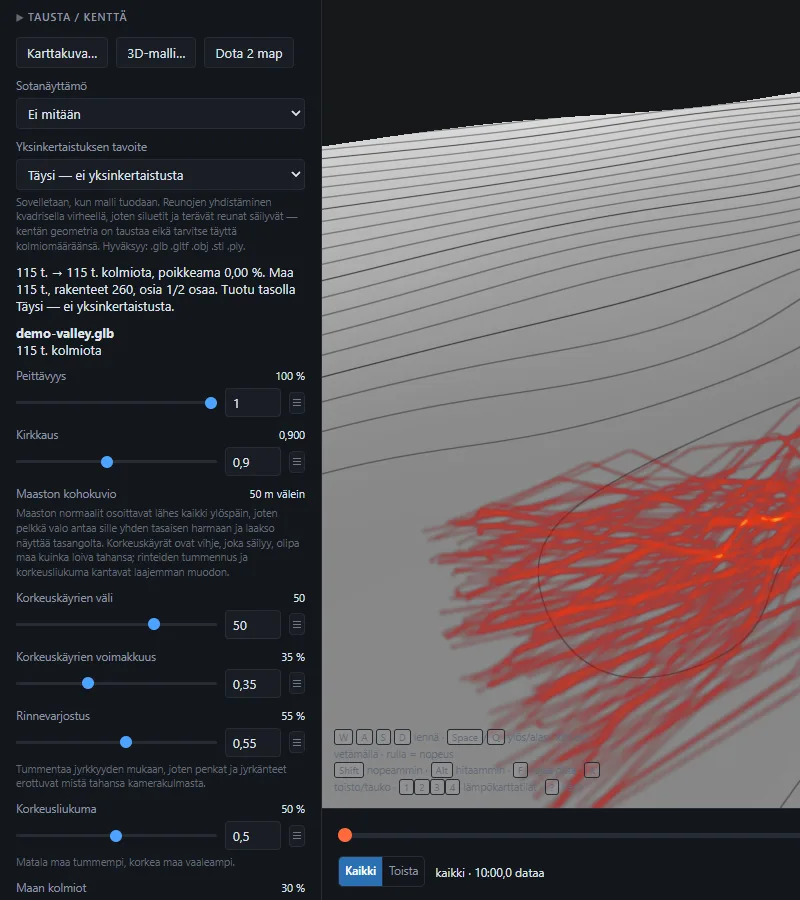

# Kentät ja taustageometria

Kenttä on 3D-paikka, jossa peli tapahtui – kartta, kaupunki tai rata. Kun asetat sen datasi taakse, näet, *missä* lämpö on. Paneeli **Tausta / kenttä** (katso [Sanasto](glossary.md) sanalle "kenttä") antaa kolmenlaista taustaa:

- **karttakuvan**, joka on sidottu maantieteellisesti kahdella ankkurilla – katso [Karttakuvat](map-images.md);
- **3D-kentän** – `.glb`, `.gltf`, `.obj`, `.stl` tai `.ply` – jaettuna maahan, rakenteisiin ja veteen ja yksinkertaistettuna tuonnissa – katso [3D-kentät](model-levels.md) ja [Kentän ulkoasu](level-appearance.md);
- **todellisen maailman taustan** – tallenteelle, joka kertoo, missä maapallolla se on (Tacview ACMI -tiedosto): todellinen maasto, tiet, vesi, lentokentät ja rakennukset, ladattuna avoimesta datasta – katso [Todellinen maailma taustana](world-backdrop.md).

Kun mitään ei ole ladattu, kohtaus on tumma ruudukon ja värillisten akselien kanssa (**Ruudukko** ja **Akselit** kohdassa [Kamera ja kohtaus](camera.md)), ja paneeli sanoo *Ei mitään ladattuna – kohtaus näyttää ruudukon ja akselit. Lisää karttakuva tai kenttämalli antaaksesi lämmölle taustan.*

Kenttä on yhteinen kaikille kolmelle välilehdelle: Kisa-analyysi-välilehdessä ladattu rata on sama kenttä, jonka lämpökartta näyttää.

## Aseta kenttä datasi taakse {#put-a-level-behind-your-data}

1. Lataa data ensin ([Datan lataaminen](getting-data-in.md)), jotta kenttä sovitetaan siihen.
2. Avaa **Tausta / kenttä** sivupalkissa.
3. Paina **Karttakuva…** kuvaa varten tai **3D-malli…** 3D-kenttää varten, ja valitse tiedosto. Todellisen maailman tallennetta varten käytä sen sijaan **Todellinen maailma taustana** -toimintoa tai **Sotanäyttämö**-toimintoa.
4. Odota, että edistymisrivi valmistuu. Iso malli yksinkertaistetaan ensin (katso alla **Yksinkertaistuksen tavoite**).
5. Paina näkymässä **F** sovittaaksesi kaiken. Käytä **Peittävyys**- ja **Kirkkaus**-säätimiä, kunnes lämpö erottuu kentästä.
6. Paina **Tallenna kirjastoon**, jos käytät kenttää uudelleen ([Kenttäkirjasto](level-library.md)).

## Mitä kenttä tekee lämmölle {#what-a-level-does-for-the-heat}

- Se **peittää**: sen takana olevat datapisteet himmennetään pinnoittain, ja maaston takana olevat datapisteet piilotetaan ([Syvyys ja etäisyysrajaus](depth-and-culling.md)). Ilman kenttää ei ole peittämistä.
- [Viipale](slice.md) ja – kun *Leikkaa myös kenttä* on päällä – [etäisyysrajaus](depth-and-culling.md#distance-culling) leikkaavat sen yhdessä lämmön kanssa.
- Se on ainoa asia, jonka [syvyysterävyys](camera.md#depth-of-field) sumentaa ruudukon ja laatikoiden lisäksi.
- 3D-kenttä **leventää kameran kaukotasoa**, kun se on datan kokoa suurempi: lähi- ja kaukotaso kalibroidaan datasta, ja viety kartta, joka on useiden kilometrien levyinen, olisi muuten kokonaan kaukotason takana ja jättäisi näkymän tyhjäksi. Kaukotaso muuttuu 3 × kentän vaakasuuntaiseksi laajuudeksi, kun se on suurempi, lähitaso liikkuu sen mukana (vähintään kauko / 100 000), jotta syvyyden tarkkuus, johon peittäminen nojaa, säilyy, ja lentonopeus nousee vähintään laajuus / 12:een. Sitä vain levennetään, ei koskaan kavenneta.

## Paneeli ylhäältä alas {#the-panel-top-to-bottom}

| Osa | Tiedot |
|---|---|
| **Karttakuva…**, **3D-malli…** | Lataa yksi; se korvaa nykyisen kentän. |
| **Todellinen maailma taustana**, **Unohda karttaruudut** | Vain datalle, jolla on maantieteellinen sijainti: rakentaa todellisen paikan sen alle kentäksi tai poistaa ladatut ruudut. [Todellinen maailma taustana](world-backdrop.md) |
| **Yksinkertaistuksen tavoite** | Kolmioiden budjetti seuraavalle mallituonnille: *Täysi – ei yksinkertaistusta* (oletus), *Korkea – 8 M*, *Keskitaso – 3 M*, *Matala – 800 k*, *Siluetti – 100 k*. [3D-kentät](model-levels.md#simplification) |
| Edistyminen ja **Peruuta** | Dekoodauksen tai tuonnin aikana. |
| Tuontihuomautus | Kolmiot ennen ja jälkeen, maan / rakenteiden / veden jako ja käytetty yksityiskohtataso. |
| Nimi ja koko | `leveys×korkeus px · x × z m/px` kuvalle, `N kolmiota (alkuperäisestä M)` mallille. |
| **Peittävyys**, **Kirkkaus** | Molemmille tyypeille. |
| Kuvan säätimet | **Poista värikylläisyys**, **Käännä pohjoinen/etelä**, **Sijoittelu** (kaksi ankkuria), **Sovita datan rajoihin**, **Korkeus**. [Karttakuvat](map-images.md) |
| Mallin säätimet | Maan kohokuvio, vesi, maan kolmiot, rautalanka, tekstuuri, tallennettu väri, rakenteet, osien luokitus. [Kentän ulkoasu](level-appearance.md) |
| **Tallenna kirjastoon**, **Poista** | [Kenttäkirjasto](level-library.md); Poista vapauttaa kentän. |
| **Kirjasto** | Tässä selaimessa tallennetut kentät. [Kenttäkirjasto](level-library.md) |

## Tämän osion sivut {#pages-in-this-section}

- [Karttakuvat](map-images.md)
- [3D-kentät](model-levels.md) – muodot, osat, luokitus, yksinkertaistus, tekstuurit
- [Kentän ulkoasu](level-appearance.md) – jokainen 3D-kentän säädin
- [Kenttäkirjasto](level-library.md)
- [Todellinen maailma taustana](world-backdrop.md) – todellinen maailma tallenteen alla, avoimesta datasta

Kuinka kentät saadaan ulos peleistä ja moottoreista, on erillisten vientityökalujen asia (katso repositorion [README](https://github.com/Holdi601/3DHeat/blob/main/README.md)); sopimus, johon ne kirjoittavat, on tiivistetty sivulla [3D-kentät](model-levels.md#the-exporter-contract).
