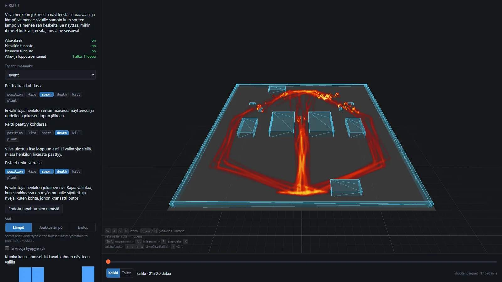

# Viivalämpö

Lämpö näyttää, missä ihmiset seisoivat. Viivat näyttää reitit, joita he kulkivat.

**Viivat** (näppäin 4) on viivalämpö. Jokaisesta [henkilön](glossary.md) näytteestä piirretään viiva seuraavaan näytteeseen. Viiva pehmenee samalla tavalla kuin [piste](glossary.md), mutta se levittyy viivan poikki eikä pisteen ympäri. Se näyttää, minne ihmiset *menivät*, eikä vain missä he seisoivat. Käytävä, jonka läpi kuljettiin kerran, näkyy yhtä selvästi kuin huone, jossa leiriydyttiin. Nopean pelaajan harvat näytteet yhdistyvät yhtenäiseksi reitiksi eivätkä jää pisteviivaksi. Tarvitaan henkilösarake ja aikasarake.

## Käyttö {#how-to-use-it}

1. Paina `4` (tai valitse **Viivat** tilapalkista).
2. Avaa **Reitit** ja tarkista vihreä tarkistuslista: aika-akselin ja henkilön tunnisteen on oltava olemassa.
3. Paina **Ehdota tapahtumien nimistä**, niin reittien alku- ja loppukohdat täyttyvät.
4. Lue tilastorivi: "N reittiä, M niistä päättyy loppuun".
5. Jos viivat hyppivät yli kartan, säädä **Pisin askel** (katso [Hyppyraja](#the-jump-limit)).

Viiva on järkevä vain alun ja lopun välillä. Siksi **Reitit**-paneeli kertoo, mikä rajaa reitin. Kaikki kohdasta [Reitin säännöt](#the-rules-of-a-route) alkaen on yksityiskohtia, jotka voit ohittaa.

## Reitit-paneeli {#the-routes-panel}

Näkyy Viivat-tilassa lämpöpaneelien yläpuolella.

### Mitä datassa on {#what-the-data-has}

Tarkistuslista, joka on vihreä, kun kohta on olemassa, ja keltainen, kun se puuttuu:

| Rivi | Tilat |
|---|---|
| **Aika-akseli** | *on* / *puuttuu - tarvitaan* |
| **Henkilön tunniste** | *on* / *puuttuu - tarvitaan* |
| **Istunnon tunniste** | *on* / *ei yhtään - kaikki rivit ovat yhtä istuntoa* |
| **Alku- ja lopputapahtumat** | *N alkua, M loppua* / *ei valittuja - koko radat* (vihreä vain, kun tapahtumasarake on olemassa ja siinä on ainakin yksi alku ja yksi loppu) |

### Säätimet {#controls}

| Säädin | Merkitys |
|---|---|
| **Tapahtumasarake** | Kategoriasarake, jonka arvot ovat tapahtumia (syntyminen, kuolema, sijainti ...). *Ei yhtään - koko radat*: jokainen henkilön rata kussakin istunnossa on yksi reitti, ja se katkeaa, kun radassa on aukko. Vain latauksessa suodatusta varten säilytettyjä sarakkeita tarjotaan. |
| **Reitti alkaa kohdassa** | Tapahtuma-arvot, jotka aloittavat reitin (syntyminen, uudelleensyntyminen, pudotus). Kun mitään ei ole valittu, reitti alkaa henkilön ensimmäisestä näytteestä ja alkaa uudelleen jokaisen lopun jälkeen. |
| **Reitti päättyy kohdassa** | Tapahtuma-arvot, jotka lopettavat reitin (kuolema, poistuminen, teleportti). Viiva kulkee itse loppuriviin asti. Kun mitään ei ole valittu, reitti päättyy siihen, missä henkilön rata päättyy. |
| **Pisteet reitin varrella** | Tapahtuma-arvot, joiden rivit sijaitsevat reitin varrella. Kun mitään ei ole valittu, mukana on jokainen henkilön rivi. Kavenna valintaa, kun sama sarake sisältää myös rivejä muualla, esimerkiksi siinä kohdassa, jonne kranaatti laskeutui. |
| **Ehdota tapahtumien nimistä** | Täyttää nämä kolme luetteloa arvojen nimien perusteella (alla). |
| **Väri** | *Lämpö*, *Joukkuelämpö* tai *Erotus*. Samat reitit tämän tilan värityksellä: jokainen ryhmä omalla sävyllään tai yksi puoli toista vastaan. Ryhmäluettelo, jako ja värialueet toimivat kuten niissä tiloissa. Oletus *Lämpö*. Joukkuelämpö ja erotus tarvitsevat ryhmäsarakkeen. |
| **Ei viivoja hyppyjen yli** / **Pisin askel** | Jos henkilön seuraava näyte on tätä kauempana, kyseessä on uudelleensyntyminen, teleportti tai pudotus eikä paikka, jossa hän kävi. Siksi kahden näytteen välille ei piirretä viivaa. Arvo täytetään latauksessa, kun data näyttää selvän aukon (alla). Muuten se on pois päältä. Toimii tapahtumasarakkeen kanssa tai ilman. |
| Tilastorivi | `N reittiä, M niistä päättyy loppuun, K osuutta`. Päivittyy muutaman kerran sekunnissa. |

Jokainen luettelo on rivi valintanappeja, yksi arvoa kohti. Yleisin on ensin. Kun osoitat nappia, näkyy sen rivimäärä. Enintään 120 arvoa tarjotaan (*N arvoa lisää ei näytetä*).

Kun valitset toisen tapahtumasarakkeen, ehdotus otetaan käyttöön, jos ehdotus valitsee saman sarakkeen. Muuten luettelot alkavat tyhjinä.

### Ehdotus {#the-suggestion}

Jokaisessa latauksessa ja kun painat **Ehdota tapahtumien nimistä** ([`suggestLineSettings`](https://github.com/Holdi601/3DHeat/blob/main/src/data/lines.ts)):

- **Tapahtumasarake:** ensimmäinen säilytetty kategoriasarake nimeltä `event`, `eventname` tai `eventtype`. Jos sitä ei ole, `kind`, `type` tai `action`. Jos nekään eivät ole, mikä tahansa, jonka nimessä on *event*, *kind*, *action* tai *type*.
- **Alut:** arvot, joissa on *spawn, deploy, join, enter, start, begin, respawn, revive, land/landed/landing, drop*. Poikkeus: jos arvo täsmää myös loppusanaan, sitä ei oteta alkuun.
- **Loput:** arvot, joissa on *death, died, dead, kill/killed, eliminat…, extract, evac, teleport, leave, left, disconnect, quit, exit, end, finish, downed*. Poikkeus: arvot `kill` ja `kills`. Tappo on jotain, minkä tappaja tekee, ei hänen reittinsä loppu.
- **Pisteet:** arvot, jotka ovat täsmälleen *position, location, player location, move, movement, tick, sample* tai *pos*. Kun jokin niistä löytyy, alut ja loput lisätään myös pisteisiin. Kun mitään ei löydy, pisteet jäävät tyhjiksi (jokainen rivi käy).

### Hyppyraja {#the-jump-limit}

Kun ihmiset hyppäävät, askelten pituudet jakautuvat kahteen ryhmään, joiden välissä ei ole juuri mitään. Toinen ryhmä on se matka, jonka henkilö kulkee kahden näytteen välillä. Toinen on kartan leveys. Latauksessa ([`suggestMaxJump`](https://github.com/Holdi601/3DHeat/blob/main/src/data/lines.ts)) askeleet lasketaan neliöpituuden kaksinkertaistumisten mukaan, enintään 16 miljoonaa. Raja asetetaan ensimmäisen yli mediaanin olevan välin keskelle. Välin on oltava vähintään yhden pituuden kaksinkertaistumisen levyinen, sen on sisällettävä alle 0,02 % askelista kussakin luokassa, ja sen yli on askelia. Jos sellaista väliä ei ole, mitään ei leikata. Hyppyä ei silloin voi erottaa nopeasta autosta. Rajan kääntäminen päälle käsin alkaa silloin datan lävistäjän kymmenesosasta.

Rajan yläpuolella oleva kaavio näyttää, kuinka pitkiä askeleet todella ovat, ja rajan kohdalla on viiva. Palkit rajan oikealla puolella eivät piirry. Molemmat akselit ovat logaritmisia, koska hypyt voivat olla sadasosa askelista ja tuhat kertaa pitempiä. Osoita palkkia, niin näet sen välin ja osuuden. Napsauta kaaviota, niin raja siirtyy sinne. Sen alla näkyy rajan yli menevien askelten osuus.

## Reitin säännöt {#the-rules-of-a-route}

Rivejä käydään läpi aikajärjestyksessä henkilöittäin ([`buildLines`](https://github.com/Holdi601/3DHeat/blob/main/src/data/lines.ts)):

1. [Jaettua nimeä](sessions-persons-groups.md#names-worn-by-several-things-at-once) kantavat rivit ohitetaan kokonaan.
2. Kun pisteitä on valittu, rivi, joka ei ole alku, loppu eikä piste, ohitetaan.
3. Rivejä seurataan henkilöittäin ja istunnoittain. Henkilöllä, jonka istunnot lomittuvat aikajärjestyksessä, on siis yksi reitti kussakin. Reitti suljetaan, kun edellisellä rivillä ei ollut seuraajaa (sen [elinaika](sessions-persons-groups.md#person) on "none"). Reitti ei koskaan ylitä istuntorajaa eikä aukkoa, jolla latauksen mukaan ei ole seuraavaa näytettä. Se, millä reitillä rivi on, lasketaan kerran ja säilytetään, 4 tavua riviä kohti. Siksi pisimmän askeleen muuttaminen ei toista tätä osaa.
4. **Alku**-rivi sulkee kaikki avoimet reitit ja avaa uuden siitä kohdasta.
5. Kun alkuja on valittu, rivi reitin ulkopuolella ohitetaan. Ilman alkuja mikä tahansa ei-loppu-rivi reitin ulkopuolella avaa reitin.
6. Muu rivi reitin sisällä lisää **osuuden** reitin edellisestä rivistä tähän riviin.
7. **Loppu**-rivi, joka jatkaa reittiä, sulkee sen osuuden jälkeen. Reitti lasketaan silloin *päättyväksi loppuun*.
8. Askel, joka on pidempi kuin **Pisin askel**, sulkee reitin siihen kohtaan, ja uusi reitti alkaa kaukaisemmasta päästä. Tämä ei päde, jos rivi on loppu. Viivaa ei piirretä askeleen yli, ja tilastorivi laskee askeleen mukaan.

Jokainen osuus tallennetaan sen *loppu*-riviin. Osuudet pysyvät siis aikajärjestyksessä. [aikajana](timeline.md)-ikkuna, näytteenotto, [suodattimet](filters.md), ryhmien näkyvyys ja erotuksen etumerkki toimivat niihin samoin kuin pisteisiin. Suodatin koskee siksi riviä, johon osuus päättyy.

## Toisto {#playback}

**Kaikki**-tilassa jokainen reitti piirretään kokonaisena. **Toista**-tilassa jokainen henkilö on piste, joka liikkuu näytteidensä välillä ja piirtää reittinsä perässään:

- osuutta, joka alkaa soittopään jälkeen, ei piirretä;
- osuus, jossa henkilö on kesken, piirretään hänen interpoloituun paikkaansa asti, ja päässä on loppukorkki;
- lämpö häipyy **hännässä**. Kertyvällä historialla häntä on rajaton, ja koko tähänastinen reitti pysyy. Ikkunalla se häipyy nollaan **Jakson** aikana (oletus 30 s). Elinaika-tilassa häntä on myös *Jakso*, ja Viivat-tilassa aikajana näyttää *Jakso*-laatikon myös tälle historialle. Se korvaa *Varaelinaika*- ja *Häivytys*-asetukset, joita viivalämpö ei käytä.

Toiston aikana jokainen kuva piirretään kokonaisena eikä kerättynä. Pään liikkuessa joka kuvassa liukuva keskiarvo levittäisi jokaisen pään viivaksi.

## Kehittäjille {#for-developers}

### Muisti {#memory}

Reitit rakennetaan pääsäikeessä, kun Viivat-tilaan siirrytään (tai reittiasetukset muuttuvat). Ne vapautetaan, kun tilasta poistutaan. Muistissa rivi vie 5 tavua. GPU:lla rivi vie 8 tavua. Se sisältää osuuden alkupisteen, joka on kvantisoitu 16 bittiin akselia kohti datan rajauslaatikon sisällä, sekä sen liput.

### Miten viiva piirretään {#how-a-line-is-drawn}

Molemmat taustaosat piirtävät jokaisen osuuden loppuriviltä **18 kärkipisteellä** ([`lineHeatVs`](https://github.com/Holdi601/3DHeat/blob/main/src/render/webgl2/shaders.ts) ja sen WGSL-vastine):

- Puolileveys kummassakin päässä on [pisteen säde](sprite-shape.md#sprite-radius) kyseisen pään etäisyydellä, pikselirajoitukset mukaan lukien. Viiva, joka on kapeampi kuin 2,5 px, piirretään 2,5 px leveänä, ja sen lämpöä pienennetään vastaavasti. Ohuet viivat eivät siis katoa eivätkä kirkastu.
- Lämpö häipyy viivan **poikki** samalla alueella kuin piste: häivytys tai käyrä, keskikohdan ja reunan voimakkuus.
- Pyöreät korkit piirretään **vain** kohtiin, joissa reitti alkaa tai päättyy. Peräkkäisten osuuksien liitokset eivät siis muodosta helmiä narussa.
- Geometria rakennetaan ruutukoordinaateissa ja interpoloidaan siellä lineaarisesti. Häivytys pysyy siis viivan keskellä, miten syvyyteen se meneekin. Lähimpään tasoon ylittävä osuus leikataan siinä eikä pudoteta.

Pisteiden ja viivojen lämpö on eri määrä riviä kohti. Siksi kyllästys mitataan uudelleen, kun vaihdat niiden välillä ([Väri ja valotus](colour-and-exposure.md#auto-exposure)).
