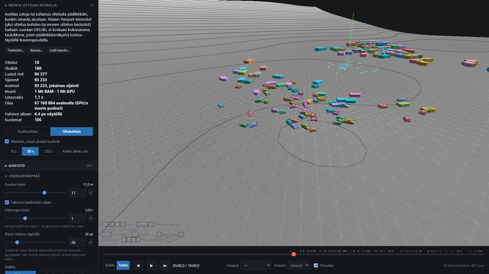

# Monta ottelua kerralla

**Monta ottelua kerralla** toistaa paljon otteluita päällekkäin, joten näet, mihin kunkin ottelun pelaajat yleensä menevät. Sitä käytetään satojen tai tuhansien otteluiden vertailuun yhdessä kuvassa.

Jokainen ottelu alkaa omasta alustaan, ja sen yksiköt liikkuvat hahmoina. Tiedostot menevät suoraan näytönohjaimelle, eikä koko taulukkoa rakenneta. Siksi se toistuu sujuvasti silloin, kun tavallinen lataus loppuisi muistista.

## Käyttö {#how-to-use-it}

1. Avaa **Monta ottelua kerralla** Heatmap-sivupalkista.
2. Paina **Tiedostot…** (valitse monta tiedostoa), **Kansio…** (kansio ja sen alikansiot) tai **Lisää kansio…** (lisää ladattuun).
3. Katselija vaihtaa hahmopeitenäkymään ja alkaa alusta. Paina **Toista**.

Jokainen tiedosto on yksi ottelu (tai sisältää useita). Parquet-tiedostot ja [`.3dheat`](container.md)-säiliöt toimivat. Tiedostossa pitää olla sijainti-, aika- ja yksikkösarake. Nimi-, tyyppi- ja puolisarakkeet säilytetään. Muut tiedostot sekä muuntajien sivutiedostot (lento, viestit, tapahtumat, chat, tavoitteet) ohitetaan. Tavallista taulukkoa varten katso [Datan lataaminen](getting-data-in.md).

## Asetukset {#settings}

| Asetus | Mitä se tekee |
|---|---|
| **Joukkueittain** / **Otteluittain** | Värittää puolen mukaan tai yhden värin per ottelu. |
| **Merkitse, missä yksiköt kuolivat** | Merkki siihen kohtaan, missä kukin yksikkö kuoli, 10 s, 30 s, 120 s tai kaikki tähän mennessä. |

Paneeli näyttää, kuinka monta ottelua, yksikköä, riviä ja sijaintia luettiin, käytetyn muistin ja latausajan. *Tilaa* on, kuinka monta sijaintia lisää näytönohjain vielä ottaisi. *Hahmot alkaen* on koko näytöllä, jonka alle yksikkö piirretään pienenä nuolena hahmonsa sijaan.

Hahmojen ulkoasussa käytetään samoja säätimiä kuin [ottelun toistossa](match-replay.md#figures): **Hahmojen koko**, **Pienin hahmo näytöllä** ja **Etäältä**.

## Vinkit {#tips}

- Kun kaikki ei mahtuisi muistiin, sijainteja harvennetaan (säilytetään vain sijainti muutaman metrin välein), ja paneeli kertoo sen.
- Lämpötilat toimivat myös peitteen datan kanssa.
- Tilastoja tuhansista otteluista ilman niiden piirtämistä varten katso [Massa-analyysi](mass-analysis.md).
