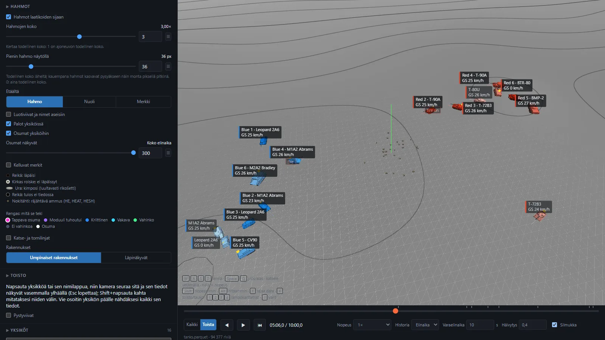
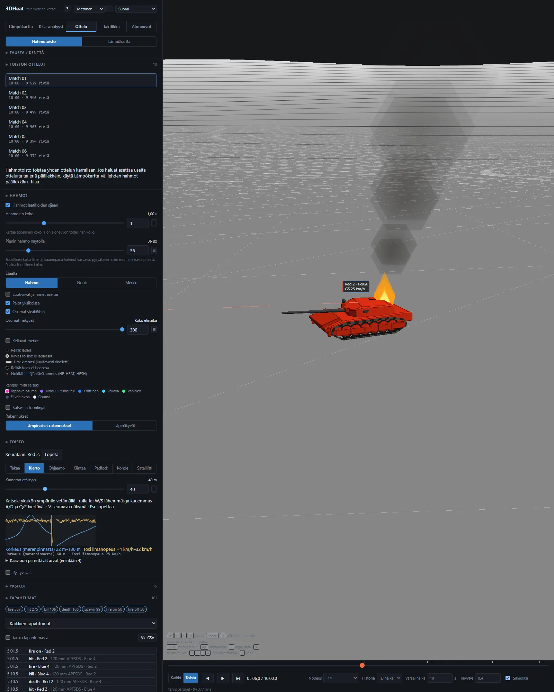
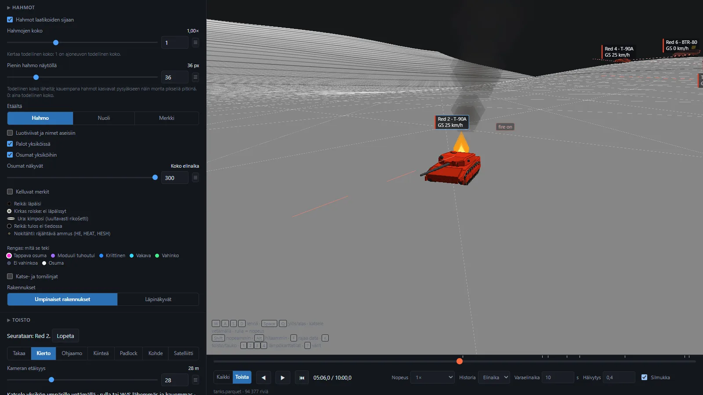
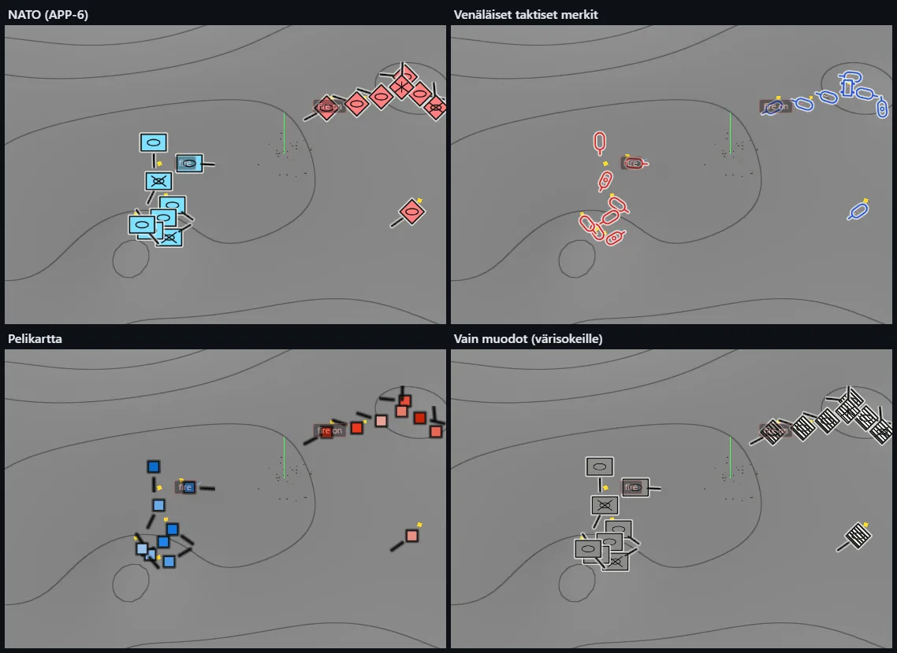
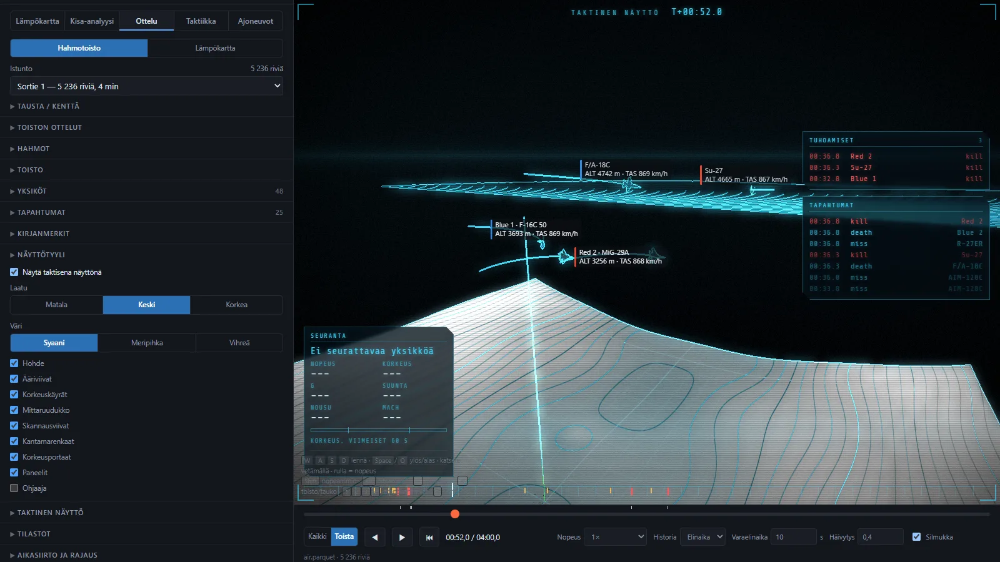
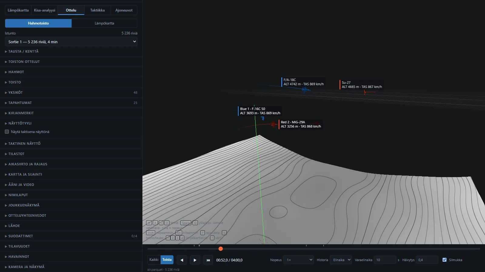

# Ottelun toisto

Toisto on elokuva ottelusta, jossa jokainen pelaaja on piirretty sellaisena, mitä hän ajoi. Sen avulla voit katsoa taistelun uudelleen, seurata yhtä yksikköä ja nähdä, kuka osui ketä.

Laukaukset, osumat, palot ja raadot piirretään kentän yksiköille ja tavoitteille. Kamerat, nimiöt ja taktinen näyttö auttavat lukemaan taistelua. Tunnetko Tacviewin? [Tacview-vastaavuus](tacview-parity.md) näyttää, missä sen jokainen työkalu on.

## Toiston aloittaminen {#start-a-replay}

1. Lataa tallenne valitsemalla **Source → Files…** tai pudottamalla se Source-paneeliin (mikä tahansa taulukko, jossa on **person**- ja **time**-sarake, Tacview-tiedosto, muunnettu toisto tai [`.3dheat`](container.md)-ottelu). Katso [Datan lataaminen](getting-data-in.md).
2. Avaa **Match**-välilehti ja valitse **Figure replay**, tai valitse **Figure overlay** Heatmap-välilehden tilapalkista.
3. Valitse kohdasta **Toiston ottelut** yksi ottelu, kaikki kerralla tai useita.
4. Paina aikajanan **Toista**-painiketta (tai `K`). Vedä aikajanaa, jos haluat hypätä.

Hahmot korvaavat laatikot jokaiselle yksikölle, jonka nimi tai tyyppi tunnetaan (katso [Hahmot](figures.md)). Data ilman nimi- tai tyyppissaraketta piirretään sotilaina.

## Hahmot {#figures}

| Asetus (osio **Hahmot**) | Oletus | Mitä se tekee |
|---|---|---|
| **Hahmot laatikoiden sijaan** | päällä | Pois päältä piirtää tavalliset laatikot. |
| **Hahmojen koko** (kertaa todellinen koko) | 1 | 1 on todellinen koko; 0,25–20 kertaa (logaritminen asteikko). Suurempi auttaa kaukaa. |
| **Pienin hahmo näytöllä** | 36 px | Kaukaiset hahmot kasvavat, jotta ne pysyvät tämän kokoisina, 0–200 px; 0 pitää todellisen koon. |
| **Etäältä**: Hahmo, Nuoli, Merkki | Hahmo | Mikä kaukainen yksikkö on. |
| **Merkit** | NATO (APP-6) | NATO (APP-6), venäläiset taktiset merkit, **Pelikartta**-kuvakkeet tai **Vain muodot (värisokeille)**. |
| **Merkin koko**, **Minun puoleni**, **Vihollinen / Neutraali**, **Suuntaviivat** | 28 px (12–64), automaattinen, vihollinen, päällä | Miltä merkit näyttävät ja mikä puoli on ystävällinen. |
| **Pystyviivat** | päällä | Viiva jokaisesta yksiköstä suoraan alas maahan, jotta korkeudet erottuvat 3D-näkymässä. |
| **Luotiviivat ja nimet aseisiin** | pois | Viivat maahan ja nimiöt ohjuksille ja pommeille. |
| **Palot yksiköissä** | päällä | Liekit siitä hetkestä, kun yksikkö syttyy, siihen asti kun se sammutetaan. |
| **Osumat yksiköihin** | päällä | Merkit kohdista, joihin laukaukset osuivat (alla). **Osumat näkyvät**: 1–300 sekuntia tai **Koko elinaika**. **Kelluvat merkit**: merkit, jotka piirretään pinnan yläpuolelle. |
| **Katse- ja tornilinjat** | pois | Katkoviiva: minne pelaaja katsoo; yhtenäinen: minne tykki osoittaa. |
| **Rakennukset** | kiinteä | Kiinteät tai läpinäkyvät rakennukset, kun kenttä ne piirtää. |

### Merkit etäisyydellä {#symbols-at-a-distance}

Kun yksikkö olisi pienempi kuin **Pienin hahmo näytöllä**, siitä voi tulla merkki, joka pysyy luettavana. Muoto kertoo lajin (esimerkiksi pyöristetty laatikko ja telamerkki panssarille); väri kertoo puolen. Avaa **Merkit**-valikko, jos haluat vaihtaa tyyliä.

### Osumamerkit, raadot ja palot {#hit-marks-wrecks-and-fires}

- **Osumamerkit** istuvat pinnalla, johon laukaus osui, hahmon mittakaavassa. Ulkonäkö kertoo, mitä tapahtui: reikä (meni läpi), kirkas roiske (ei mennyt läpi), vako (liukui ohi) tai nokitähti (räjähtävä ammus). Värillinen rengas kertoo vaikutuksen: tappava osuma, moduuli tuhoutui, kriittinen, vakava, vahinko, ei vahinkoa, osuma. Vie osoitin merkin päälle, niin näet ammuksen nimen.
- Tuhoutunut yksikkö piirretään **palaneena** raatona siitä hetkestä kuin se kuolee, kunnes se syntyy uudelleen tai poistetaan; sen merkki on yliviivattu.
- **Palot** palavat yksikössä siitä hetkestä, kun se syttyy, kunnes se sammutetaan.
- **Tornit** kääntyvät sinne, minne data kertoo tykin osoittavan (tai ilman sitä sinne, minne pelaaja katsoo).

### Aseet, harhautukset ja jäljet {#weapons-decoys-and-tracers}

Kun **Aseet, laukaukset ja osumat** on päällä (osio Joukkueen katselija): ohjukset, raketit, pommit ja torpedot lentävät omina hahmoinaan savujäljen kanssa; luodit ja kranaatit ovat jälkiä; osumat ja räjähdykset välähtävät. Jälki, joka piirretään **katkoviivalla**, on laskettu osumasta, koska datassa ei ollut laukausta. Soihdut ja häiventeet piirretään harhautuksina; ne piilotetaan yksikköluettelosta, ellei *Harhautukset ja kranaatit* ole valittu.

## Kamerat {#cameras}

Napsauta yksikköä tai sen nimilappua, jos haluat **seurata** sitä. Osio **Toisto** tarjoaa **Takaa**, **Kierto**, **Ohjaamo** (näytöllä head-up-näyttö, `H`), **Kiinteä**, **Padlock**, **Kohde** ja **Satelliitti**. `V` vaihtaa niiden välillä, **Kameran etäisyys** asettaa etäisyyden. Esc pysäyttää seurannan.

- **Kahden yksikön näkymä**: valitse **Kohde** (tai Ctrl- tai Alt-napsauta yksikköä), jotta näet sen seurattavan yksikön näkökulmasta; **Vaihda** vaihtaa ne keskenään.
- **Mitta**: Shift-napsauta kahta yksikköä, niin näet niiden välisen suunnan, etäisyyden ja korkeuseron.
- **2D-kartta** (`M`): kulmanäkymä tai koko näkymä, jäljet ja nimet mukana.
- **Kirjanmerkit** (`B`): tallentavat hetken ja kameran. Tallenteen omat tuhoamiset, kuolemat ja merkinnät näkyvät myös luettelossa.
- **Tapahtumat**: jokainen tapahtuma aikajärjestyksessä; napsautus hyppää siihen. `Page Up` ja `Page Down` hyppivät tapahtumien välillä; **Tauko tapahtumassa** pysähtyy jokaiseen.

## Taktinen näyttö {#tactical-display}

Osio **Taktinen näyttö** piirtää ei yhdellekään yksikölle, valituille, kaikille tai yhdelle lajille (ilma-alukset, maayksiköt, laivat, aseet): nopeusvektorit ja edessä oleva reitti, nokka- ja nostolinjat, tutkakartiot, lukitukset, tietoliikenneyhteydet, taisteluvyöhykkeet ja -linjat, näköyhteydet, paikat, joihin pelaajat katsovat (näkökartiot), tornin tähtäys ja tallenteen kamera.

### Näyttötyyli {#display-style}

`T` (tai **Näytä taktisena näyttönä** -kytkin) vaihtaa ulkoasun tutkanäytön tyyliin: hehku, ääriviivat, korkeuskäyrät, mittaruudukko, skannausviivat, etäisyysrenkaat, korkeusasteikot, paneelit tuhoamisilla ja tapahtumilla sekä **Ohjaaja**, joka siirtää kameran tapahtumiin itsekseen.

## Tavoitteet {#objectives}

Kun ottelu tulee tavoitteineen, osio **Tavoitteet** piirtää ne kentälle: valtausalueet (omistajan ja valtauksen edistymisen kanssa), tukikohdat, lentokentät, alueet ja pommituskohteet. Jokainen taso voidaan kytkeä päälle tai pois, ja niissä on nimiöt. Ne näkyvät maan läpi. Kun useita pelitiloja on ladattu, **Tila** suodattaa ottelut pelitilan mukaan. Tavoitteet tulevat muuntajan ottelutiedostosta, joka on tallenteen vieressä tai [`.3dheat`](container.md)-säilön sisällä.

Rainbow Six Siege -otteluissa tulevat mukana pommipaikat: kunkin paikan kaksi huonetta piirretään lattialleen ääriviivoina nimineen. Ne päätellään siitä, missä pelaajat seisoivat, kun peli nimesi huoneen. Kartan paikka, jota ottelussa ei pelattu, tulee muuntimen paikkataulukosta ympyränä. Toistossa toistokohdan kierroksen paikka hehkuu meripihkan värisenä, muut pysyvät harmaina. Ne kuuluvat valtausalueiden tasoon.

## Nimiöt ja tilastot {#labels-and-statistics}

- **Nimiöt**: säännöt lajeittain (**Valitut**, **Ilma-alukset**, **Maa**, **Laivat**, **Aseet**, **Tekoäly**): näytetäänkö vai ei, mitkä arvot ja **Prioriteetti** sille, kuka saa tilan, kun nimiöt menevät päällekkäin. **Pidä nimilaput erillään** siirtää nimilapun yksikkönsä viereen, kun se peittäisi toisen, ja jättää sen pois, jos tilaa ei ole. **Nimilappujen koko** on 60–250 %. **Takaisin nimeen, ajoneuvoon, korkeuteen ja nopeuteen** palauttaa säännöt.
  - Maayksiköissä näkyvät aluksi nimi, ajoneuvo ja nopeus.
  - Ilma-aluksissa näkyvät aluksi nimi, ajoneuvo, korkeus ja nopeus.
  - Laivoissa näkyvät aluksi nimi, ajoneuvo, nopeus ja suunta.
  - Vie osoitin yksikön päälle, niin näet kaikki sen arvot.
- **Tilastot**: joukkueittain ja yksiköittäin: tuhoamiset, kuolemat, laukaukset, osumat, osumasuhde, lentoonlähdöt, laskut, ilmassa oloaika, huippunopeus, korkeus ja G, matka. Vienti CSV-muodossa.
- **Kaaviot**: yksikön arvot ajan funktiona, kahden yksikön vertailu tai yksi arvo toisen suhteen.

## Monta ottelua kerralla {#many-matches-at-once}

Kun haluat asetella satoja tai tuhansia otteluita päällekkäin, katso [Monta ottelua kerralla](many-matches.md). Hahmojen yksityiskohdat (savu, tuli ja muut ajastetut tehosteet): [Hahmot päällekkäin -näkymässä](figure-replay.md). Tacview-ominaisuuslista: [Tacview-vastaavuus](tacview-parity.md), tämän sivun alasivu.
