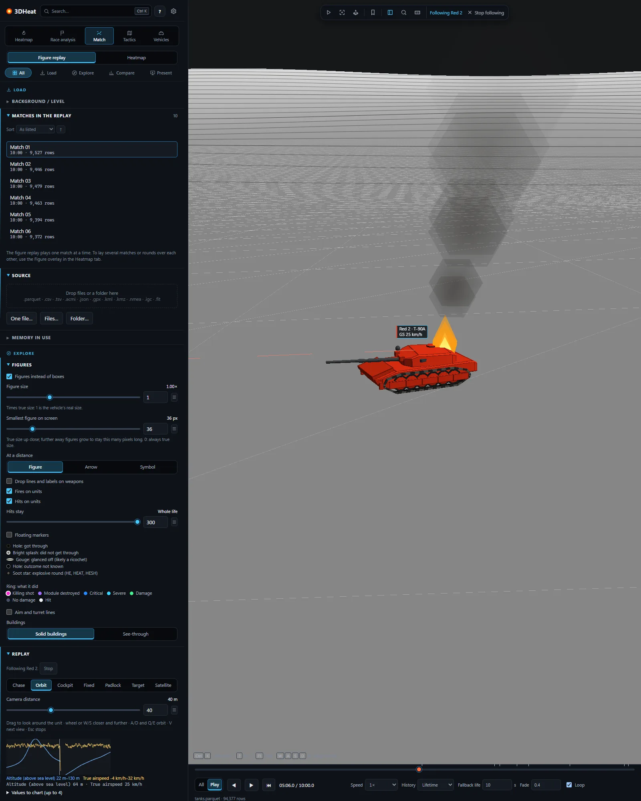

# Ottelun toisto

Toisto on elokuva ottelusta, jossa jokainen pelaaja on piirretty sellaisena, mitä hän ajoi. Sen avulla voit katsoa taistelun uudelleen, seurata yhtä yksikköä ja nähdä, kuka osui kenteen.

Laukaukset, osumat, palot ja raadot piirretään kentän yksiköille ja tavoitteille. Kamerat, nimiöt ja taktinen näyttö auttavat lukemaan taistelua. Tunnetko Tacviewin? [Tacview-vastaavuus](tacview-parity.md) näyttää, missä sen jokainen työkalu on.

## Aloita toisto {#start-a-replay}

1. Lataa tallenne **Lähde → Tiedostot…** -valinnalla tai pudottamalla se Lähde-paneeliin (mikä tahansa taulukko, jossa on **henkilö**- ja **aika**-sarake, Tacview-tiedosto, muunnettu toisto, [`.3dheat`](container.md)-ottelu). Katso [Datan lataaminen](getting-data-in.md).
2. Avaa **Ottelu**-välilehti ja valitse **Hahmotoisto**, tai valitse **Hahmot päällekkäin** Lämpökartta-välilehden tilapalkista.
3. Kohdassa **Toiston ottelut** valitse yksi ottelu, kaikki kerralla tai useita.
4. Paina aikajanalla **Toista** (tai `K`). Vedä aikajanaa hypätäksesi.

Hahmot korvaavat laatikot jokaiselle yksikölle, jonka nimi tai tyyppi tunnetaan (katso [Hahmot](figures.md)). Data ilman nimi- tai tyyppisaraketta piirretään sotilaina.

## Hahmot {#figures}

| Asetus (osio **Hahmot**) | Oletus | Mitä se tekee |
|---|---|---|
| **Hahmot laatikoiden sijaan** | päällä | Pois päältä piirtää tavalliset laatikot. |
| **Hahmojen koko** (kertaa todellinen koko) | 1 | 1 on todellinen koko; 0,25-20 kertaa (logaritminen asteikko). Suurempi auttaa kaukaa. |
| **Pienin hahmo näytöllä** | 36 px | Kaukana olevat hahmot kasvavat pysyäkseen tämän kokoisina, 0-200 px; 0 pitää todellisen koon. |
| **Etäältä**: Hahmo, Nuoli, Merkki | Hahmo | Mitä kaukana oleva yksikkö muuttuu. |
| **Merkit** | NATO (APP-6) | NATO (APP-6), venäläiset taktiset merkit, **Pelikartta**-kuvakkeet tai **Vain muodot (värisokeille)**. |
| **Merkin koko**, **Minun puoleni**, **Vihollinen / Neutraali**, **Suuntaviivat** | 28 px (12-64), automaattinen, vihollinen, päällä | Miltä merkit näyttävät ja mikä puoli on ystävällinen. |
| **Pystyviivat** | päällä | Viiva jokaisesta yksiköstä suoraan maahan, jotta korkeudet näkyvät 3D:ssä. |
| **Luotiviivat ja nimet aseisiin** | pois | Viivat maahan ja nimet ohjuksille ja pommeille. |
| **Palot yksiköissä** | päällä | Liekit siitä hetkestä, kun yksikkö syttyy, kunnes palo sammutetaan. |
| **Osumat yksiköihin** | päällä | Merkit kohdista, joihin laukaukset osuivat (alla). **Osumat näkyvät**: 1-300 sekuntia tai **Koko elinaika**. **Kelluvat merkit**: pinnan yläpuolelle piirretyt merkit. |
| **Katse- ja tornilinjat** | pois | Katkoviiva: mihin pelaaja katsoo; yhtenäinen: mihin tykki osoittaa. |
| **Rakennukset** | yhtenäinen | Läpinäkymättömät tai läpikuultavat rakennukset, kun kenttä ne piirtää. |

### Merkit etäisyydellä {#symbols-at-a-distance}

Kun yksikkö olisi pienempi kuin **Pienin hahmo näytöllä**, siitä voi tulla merkki, joka pysyy luettavana. Muoto kertoo lajin (esimerkiksi pyöristetty laatikko, jossa on telaraitamerkki panssarille); väri kertoo puolen. Avaa **Merkit**-valikko vaihtaaksesi tyyliä.

### Osumamerkit, raadot ja palot {#hit-marks-wrecks-and-fires}

- **Osumamerkit** istuvat pinnalla, johon laukaus osui, hahmon mittakaavassa. Niiden ulkonäkö kertoo, mitä tapahtui: reikä (meni läpi), kirkas roiske (ei mennyt läpi), vako (lipesi pinnasta), nokitähti (räjähtävä kranaatti). Värillinen rengas kertoo, mitä se teki: tappava osuma, moduuli tuhoutui, kriittinen, vakava, vaurio, ei vauriota, osuma. Vie hiiri merkin päälle nähdäksesi laukauksen nimen.
- Tuhoutunut yksikkö piirretään **palaneena** raatona kuolemasta alkaen, kunnes se herää uudelleen tai poistetaan; sen merkki on yliviivattu.
- **Palot** palavat yksikössä siitä hetkestä, kun se syttyy, kunnes se sammutetaan.
- **Tornit** kääntyvät sinne, minne data kertoo tykin osoittavan (tai ilman sitä sinne, minne pelaaja katsoo).

### Aseet, harhautukset ja jäljittimet {#weapons-decoys-and-tracers}

Kun **Aseet, laukaukset ja osumat** on päällä (Joukkuenäkymä-osio): ohjukset, raketit, pommit ja torpedot lentävät omina hahmoinaan savujäljen kanssa; luodit ja kranaatit ovat jäljittimiä; iskut ja räjähdykset välähtävät. Jäljitin, joka piirretään **katkoviivana**, on laskettu osumasta, koska datassa ei ollut laukausta. Soihdut ja metalliliuskat piirretään harhautuksina; ne piilotetaan yksikköluettelosta, ellei *Harhautukset ja kuoret* ole valittuna.

## Kamerat {#cameras}

Napsauta yksikköä tai sen nimiötä **seurataksesi** sitä. **Toisto**-osio tarjoaa **Takaa**, **Kierto**, **Ohjaamo** (näytön tietonäytöllä, `H`), **Kiinteä**, **Padlock**, **Kohde** ja **Satelliitti**. `V` kiertää niiden läpi, **Kameran etäisyys** asettaa etäisyyden. Esc pysäyttää.

- **Kahden yksikön näkymä**: valitse **Kohde** (tai Ctrl/Alt-napsauta yksikköä) katsoaksesi sitä seuratusta yksiköstä; **Vaihda** vaihtaa ne keskenään.
- **Mitta**: Shift-napsauta kahta yksikköä saadaksesi niiden välisen suunnan, etäisyyden ja korkeuseron.
- **2D-kartta** (`M`): kulma- tai koko näkymä, jäljillä ja nimillä.
- **Kirjanmerkit** (`B`): tallentaa hetken ja kameran; tallenteen omat tappot, kuolemat ja merkinnät luetellaan myös.
- **Tapahtumat**: jokainen tapahtuma aikajärjestyksessä; napsautus hyppää sinne. `Page Up` / `Page Down` hyppivät tapahtumien välillä; **Tauko tapahtumassa** pysähtyy jokaiseen.

## Taktinen näyttö {#tactical-display}

**Taktinen näyttö** -osio piirtää joko ei yhtään yksikköä, valitut, kaikki tai yhden lajin (ilma-alukset, maa, laivat, aseet): nopeusvektorit ja edessä oleva reitti, nokka- ja nostolinjat, tutkakartiot, lukitukset, tietoliikenneyhteydet, taisteluvyöhykkeet ja -linjat, näköyhteydet, joihin pelaajat katsovat (näkökartiot), tornin suuntaus ja tallennettu kamera.

### Näyttötyyli {#display-style}

`T` (tai **Näytä taktisena näyttönä** -kytkin) vaihtaa ilmeen tutkanäyttötyyliin: hehku, reunaviivat, korkeuskäyrät, mittaruudukko, skannausviivat, etäisyysrenkaat, korkeusportaat, paneelit tappoineen ja tapahtumineen sekä **Ohjaaja**, joka siirtää kameran tapahtumiin itsestään.

## Tavoitteet {#objectives}

Kun ottelun mukana tulevat tavoitteet, **Tavoitteet**-osio piirtää ne kentälle: valtausalueet (omistajineen ja valtauksen edistymisineen), spawnit, lentokentät, alueet ja pommituskohteet, kukin taso kytkettävissä, nimiöineen. Ne näkyvät maan läpi. Kun useita pelitiloja on ladattu, **Tila** suodattaa ottelut pelitilan mukaan. Tavoitteet tulevat tallenteen vieressä olevasta muuntimen ottelutiedostosta tai [`.3dheat`](container.md)-säiliön sisältä.

## Nimiöt ja tilastot {#labels-and-statistics}

- **Nimiöt**: säännöt lajeittain (**Valitut**, **Ilma-alukset**, **Maa**, **Laivat**, **Aseet**, **Tekoäly**): näytetäänkö, mitkä arvot, ja **Prioriteetti**, joka päättää, kenelle tila annetaan, kun nimiöt menevät päällekkäin. **Pidä nimilaput erillään** siirtää nimiön yksikkönsä viereen, kun se peittäisi toisen, ja jättää sen pois, jos tilaa ei ole. **Nimilappujen koko** on 60-250 %. **Takaisin nimeen, ajoneuvoon, korkeuteen ja nopeuteen** palauttaa säännöt.
  - Maayksiköissä näkyvät nimi, ajoneuvo ja nopeus.
  - Ilma-aluksissa näkyvät nimi, ajoneuvo, korkeus ja nopeus.
  - Laivoissa näkyvät nimi, ajoneuvo, nopeus ja suunta.
  - Vie hiiri yksikön päälle nähdäksesi kaikki sen arvot.
- **Tilastot**: joukkueittain ja yksiköittäin: tappot, kuolemat, laukaukset, osumat, osumasuhde, lentoonlähdöt, laskut, lentoaika, huippunopeus, korkeus ja G, matka. CSV-vienti.
- **Kaaviot**: yksikön arvot ajan yli, kaksi yksikköä vertailtuna tai yksi arvo toista vastaan.

## Monta ottelua kerralla {#many-matches-at-once}

Satojen tai tuhansien otteluiden päällekkäin asettamiseen katso [Monta ottelua kerralla](many-matches.md). Hahmojen yksityiskohdat (savu, palo ja muut ajastetut tehosteet): [Hahmot päällekkäin -näkymän hahmot](figure-replay.md). Tacview-ominaisuuslista: [Tacview-vastaavuus](tacview-parity.md), tämän sivun alasivu.
