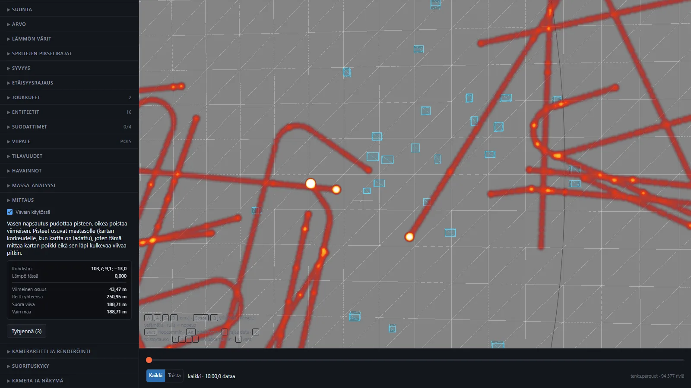

# Mittaus

**Mittaus** tekee hiirestä viivaimen ja kertoo, kuinka vilkas kohta kohdistimen alla on. Sitä käytetään, kun halutaan tietää, kuinka kaukana kaksi paikkaa toisistaan on, tai kuinka paljon liikennettä yhdessä kohdassa on.

## Kokeile {#try-it}

1. Avaa **Mittaus** sivupalkista ja rastita **Viivain käytössä**.
2. Napsauta vasemmalla kolmea paikkaa kartalla. Jokainen napsautus pudottaa pisteen.
3. Lue **Reitti yhteensä** (koko reitin pituus) ja **Viimeinen osuus** (viimeinen osuus).
4. Poista viimeinen piste napsauttamalla hiiren oikealla, tai poista kaikki painamalla **Tyhjennä (3)**.

| Toiminto | Vaikutus |
|---|---|
| Vasen napsautus | Pudottaa pisteen, jossa kohdistin osuu maatasoon. Napsautus, jossa hiiri liikkui painalluksen ja vapautuksen välillä yli 4 pikseliä, on kameran vetämistä, ei pistettä. |
| Oikea napsautus | Poistaa viimeisen pisteen. |
| Liike | Kohdistimen sijainti ja sen alla oleva lämpö päivittyvät heti. |

Kamera toimii, kun viivain on päällä: vetäminen yhä katselee ympärille ja näppäimet yhä lentävät. Kun viivain on päällä, se ottaa jokaisen napsautuksen, joten [napsautus valitsemiseen](camera.md#click-to-pick) odottaa, kunnes se on pois päältä.

**Maataso** on [karttakuvan](map-images.md) korkeus, kun karttakuva on ladattu. Muuten se on aineiston pienin Y (ilman sitä 0). Pisteet asettuvat tasolle, joten viivain mittaa kartan poikki eikä linjaa sen läpi. Kolmiulotteisella kentällä taso on yhä aineiston pienin Y, ei kentän pinta. Jos haluat pisteen oikealta pinnalta, sammuta viivain ja napsauta sitä ([napsautus valitsemiseen](camera.md#click-to-pick)). Se lukee koordinaatit kentän omista kolmioista.

## Lukemat {#readouts}

| Rivi | Merkitys |
|---|---|
| **Kohdistin** | Maailman X, Y, Z pisteestä kohdistimen alla, tasolla. |
| **Lämpö tässä** | Kuinka paljon lämpöä on kohdistimen pikselissä. Suurempi luku tarkoittaa enemmän liikennettä kohdassa. Se on arvo, joka syötetään väriliukumalle ennen kuin kyllästyspiste jakaa sen. Voit siis verrata sitä [Kyllästyspisteeseen](colour-and-exposure.md#saturation-point). |
| **Viimeinen osuus** | Etäisyys viimeisestä pisteestä kohdistimeen (tai kahden viimeisen pisteen välillä). |
| **Reitti yhteensä** | Kaikkien pisteiden ja kohdistimen läpi kulkevan murtoviivan pituus. |
| **Suora viiva** | 3D-etäisyys ensimmäisestä pisteestä kohdistimeen (tai viimeiseen pisteeseen). |
| **Vain maa** | Sama, vain X- ja Z-akseleilla. |
| **Tyhjennä (N)** | Poistaa kaikki pisteet. |

Etäisyydet näytetään senttimetreinä alle yhden yksikön, metreinä alle 1 000:n ja kilometreinä sen yläpuolella. Oletus on, että yksi maailmayksikkö on metri ([Akselit, yksiköt ja aika](axes-units-and-time.md#unit-scale)). Koordinaatit ovat maailmakoordinaatteja, myös silloin, kun akseli on [käännetty näytettäväksi](camera.md#invert-world-axis).

Pisteet ja niiden välinen viiva piirretään näkymään peitteenä. Koko määräytyy ruudukon välin mukaan. Viivaimen pisteitä ei tallenneta näkymiin. Ne pysyvät, kun ladataan muuta dataa.

## Kehittäjille {#for-developers}

**Lämpö tässä** luetaan GPU:lta enintään 120 ms välein, koska yhden pikselin takaisinluku pysäyttää putken. Se käyttää samaa polkua kuin `engine.readHeatProbe()`: jaetaan sillä vahvistuksella, jolla kehys kirjoitettiin. Puolitarkkuuskertymäpolulla (`?heat=f16`) se on siis samoissa yksiköissä kuin 32-bittisellä kohteella ([Puolitarkkuuskertyminen](half-float-accumulation.md)).
