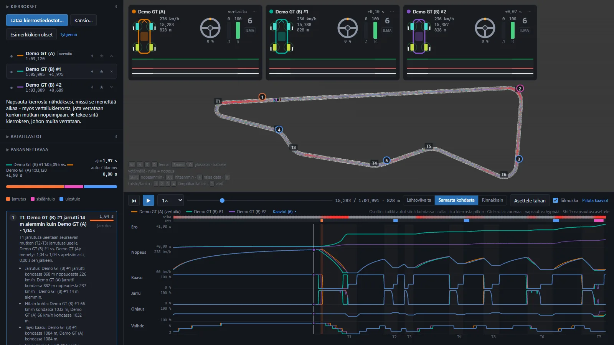

# Kisa-analyysi

Ajoit saman radan kahdesti. **Kisa-analyysi**-välilehti toistaa molemmat ajot yhdessä 3D:nä, näyttää, missä yksi kierros oli hitaampi, ja kertoo miksi. Ei vielä kierroksia? Paina **Esimerkkikierrokset**.

Välilehti vertaa kahta tai useampaa kierrosta samalta radalta. Se jakaa piirtoalueen, kameran ja ladatun radan mallin (**Tausta / kenttä**) lämpökartan kanssa; kaikki muu on omaa: oma sivupalkki ja oma palkki näkymän alla. Sanat *kierros*, *vertailu* ja *kärki* ovat [sanastossa](glossary.md).

Tämä sivu on välilehden kartta. Jokaisella osalla on oma sivunsa:

| Sivu | Mitä se kattaa |
|---|---|
| [Kierrosten lataaminen](race-loading-laps.md) | jokainen tiedostomuoto, kansiot ja radat, autojen nimet, esimerkkikierrokset, kierroslista, vertailu ja painopiste |
| [Toisto ja 3D-näkymä](race-replay-and-scene.md) | toistopalkki, kolme toistotilaa, autojen asettaminen linjaan, takaa-seurantakamera, viivat, kartat, autot, nimiöt, peilatut maailmat |
| [Kaaviot ja HUD](race-charts-and-hud.md) | matkakaaviot, kaaviovalitsin, osoitus ja zoomaus, autokortit, kanavataulukko |
| [Auton hallinnan tapahtumat](race-control-events.md) | lukkiutumiset, spinnaukset, ylikääntyminen, pyörimiset, alikääntyminen, osumat, törmäykset, ABS/TC, käsijarru, ilma - miten kukin tunnistetaan, jokaisen kynnysarvon kanssa |
| [Mutka mutkalta -analyysi](race-corner-analysis.md) | kohdistus matkan mukaan, mutkat ja osuudet, mutkan aikatili, jokainen syy ja järjestys, jossa ne kokeillaan, linjan muoto ja neuvo |
| [Autoprofiilit ja vertailu](race-car-profiles.md) | mitä kukin auto pystyy tekemään, mitattuna sen kierroksista; *Autojen vertailu*; mitä auto päättää kussakin mutkassa |
| [Ratatilastot](race-course-statistics.md) | monta kierrosta yhdeltä radalta: virheet mutkittain ja lajeittain, virhekartta, lämpökartan vienti, suorituskykyrajat |
| [Kisa-analytiikka: menetelmä](race-analytics.md) | sääntöjen taustalla oleva tutkimus lähteineen |
| [Muut kilpailupelit](other-games.md) | mitä katselin tekee kunkin pelin kierroksilla: luisto ja ajelehtiminen lasketaan siellä, missä peli ei niitä lähetä, peilatut maailmat, lisäkanavat |

## Näyttö {#the-screen}

**Sivupalkki**, ylhäältä alas (osioita voi taittaa):

1. **Kierrokset** - lataus, luettelo, näytä/piilota, vertailu, painopiste, takaa-seuranta.
   Katso [Kierrosten lataaminen](race-loading-laps.md).
2. **Ratatilastot** - vain kolmesta ladatusta kierroksesta alkaen.
   Katso [Ratatilastot](race-course-statistics.md).
3. **Parannettavaa** - painopisteen kierroksen havainnot mutka mutkalta.
   Katso [Mutka mutkalta -analyysi](race-corner-analysis.md).
4. **Mutka mutkalta** (tai *Mutka mutkalta - luokka X*, kun luokkia on useita) - nopein kierros jokaisen mutkan läpi ja sen linja. Näkyy kahdella tai useammalla kierroksella.
5. **Auton hallinta** - painopisteen kierroksen lukot, liukumiset, työnnöt ja osumat.
   Katso [Auton hallinnan tapahtumat](race-control-events.md).
6. **Autojen vertailu** (tai **Auto**, kun yksi auto on) - katso [Autoprofiilit ja vertailu](race-car-profiles.md).
7. **Näkymä** - mikä kartta maalataan radalle ja mitä piirretään.
   Katso [Toisto ja 3D-näkymä](race-replay-and-scene.md).
8. Yhteiset **Tausta / kenttä**- ja **Kamera ja näkymä** -paneelit (radan malli, akselin kääntö, kamera) - dokumentoitu lämpökartan yhteydessä ja [Kamerassa](camera.md).

**Näkymä** näyttää radan, ajetut linjat, kartan, autot, radan kiinnittämät nimiöt ja enintään kuusi autokorttia vasemmassa yläkulmassa (katso [Kaaviot ja HUD](race-charts-and-hud.md)). Kun kierroksia ei ole ladattu, siinä lukee: "Ei kierroksia ladattuna - pudota tähän kaksi tai useampi kierrostiedosto tai lataa esimerkkikierrokset sivupalkista."

**Palkki näkymän alla** sisältää toiston kuljetuspainikkeet ja, ellei piilotettu, matkakaaviot.

## Pika-aloitus {#quick-start}

1. Avaa **Kisa-analyysi**-välilehti (**Lämpökartta**-välilehden vieressä sivupalkin yläosassa).
2. Hanki kierrokset. Paina **Esimerkkikierrokset** nähdäksesi, mitä välilehti tekee kolmella keksityllä kierroksella. Omia kierroksiasi varten tallenna ne ensin ([tiedostomuodot ja tallentimet](race-loading-laps.md#file-formats)), paina sitten **Lataa kierrostiedostot…** tai **Kansio…**, tai pudota tiedostot tai kansiot näkymään.
3. Nopein täydellinen kierros tulee vertailuksi; hitain muu kierros on painopisteessä. Napsauta mitä tahansa kierrosta luettelossa asettaaksesi sen painopisteeksi; ★ tekee kierroksesta vertailun.
4. Lue **Parannettavaa**. Napsauta havaintoa: autot asetetaan linjaan 40 m ennen sitä, kamera kehystää sen, toisto toistaa sen läpi ja mittaukset avautuvat.
5. Vie hiiri kaavioiden päälle siirtääksesi jokaisen auton tuohon metriin; Shift+napsautus asettaa ne linjaan siinä.

## Näppäimistö {#keyboard}

Kun Kisa-analyysi-välilehti on auki:

| Näppäin | Tekee |
|---|---|
| **K** | toiston toisto / tauko |
| **Home** | takaisin toiston alkuun |
| numeronäppäimet | ei mitään (lämpökartassa ne vaihtavat tiloja) |

Tekstikenttään tai pudotusvalikkoon kirjoitetut näppäimet jätetään huomiotta. Kamera-näppäimet toimivat kuten lämpökartassa (**W A S D**, **Välilyönti** ylös, **Q** alas, **Shift** nopeammin, **Alt** hitaammin, hiiri katsomiseen; kaikki [Kamerassa](camera.md)); **F** kehystää ladatut kierrokset (kuten kierrosten lataus tekee).

## Monta kierrosta {#many-laps}

- Kaikki ladatut kierrokset analysoidaan ja lasketaan; kymmenet vievät sekunnin tai kaksi.
- Yli **8** kierroksen (`SHOW_ALL_UP_TO`) lisätyt kierrokset piirretään vain, kun ne ovat vertailu, painopiste tai painopisteen luokan paras kierros. *Näytä kaikki* / *Vain tarkasteltavat* vaihtavat.
- Yli **10** näkyvän auton (`PLAIN_PAST`) kierrokset, joita ei katsota (ei painopiste, seurattu auto tai vertailu), piirretään linjoilla, jotka on harvennettu yhteen pisteeseen 6 metrin välein 1,5 metrin sijaan, ja tavallisina autoina.
- Kaaviot piirtävät enintään **8** kierrosta; HUD näyttää enintään **6** korttia.
- Ratatilastot ilmestyvät **3** kierroksesta alkaen.

Yksityiskohdat: [Ratatilastot](race-course-statistics.md#performance-with-many-laps).

## Näkymän oletusasetukset {#default-view-settings}

| Asetus | Oletus |
|---|---|
| Kartta | Aikakartta |
| Ajetut linjat, Autot, Renkaat ja jousitus, Nimiöt, Rata kierroksista | päällä |
| Kaikki arvot korteilla | pois |
| Auton koko | 1× |
| Kaaviot | näkyvissä |
| Toistotila | Lähtöviivalta |
| Toistonopeus | 1× |
| Silmukka | päällä |

Mitään näistä ei tallenneta; sivun uudelleenlataus alkaa oletuksista. Selaimessa muistetaan: kieli ja kierrostiedostoista opitut autojen nimet (katso [Kierrosten lataaminen](race-loading-laps.md#car-names)).

## Kehittäjille {#for-developers}

### Mitä tapahtuu, kun kierroksia ladataan {#what-happens-when-laps-are-loaded}

Aina kun kierrosjoukko, vertailu tai kieli muuttuu, koko analyysi tehdään uudelleen (`analyse` tiedostossa [`src/race/analysis.ts`](https://github.com/Holdi601/3DHeat/blob/main/src/race/analysis.ts)):

1. Johdetut kanavat lisätään jokaiseen kierrokseen siellä, missä peli ei niitä lähetä: ajautumiskulma, renkaiden luisto pyörien nopeuksista, ilmassa, löysä maa, kääntymisnopeus ([`derive.ts`](https://github.com/Holdi601/3DHeat/blob/main/src/race/derive.ts)).
2. Vertailu valitaan ja jokainen kierros projisoidaan sen reitille ja näytteistetään uudelleen 2 metrin välein ([`align.ts`](https://github.com/Holdi601/3DHeat/blob/main/src/race/align.ts)).
3. Selvitetään kierroksista, onko pelin maailma peilattu ([`handedness.ts`](https://github.com/Holdi601/3DHeat/blob/main/src/race/handedness.ts)).
4. Mutkat löydetään vertailusta ja ryhmitellään osuuksiksi yhdestä jarrutusalueesta seuraavaan ([`segments.ts`](https://github.com/Holdi601/3DHeat/blob/main/src/race/segments.ts)).
5. Autokohtaisesti: sen verhokäyrä (pito, jarrutus, veto nopeuden mukaan), sen profiili, sen renkaiden käyrät ([`envelope.ts`](https://github.com/Holdi601/3DHeat/blob/main/src/race/envelope.ts), [`profile.ts`](https://github.com/Holdi601/3DHeat/blob/main/src/race/profile.ts), [`control.ts`](https://github.com/Holdi601/3DHeat/blob/main/src/race/control.ts)).
6. Kierros- ja osuuskohtaisesti: mitä se teki (jarrupiste, hitain piste, täysi kaasu, ...) ja ajettu linja ([`line.ts`](https://github.com/Holdi601/3DHeat/blob/main/src/race/line.ts)).
7. Kierroskohtaisesti: sen auton hallinnan tapahtumat, jokainen asetettuna vertailukierrokseen, jota siinä verrataan.
8. Kierros- ja osuuskohtaisesti: aikatili suhteessa vertailukierrokseen ja havainto sanoin.
9. Aikakartta ja syykartta kierroksittain.

Tekstit tuotetaan nykyisellä kielellä; kielen vaihto ajaa analyysin uudelleen (ja nimeää esimerkkikierrokset uudelleen). Analyysin virhe näytetään **Kierrokset**-painikkeiden alla virheenä, ja kierrokset pysyvät ladattuina.

### Lähdetiedostot {#source-files}

| Tiedosto | Tehtävä |
|---|---|
| `src/race/adapters.ts`, `ibt.ts` | kierrostiedostojen lukeminen |
| `src/race/lap.ts`, `carNames.ts`, `synthetic.ts` | kierrostyyppi, nimeäminen, esimerkkikierrokset |
| `src/race/derive.ts`, `handedness.ts` | johdetut kanavat, peilatut maailmat |
| `src/race/align.ts`, `segments.ts`, `line.ts` | matka-akseli, mutkat, linjat |
| `src/race/analysis.ts` | verratut mutkat, syyt, havainnot |
| `src/race/envelope.ts`, `profile.ts` | mitä auto pystyy tekemään |
| `src/race/control.ts`, `impacts.ts` | auton hallinta, osumat ja törmäykset |
| `src/race/stats.ts` | monta kierrosta |
| `src/race/replay.ts`, `scene.ts`, `glyph.ts`, `geometry.ts` | toisto ja piirto |
| `src/race/schema.ts`, `graphs.ts` | kanavataulukko, kaavioiden rivit |
| `src/ui/race/*` | sivupalkki, kaaviot, HUD, nimiöt |
| `src/state/raceStore.ts` | välilehden tila ja toistokello |
