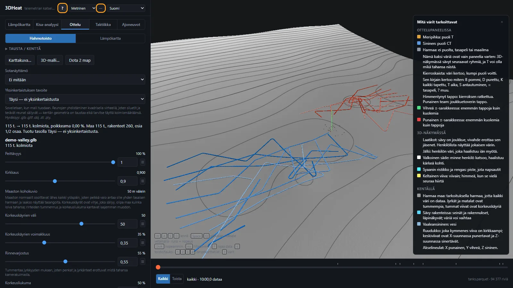

# Asetukset, yksiköt ja näppäimet

Sivupalkin yläosan pienet säätimet muuttavat tapaa, jolla katselija puhuu sinulle: kielen, yksiköt (metriä tai jalkoja, km/h tai solmuja) ja ohjetilan, joka selittää värit. Valintasi muistetaan selaimessasi.

## Ylätunniste {#the-header}

Sivupalkin yläosassa:

| Säädin | Mitä se tekee |
|---|---|
| **?** | Ohjetila: mitä jokainen väri tarkoittaa (myös `?` tai `F1`) |
| **Yksiköt**-valikko | Metrinen, Imperiaalinen, Ilmailu tai Meri |
| Painike **...** nimen **Yksiköt** vieressä | Avaa "Valitse yksikkö kullekin suureelle": yksi pudotusvalikko per suure |
| **Kieli**-valikko | Katselijan kieli: [40 kieltä](languages.md), tai selaimen kieli |

Ruutuun kirjoitetuissa luvuissa voi käyttää pistettä tai pilkkua (`0.35` tai `0,35`). Katselija lukee molemmat ja näyttää luvut sillä tavalla, miten sen kieli kirjoittaa ne.

## Yksiköt {#units}

1. Valitse esiasetus **Yksiköt**-valikosta. Kaikki suureet vaihtuvat yhdessä.
2. Jos haluat muuttaa vain yhden suureen, napsauta sen vieressä olevaa painiketta **...** ja valitse sille yksikkö. Valikko näyttää sitten `*`-merkin esiasetuksen jälkeen.
3. Suure, jota et ole asettanut, seuraa esiasetusta. Palaa valitsemalla "Esiasetuksen mukaan".

| Suure | Metrinen (oletus) | Imperiaalinen | Ilmailu | Meri |
|---|---|---|---|---|
| Matka | km | mi | NM | NM |
| Korkeus, pituus | m | ft | ft | m |
| Nopeus | km/h | mph | kt | kt |
| Pystynopeus | m/s | ft/min | ft/min | m/s |
| Lämpötila | °C | °F | °C | °C |
| Paine | hPa | inHg | hPa | hPa |
| Massa, polttoaine | kg, l | lb, gal | lb, gal | t, m³ |
| Kulma | astetta | astetta | astetta | astetta |

Muita yksiköitä, joita voit valita yhdelle suureelle: matka km, mi, NM; nopeus km/h, m/s, kt, mph; pystynopeus m/s, ft/min, m/min; lämpötila °C, °F, K; paine hPa, inHg, mmHg, psi; massa kg, lb, t; kulma astetta tai NATO-mils (6 400 ympyrässä). Yksiköt ovat sama kaikkialla katselijassa: nimiöissä, korteissa, kaavioissa ja tilastoissa.

## Ohjetila {#help-mode}

Paina `?` tai `F1` tai napsauta painiketta **?**. Se näyttää *What the colours mean* -kohdan: selitteet 3D-näkymälle, lämpöliukumille, joukkueiden väreille, kentän väreille, paneelien tilavärit, ottelupaneelin ja kilpailunäkymän. Se pysyy päällä, kunnes kytket sen pois. Välilehdellä Ottelu se selittää myös ottelupaneelin värit.

## Mitä selain muistaa {#what-the-browser-remembers}

Nämä asetukset säilyvät selaimessasi käyntien välillä (mitään ei lähetetä mihinkään):

- kieli, yksiköt ja ohjetila;
- toiston hahmon, symbolin, nimiön, kameran ja taktisen näytön asetukset;
- toistonopeus ja peilaus;
- kirjanmerkit tallennuksittain, äänenvoimakkuudet aineistoittain, tavoitekerrokset;
- ulkoiset tekoälyasetukset (avain vain, jos rastität *Muista*).

Lämpöasetukset, suodattimet ja tila alkavat alusta jokaisella latauksella. Koko luettelo, joka on luotu automaattisesti: [Tallennetut asetukset](ref-settings-storage.md).

## Näppäimet, jotka katselija pitää selaimelta {#keys-the-viewer-keeps-from-the-browser}

Suuren aineiston lataaminen vie aikaa, joten katselija estää selainta heittämästä sitä pois vahingossa:

- `Ctrl`/`Cmd` + kirjaimet, jotka tulostaisivat, tallentaisivat, avaisivat, lataisivat uudelleen, sulkisivat tai avaisivat uusia ikkunoita, eivät tee mitään tekstikenttien ulkopuolella. `F1`, `F3`, `F5`, `F6` ja `F7` eivät tee mitään.
- Välilehden sulkeminen tai uudelleenlataus, kun data tai kenttä on ladattuna, kysyy ensin.
- Koko näytössä katselija lukitsee käyttämänsä näppäimet (W, T, N, S, R, P, Q, Esc), joten selain ei ota niitä.

Tarkka luettelo: [Selaimen näppäimet](ref-browser-keys.md). Kaikki katselijan omat näppäimet: [Näppäimistön ja hiiren viite](keyboard-reference.md).
