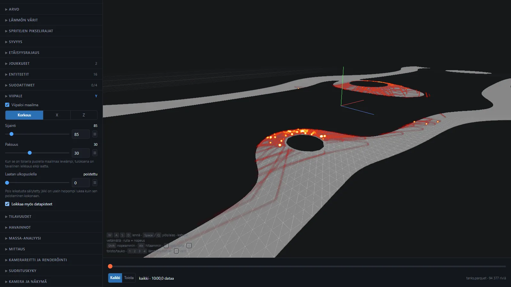

# Viipale

**Viipale** leikkaa maailman kuin kakkupalan, jotta voit katsoa rakennusten sisään. Sitä käytetään, kun seinät peittävät kiinnostavan lämmön, esimerkiksi kun haluat nähdä yhden rakennuksen kerroksen.

## Kokeile {#try-it}

1. Lataa kenttä ja dataa ja avaa **Viipale**.
2. Rastita **Viipaloi maailma**. Akseli on **Korkeus**.
3. Vedä **Sijainti** ylös ja alas: laatta liikkuu kentän läpi.
4. Tee **Paksuudesta** ohut pohjapiirrosta varten tai leveä "kaikki tämän alapuolella" -näkymää varten.
5. Pidä **Laatan ulkopuolella** arvossa 0, jotta muu poistuu, tai nosta sitä, jotta jää himmeä jälki.



Laatta leikkaa **kentän geometrian ja datapisteet yhdessä**. Pelkän kentän leikkaaminen jättäisi lämmön leijumaan siihen kohtaan, missä sen rakennus oli. Se on vastine [syvyyspeitolle](depth-and-culling.md): kun kenttä piilottaa oikein sen, mikä on sen takana, myös rakennuksen sisäpuoli on piilossa. Paneeli näytetään, kun leikattavaa on (aineisto tai 3D-kenttä). Sen otsikko näyttää akselin, kun viipale on päällä, muuten *off*.

```
sivukuva          Sijainti = missä laatta on
 ----------       Paksuus = kuinka korkea laatta on
 | kerros 3 |
 |=========|  <--- laatta (säilytetään)
 | kerros 2 |  <--- ulkopuolella: poistettu (tai himmeä)
 | kerros 1 |
 ----------
```

## Säätimet {#controls}

| Säädin | Oletus | Merkitys |
|---|---|---|
| **Viipaloi maailma** | pois | Kytkee laatan päälle. Kun sijainti on yhä alkuarvossaan 0 ja paksuus alkuarvossaan 500, päälle kytkeminen siirtää ne akselin keskelle ja 15 %:iin sen jänteestä. |
| Akseli | **Korkeus** | *Korkeus* (Y), *X* tai *Z*. Akselin vaihtaminen siirtää laatan uuden akselin keskelle. |
| **Sijainti** | keskellä | Laatan keskus maailmayksiköissä akselin jänteen yli (500 askelta). |
| **Paksuus** | 15 % jänteestä | Jänteen 1/500 ... kaksinkertainen jänne logaritmisin askelin. Lukee *past the world*, kun se on yhtä leveä kuin jänne: toinen puoli ulottuu maailman ohi, ja kyseessä on tavallinen leikkaus eikä laatta. |
| **Laatan ulkopuolella** | 0, *removed* | Kuinka paljon leikatun ulkopuolelle jäävästä pysyy näkyvissä, 0-100 %. Leikatun himmeä jälki on usein helpompi lukea kuin sen täysi poistaminen. |
| **Leikkaa myös datapisteet** | päällä | Pois päältä lämpö pysyy kokonaisena, joten se näkyy leikkauksen läpi. Tämä on hyödyllistä, kun haluat nähdä, mitä laatan yläpuolella ja alapuolella on. |

Akselin jänne on 3D-kentän jänne, kun kenttä on ladattu, muuten aineiston jänne.

Viipale on riippumaton [etäisyysrajauksesta](depth-and-culling.md#distance-culling), joka leikkaa katselusuunnan mukaan eikä maailman akselin. Ne yhdistyvät. Mikä tahansa viipaleen asetuksen muutos käynnistää lämpökertymän uudelleen.

## Kehittäjille {#for-developers}

Laatta testataan jokaisen rivin maailmasijainnilla vertex-varjostimessa. Laatan ulkopuolella olevan rivin panos kerrotaan arvolla *Ulkopuolella*. Kun arvo on 0, rivi hylätään ennen kuin mitään fragmenttia piirretään. Kentän varjostimet soveltavat samaa testiä jokaiseen maan, rakennelmien ja veden fragmenttiin.
