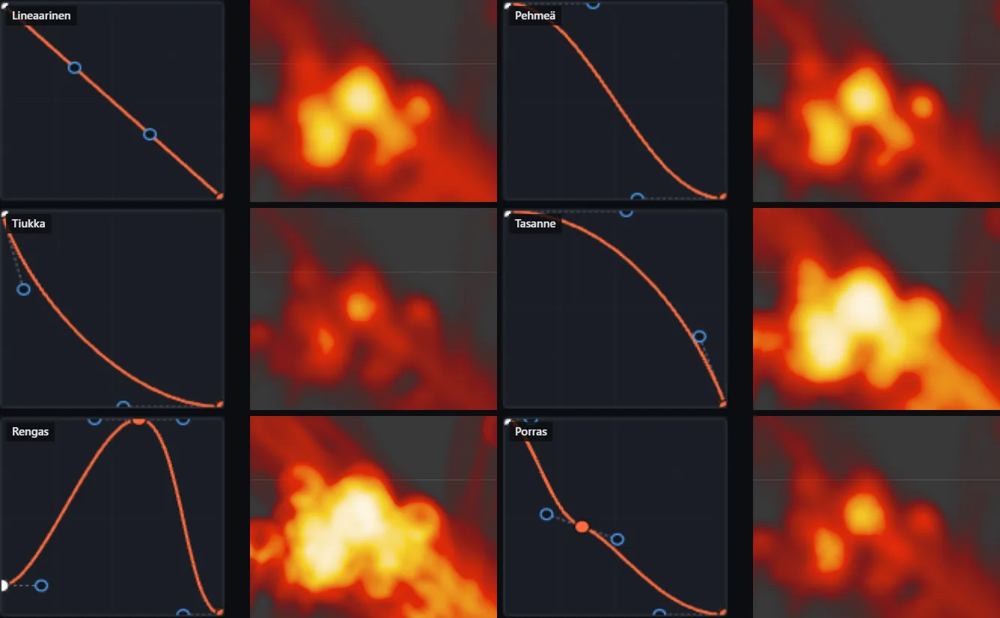

# Spriten muoto

Jokainen rivi piirretään pyöreänä spritenä, joka aina osoittaa kameraan päin. Sen koko ja profiili keskustasta reunaan – **liukuma** – ratkaisevat, näyttääkö kuuma kohta tiukalta pisteeltä, pehmeältä pilvenä, levynä vai renkaana. Nämä säätimet ovat sivupalkin osioissa **Lämmön muoto** ja **Spritejen pikselirajat**, ja ne koskevat [Lämpöä](heat.md), [Erotusta](difference.md), [Joukkuelämpöä](team-heat.md) ja viivan puolileveytenä [Viivalämpöä](line-heat.md).

Minkä tahansa niistä muuttaminen käynnistää kertymisen uudelleen (kenttä on piirrettävä uudelleen uudella muodolla).

Ajattele jokaista pistettä pehmeänä valopisteenä. Pieni pisteen säde näyttää yksittäisiä kohtia; iso pisteen säde yhdistää naapurit pilveksi. Muoto päättää, kuinka pehmeä reuna on.



## Spriten säde {#sprite-radius}

Spriten säde **maailmayksiköissä** (merkitty metreiksi). Oletus 6, ja joka latauksella datan vaakasuuntainen laajuus / 120 – tarpeeksi suuri, jotta polkua pitkin olevat naapurinäytteet yhdistyvät nauhaksi eikä näytä hiushalkeamalta. Logaritminen liukusäädin 0,05–2000, kahva ulottuu 50 000 asti.


Kaukana olevat asiat näyttävät pienemmiltä, joten sprite kutistuu näytöllä etäisyyden mukana. Rinnakkaisprojektiossa se on kaikkialla sama, ja siksi rinnakkaisnäkymä sopii kuumien kohtien vertailuun ([Kamera](camera.md#projection)).

## Pikselirajat {#pixel-clamps}

**Spritejen pikselirajat** (oletuksena suljettu) rajaavat näytöllä näkyvän säteen edellä olevan muunnoksen jälkeen.

| Säädin | Oletus | Alue (säätörulla) | Miksi |
|---|---|---|---|
| **Pienin pikselisäde** | 1 px | 0–16 (512) | Pitää kaukaiset tiedot yhden pikselin alla katoamasta. |
| **Suurin pikselisäde** | 96 px | 2–1024, logaritminen (8192) | Ylipiirtämisen suoja. N pikseliä peittävä sprite maksaa N sekoitusoperaatiota, joten rajaamaton säde lähellä kameraa on se, mikä tekee nopeasta kuvasta hitaan. Kun raja ylittää näkymän korkeuden, se ei enää rajaa mitään. |

**Sama tiheys kaikilla zoomaustasoilla** (osiossa Lämmön muoto, oletuksena päällä) toimii rajojen kanssa. Sprite, jonka raja tekee suuremmaksi (kaukana) tai pienemmäksi (lähellä), säilyttää sen lämmön, minkä todellinen koko lisäisi, joten väri tarkoittaa samaa rivimäärää maan pinta-alaa kohden millä tahansa zoomauksella. Kun se on pois päältä, rajattu sprite lisää täyden painonsa rajatussa koossaan, ja kuva muuttuu, kun lennät sisään.

## Keski- ja reunavoimakkuus {#centre-and-edge-intensity}

Lämpö, jonka sprite lisää täsmälleen keskustassaan (**Keskustan voimakkuus**, oletus 1, 0–10, säätörulla 1000) ja reunassaan (**Reunan voimakkuus**, oletus 0, -2–10, säätörulla 1000). Liukuman arvo *t* (1 keskustassa, 0 reunassa, muotoiltuna vaimenemisen tai alla olevan käyrän mukaan) sekoittaa niiden välillä (kaava on kohdassa [Kehittäjille](#for-developers)).

**Negatiivinen reunavoimakkuus** saa reunan vähentämään, mikä kaivaa viileän haloon jokaisen kuuman kohdan ympärille ja terävöittää klustereita toisiaan vasten. Näkyvyyteen vaikuttavat [peittäminen](depth-and-culling.md) ja [viipale](slice.md); häivytys on [Eliniän](timeline.md#history) häivytys; merkki on ±1 kohdassa [Erotus](difference.md).

## Liukuman muoto: Vaimeneminen tai Käyrä {#ramp-shape-falloff-or-curve}

**Liukuman muoto** vaihtaa kahden tavan välillä, joilla *t* muotoillaan spriten yli. Kun *d* on etäisyys keskustasta (0) reunaan (1):

### Vaimeneminen {#falloff}

Näkyy, kun *Vaimeneminen* on valittu (oletus).

- **Vaimeneminen** (oletus 1,6, 0,1–8, säätörulla 64): `t = (1 - d) ^ vaimeneminen`. 1 on suora lineaarinen liukuma; suurempi vetää lämmön keskustaan ja tiukentaa kuumaa kohtaa; alle 1 litistää sen levyksi.
- **Pehmeä liukuma** (oletuksena päällä): käyttää *t*:een smoothstep-S-käyrää, jolloin sprite häipyy reunassaan eikä päätyy näkyvään reunaan.

### Käyrien muokkain {#the-curve-editor}

Näkyy, kun *Käyrä* on valittu. Spriten suora poikkileikkaus: etäisyys keskustasta poikki (*keskusta* vasemmalla, *reuna* oikealla), lämpö ylöspäin. Käyrä on paloittainen kuutiollinen Bézier-käyrä ohjauspisteiden kautta, joilla kummallakin on kaksi kahvaa.

| Toiminto | Vaikutus |
|---|---|
| Kaksoisnapsautus kuvaajassa | Lisää pisteen siihen etäisyyteen (pidetään välillä 0,02–0,98), käyrälle ja käyrän kulmakertoimella siinä kohdassa, joten lisääminen ei muuta mitään, ennen kuin vedät sitä. |
| Vedä pistettä | Siirtää sitä. Korkeudet pidetään välillä 0–1. |
| Vedä pientä ympyrää | Taivuttaa viereistä osuutta (siirtää sitä kahvaa). |
| Alt-napsautus tai oikea napsautus pisteen päällä | Poistaa sen. Kahta päätepistettä ei voi poistaa. |
| Esiasetuspainike | Korvaa käyrän esiasetuksella. |

Päätepisteet ovat kiinteitä keskustassa ja reunassa; niiden korkeus on silti sinun päätettävissäsi.

**Esiasetukset** ([`curve.ts`](https://github.com/Holdi601/3DHeat/blob/main/src/state/curve.ts)):

| Esiasetus | Muoto | Käyttö |
|---|---|---|
| **Lineaarinen** | Suora 1:stä 0:aan | Sama kuin *Vaimeneminen* 1, kun *Pehmeä liukuma* on pois. |
| **Pehmeä** | S-käyrä | Oletuskäyrä; sitä *Pehmeä liukuma* antaa vaimenemisella 1. |
| **Tiukka** | Jyrkkä ydin, pitkä laiha reuna | Harva data. |
| **Tasanne** | Tasainen, sitten nopea lasku | Luetaan levynä eikä pilvenä. |
| **Rengas** | 0,15 keskustassa, 1 säteen 62 %:ssa, 0 reunassa | Ontto sprite: näyttää, missä polut kulkevat eikä missä ne pysähtyvät. |
| **Porras** | Kaksivaiheinen vaimeneminen, 0,45 kohdassa 35 % | Erottaa tiheän ytimen ympäristöstään. |

## Litistä maatasolle {#flatten-onto-ground-plane}

**Litistä maatasolle** (oletuksena pois) jättää huomiotta jokaisen rivin korkeuden ja piirtää kaiken lämmön yhdelle korkeudelle – datan alimpaan Y:hen – eli klassiseen 2D-karttalämpökarttaan. Kun se on päällä, syvyyspeittäminen ja *Piilota maaston taakse* ovat pois (jokainen piste istuisi tarkalleen pinnalla, jota vastaan se testataan), ja Syvyys-osio kertoo tämän.

## Kehittäjille {#for-developers}

### Kaavat {#formulas}

Säde pikseleinä näytöllä: `säde × P[1][1] / w × näkymän korkeus / 2`, missä `P` on projektiomatriisi ja `w` pisteen näkymäsyvyys.

Lämpö, jonka sprite lisää:

```
lisätty lämpö = sekoita(reuna, keskusta, t) × näytepaino × merkki × häivytys × näkyvyys
```

### Käyrä {#the-curve}

Kahvat rajataan vaakasuunnassa omaan osuuteensa, joten käyrä on aina etäisyyden funktio: jos vedät kahvaa kauas seuraavan pisteen ohi, se litistyy sitä vasten sen sijaan, että taittaisi käyrän takaisin, mikä tekisi tuloksesta riippuvaisen siitä, minkä juuren ratkaisija sattui löytämään.

### Miten käyrä piirretään {#how-the-curve-is-drawn}

Käyrä paistetaan 256 merkinnän taulukkoon aina, kun se muuttuu, ladataan 16-bittisenä liukulukutekstuurina ja otetaan näytteitä fragmentti kerrallaan lineaarisella suodatuksella ja puolen tekselin sisennyksellä, jotta molemmat päät pysyvät tarkkoina. Bézier-käyrän ratkaiseminen x:lle vaatii iterointia, jolla ei ole sijaa ohjelman kuumimmassa varjostimessa, ja taulukkohaku on myös halvempi kuin `pow()`, jota vaimeneminen käyttää. 16 bittiä eikä 8 bittiä, koska 8 bittiä näyttää raidoittumista, kun tuhannet spritet ovat summautuneet; 16-bittinen puolitarkkuus on suodatettavissa WebGL2:n perusominaisuuksilla, kun taas 32-bittinen vaatii laajennuksen.
