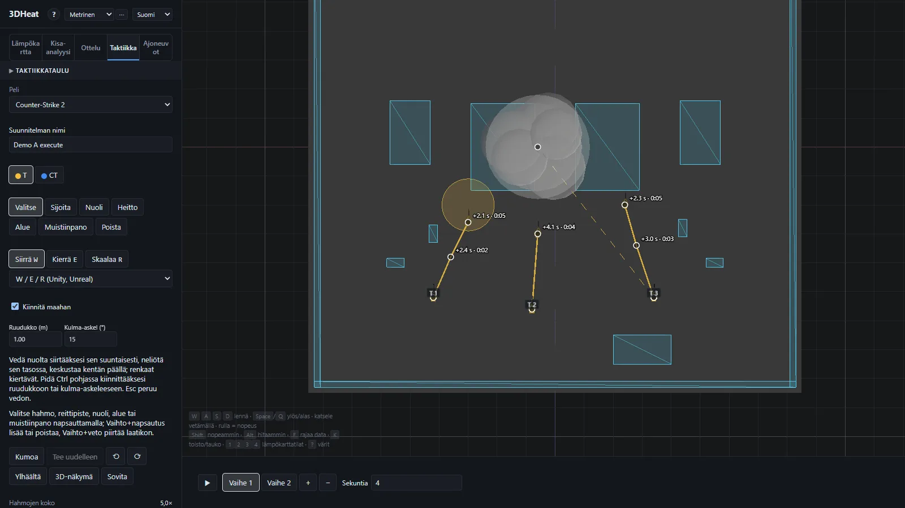

# Taktiikkataulu

**Taktiikka**-välilehti on piirrustaulu joukkueen suunnitelmalle. Asetat kartalle pieniä hahmoja, piirrät nuolia siihen, minne ne menevät, ja painat toistoa nähdäksesi, mitä tapahtuu. Sillä voit suunnitella kierroksen tai hyökkäyksen ennen pelaamista. Se jakaa piirtoalueen, kameran ja [kentän](levels.md) muiden välilehtien kanssa, mutta ei mitään muuta. Suunnitelma ei ole dataa, eikä se piirrä lämpöä.

## Ensimmäinen suunnitelmasi {#your-first-plan}

1. Avaa **Taktiikka**-välilehti. Valitse **Peli** (esimerkiksi Counter-Strike 2). Valorantia varten paina **Lataa Valorant-kartat** ja valitse **Kartta**. Voit myös ladata ensin [kentän](levels.md).
2. Valitse **Puoli** (se määrää värin) ja paina **Ylhäältä**.
3. Valitse **Paikka**, valitse hahmo kohdasta **Hahmot** (**Hae hahmoja** auttaa löytämään sen) ja napsauta karttaa. Aseta kaksi tai kolme hahmoa.
4. Valitse **Nuoli**, napsauta hahmoa, napsauta reittiä, jota sen pitäisi kulkea, ja paina **Enter** lopettaaksesi nuolen.
5. Lisää vaihe 2 painamalla **+** näkymän alla. Jokainen hahmo alkaa siitä kohdasta, johon sen nuoli päättyi. Piirrä siihen lisää nuolia.
6. Paina **▶** (tai `K`), niin suunnitelma toistuu näkyvästä vaiheesta loppuun.
7. Nimeä suunnitelma kentässä **Suunnitelman nimi** ja paina **Tallenna**.

## Suunnitelman aloittaminen {#starting-a-plan}

| Säädin | Mitä se tekee |
|---|---|
| **Peli** | Valitsee puolet ja hahmot, jotka paletti tarjoaa: Counter-Strike 2 (T, CT; pelaajat ja apuvälineet), Valorant (Hyökkäys, Puolustus; pelaajat ja yleiset kyvyt), Battlefield, Squad, Arma (jalkaväki, maa-ajoneuvot, ilma-alukset, veneet), DCS / War Thunder / IL-2 (suihkukoneet, potkurikoneet, helikopterit, ilmatorjunta, maa, laivat, aseet) ja Muu. Suunnitelma, jossa on jo hahmoja, säilyttää puolensa, kun peli vaihtuu. |
| **Suunnitelman nimi** | Nimi, jolla suunnitelma tallennetaan. |
| **Kartta**, **Lataa Valorant-kartat** | Kun Valorant on valittu: **Lataa Valorant-kartat** hakee karttalistan sivustolta [valorant-api.com](https://valorant-api.com). **Kartta** asettaa valitun kartan pienoiskartan kentäksi ja kohdistaa sen ylhäältä. Kuva haetaan, kun se valitaan, eikä sitä toimiteta mukana. Riotin ilmoitus näkyy, kun kuva on näkyvissä (katso alla). |
| **Puoli** | Puoli, johon seuraava hahmo, nuoli tai alue kuuluu. Se saa puolen värin. |

Ilman kenttää taulu on tasainen maataso. Lataa kenttä kohdassa **Kenttä**, jos haluat suunnitella oikealla kartalla. Käytettävissä on CS2-kartta CS2-työkalulla viety, kirjastosta valittu kenttä tai karttakuva.

## Työkalut {#tools}

| Työkalu | Napsautus | Huomiot |
|---|---|---|
| **Valitse** | Hahmo, reittipiste, nuoli, alue tai muistiinpano valitaan napsauttamalla. | Shift+napsautus lisää tai poistaa valinnan. Shift+vetäminen piirtää laatikon, johon kuuluvat valittavat kohteet. Valintaan tulee muunnoskahva (katso alla). `Delete` tai `Backspace` poistaa sen. `M` siirtää valitun hahmon seuraavaan napsautukseen. |
| **Paikka** | Asettaa valitun hahmon paikalleen. | Hahmo valitaan **Hahmot**-paletista (**Hae hahmoja** -haulla). Kun mitään ei ole valittuna, `R` kääntää seuraavaa hahmoa 15° ennen kuin se asetetaan (`Shift+R` toiseen suuntaan). |
| **Nuoli** | Jokainen napsautus lisää pisteen. Enter, kaksoisnapsautus tai oikea napsautus lopettaa nuolen, Esc hylkää sen. | **Siirrä**, **Hyökkäys** (leveämpi kärki) tai **Tähystys** (ohut viiva silmän korkeudella). Hahmosta alkava nuoli on sen reitti tässä vaiheessa. Toistettaessa hahmo kulkee sitä pitkin, ja seuraava vaihe alkaa siitä, mihin se päättyi. |
| **Heitto** | Heittäjä, sitten kohta, johon heitto osuu. | Katkoviivainen kaari heittäjän ja kohdan välillä. Valittu apuväline (savu, välähdys, molotov ... ) näkyy kohdassa, johon se osuu, ja pysyy siellä tästä vaiheesta eteenpäin. |
| **Alue** | Keskipiste, sitten reuna. | Levy puolen värissä. |
| **Muistiinpano** | Kohta, johon muistiinpano menee. Kysyy sen tekstiä. | Näkyy neulana, ja teksti näkyy sen päällä. |
| **Poista** | Hahmo, nuoli, alue tai muistiinpano. | Poistaa sen tästä vaiheesta eteenpäin. Ensimmäisessä vaiheessaan se poistaa sen kokonaan. |

**Kumoa** ja **Tee uudelleen** (`Ctrl+Z`; `Ctrl+Y` tai `Ctrl+Shift+Z`) kulkevat jokaisen muutoksen läpi. Suunnitelman alla oleva rivi kertoo, kuinka monta hahmoa, nuolta ja vaihetta siinä on. **Ylhäältä** katsoo suoraan alas (ortografinen). **3D-näkymä** palaa perspektiiviin. **Kuva** sovittaa suunnitelman näkyviin, ja jos suunnitelma on tyhjä, sovitetaan kenttä.

**Hahmojen koko** skaalaa kaikki hahmot taulussa. 1× on todellinen koko. Kaukaa ylhäältä katsottuna henkilö on muutaman pikselin kokoinen.

## Siirtäminen, kääntäminen ja skaalaus {#moving-turning-and-scaling}

Kaikkea taulussa voi siirtää kuten 3D-editorissa: hahmoja, apuvälineitä, merkkejä, yksittäisiä reittipisteitä ja kokonaisia nuolia, alueita ja muistiinpanoja. Valittuun kohteeseen tulee kahva keskikohtaansa:

| Tila | Näppäimet | Kahvat |
|---|---|---|
| **Siirrä** | W (tai G) | Nuoli kullekin akselille (X punainen, Y vihreä ja ylöspäin, Z sininen). Akselia pitkin siirtyy nuoli. Neliö siirtää tasossaan. Keskipiste siirtyy kentän päälle osoittimen alle. |
| **Kierrä** | E (tai R) | Rengas kullekin akselille kääntää ympäri sitä. Yksittäisen hahmon renkaat ovat sen oma kiertymä, kallistus ja kierto. Ryhmä kääntyy maailman akselien ympäri keskikohtansa kautta. |
| **Skaalaa** | R (tai S) | Levittää tai kokoaa valinnan keskikohdastaan akselia pitkin tai joka suuntaan. Alueen säde kasvaa mukana. |

**Näppäimet** vaihtavat W / E / R (Unity, Unreal) ja G / R / S (Blender) välillä. Näppäimet valitsevat tilan vain, kun jokin on valittuna. Muuten ne liikuttavat kameraa. Joten `R` tarkoittaa **Skaalaa** W / E / R -näppäimillä ja **Kierrä** G / R / S -näppäimillä, kun jokin on valittuna. Kun mitään ei ole valittuna, se kääntää seuraavaa asetettavaa hahmoa. Kaikki taulun näppäimet on lueteltu [näppäinviitteessä](keyboard-reference.md#tactics-board). Pidä **Ctrl** pohjassa vetäessäsi, niin siirto kiinnittyy **Ruudukkoon** (metreinä) tai kääntö **Kulmaväliin**. **Kiinnitä maahan** (oletuksena päällä) asettaa siirretyt ihmiset, ajoneuvot, merkit, reittipisteet ja alueet kentän pinnalle. Ilma-alukset ja helikopterit pitävät korkeutensa, eikä Y-nuolen suuntainen vetäminen koskaan kiinnity. Kahvan vetäminen ei koskaan siirrä kameraa. **Esc** peruuttaa vedon, ja jokainen muutos on yksi **Kumoa**-askel.

Reittipisteet näkyvät pisteinä näytetyn vaiheen nuolilla. Napsauta yhtä valitaksesi sen, vedä sitä siirtääksesi ja paina Delete poistaaksesi sen. Osio **Valitut** näyttää valinnan paikan metreinä, hahmon kiertymän, kallistuksen ja kierron asteina sekä alueen säteen. Jokaisen voi kirjoittaa itse.

## Ajoitus {#timing}

Hahmon reitti on ajoitettu. Jokainen osuus kestää pituutensa verran kentällä. Pituus mitataan pinnalta muutaman metrin välein, joten mäki tai portaat kahden pisteen välillä lasketaan mukaan. Nopeus on hahmon liikkumistilan mukainen tässä pelissä. Reittipisteessä lisätään myös mahdollinen **odotusaika**. Jalkaväki hiipii, kyykkii, kävelee (hiljaa), juoksee tai sprintaa. Ajoneuvot ja veneet hiipivät, ajavat varovasti, normaalisti tai kiirehtien. Ilma-alukset ja helikopterit lentävät hitaasti, matkavauhdilla, taistelunopeudella tai enimmäisnopeudella. Jos pelissä ei ole jotakin tilaa (CS2:ssa ei ole sprinttiä), otetaan lähin siinä oleva. Se, kuinka rinne hidastaa, riippuu pelistä. CS2:ssa ja Valorantissa lasketaan vain vaakasuora matka, kuten peleissä. Sotasimulaatiot hidastavat jalkaväkeä ylämäkeen (Toblerin vaellusfunktio) ja ajoneuvoja kaltevuuden mukaan.

Nopeudet tulevat pelikohtaisista taulukoista lähteineen (katso [Liikkumisnopeudet](tactics-speeds.md)). CS2:ssa nopeus riippuu kädessä olevasta aseesta pelin aselaskelmista. Valorantissa nopeus riippuu aseesta. Battlefieldissä, Squadissa, Armassa ja ilmapeleissä nopeus riippuu ajoneuvotyypistä ja luokasta. **Liikkuu kuten** valitsee hahmon profiilin (aseen, ajoneuvotyypin). **Oma (m/s)** ohittaa minkä tahansa tilan kyseiselle hahmolle. Tilat on nimetty niin kuin taulu ne näyttää: *Hiipii*, *Kyykky*, *Kävelee (hiljaa)*, *Juoksee*, *Sprintti*; *Varovasti*, *Normaali*, *Kiirehtii*; *Hidas*, *Matkavauhti*, *Taistelu*, *Enimmäisnopeus*.

Jokainen reittipiste näyttää ajan edellisestä pisteestä ja ajan suunnitelman alusta ("+3,9 s · 0:12"). Valitun hahmon reitti luettelee jokaisen osuuden tilan, pituuden ja ajan, odotuksen ja saapumisen. **Saapumiset**-kohta kohdassa **Ajoitus** asettaa jokaisen reititetyn hahmon samalle aikajanalle. Ensimmäinen saapuja on ylhäällä. Kun **Toista reaaliajassa** on päällä (oletuksena päällä), vaihe kestää, kunnes sen hitain reitti saapuu, ja jokainen hahmo liikkuu omalla nopeudellaan. **Sekuntia** on silloin vaiheen lyhin pituus. **Kentän yksikköä metrissä** kertoo, mitä yksikköä kenttä käyttää. CS2-kartoissa se on 39,37 (pelin yksiköt), metrikartoissa 1.

## Vertailu ottelun dataan {#compare-with-match-data}

**Lataa ottelutiedostot…** lukee kartan CS2-ottelutaulukot (CS2-työkalun Parquet-tiedostot, niin monta kuin haluat). Lataus tehdään vain tarvittavat sarakkeet taustalla. **Käytä ladattua dataa** ottaa katselimeen ladatun datan. Sen jälkeen:

- **Aikaisin saapuminen kartalla** värittää kartan sen mukaan, kuinka pian pelaaja saapui kuhunkin kohtaan kierroksen alusta. Painike **Nopein** näyttää nopeimman kaikista kierroksista, ja **Tyypillinen (mediaani)** näyttää keskimmäisen kierroksen. Väri on vihreästä (aikaisin) punaiseen (myöhään), yhdelle puolelle tai molemmille. Se näyttää, mikä on mahdollista ja milloin.
- Valittua reittiä verrataan siihen, mitä pelaajat saavuttivat sen alusta (tai kierroksen alusta) loppuun. Kumpikin pää on levy asetetulla säteellä: "Nopein havaittu 14,2 s, p10 15,0 s, mediaani 18,3 s 41 yrityksestä; suunnitelmasi 15,1 s".
- Vauhdit, joilla pelaajat todella liikkuivat: juoksu, kävely ja kyykyssä liikkuminen. Ne tulevat taulukoiden kävely- ja kyykkysarakkeista, yksikkönä m/s.

## Vaiheet {#steps}

Näkymän alla oleva palkki sisältää vaiheet. Suunnitelma alkaa yhdellä vaiheella. **+** lisää vaiheen, ja jokainen hahmo alkaa siitä kohdasta, johon sen reitti edellisessä vaiheessa päättyi. **−** poistaa näkyvän vaiheen. **Sekuntia** kertoo, kuinka kauan näytetty vaihe kestää toistettaessa. **▶** (K) toistaa näytetystä vaiheesta loppuun. Hahmot, joilla on reitti, kulkevat sitä. Hahmot, jotka on siirretty uuteen paikkaan seuraavassa vaiheessa, liukuvat sinne. Muut seisovat. Kun vaihe on näkyvissä, jokaisen hahmon paikka seuraavassa vaiheessa piirtyy himmeänä haamuna. Edellisen vaiheen nuolet näkyvät himmeinä tämän vaiheen alla.

## Tallentaminen {#saving}

**Tiedosto**-osio sisältää painikkeet **Tallenna**, **Avaus** ja **Tyhjennä**. **Tallenna** kirjoittaa suunnitelman tiedostoon `<nimi>.h3dplan.json` (tavallinen JSON: puolet, vaiheet, hahmot paikkoineen jokaisessa vaiheessa, nuolet, alueet ja muistiinpanot). **Avaus** lukee suunnitelman takaisin. Toisen version tiedosto tai tiedosto, joka ei ole suunnitelma, hylätään ja syy kerrotaan. **Tyhjennä** tyhjentää suunnitelman. Kumoa palauttaa sen.

## Hahmot {#figures}

Katselin rakentaa jokaisen hahmon itse. Hahmot ovat yksinkertaisia muotoja, joiden koko vastaa tyypin julkaistua kokoa. Mukana ovat piirteet, jotka erottavat ne naapureistaan: panssarivaunun tiet pyörät ja torni, ilmatorjuntaajoneuvon tykit, ohjukset ja tutkat, lentokoneen siipikuva, häntä ja moottorit sekä helikopterin roottorit ja lyhyet siivet. Mitään ei oteta pelistä. Jos peli on keksinyt muotoilun, sitä näytetään sen luokan yleisenä hahmona. Katso [Hahmot](figures.md#which-figure-a-unit-gets), miten data löytää hahmonsa.

## Riotin ilmoitus {#riots-notice}

Valorant-kartat näytetään Riot Gamesin politiikan "Legal Jibber Jabber" mukaisesti. Politiikka sallii ilmaiset yhteisöprojektit ja pyytää tätä ilmoitusta aina, kun kartat näkyvät: *3DHeat on luotu Riot Gamesin politiikan "Legal Jibber Jabber" mukaisesti käyttäen Riot Gamesin omistamia assetteja. Riot Games ei hyväksy tai tue tätä projektia.* Taulun kyvyt ovat yleisiä muotoja, eivät Riotin taidetta.
