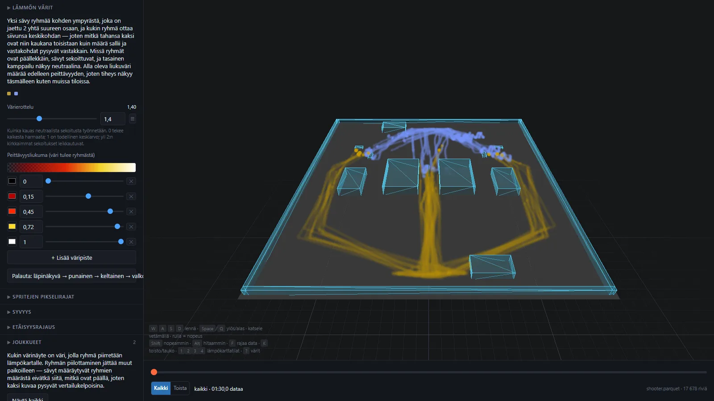

# Joukkuelämpö

Joukkuelämpö näyttää, missä kukin joukkue oli, jokainen omalla värillään. Siellä, missä joukkueet menevät päällekkäin, värit sekoittuvat.

**Joukkuelämpö** (näppäin 3) on [Lämmön](heat.md) tiheyskenttä, jossa jokaisella [ryhmällä](glossary.md) on oma sävynsä. Siellä, missä ryhmät menevät päällekkäin, niiden sävyt sekoittuvat. Tasainen kamppailu näkyy neutraalina. Peittävyys kantaa tiheyttä edelleen samoin kuin muissa tiloissa, joten kuva vastaa samalla kysymyksiin *kuinka paljon* ja *kenen*. Tila tarvitsee ryhmäsarakkeen.

Se ei ole [hahmo päällekkäin -näkymä](box-replay.md): se piirtää yhden hahmon henkilöä kohden. Tämä on tiheyskenttä, joka on värjätty saman sarakkeen mukaan.

## Käyttötapa {#how-to-use-it}

1. Paina `3` (tai valitse **Joukkuelämpö** tilapalkista).
2. Avaa **Lämmön värit**. Värinäytteet näyttävät kunkin ryhmän värin; vie hiiri näytteen päälle nähdäksesi joukkueen nimen.
3. Jos kaikki näyttää harmaalta, nosta **Värierottelua**.
4. Poista ryhmän valinta [Joukkuelistassa](teams-list.md) poistaaksesi sen. Muiden värit pysyvät paikoillaan.

## Säätimet {#controls}

Osiossa **Lämmön värit**:

| Säädin | Oletus | Merkitys |
|---|---|---|
| Värinäytteet | | Kunkin ryhmän väri ensimmäisille 12 ryhmälle, sitten *+N lisää*. Vie hiiri päälle nähdäksesi ryhmän nimen ja värin. |
| **Värierottelu** | 1,4 | Kuinka paljon sekoitusta työnnetään pois neutraalista, 0-4. 0 tekee kaiken harmaaksi; 1 on todellinen keskiarvo; noin 2:n yli kirkkaimmat sekoitukset poistuvat näytettävältä alueelta ja rajataan kanavittain, mikä siirtää niiden sävyä. |
| **Peittävyysliukuma (väri tulee ryhmästä)** | oletuksen lämpöliukuma | Tässä käytetään vain liukuman **alfaa**: läpinäkyvä siellä, missä ei ole mitään, peittävä ylhäällä. Sen värejä ei käytetä. |

Kaikki muut lämpösäätimet - muoto, kyllästys, vaste, vähimmäislämpö, syvyys, rajaus - toimivat kuten [Lämmössä](heat.md).

[Joukkuelista](teams-list.md) näyttää kunkin ryhmän joukkuelämmön värin näytteenään tässä tilassa. Ryhmän piilottaminen jättää kaikkien muiden ryhmien värit paikoilleen: sävyt tulevat ryhmien kokonaismäärästä, eivät siitä, mikä on päällä, joten kaksi kuvaa pysyvät vertailukelpoisina.

## Paletti {#the-palette}

Lähteenä [`colors.ts`](https://github.com/Holdi601/3DHeat/blob/main/src/render/colors.ts):

- Värit ovat **Oklab**-väritasossa kiinteällä kirkkaudella (0,7) ja värikylläisyydellä (0,115), joten jokainen ryhmä on yhtä kirkas, eikä punainen ryhmä näytä kuumemmalta kuin sininen.
- Kun ryhmiä on *n*, sävyympyrä jaetaan *n* yhtä suureen osaan, ja ryhmä *i* saa oman osansa **keskikohdan**, `(i + 0,5) / n` kierroksesta. Mitkä tahansa kaksi ryhmää ovat mahdollisimman kaukana toisistaan, ja vastakkaiset pysyvät vastakkaisina ryhmämäärästä riippumatta.
- Käytetään enintään **16** eri sävyä. Kun ryhmiä on enemmän, tunnisteet sijoitetaan toistuvalla puolittamisella (bittikäänteiset tunnisteet: 0, ½, ¼, ¾, ⅛ ja niin edelleen), joten vierekkäiset tunnisteet eivät jaa sävyä. Ryhmät yli 16:n jakavat väistämättä sävyn.
- Ryhmä, jonka nimi tarkoittaa "ei ryhmää" - `0`, tyhjä, `none`, `unknown`, `null` tai `-1`, kirjainkoosta välittämättä - piirretään **neutraalina harmaana**, eikä se saa osaa ympyrästä. Ryhmäluettelosta vain ensimmäinen tällainen nimi käsitellään näin.

Oletuserottelu on 1,4 eikä 1, koska tasolla 1 viiden tasaisesti jakautuneen sävyn sekoitus *on* harmaa: oikein, mutta lukukelvoton. Hiukan yli 1 pitää tasatilanteet rehellisinä ja tekee 60/40-jaon näkyväksi.

## Miten se toimii {#how-it-works}

Lämpökohteessa on tässä tilassa neljä kanavaa. Jokainen hahmo lisää tiheytensä *v* ensimmäiseen kanavaan ja *v* × ryhmän Oklab-koordinaatit *a* ja *b* toiseen ja kolmanteen. Yhdistämisen aikana pikselin sekoitus on tiheydellä painotettu keskiarvo: *a* = G / R, *b* = B / R, skaalattuna väriparilla ja muunnettuna sRGB:ksi paletin kirkkaudella. Jakaminen kertyneellä tiheydellä pitää sävyn riippumattomana siitä, kuinka paljon dataa on, ja siksi kaikki tiheyssäätimet vaikuttavat yhä vain peittävyyteen.

Neljän kanavan kohde maksaa saman resoluution yksikanavaisen lämpökohteen nelinkertaisen näytönohjaimen muistin.
