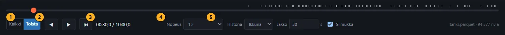

# Aikajana ja toisto

Kuvan alla oleva palkki on kuin videosoitin: voit toistaa datan elokuvana, pysäyttää sen, hypätä kohdasta toiseen ja muuttaa nopeutta.

Näkymän alla oleva palkki on aikajana ([`Timeline.tsx`](https://github.com/Holdi601/3DHeat/blob/main/src/ui/Timeline.tsx)). Se päättää, mitkä rivit ovat näkyvissä milloinkin. Se tarvitsee aikasarakkeen. Ilman sitä koko palkki poistetaan käytöstä, näkymä pysyy tilassa **Kaikki** ja sivupalkki kertoo: *Tässä datassa ei ole aikasaraketta - aikajana on pois käytöstä ja jokainen datapiste näytetään kerralla.*

## Kaikki ja Toista {#all-and-play}

Kaksi ylimmän tason tilaa, koska ne vastaavat eri kysymyksiin.

- **Kaikki** (oletus jokaisella latauksella) ei välitä toistokohdasta lainkaan, vaan näyttää jokaisen suodattimet läpäisevän rivin. Se on näkymä "missä tämä tapahtuu", eikä se ole sama kuin vetäminen loppuun. Vierityspalkki on pois käytöstä ja kello näyttää `kaikki ·  datasta`.
- **Toista** toistaa datan aikavalokuvana. Vierityspalkki, toistopainikkeet ja historia-asetukset tulevat näkyviin.

**Kaikki**-tilan valitseminen pysäyttää myös toiston.

## Säätimet {#the-controls}

| Säädin | Oletus | Merkitys |
|---|---|---|
| Vierityspalkki | alku | Toistokohta. Vedä hyppiäksesi; 20 000 askelta koko välin yli. |
| **Kaikki** / **Toista** | Kaikki | Katso yllä. |
| ▶ / ❚❚ | pysäytetty | Toista tai pysäytä; myös `K`. |
| ◀ **Toista taaksepäin (J)** | | Toistaa datan käänteisessä järjestyksessä. Näkyy vain **Hahmot päällekkäin** -tilassa; sama näppäin `J` toimii siellä myös (katso [Näppäimistö](#keyboard)). |
| ⏮ | | Takaisin välin alkuun. |
| Kello | | `kulunut / yhteensä` muodossa `mm:ss.s` (tai `h:mm:ss`) ja, kun aikasarake on absoluuttinen aikaleima, toistokohdan seinäkellon kellonaika muodossa `HH:MM:SSZ` (UTC). |
| **Nopeus** | 1× | Aineiston sekuntia todellista sekuntia kohden. Valikossa on 17 askelta 0,01×:stä 1800×:aan (0,01, 0,02, 0,05, 0,1, 0,25, 0,5, 1, 2, 4, 8, 16, 32, 64, 128, 256, 600, 1800), sekä **Mukautettu…**: kirjoita mikä tahansa nopeus 0,001×:stä 3600×:ään (esimerkiksi 0,3 tai 12) ja paina Enter; Esc säilyttää nykyisen nopeuden. Viimeisin nopeus muistetaan seuraavaa käyntiä varten (katso [Tallennetut asetukset](ref-settings-storage.md)). |
| **Historia** | Kertyvä | Mikä näkyy toistokohdassa: *Kertyvä*, *Ikkuna* tai *Elinaika* (alla). |
| **Jakso** (Ikkuna; Viivat-tilassa myös Elinaika) | 30 s | Toistokohtaan päättyvän ikkunan pituus; vähintään 0,01 s. [Viivalämmössä](line-heat.md#playback) se on hännän pituus. |
| **Varaelinaika** (vain Elinaika, ei Viivat-tilassa) | 10 s | Kuinka kauan datapiste, jolla ei ole seuraavaa näytettä samalta henkilöltä, pysyy näkyvissä. |
| **Häivytys** (vain Elinaika, ei Viivat-tilassa) | 0,4 | Osuus kunkin datapisteen elinajasta, jonka se häipyy, 0-1. |
| **Silmukka** | päällä | Lopussa alkaa alusta; pois päältä pysähtyy loppuun. |
| Oikea reuna | | Aineiston nimi. |

**Väli** on aineiston aikaväli - tai [hahmo päällekkäin -näkymässä](box-replay.md), kun istunto on valittu, kyseisen istunnon väli.

## Historia {#history}

Toista-tilassa:

- **Kertyvä** - kaikki välin alusta toistokohtaan asti. Lämpö kasvaa toistaessa.
- **Ikkuna** - kiinteä historiajakso, joka päättyy toistokohtaan (*Jakso*).
- **Elinaika** - jokainen datapiste elää, kunnes **saman henkilön seuraava näyte** (samassa istunnossa) tulee, joten jokaisella hetkellä on täsmälleen yksi sijainti henkilöä kohden. Datapiste, jonka henkilö ei enää esiinny - kuolema, yhteyden katkeaminen, lokin loppu - ei saa seuraavaa näytettä, ja se elää *Varaelinajan* ajan sen sijaan, että katoaisi heti tai pysyisi ikuisesti. Datapisteet **häipyvät** elinajan viimeisen *Häivytys*-osuuden aikana sen sijaan, että ne poksahtaisivat pois. Kun henkilöä kohden on yksi elävä näyte, datapisteen katoaminen yhdeltä kehykseltä seuraavalle saa koko kentän vilkkumaan näytteenottotaajuudella. *Häivytys* 0 palauttaa kovan leikkauksen.

Elinaika tarvitsee henkilösarakkeen aikasarakkeen lisäksi; ilman sitä historia palautuu latauksessa Kertyväksi. [Viivalämmössä](line-heat.md#playback) historia asettaa, kuinka kauan reitin häntä on näkyvissä; [hahmo päällekkäin -näkymässä](box-replay.md) *Varaelinaika* on se, kuinka kauan henkilöä pidetään, jolla ei ole enää näytteitä.

## Toiston käyttäytyminen {#playback-behaviour}

Kehysluupista ([`engine.ts`](https://github.com/Holdi601/3DHeat/blob/main/src/render/engine.ts)):

- Toistokohta etenee *kehysaika × nopeus*. Kehysaika on rajattu 0,1 s:iin, joten välilehdelle vaihtaminen ei hyppäytä toistokohtaa.
- Kun painat toistoa aivan välin lopussa, toisto alkaa alusta, kuten mediasoitin. Jokaisella latauksella toistokohta on asetettu alkuun, joten ensimmäinen toistopainallus toistaa.
- Välin lopussa toistokohta hyppää takaisin alkuun (Silmukka päällä) tai pysähtyy siihen ja toisto päättyy (Silmukka pois).
- Vierityspalkki lukee moottorin toistokohdan suoraan joka kehyksellä; sovellustila päivittyy hyppyissä, aloituksissa, pysäytyksissä ja silmukoissa.
- Istunnon valitseminen Istuntovalitsimessa hyppää sen istunnon alkuun.

## Miksi toisto on sujuva ja halpa {#why-playback-is-smooth-and-cheap}

Rivit on tallennettu aikajärjestykseen, joten aikaväli on kaksi binäärihakua aikasarakkeesta. Toistokohdan siirtäminen liikuttaa kahta kokonaislukua eikä koske yhteenkään riviin. Toiston kustannus seuraa välin rivimäärää, ei aineiston kokoa.

Lämmön pitäminen tasaisena, kun ikkuna liikkuu, riippuu historiasta ([Kertyminen](accumulation.md)):

- **Kertyvä** vain kasvaa, joten jokainen kehys lisää vain ne rivit, jotka tulivat näkyviin edellisen jälkeen, täydellä painolla. Kenttä kasvaa yksitoikkoisesti, ja tauko ei muuta mitään, koska ei ole enää mitään saapumassa. (Uudelleenarviointi tekisi jokaisesta kehyksestä eri satunnaisen osajoukon valaisun ja sitten häivytyksen, mikä näkyisi purskeina, jotka leimahtavat ja katoavat.)
- **Ikkuna** ja **Elinaika** muuttuvat todella joka kehys, ja ne arvioidaan uudelleen. Ne yhdistetään eksponentiaalisena liukuvana keskiarvona (painokerroin 0,34 uudelle kehykselle). Se on tasapainotilassa harhaton ja paljon hiljaisempi kuin alusta aloittaminen.
- Elinaika-tilassa ehdokasrivit ovat ne, jotka ovat välillä *toistokohta - max(datan pisin aukko, Varaelinaika)* toistokohtaan asti. Varjostin pudottaa sitten jokaisen rivin, jonka oma elinaika on päättynyt, ja soveltaa häivytystä.

Siirtyminen Kaikki- ja Toista-tilojen välillä tai historian muuttaminen käynnistää kertymisen uudelleen.

## Näppäimistö {#keyboard}

| Näppäin | Vaikutus |
|---|---|
| `K` | Toista / pysäytä |
| `J` | Toista taaksepäin; uusi painallus pysäyttää (vain Hahmot päällekkäin) |
| `L` | Toista eteenpäin; uusi painallus pysäyttää (vain Hahmot päällekkäin) |

`J` ja `L` vaihtavat myös aikajanan tilaan **Toista**. Näppäimet eivät vaikuta, kun tekstikenttä tai valikko on valittuna. Kisa-analyysi-välilehdessä `K` ohjaa sen oman välilehden toistoa.
