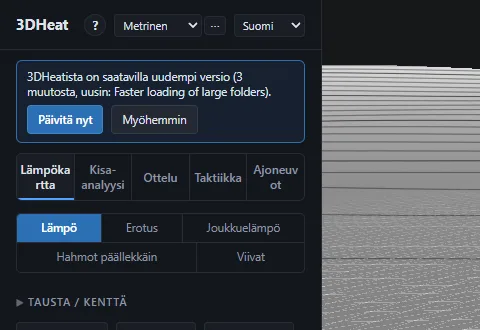

# Päivitykset

Katselin kertoo, kun uudempi versio on saatavilla. Se päivittää itsensä vain, kun sanot kyllä. Mitään ei muuteta tietokoneellasi ilman vastaustasi.

## Katselimen päivittäminen {#update-the-viewer}

1. **Sivulla.** Kun uudempi versio on saatavilla, sivupalkin yläosassa olevan nimen alle ilmestyy laatikko: "A newer version of 3DHeat is available". Napsauta **Päivitä nyt**. Sivu latautuu uudelleen itsestään, kun päivitys on valmis. **Myöhemmin** piilottaa laatikon, kunnes lataat sivun uudelleen.
2. **Jos siinä lukee, että pitää ajaa restart.bat**, sulje palvelimen ikkuna (musta ikkuna, jonka `start.bat` avasi) ja kaksoisnapsauta `restart.bat`-tiedostoa.
3. **Kun käynnistät katselimen.** `start.bat` tarkistaa myös. Jos uudempi versio on saatavilla, se kysyy **Update now? [Y/N]**. Paina `Y` päivittääksesi. Paina `N` tai odota 60 sekuntia ilman vastausta, niin käynnistyy versio, joka sinulla on.



Kopiota, jossa on omia muutoksia, ei koskaan päivitetä puolestasi. Laatikko kertoo vain, että päivitys odottaa, ja neuvoo tekemään commit tai stash omille muutoksillesi ja ajamaan `git pull`. Kopio, jota ei ole asennettu gitillä (esimerkiksi zip-tiedosto), ei näytä mitään.

Tarkistus etenee näin, vaihe vaiheelta:

```
page ---(after 4 s, then every 6 h)---> dev server ---> git fetch
   behind?  no  -> nothing is shown
            yes -> your own changes or commits?  yes -> tell you only
                                                 no  -> [Update now] -> git pull
                                                        -> reload, or "run restart.bat"
```

## Turvasäännöt {#the-safety-rules}

- **Vain pikasiirto** (`git pull --ff-only`): päivitys ei koskaan yhdistä, siirrä tai kirjoita mitään uudelleen.
- **Ei paikallisia muutoksia**: kopiota, jossa on tallentamattomia muutoksia seurattuihin tiedostoihin (`git status --porcelain --untracked-files=no` ei ole tyhjä), ei koskaan päivitetä automaattisesti. Kenenkään oma työ ei kuulu päivityksen korvattavaksi. Siitä vain kerrotaan, että päivitys odottaa. Seuraamattomat tiedostot (data, viennit) eivät ole muutoksia.
- **Ei paikallisia commit-muutoksia**: kopiota, jossa on commit-muutoksia, joita ylävirta ei tunne ("diverged"), ei päivitetä. Pikasiirto ei voi tuoda sitä ajan tasalle, ja yhdistäminen kuuluu käsin ajettavalle `git pull`-komennolle. Sivu ja `start.bat` kertovat tämän samoilla sanoilla. `start.bat` käynnistää siinä olevan version.
- **Vain sivulta itseltään**: kehityspalvelimen päivityspyynnön on kannettava mukanaan oma otsikko. Jos selain lähettää `Origin`-kentän, sen on tultava palvelimen omasta isännästä (alla).
- Päivitetään vain git-kopiota, jolla on ylävirran haara. Kaikki muu (kopio ilman `.git`-hakemistoa, ilman gitiä, staattinen versio) jätetään rauhaan, eikä siitä sanota mitään.

## Mitä start.bat tekee {#what-startbat-does}

`start.bat` (kaksoisnapsauta sitä; ikkuna on palvelin) tekee järjestyksessä:

1. Etsii Node.js:n. Ensin `PATH`:sta, sitten `%ProgramFiles%\nodejs`-, `%ProgramFiles(x86)%\nodejs`- tai `%LOCALAPPDATA%\Programs\nodejs`-hakemistosta. Jos sitä ei löydy, se tarjoutuu asentamaan sen komennolla `winget install -e --id OpenJS.NodeJS.LTS` (kysytään, Y/N. Sen jälkeen ikkuna täytyy avata uudelleen, jotta Windows ottaa uuden `PATH`:n käyttöön).
2. **Päivitykset**, kun git on asennettu ja kansiossa on `.git`:
   - `git fetch --quiet` (ei verkkoa tai ylävirtaa: ohitetaan hiljaa);
   - lasketaan `git rev-list --count HEAD..@{u}`. Jos mitään ei ole jäljessä, mitään ei sanota;
   - paikalliset muutokset: "A newer version of 3DHeat is available (N changes), but this copy has local changes, so it is not updated. Commit or stash them, then run git pull." Käynnistyy siinä oleva versio;
   - omat commitit (`git rev-list --count @{u}..HEAD` ei ole 0): "A newer version of 3DHeat is available (N changes), but this copy has commits of its own that the newest version does not, so it is not updated. Update it with git pull." Käynnistyy siinä oleva versio;
   - muutoin "A newer version of 3DHeat is available (N changes)." ja kysymys **Update now? [Y/N]**. `N`, tai ei vastausta 60 sekuntiin, tulostaa "Not updated; starting the version you have." ja käynnistää siinä olevan version. Kun vastaus on `Y`: "Updating...", kerrotaan muuttuvatko `package.json` tai `package-lock.json`, ajetaan `git pull --ff-only` (jos sekin epäonnistuu, esimerkiksi verkon takia: "The update did not go through; starting the version you have."), sitten `git submodule update --init` ([Ylläpidä dokumentaatiota](maintaining.md#the-tools-under-exporters)), sitten `npm install`, jos paketti-tiedostot muuttuivat ja `node_modules` on olemassa, ja lopuksi "Updated.";
3. Estää toisen palvelimen käynnistämisen. Jos portti **5273** on jo käytössä, se kertoo tämän ja ohjaa `restart.bat`- tai `stop.bat`-tiedostoon;
4. Ensimmäisellä kerralla (kun `node_modules` puuttuu) se kysyy ennen riippuvuuksien lataamista (noin 300 MB `node_modules\`-hakemistoon, ei mihinkään järjestelmän laajuiseen paikkaan);
5. Käynnistää kehityspalvelimen osoitteeseen `127.0.0.1:5273` (`--strictPort`) ja avaa selaimen, kun se on valmis.

`restart.bat` pysäyttää palvelimen (portin perusteella) ja ajaa `start.bat`-tiedoston uudelleen, joten se kysyy saman kysymyksen. `stop.bat` vain pysäyttää palvelimen.


## Kehittäjille {#for-developers}

### Kun se toimii: päivitysreitti {#while-it-runs-the-update-route}

Kehityspalvelin (Vite-liitännäinen `heat3d-self-update` tiedostossa `vite.config.ts`) tarjoaa reitin `/__heat3d/update`. Se on olemassa vain kehityspalvelimella, ei staattisessa versiossa eikä `vite preview`:ssä.

**`GET /__heat3d/update`** kertoo, onko kopio jäljessä:

```json
{ "checkout": true, "upstream": "origin/main", "behind": 3, "ahead": 0, "dirty": false, "latest": "the newest commit's subject" }
```

- `checkout: false`, kun kansio ei ole git-kopio;
- se ajaa `git fetch --quiet` **enintään 30 minuutin välein**. Pyynnöt välissä vastaavat viimeksi haetusta tilasta;
- `behind` ja `ahead` tulevat komennoista `git rev-list --count HEAD..@{u}` ja `@{u}..HEAD`. `dirty` tulee komennosta `git status --porcelain --untracked-files=no`. `latest` on ylävirran uusimman commitin otsikko;
- ilman ylävirran haaraa `upstream: null` ja `behind: 0`.

**`POST /__heat3d/update/apply`** tuo kopion ajan tasalle:

1. Hylätään koodilla `403 { ok: false, reason: "forbidden" }`, ellei pyynnössä ole otsikkoa `X-Heat3d-Update: 1`. Jos pyyntö kantaa `Origin`-kentän, sen isännän on oltava pyynnön `Host`. Sivustojen välinen lomake ei voi lähettää mukautettua otsikkoa ilman CORS-esitarkistusta, eikä tämä palvelin koskaan myönnä sitä.
2. Ei tehtävää (ei kopiota, ei ylävirtaa, ei jäljessä): `{ ok: true, updated: false }`.
3. Paikalliset muutokset: `{ ok: false, reason: "dirty" }`. Paikalliset commitit: `{ ok: false, reason: "diverged" }`.
4. Muuten: kerätään muuttuvat tiedostot (`git diff --name-only HEAD @{u}`), ajetaan `git pull --ff-only` (2 min aikaraja), `git submodule update --init` (virhe ohitetaan), `npm install`, jos `package.json` tai `package-lock.json` muuttui (15 min aikaraja). Vastaus on `{ ok: true, updated: true, restart }`. `restart` kertoo, miksi käynnissä oleva palvelin ei voi ottaa päivitystä käyttöön: `"dependencies"`, kun riippuvuudet asennettiin uudelleen, `"config"`, kun vain `vite.config`-tiedosto muuttui, ja `false`, kun uudelleenkäynnistystä ei tarvita.
5. Epäonnistunut git- tai npm-komento vastaa `{ ok: false, reason: "<virhe, enintään 300 merkkiä>" }`.

Vastaukset ovat JSON-muodossa, `Cache-Control: no-store`. Palvelin kuuntelee vain `127.0.0.1`-osoitetta, joten reittiin ei pääse verkosta.

### Ilmoitus sivulla {#the-notice-in-the-page}

`UpdateBanner` sivupalkin yläosassa olevan nimen alla:

- Se kysyy reitiltä **4 sekuntia** sivun latautumisen jälkeen (ei heti: sivulla on aineistoa ladattavana ja GPU käynnistettävänä). Sen jälkeen se kysyy **6 tunnin välein**, kun sivu pysyy auki.
- Se ei näytä **mitään**, kun reittiä ei ole (staattinen versio), kansio ei ole git-kopio tai mikään ei ole uudempaa. Ilmoitus joka käynnistyksellä on sellainen, johon ihmiset oppivat olemaan kiinnittämättä huomiota.
- Jäljessä ilman paikallisia muutoksia: "A newer version of 3DHeat is available (N changes, the newest: <subject>)." sekä painikkeet **Päivitä nyt** ja **Myöhemmin** (*Myöhemmin* piilottaa laatikon, kunnes sivu ladataan uudelleen).
- Jäljessä paikallisilla muutoksilla: sama lause ja "This copy has local changes, so it is not updated automatically; commit or stash them, then run git pull." Painiketta ei ole.
- **Päivitä nyt** lähettää pyynnön osoitteeseen `/apply` ("Updating..."). Sen jälkeen:
  - "Updated. The page reloads." Sivu latautuu uudelleen 1,5 s kuluttua, koska palvelin tarjoaa jo uudet tiedostot;
  - kun riippuvuudet asennettiin uudelleen: "Updated. Its dependencies changed: close the server window and run **restart.bat** to finish.";
  - kun vain palvelimen asetukset muuttuivat: "Updated. Its server settings changed: close the server window and run **restart.bat** to finish.";
  - kun päivitettävää ei loppujen lopuksi ole (`updated: false`, esimerkiksi `start.bat` toi kopion ajan tasalle sillä välin): "Nothing to update: this copy is already the newest version." Sivua ei ladata uudelleen;
  - hylätty: *dirty*-lause tai "This copy has commits of its own that the newest version does not; update it with git pull." tai "The update did not go through: <reason>".
