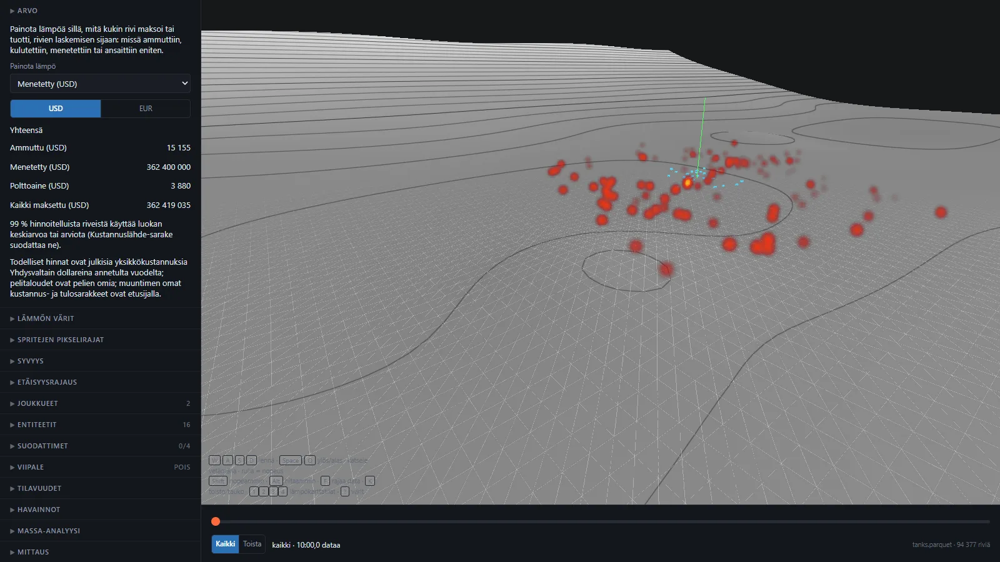

# Arvopainotus

Jokaisella laukauksella, ammuksella, menetetyllä ajoneuvolla ja litralla polttoainetta on hinta. Katselija laskee, mitä kukin rivi maksoi tai ansaitsi, ja voi painottaa lämmön sillä. Kartta näyttää siis **minne raha meni**, eikä vain sitä, missä rivit ovat.

## Käyttö {#how-to-use-it}

1. Lataa data, jossa on tapahtumia (laukauksia, tappoja, kuolemia) sekä ajoneuvojen tai aseiden nimiä.
2. Avaa **Arvo** lämpöpalkista.
3. Valitse **Painota lämpö**, esimerkiksi *Lost (USD)*. Lämpö lisää nyt jokaisen rivin hinnan 1:n sijaan.
4. Lue **Yhteensä**: kaikkien arvosarakkeiden summa näytettävälle datalle (suodattimet ja aikaikkuna vaikuttavat).
5. Kun hinnat ovat todellista rahaa, näkyviin tulee kytkin **USD / EUR**.

Valitse valikon tyhjä ensimmäinen kohta laskeaksesi rivit uudelleen.

## Mitä voi painottaa {#what-can-be-weighed}

Arvosarakkeet lisätään latauksessa, yksi per laji ja valuutta:

| Laji | Rivit, joille se osuu | Miten se hinnoitellaan |
|---|---|---|
| **Fired** | laukaukset ja laukaisut | ase, muuten lajin ammuksen keskiarvo |
| **Spent** | ostaminen, ilmestyminen | pelin rahasarakkeet (esimerkiksi ampujan ostovalikko) |
| **Lost** | kuolemat, tuhoutumiset | oma ajoneuvo, muuten sen luokan keskiarvo |
| **Destroyed** | tapot | kohteen ajoneuvo |
| **Damage dealt** | osumat | osuus kohteen arvosta |
| **Fuel** | sijainnit | kulutettu polttoaine polttoainesarakkeesta tai arvioituna luokasta ja ajasta |
| **All paid** | | fired + spent + lost + fuel |
| **Earned** | palkinnot | pelin omat palkintosarakkeet (`earn_…`) |
| **Net** | | earned miinus paid; piirretään etumerkillisenä lämpönä (positiivinen liukuma, missä ansaittiin enemmän, negatiivinen, missä maksettiin enemmän) |

Sarakkeiden nimet ovat `cost_<kind>_<currency>`, `earn_<currency>` ja `net_<currency>`. Muunnin, joka tuntee pelin oman valuutan (esimerkiksi toistomuunnin, joka kirjoittaa pelin sisäisiä krediittejä), voittaa sisäänrakennetut hintataulukot.

## Hintataulukot {#the-price-tables}

| Taulukko | Valuutta |
|---|---|
| Todellinen sotilasmaailma: ohjukset, pommit, ammukset, vastatoimet, lentokoneet, helikopterit, maajoukkojen ajoneuvot, laivat, polttoaine | USD (EUR = USD × 0,92, kiinteä `EUR_PER_USD` tiedostossa [`cost.ts`](https://github.com/Holdi601/3DHeat/blob/main/src/data/cost.ts); se ei ole reaaliaikainen kurssi) |
| Ampujien ostovalikot ja tappopalkinnot | pelin krediitit |
| Panssari- ja laivapelit | pelin krediitit |
| Strategiapelit (useita resursseja) | yksi sarake per resurssi sekä yhdistetty sarake |
| Sotapelit | pisteet |

Peli tunnistetaan datan nimistä. Todellisten maailman hinnat tulevat julkisista lähteistä (budjettiasiakirjat, tietosanakirjat) tai ne on merkitty arvioiksi. Niitä ei ole korjattu inflaatiolla. Luettelo taulukoista on sivulla [Arvotaulukot](ref-value-tables.md).

## Arviot {#estimates}

Lisäsarake **Cost source** kertoo, miten kukin rivi hinnoiteltiin: `table`, `class average`, `estimate` tai `none`. Osio Arvo näyttää, minkä osuuden hinnoitelluista riveistä muodostavat keskiarvot tai arviot. Jos haluat vain tarkasti hinnoitellut rivit, poista rasti kohdista *estimate* ja *class average* kohdassa **Cost source** sivulla [Suodattimet](filters.md).

## Muualla arvo näkyy {#where-else-value-shows}

- [Oivallukset](insights.md): löydökset *Costly ground* ja *Earning ground*.
- [Erittely](breakdown.md): ansaitut, menetetyt ja nettorahat joukkueittain, pelaajittain tai aseittain.
- [Tilavuudet](volumes.md): arvosarakkeet tilastoissa ja vertailussa.
