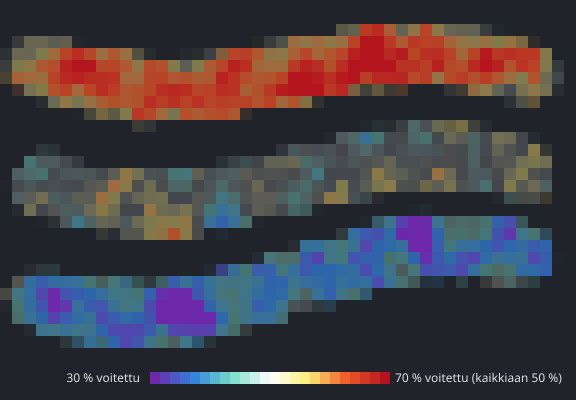

# Voittojen osuus: kuinka usein paikka, reitti tai siirto voittaa

Missä pelaaja seisoo, mihin suuntaan hän kulkee, mihin hän heittää varusteensa - ja kuinka usein hänen puolensa sitten voittaa erän. **Voittokartta** värittää jokaisen paikan sen mukaan, kuinka suuri osa siellä olevista riveistä kuuluu eriin, jotka rivin puoli voitti, verrattuna osuuteen kaikesta näytetystä: lämmin, missä osuus on suurempi, kylmä, missä se on pienempi, ei mitään, missä se on sama.

*Kuva on keksittyä dataa: kolme reittiä tyhjällä tasolla, ja niiden riveistä 68 %, 50 % ja 33 % voitetuissa erissä.*

Se tarvitsee dataa, joka kertoo, kuka voitti: [tulossarakkeet](data-formats.md#outcome-columns) (`won`, `matchWon`, `roundEndReason`). CS2:n ja War Thunderin muuntimet kirjoittavat ne, Tacview-muunnin DCS-palvelimen kampanjoille ([DCS-palvelimet](tacview-acmi.md#dcs-servers-who-won-and-how-each-sortie-ended)); mikä tahansa tiedosto voi sisältää ne.

## Kokeile {#try-it}

1. Lataa otteluita, joissa on tulossarake, ja paina `2` (**Erotus**).
2. Paina kohdassa **Erotusjako** **Erävoittojen osuus** (tai **Ottelovoittojen osuus**). Se laittaa voitetut erät **+**:lle ja hävityt **−**:lle ja vaihtaa paneelin tilaan **+:n osuus**.
3. Lue värit. Paneeli kertoo kokonaisosuuden: *Kaikkiaan 52,0 % 1 200 000 rivistä on +:lla.*
4. Rajaa sitä [suodattimilla](filters.md): yksi puoli (T tai CT), yksi tapahtumatyyppi (*Sijainti* sille, missä ihmiset seisoivat, *Laukaus* tai *Laukaisu* sille, mistä he ampuivat tai heittivät), yksi osto, yksi kartta.

Paikka, joka on lämmin *Sijainti*-riveillä, on paikka, jonka haltijat yleensä voittivat erän. *Tuho*-riveillä se on paikka, jossa tehdyt tuhot johtivat voitettuihin eriin.

## Asetukset {#the-settings}

| Asetus | Mitä se tekee | Oletus |
|---|---|---|
| **Erotus** / **+:n osuus** | itse erotus, tai +-puolen osuus kummankin puolen riveistä | Erotus |
| **Täysi väri kohdassa** | kuinka paljon kokonaisosuuden ylä- tai alapuolella paikka näytetään täydellä värillä, prosenttiyksikköinä | ± 20 prosenttiyksikköä |
| **Vähiten rivejä paikan värittämiseen** | paikkaa, jossa on vähemmän rivejä, ei väritetä; väri tulee näkyviin vähitellen puolesta määrästä alkaen | 12 |
| **Veto kokonaisosuutta kohti (riviä)** | jokainen paikka alkaa näin monesta rivistä kokonaisosuudella, joten paikkaa, jossa on 3 riviä, kaikki voitettuja, ei näytetä 100 %:na | 12 |

Kaikki kolme vaikuttavat valmiiseen kuvaan: niiden vetäminen ei koskaan käynnistä kertymää uudelleen.

Osuus on minkä tahansa jaon osuus, ei vain voittojen: *+:n osuus* puolen mukaisella jaolla näyttää, missä T-puoli oli suurempi osa läsnäolosta, ja kahden kartan tiedostojen mukaisella jaolla, missä toisen tiedoston rivit painavat enemmän kuin toisen.

## Rivejä, ei eriä {#rows-not-rounds}

Kartta laskee rivejä. Pelaaja, joka seisoo yhdessä paikassa kaksikymmentä sekuntia, lisää rivin jokaisesta näytteestä, kaikki samasta erästä, joten näyttö paikassa on sen lähellä olevat rivit, ei erät. Siksi vähimmäismäärä ja veto ovat riveinä, ja siksi ne ovat suurempia kuin yhden erän verran.

Itse erille:

- **[Erittely](breakdown.md)** pisteessä, näkymässä tai tilavuudessa: *Voitto %* laskee jokaisen pelaajan erän kerran, vedettynä paikan kokonaisosuutta kohti samalla tavalla (4 erää).
- **[Tilavuudet](volumes.md)**-tilastot: *Voittojen osuus* - erät, joissa pelaaja oli tilavuuden sisällä, kukin kerran, vedettynä kaiken näytetyn osuutta kohti, lukumäärien kanssa.

## Tulossuodattimet {#outcome-filters}

[Suodattimet](filters.md)-paneeli luettelee tulossarakkeet heti katselimen omien jälkeen: **Erän tulos** ja **Ottelun tulos** (*Mikä tahansa*, *Voitettu*, *Hävitty*) ja **Miten erä päättyi** (Eliminointi, Pommi räjähti, Pommi purettu, Aika loppui, Luovutus, Tasapeli, Tavoite, Alueet hallussa, Pisteet menetetty, Kaikki ajoneuvot menetetty), katselimen kielellä.

## Kehittäjille {#for-developers}

Lämpöajo kirjoittaa kolme summaa nelikanavaiseen kohteeseen, jota joukkuelämpö käyttää: lämmön `R = Σ|v|`, +-puolen lämmön `P` ja `S = Σ v²/w`, jossa `w` on ajon paino (otantapaino kertaa kuvavahvistus). Yhdistelmä lukee osuuden `P/R` (ytimellä painotettu keskiarvo) ja rivit, joihin se perustuu, `n = R²/S` (Kishin efektiivinen otoskoko), vetää osuutta kokonaisosuutta kohti, `p = (n·P/R + m·r0)/(n + m)`, ja värittää `p - r0`:n välin yli erotusasteikoilla.

`n` jakaa pois jokaisen tekijän, joka on yhteinen pikselin kohdalla oleville riveille - kuvavahvistuksen, otantapainon, rajatun spriten pinta-alapainon - joten kuva on sama millä tahansa zoomauksella ja otantatiheydellä, ja joka k:nnen rivin kuvat yhdistyvät kokonaisuudeksi ilman, että värit hyppivät. Kokonaisosuus tulee suorittimen puolikohtaisista laskureista, prosentin kymmenesosan tarkkuudella; näytönohjaimelta ei lueta mitään takaisin. Laskenta ja sen tarkistukset: [`render/rateMap.ts`](https://github.com/Holdi601/3DHeat/blob/main/src/render/rateMap.ts) ja sen testi.

Se maksaa saman kuin joukkuelämpö: nelikanavainen kohde nelinkertaistaa lämpöajon sekoituskaistanleveyden, vain kun *+:n osuus* on päällä.
