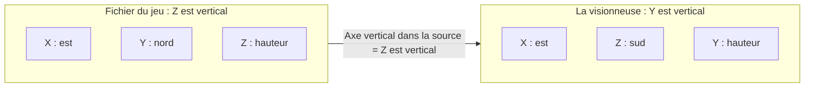

# Axes, unités et temps

Les jeux et les cartes ne sont pas d’accord sur le sens du haut, sur la longueur d’une unité, ni sur la façon d’écrire le temps. Cette page montre les trois réglages qui font tenir, à l’échelle et dans le bon sens vos données.

Si votre carte se dresse comme un mur au lieu de reposer comme un sol, changez **Axe vertical dans la source**.

Avec un mauvais **Axe vertical dans la source**, la carte se dresse comme un mur ; avec le bon, elle repose comme un sol.

## Le monde dans lequel dessine la visionneuse {#the-world-the-viewer-draws-in}

Le monde de la visionneuse est **Y vertical** : X et Z forment le plan du sol, Y est la hauteur. La plupart des moteurs de jeu sont **Z vertical** : pour eux, X et Y sont le sol et Z est la hauteur. Certains moteurs sont aussi en miroir (main gauche). La correspondance indique comment transformer les axes du fichier en axes de la visionneuse. (Techniquement, la visionneuse est en main droite, la convention de three.js.)

### Axe vertical {#up-axis}

**Axe vertical dans la source** dans le [Mappage des colonnes](column-mapping.md) :

| Réglage | Le fichier (x, y, z) devient le monde (X, Y, Z) |
|---|---|
| *Z est vertical (la plupart des moteurs de jeu)* - par défaut | (x, **z**, **y**) : le Z du fichier devient la hauteur et le Y du fichier devient le Z du monde |
| *Y est vertical (convention graphique)* | (x, y, z) inchangé |

Pour les données à Z vertical, les trois tableaux sont renommés au lieu d’être copiés ([`remapAxesInPlace`](https://github.com/Holdi601/3DHeat/blob/main/src/data/ingest.ts)), ce qui économise des centaines de mégaoctets lors des gros chargements. La devinette se fait sur l’échantillon : celle des colonnes Y et Z qui a la plus petite dispersion est verticale.

### Inversions {#flips}

**Inverser X**, **Inverser Y**, **Inverser Z** changent le signe de l’axe *du fichier* portant ce nom, avant le renommage - donc, avec Z vertical, *Inverser Y* change le signe de ce qui devient le Z du monde. Une inversion modifie les données chargées : les coordonnées affichées par la [règle](measure.md), la coupe et la pose de la caméra sont alors les coordonnées inversées.

Pour dessiner un monde en miroir dans le bon sens **sans** changer les données, utilisez plutôt **Caméra et scène → Inverser l’axe du monde** ([Caméra](camera.md#invert-world-axis)). C’est le meilleur choix pour les jeux dont le monde est en main gauche, car chaque coordonnée que montrent les outils reste celle du jeu.

### Échelle des unités {#unit-scale}

**Échelle des unités** multiplie chaque position. *1 (m)* met 1, *0.01 (cm→m)* met 0.01 (les unités de Unreal Engine sont des centimètres, il faut donc 0.01 ; les unités du moteur Source sont des pouces, il faut donc 0.0254 ; aucune des deux n’est en mètres), et la case accepte n’importe quelle valeur. Un 0 tapé, ou une valeur qui n’est pas un nombre, est remplacé par 1.

La visionneuse indique les distances en mètres (rayon des sprites, distances d’élimination, règle, vitesse de vol), ce qui n’est vrai que si l’unité du monde mise à l’échelle est un mètre. Rien ne casse si ce n’est pas le cas ; les étiquettes disent simplement « m » pour quelle que soit l’unité.

## Temps {#time}

### Unités de temps {#time-units}

Règle empirique : des valeurs comme 17000000000 (dix chiffres ou plus) sont un horodatage Unix ; des valeurs comme 0, 0.25, 0.5 sont des secondes depuis le début.

| Unité de temps (libellé du menu) | Lue comme | Heure murale affichée |
|---|---|---|
| *Secondes (relatif)* | valeur × 1 s | non |
| *Millisecondes (relatif)* | valeur × 0.001 s | non |
| *Microsecondes (relatif)* | valeur × 10^-6 s | non |
| *Nanosecondes (relatif)* | valeur × 10^-9 s | non |
| *Horodatage Unix (s)* | secondes depuis le 1970-01-01 UTC | oui |
| *Horodatage Unix (ms)* | millisecondes depuis le 1970-01-01 UTC | oui |
| *Chaîne de date ISO-8601* | texte tel que `2026-03-14T18:02:11.250Z`, analysé avec `Date.parse` du navigateur | oui |

Avec une unité absolue (les trois dernières), le jeu de données garde l’instant de l’heure murale de sa ligne la plus ancienne, et la chronologie affiche l’heure UTC courante (`HH:MM:SSZ`) à côté de la tête de lecture.

**Les colonnes Parquet `TIMESTAMP` et `DATE`** se décodent en instants réels ; leur réglage d’unité est donc ignoré, et le panneau le dit. Une colonne `DATE` représente un jour entier : toutes les lignes d’un jour partagent un même instant, et la lecture saute un jour à la fois, ce que signale le panneau.

**Les chaînes ISO-8601 marchent aussi bien en CSV qu’en Parquet.** Une colonne de temps en texte avec l’unité ISO est analysée une fois par chaîne distincte ; si aucune ne se laisse analyser, le chargement échoue avec *Aucun horodatage ISO-8601 analysable dans la colonne de temps mappée.* - et le mappage refuse déjà de démarrer quand aucune des valeurs échantillonnées ne s’analyse. Une colonne Parquet `TIMESTAMP` est lue comme horodatage quelle que soit l’unité réglée, et une colonne Parquet numérique avec l’unité ISO est lue comme des millisecondes Unix. Une colonne de temps en texte avec une unité numérique est refusée avant le chargement : chaque valeur se lirait comme NaN.

### Comment le temps est stocké {#how-time-is-stored}

Pendant la fusion des fichiers, les temps sont des secondes sur 64 bits, si bien qu’une époque absolue garde son détail sous la seconde. Quand tous les fichiers sont là, le temps le plus ancien de toute la sélection devient 0 et chaque ligne stocke des secondes sur 32 bits à partir de ce point. Un flottant sur 32 bits a 24 bits de mantisse : des étendues allant jusqu’à environ un jour et demi se résolvent à mieux que 1/100 s, des étendues d’un demi-an à environ une seconde. Une ligne dont le temps manque ou n’est pas un nombre est placée à 0, le début.

Les lignes sont ensuite triées par temps, ce qui rend la chronologie peu coûteuse : une fenêtre de temps se trouve par deux recherches dichotomiques (voir [Échantillonnage et budgets](sampling-and-budgets.md)).

### Temps écoulé ou heure murale {#elapsed-time-versus-wall-clock}

Une colonne de temps comme `match_time` ou `round_time` compte depuis le début propre à chaque match. La choisir place chaque match sur un axe commun - bien pour comparer ce qui se passe à la minute 3 de chaque match - et le panneau le signale. Une colonne d’heure murale montre les matchs dans l’ordre où ils se sont vraiment déroulés, en se chevauchant là où ils se sont chevauchés.

## Sens du regard {#look-direction}

Le sens du regard n’est utilisé que par le [replay de boîtes](box-replay.md) (les rayons de chaque boîte). Il est stocké sous forme de deux angles, lacet et tangage, en radians.

- **Colonnes lacet / tangage** : lues telles quelles, converties depuis les degrés si *Degrés* est choisi. Elles ne sont pas ajustées par l’axe vertical ni par les inversions.
- **Colonnes de vecteur de direction** passent par le même renommage et les mêmes inversions que les positions, puis deviennent lacet = atan2(x, -z) et tangage = atan2(y, √(x² + z²)) dans les axes du monde ; le rayon pointe donc aussi là où la boîte fait face dans un monde source en miroir.

Si les colonnes lacet/tangage sortent dans le mauvais sens après une inversion, un vecteur de direction ou des angles ajustés, c’est la solution.
