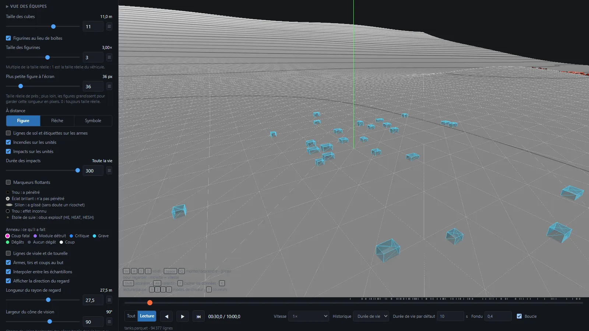

# Figurines superposées (replay de boîtes)

Un petit film : une figurine pour chaque personne, qui bouge au fil du temps, avec une traînée derrière elle.

Le mode s’appelle **Figurines superposées** dans la barre des modes. Cette page s’appelait autrefois « replay de boîtes », car avant l’arrivée des figurines, chaque personne était une boîte ; « replay en figurines » et « replay de boîtes » veulent dire la même chose. **Figurines superposées** n’a pas de touche numérique : choisissez-la dans la barre des modes. Il dessine une figurine (ou une boîte) par [personne](glossary.md), qui se déplace le long de la [chronologie](timeline.md), avec des rayons de regard et des traînées facultatifs. C’est une lecture plutôt qu’une densité : *qui était où, et quand*. Il lui faut une colonne de personne ; sans colonne de temps, chaque échantillon est dessiné d’un coup.

## Comment l’utiliser {#how-to-use-it}

1. Chargez des données avec une colonne de personne et une colonne de temps.
2. Choisissez **Figurines superposées** dans la barre des modes.
3. Passez la chronologie sur **Lecture** et lancez la lecture (`K`).
4. Ouvrez **Vue des équipes** pour changer la **Longueur de traînée**, la taille des figurines ou les rayons de regard.

Aucune chaleur n’est dessinée dans ce mode, et le budget de sprites adaptatif est inactif.

Par défaut, chaque personne est dessinée comme la figurine de ce qu’elle est, et non comme une boîte - voir [Figurines](figures.md) pour la figurine qu’obtient chaque unité, et [Replay de match](match-replay.md) pour les étiquettes, la caméra qui suit, la mesure entre deux unités et la liste des événements.

## Le panneau Vue des équipes {#the-team-viewer-panel}

Affiché à la place des panneaux de chaleur dans ce mode.

| Commande | Par défaut | Plage (curseur) | Signification |
|---|---|---|---|
| **Figurines au lieu de boîtes** | activé | | Chaque personne comme la figurine de ce qu’elle est : un soldat à pied, le char ou l’aéronef que nomment les données. Ce que les données ne précisent pas reste une boîte. |
| **Taille des figurines** | 1× | | 1× est la taille réelle. |
| **Plus petite figure à l’écran** | 36 px | 0 = toujours la taille réelle | Taille réelle de près ; plus loin, les figurines grandissent pour rester aussi longues que ce nombre de pixels. |
| **Armes, tirs et coups au but** | activé | | Armes en vol avec fumée, traceurs, impacts, coups au but et éliminations. Les traceurs déduits d’un coup au but sont en pointillés. |
| **Taille des cubes** | taille de l’entité, ou étendue / 500, au chargement | 0.05-200 m, logarithmique (5000) | Longueur d’arête de chaque boîte. Voir [taille de l’entité](sessions-persons-groups.md#entity-size). |
| **Interpoler entre les échantillons** | activé | | Entre deux échantillons de la même personne dans la même session, place la boîte proportionnellement entre les deux. Jamais à travers une frontière de session. |
| **Afficher la direction du regard** | activé | | Un rayon part de chaque boîte dans la direction du regard de la personne (nécessite des [colonnes de regard](axes-units-and-time.md#look-direction)). |
| **Longueur du rayon de regard** | taille de l’entité × 4, ou étendue / 200, au chargement | 0.5-500 m, logarithmique (20 000) | Affiché quand la direction du regard est active. |
| **Longueur de traînée** | 8 s | 0-300 s (86 400) ; 0 = désactivé | Secondes d’historique tracées derrière chaque personne. |
| **Dessiner chaque échantillon brut** | désactivé | | Une boîte par échantillon stocké dans la fenêtre, au lieu d’une boîte interpolée par personne. Sous-échantillonné pour rester interactif. |

Les indications du panneau expliquent que l’interpolation et les traînées ne relient les échantillons qu’au sein d’une seule session et, quand le chargement a des [noms partagés](sessions-persons-groups.md#names-worn-by-several-things-at-once), combien de noms sont dessinés comme des échantillons isolés.

## La session jouée {#the-session-being-played}

Avec une colonne de session, le sélecteur **Session** en haut de la barre latérale ([Sessions](sessions-persons-groups.md#the-session-picker)) décide quel match est rejoué. Le plus actif est choisi au chargement. Seules les lignes de cette session deviennent des boîtes et des traînées, et la chronologie parcourt l’étendue de cette session au lieu de tout le jeu de données. *Toutes les sessions* joue toutes les sessions à la fois, sans jamais relier des échantillons entre sessions.

## Ce qui est dessiné quand {#what-is-drawn-when}

Tiré de [`TrackCursor`](https://github.com/Holdi601/3DHeat/blob/main/src/data/tracks.ts) :

**Boîtes en direct** (mode Lecture, échantillons bruts désactivés). Pour chaque personne visible, son dernier échantillon à la tête de lecture ou avant :

- Si la personne a un échantillon suivant, qu’il est dans la même session et que le nom n’est pas partagé, la boîte est placée entre les deux échantillons proportionnellement au temps, avec le lacet interpolé par le plus court chemin et le tangage linéairement (quand *Interpoler* est activé).
- Sinon, la boîte reste au dernier échantillon pendant la **Durée de vie par défaut** de la chronologie (10 s par défaut), puis elle disparaît, pour que les joueurs éliminés ne traînent pas.

**Le mode Tout** ignore la tête de lecture et dessine chaque échantillon de la plage comme une boîte.

**Échantillons bruts** dessine une boîte par échantillon stocké dans la fenêtre : l’*étendue* avec l’historique *Fenêtre*, sinon tout ce qui va jusqu’à la tête de lecture. 65 536 boîtes au maximum ; avec davantage d’échantillons, un sur *k* est dessiné.

**Traînées** (quand la longueur de traînée est supérieure à 0 et que les échantillons bruts ne sont pas dessinés) : une ligne entre chaque paire d’échantillons consécutifs d’une personne dans les dernières *longueur de traînée* secondes jusqu’à la tête de lecture, qui passe de 80 % d’opacité à transparent avec l’âge. Une traînée s’arrête à un changement de session et n’est pas dessinée pour les noms partagés. 131 072 sommets au maximum ; au-delà, des lignes sont sautées régulièrement.

**Qui est visible :** une personne est masquée quand son groupe est décoché dans la [liste des équipes](teams-list.md) (son groupe étant celui de sa première ligne), quand un filtre de groupe l’exclut, ou quand le panneau [Entités](entities.md) a une sélection qui ne la comprend pas. Les [filtres](filters.md) de colonnes ne s’appliquent pas aux boîtes.

## Couleurs {#colours}

Une famille de teintes par groupe et une nuance par membre, si bien qu’un coup d’œil suffit pour savoir de quel côté est quelqu’un ([`teamMemberColor`](https://github.com/Holdi601/3DHeat/blob/main/src/render/colors.ts)). Les teintes des groupes tournent sur une liste fixe de dix - bleu, rouge, vert, ambre, violet, cyan, magenta, citron vert, orange, indigo - et les membres d’un groupe se répartissent entre une luminosité de 42 % à 76 % et une saturation de 90 % à 65 %.

## Notes {#notes}

- La superposition de figurines ne reconstruit ses figurines que quand quelque chose change ; une image inactive redessine les dernières.
- La ligne *Cubes* de la [superposition des statistiques](performance-and-stats.md) compte les boîtes à l’écran.
- La superposition de figurines se dessine dans la même scène que le niveau ; la [profondeur de champ](camera.md#depth-of-field) floute donc les boîtes, mais jamais la chaleur.
