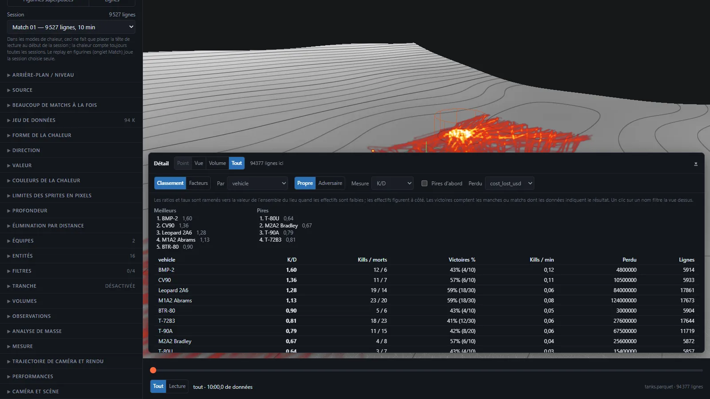
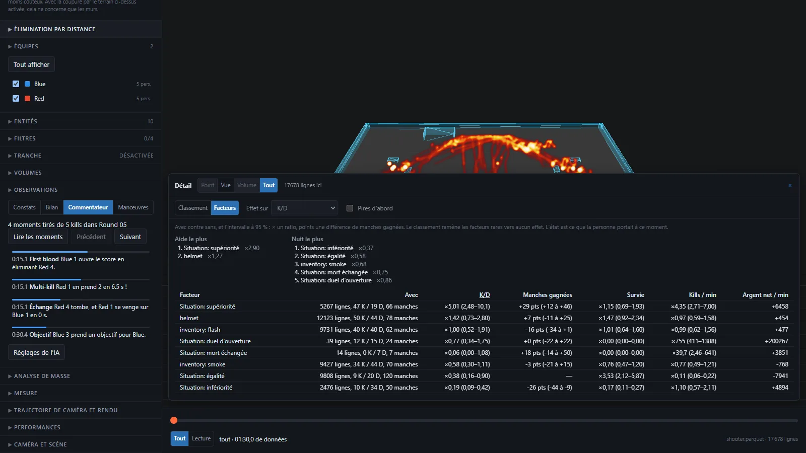

# Détail : qui et quoi réussit le mieux, et où

Le **Détail** répond à une seule question : à cet endroit, quel véhicule, quel joueur ou quelle arme réussit le mieux ? Servez-vous-en pour trouver le char qui gagne au pont, ou pour voir si porter un casque aide vraiment.

Il classe ce qui se passe à un endroit (un point choisi, la vue, un volume ou tout ce qui est affiché) selon n’importe quelle catégorie, et mesure chaque facteur d’état avec et sans.

## Essayer {#try-it}

1. Chargez un match avec des éliminations et des morts, et ouvrez **Volumes**.
2. Dessinez un volume autour de l’endroit qui vous intéresse et sélectionnez-le.
3. Appuyez sur **Détail…** sous Statistiques.
4. Sous **Par**, choisissez *Véhicule*, puis la mesure *K/D* (éliminations par mort).
5. Lisez la liste, le meilleur en premier. Appuyez sur **Pires d’abord** pour la retourner. Cliquez sur un nom pour filtrer la vue sur lui ; cliquez à nouveau pour le relâcher.

## L’ouvrir {#open-it}

| Depuis | Région de départ |
| --- | --- |
| **Détail…** dans [Volumes](volumes.md) (Statistiques) | le volume sélectionné |
| **Détail ici** sur la fiche de sélection, après un clic sur un point | une sphère autour de ce point (**Rayon**, par défaut 3 % de la taille des données) |
| le panneau de séparation **Différence** | la vue |

L’en-tête change la région : **Point**, **Vue** (ce que la caméra voyait au dernier comptage ; **Recompter** après un déplacement), **Volume** (en choisir un) ou **Tout**. Le comptage se fait en arrière-plan ; la ligne d’état indique combien de lignes sont dans la région.

## Classement {#ranking}

Choisissez selon quoi classer et une mesure :

| Mesure | Ce que c’est |
| --- | --- |
| A, B | lignes de chaque côté de la carte de différence, séparées comme la chaleur les sépare |
| A / B, A - B, A / (A + B) | les deux couches l’une contre l’autre |
| K/D | éliminations contre morts |
| Victoires % | manches (ou matchs) gagnées, quand les données disent qui a gagné |
| Éliminations / min | éliminations par minute de présence (écarts entre les échantillons de mouvement) |
| Gagné, Perdu, Argent net | sommes des colonnes `earn_*` et `cost_*` ; un sélecteur choisit la monnaie |

Les éliminations, les morts, la présence, les victoires et l’argent comptent chaque ligne que la vue montre à cet endroit, des deux côtés de la séparation ou d’aucun.

Les ratios et les taux sont tirés vers la valeur de l’endroit entier quand les effectifs sont petits, si bien que 2 éliminations en 1 vie ne se hissent pas en tête. Les effectifs sont affichés à côté.

Vous pouvez classer par groupes, joueurs et matchs, par toute colonne de catégorie (un véhicule, une arme, un camp, un type d’achat, un agent ou un kit), par toute colonne numérique en plages (blindage, valeur d’un équipement), par la **classe** d’une colonne d’arme (fusil, fusil de précision, pistolet-mitrailleur, pistolet...) et par le nombre d’éléments d’**utilitaire** qu’une colonne de liste comme `inventory` contient.

**Propre** classe par la valeur propre de la ligne. **Adversaire** classe par la valeur de l’autre partie : l’arme de la victime sur une élimination, celle du tueur sur une mort (demande une colonne `other` / `victim` qui les nomme).

## L’état au moment {#state-at-the-time}

La valeur d’une ligne est la sienne, sauf si la ligne n’en enregistre aucune (une ligne d’événement sans équipement) ou s’il s’agit d’une mort (dont la colonne d’arme peut nommer l’arme du tueur) ; c’est alors ce que la même personne portait en dernier plus tôt dans le match.

## Facteurs : avec contre sans {#factors-with-against-without}

Passez de **Classement** à **Facteurs**, choisissez **Effet sur**, et lisez *Aide le plus* et *Nuit le plus* :

L’effet de chaque facteur sur le K/D, les manches gagnées, la survie (minutes par mort), les éliminations par minute et l’argent net par minute, avec un intervalle à 95 % : les ratios en x, les manches gagnées en différence de points. Le classement tire chaque estimation vers l’absence d’effet selon sa propre incertitude, si bien qu’un facteur rare a besoin d’un effet net pour se hisser haut ; l’intervalle affiché est celui qui n’est pas tiré.

Les données avec des manches ajoutent les **situations** de combat rapproché ([Combat rapproché et manches](close-quarters.md)), calculées une fois pour un jeu de données : *aveuglé* (le `state_flashed` de la ligne, ou un flash ennemi dans un rayon de 15 m dans les 3 dernières secondes), *mort échangée*, *duel d’ouverture*, et *surnombre*, *nombres égaux* ou *infériorité* (joueurs vivants du côté de la ligne contre l’ennemi). Une mort compte dans la situation où se trouvait sa victime juste avant elle.

256 facteurs au maximum sont mesurés en une seule passe.

## Pour les développeurs {#for-developers}

### Tirer les petits échantillons {#pulling-small-samples}

La valeur de classement est `(n + m*r0) / (d + m)` : `n` et `d` sont les effectifs, `r0` le ratio de tout l’endroit et `m` le poids de cet a priori.

### Pour les auteurs de convertisseurs : nommer les colonnes de facteurs {#for-converter-authors-naming-factor-columns}

Un convertisseur ajoute un facteur en nommant sa colonne :

| Colonne | Facteur |
| --- | --- |
| `state_<nom>` nombre | actif tant qu’il est non nul (`state_scoped`, `state_suppressor`) |
| `state_<nom>` catégorie | un facteur par valeur (`state_ammo` = AP, HE...) |
| `active_<nom>` | le même, pour quelque chose d’activé ou utilisé récemment : une capacité, un ultime, un gadget, un bonus (`active_ult`, `active_stim`) |
| colonne de liste (`inventory`, `loadout`, `perks`, `abilities`, `attachments`, `modules`, `buffs`, `debuffs`, `upgrades`, ou un nom `state_`/`active_` finissant par `s`) | un facteur par élément d’une valeur `a\|b\|c` |
| indicateurs d’équipement déjà courants (`helmet`, `defuser`, `armor`, `scoped`, `airborne`, `duck`, `flashed`...) | actif tant qu’il est non nul |
| `ammoType`, `shellType`, `ammoName` | le projectile tiré en dernier |

Résultats : une colonne `won` à 0/1 (le camp de la ligne a gagné la manche ou le match) et une colonne `round`. Argent : `earn_<monnaie>` et `cost_<type>_<monnaie>` ; un revenu par type seul (`earn_round_cs2`, les récompenses exactes de manche d’un convertisseur) ne remplace que le revenu de ce type dans le modèle de coût (`round` couvre aussi les poses et désamorçages), et le modèle chiffre le reste.

Le mappage charge ces colonnes par lui-même, à côté de la liste propre du fichier : chaque colonne `state_*`, `active_*`, `won`, `round` et de liste, sauf celles que les statistiques d’un fichier Parquet montrent à valeur unique tout du long (chaque colonne chargée occupe 4 octets par ligne).
