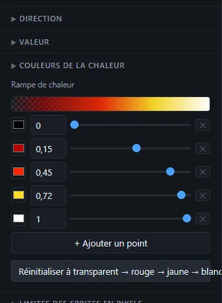

# Couleur et exposition

Ces commandes décident quelle quantité de chaleur reçoit quelle couleur. Le **Point de saturation** est la quantité de chaleur qui compte comme blanc incandescent.

## Corrections rapides {#quick-fixes}

- Tout est blanc : augmentez le **Point de saturation**, ou appuyez sur **Exposition automatique d’après le champ**.
- Rien n’est visible : baissez le **Point de saturation**, ou appuyez sur **Exposition automatique d’après le champ**.
- Seuls quelques points isolés apparaissent : augmentez la **Chaleur minimale**.

Chaque commande de cette page agit au moment où la chaleur devient une couleur. Si vous faites glisser l’une d’elles, l’image se redessine tout de suite, et cela **ne relance jamais l’accumulation**.

## Point de saturation {#saturation-point}

**Point de saturation** (section Forme de la chaleur) : la chaleur accumulée qui correspond au haut de la rampe de couleurs (avec la réponse *Linéaire* ; voir plus bas pour les autres). Curseur logarithmique de 0.1 à 4000, la poignée peut aller jusqu’à 10 000 000, car la chaleur accumulée grandit avec le nombre de lignes. Par défaut : 24. À chaque chargement, une **estimation analytique**, puis une **mesure** faite sur l’image.

Bien choisir cette valeur fait la différence entre une carte de chaleur et un écran blanc (ou vide). On ne peut pas la déduire de façon fiable : les données de télémétrie se regroupent tellement - un point de départ, une porte, un goulot d’étranglement - que le rapport entre la densité de pointe et la densité moyenne varie d’un ordre de grandeur selon les jeux de données et selon les angles de caméra.

## Exposition automatique {#auto-exposure}

**Exposition automatique d’après le champ** mesure le champ que le shader a réellement produit. Il ignore les pixels vides, prend le 98e centile des pixels éclairés et le place à 85 % du chemin vers le point de saturation. Ainsi, le haut de la rampe reste réservé aux vrais pics.

Le panneau affiche alors *mesuré sur X % de l’image ; 98e centile R placé près du haut de la rampe*. Avec la réponse *Saturante*, une valeur à 85 % du point de saturation tombe à environ 57 % de la rampe au lieu de 85 %.

Elle se lance aussi **automatiquement** :

- 8 images rendues après le chargement d’un jeu de données ;
- 8 images après un changement des [filtres](filters.md) (filtrer chaque position jusqu’à cent événements change la densité de plusieurs ordres de grandeur) ;
- 8 images après le passage de la chaleur par points à la [chaleur linéaire](line-heat.md), ou après un changement des routes tracées par la chaleur linéaire, car une ligne dépose beaucoup moins de chaleur par échantillon qu’un sprite.

Quand rien n’est éclairé, la mesure automatique laisse la saturation telle quelle ; le bouton revient alors à l’estimation analytique et affiche *rien à mesurer - estimation analytique utilisée*.

### Suivre la vue {#follow-the-view}

**Suivre la vue** (section Forme de la chaleur, activée par défaut) mesure de nouveau à chaque fois que la caméra s’arrête. Une région dans laquelle vous volez utilise donc toute la rampe de couleurs, au lieu de l’échelle mesurée pour la carte entière. Les petits changements sont ignorés, et l’échelle glisse au lieu de sauter. Cela fonctionne dans les quatre modes de chaleur, pas dans la superposition des figurines.

Décochez-la pour bloquer l’échelle et comparer des endroits sur une même échelle. Faire glisser le **Point de saturation** à la main la bloque aussi.

## Réponse à la densité {#density-response}

**Réponse à la densité** - la façon dont *k* (chaleur / saturation) se répartit sur la rampe :

| Réponse | Formule | Usage |
|---|---|---|
| **Saturante** (par défaut) | t = 1 - e^(-k) | Tend vers le haut de la rampe sans jamais l’atteindre, comme le font des sprites translucides empilés. Rien ne tombe jamais à un blanc uni, ce qui en fait le choix sûr par défaut pour des données inconnues. |
| **Linéaire** | t = k | Seule répartition où une même couleur veut dire un même nombre. Utilisez-la pour comparer deux jeux de données ou deux périodes. |
| **Log** | t = log₂(1 + 7k) / 3 | Compresse une longue queue, pour qu’un point chaud extrême n’écrase plus tout le reste vers le bas de la rampe. Éclaircit les zones peu denses. |

## Chaleur minimale {#minimum-heat}

**Chaleur minimale** (désactivée par défaut, 0-100 %) : chaque pixel qui porte une chaleur, même faible, est remonté à au moins ce point de la rampe. Montez-la, et baissez le rayon des sprites, pour voir **où quelque chose s’est produit** - chaque point de donnée devient nettement visible au lieu de rester juste au-dessus du transparent. Laissez-la désactivée pour juger de la densité, car elle aplatit volontairement le bas de la rampe. Le seuil (k > 0.0001) garde vides les pixels réellement vides.

## L’éditeur de rampe {#the-ramp-editor}

Dans la section **Couleurs de la chaleur**. Son intitulé dit à quoi sert la rampe : *Rampe de la chaleur* dans Chaleur et Lignes, *Positive (équipes additives)* dans Différence, *Rampe d’opacité (la couleur vient du groupe)* dans [Chaleur par équipe](team-heat.md), où seule son opacité est utilisée.



La barre du haut montre un aperçu de la rampe. Dessous, une ligne par point :

| Élément | Signification |
|---|---|
| Pastille de couleur | La couleur du point (le sélecteur de couleurs du navigateur). |
| Nombre | La position du point sur la rampe, de 0 à 1 (0 = pas de chaleur). |
| Curseur | L’opacité du point, 0-100 %. |
| ✕ | Supprime le point ; désactivé quand il ne reste que deux points. |

**+ Ajouter un point** ajoute un point à mi-chemin entre les deux derniers, avec la couleur et l’opacité du dernier point. **Réinitialiser à transparent → rouge → jaune → blanc** rétablit la valeur par défaut.

Les points peuvent être donnés dans n’importe quel ordre ; ils sont triés quand la rampe est construite. L’**alpha** est ce qui mélange la chaleur à la scène, et c’est pour cela que l’extrémité zéro de la rampe par défaut est entièrement transparente.

### Les rampes par défaut {#the-default-ramps}

| Position | Positive (Chaleur, Lignes, Différence +) | Négative (Différence −) |
|---|---|---|
| 0.00 | noir, alpha 0 | noir, alpha 0 |
| 0.15 | rgb(180, 0, 0), alpha 0.55 | rgb(0, 170, 60), alpha 0.55 |
| 0.45 | rgb(255, 40, 0), alpha 0.85 | rgb(0, 190, 200), alpha 0.85 |
| 0.72 | rgb(255, 220, 40), alpha 0.95 | rgb(40, 80, 255), alpha 0.95 |
| 1.00 | blanc, alpha 1 | rgb(170, 60, 255), alpha 1 |

## Pendant que la caméra bouge {#while-the-camera-moves}

Quand la caméra bouge, l’accumulation repart à zéro à chaque image. Avec **Dessiner chaque ligne à chaque image** activé (par défaut), chaque image en mouvement reste exacte ; désactivé, une image en mouvement montre une estimation par échantillons - des grumeaux plus lumineux et pondérés - qui converge vers l’image vraie et plus lisse dès que vous vous arrêtez. C’est normal ; voir [Accumulation](accumulation.md).

## Pour les développeurs {#for-developers}

### La passe de composition {#the-composite-pass}

Une fois la chaleur accumulée, la valeur de chaque pixel est transformée en couleur dans une seule passe de composition ([`COMPOSITE_FS`](https://github.com/Holdi601/3DHeat/blob/main/src/render/webgl2/shaders.ts)). Les étapes sont :

```
k = |heat| / saturation point
t = response(k)                         clamped to 0..1
if minimum heat > 0 and k > 0.0001:  t = minimum + (1 - minimum) × t
colour, alpha = ramp(t)                  (the negative ramp when heat < 0, Difference only)
pixel = mix(scene, colour, alpha)
```

### L’estimation analytique {#the-analytic-estimate}

**L’estimation analytique** ([`estimateSaturation`](https://github.com/Holdi601/3DHeat/blob/main/src/data/calibrate.ts)) suppose que les lignes se répartissent sur l’empreinte X-Z des données : chaleur moyenne = lignes × (π r² / surface de l’empreinte) × 1/3 × intensité au centre (1/3 étant la moyenne sur le disque d’une rampe linéaire), multipliée par un rapport supposé pic/moyenne de 25, borné entre 0.1 et 1 000 000. Elle doit seulement être juste à un ordre de grandeur près.

### Mesure {#metering}

[`exposure.ts`](https://github.com/Holdi601/3DHeat/blob/main/src/render/exposure.ts) :

1. la cible de chaleur est relue depuis le GPU, sous-échantillonnée à 40 000 valeurs au plus ;
2. les pixels vides (chaleur ≤ 0.0001) sont écartés - la plupart d’un champ de chaleur est vide, et les moyenner tout ferait sous-exposer tout, comme un posemètre pointé sur un fond noir ;
3. le 98e centile des pixels éclairés sert de référence ;
4. le point de saturation devient référence / 0.85, si bien que la référence se place à 85 % du chemin vers le point de saturation, et que le haut de la rampe reste réservé aux vrais pics.

### La table de couleurs {#the-colour-table}

La rampe est cuite dans une table RGBA de 256 × 2 (rampe positive dans la première ligne, négative dans la seconde) ([`buildColorLut`](https://github.com/Holdi601/3DHeat/blob/main/src/render/colors.ts)). Les couleurs sont interpolées en lumière linéaire et stockées en sRGB ; l’opacité est interpolée linéairement.
