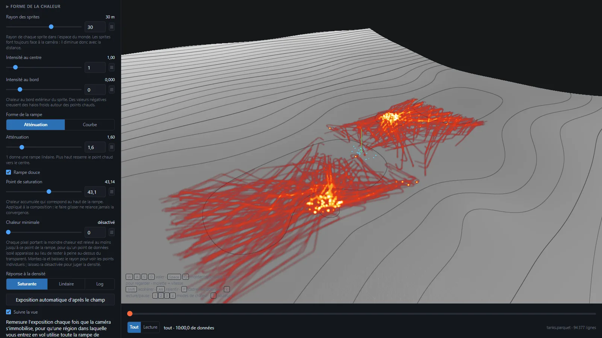
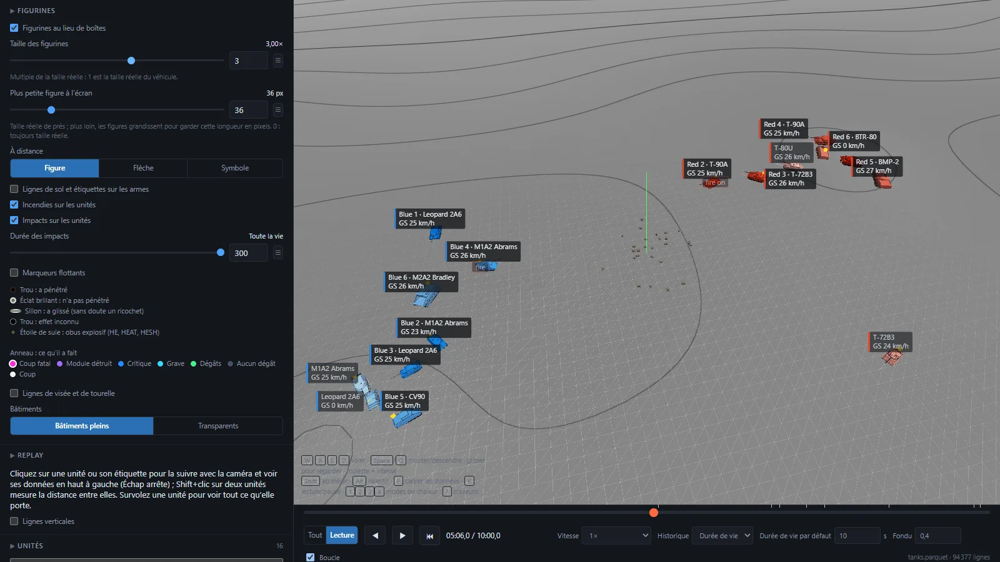

# Données de démonstration : essayez la visionneuse en cinq minutes



Vous n'avez pas encore de données ? Le dépôt en fournit. Tout ce qu'il contient est inventé : une vallée, une cour, et des matchs de trois styles de jeu fictifs avec des joueurs nommés *Blue 1* ou *Red 3*. Toutes les images de ce site ont été prises avec elles.

## Les créer {#make-it}

```bash
node tools/demo-data.mjs
```

Cela écrit dans `tools/.shots/demo/` :

| Fichier | Ce que c'est |
|---|---|
| `demo-valley.glb` | une vallée de 12 km avec deux collines et un village, sous forme de niveau 3D |
| `demo-yard.glb` | une cour murée de 160 m avec des bâtiments, sous forme de niveau 3D |
| `tanks.parquet` | 10 matchs de chars, 8 contre 8 : déplacements, tirs, impacts avec l'endroit sur la coque, incendies, éliminations, épaves, visée des tourelles, vainqueurs |
| `tanks/match-NN.parquet` | les mêmes matchs, un fichier par match, pour [plusieurs matchs à la fois](many-matches.md) |
| `air.parquet` | un combat aérien 4 contre 4 avec missiles, leurres, éliminations et tirs ratés |
| `shooter.parquet` | 12 manches de 5 contre 5 à pied : tirs, éliminations, une pose d'explosif, crédits gagnés et dépensés, casques et équipements |
| `mass/` | un dossier de petits matchs `.3dheat`, pour l'[analyse de masse](mass-analysis.md) |
| un jeu de tours de course | deux tours d'une même voiture sur un parcours fictif, pour l'[Analyse de course](race-analysis.md) |

Chaque table nomme ses propres colonnes dans son pied de page : elle se charge donc sans aucun mappage.

## L'essayer {#try-it}

1. Lancez la visionneuse (`start.bat` sous Windows, ou `npm install` une fois puis `npm run dev` sur tout système) et ouvrez `http://127.0.0.1:5273/`.
2. **Arrière-plan / niveau → Modèle 3D…** et choisissez `demo-valley.glb`.
3. **Source → Fichiers…** et choisissez `tanks.parquet`.
4. Appuyez sur `F` pour cadrer les données. Vous voyez la [chaleur](heat.md) de dix matchs.
5. Essayez la barre des modes : **Différence** (Blue contre Red), **Chaleur par équipe**, **Lignes**.
6. Ouvrez **Observations** (dans la barre latérale Carte de chaleur) : il repère les endroits où bien plus de tirs, d'impacts et de destructions que partout ailleurs se sont produits, autour des deux collines.
7. Ouvrez l'onglet **Match** ; sous **Matchs du replay**, choisissez *Match 01* ; appuyez sur **Lecture** sur la chronologie : le [replay](match-replay.md).



Pour le tireur, chargez `demo-yard.glb` et `shooter.parquet` ; pour le combat aérien, `air.parquet` (les figurines se voient mieux à **Taille des figurines** 4, un curseur du panneau **Vue des équipes** de la barre latérale Carte de chaleur).

## Les captures d'écran {#the-screenshots}

Les images du site sont réalisées à partir de ces données par un script, dans chacune des langues de la visionneuse :

```bash
node tools/demo-data.mjs
HEAT3D_FIGURE_PACK=none npx vite --port 5321 --strictPort --host 127.0.0.1   # PowerShell : $env:HEAT3D_FIGURE_PACK="none"; npx vite ...
node tools/docs-shots.mjs --lang en
```

Le serveur de captures fonctionne sans paquet de figurines local : seul le catalogue public de figurines est affiché. Les images vont dans `docs/assets/img/<lang>/`. Voir [Maintenir la documentation](maintaining.md).
