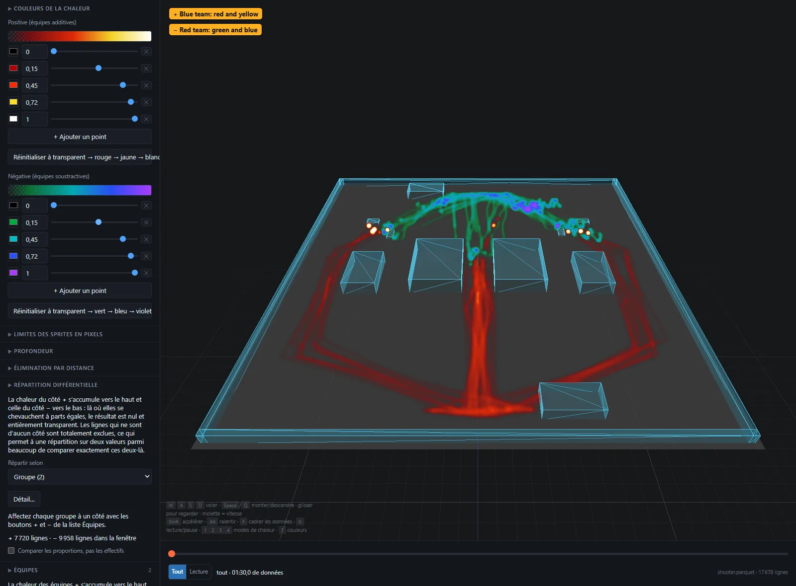

# Différence

Rouge là où l'équipe A était plus présente, bleu-vert là où c'était l'équipe B, rien là où elles étaient à égalité.

**Différence** (touche 2) est une chaleur signée. Les lignes d'une population ajoutent de la chaleur ; celles d'une autre population en retirent. Là où les deux se recouvrent à égalité, le résultat est zéro et entièrement transparent ; là où l'une domine, il s'affiche dans les couleurs de ce camp — par défaut chaudes (transparent → rouge → jaune → blanc) pour le camp **+** et froides (transparent → vert → bleu → violet) pour le camp **−**.

## Comment l'utiliser {#how-to-use-it}

1. Appuyez sur `2` (ou choisissez **Différence** dans la barre des modes).
2. Ouvrez **Répartition différentielle** dans la barre latérale.
3. Choisissez quoi **Répartir selon** : en général *Groupes*.
4. Mettez un groupe (ou une valeur) sur **+** et un autre sur **−**.
5. Lisez les couleurs : le chaud veut dire le camp +, le froid le camp −. Le panneau prévient si un camp n'a aucune ligne (voir [Messages que vous pouvez voir](#messages-you-may-see)).

*Quelles* deux populations comparer est toute la question : la répartition peut donc porter sur n'importe quelle colonne gardée, pas seulement sur les groupes. Les lignes qui ne tombent sur **aucun** des deux camps sont **laissées de côté**, et non comptées comme zéro : c'est ce qui fait qu'une répartition sur deux valeurs parmi beaucoup compare exactement ces deux-là, et elle se combine avec les [filtres](filters.md) — filtrez sur une seule carte, puis répartissez cela par version.

Le mode a besoin de deux camps : une colonne de groupe avec au moins deux groupes, ou une répartition sur une colonne gardée pour le filtrage. Sur des données avec moins de deux groupes, un chargement démarre avec une répartition par colonne — la colonne *Source file* d'un chargement de plusieurs fichiers d'abord, sinon la première colonne de catégorie qui a deux valeurs, sinon la première colonne numérique qui a une étendue — si bien que *comparer deux chargements* fonctionne sur des données sans aucun groupe. Seules les données sans rien de tel laissent le mode indisponible ; une répartition par colonne qui ne laisse rien d'un côté l'est aussi.

## Le panneau Répartition différentielle {#the-difference-split-panel}

Affiché en mode Différence, sous les panneaux de chaleur.

**Répartir selon** propose :

| Option | Affichée comme | Règle de répartition |
|---|---|---|
| Groupes | *Groupe (N)* (quand il y a une colonne de groupe) | Chaque groupe sur +, − ou aucun, réglé dans la [Liste des équipes](teams-list.md) |
| Une colonne de catégorie | *colonne (N valeurs)* | Valeurs sur +, − ou aucun |
| Une colonne numérique | *colonne (numérique)* | Une plage de valeurs pour chaque camp |
| Le fichier d'origine | *Source file - comparer deux chargements* (quand plusieurs fichiers sont chargés) | Fichiers sur +, − ou aucun |

Seules les colonnes gardées sous *Conserver pour le filtrage* au chargement sont proposées.

### Comparer les proportions, pas les effectifs {#compare-shares-not-counts}

**Comparer les proportions, pas les effectifs** (désactivé par défaut) pondère chaque camp par un sur son propre nombre de lignes, si bien qu'un camp qui a cinq fois plus de lignes ne gagne pas par le seul nombre. La couleur montre alors où chaque camp est proportionnellement plus fréquent que l'autre. Utilisez-le quand les deux camps ont des quantités de données très différentes, par exemple deux sessions de durées différentes.

### Messages que vous pouvez voir {#messages-you-may-see}

Le panneau prévient quand l'image n'est pas une vraie différence :

| Message | Signification |
|---|---|
| *N + / M −* (ou *N + / M − / K inutilisées*) | Combien de valeurs sont sur chaque camp (et sur aucun). |
| Aucune ligne de la fenêtre n'est du côté **+** | Seul le camp **−** est dessiné. Déplacez la fenêtre de la chronologie ou changez la répartition. |
| Aucune ligne de la fenêtre n'est du côté **−** | Seul le camp **+** est dessiné. |
| Aucune valeur n'est sur l'un ou l'autre camp | La différence ne dessine rien. Mettez au moins une valeur sur **+** ou **−**. |
| *colonne* ne peut pas être répartie ainsi | La colonne choisie ne convient pas à la répartition. Choisissez à nouveau la colonne. |
| La colonne de répartition n'a pas tenu dans la mémoire du GPU pour N des M morceaux | Ces lignes ne sont pas dessinées. Augmentez le budget GPU sous Performance → Budgets de ressources, ou chargez moins de lignes. |

### Par groupe {#by-group}

Le panneau renvoie simplement à la [Liste des équipes](teams-list.md), où chaque groupe a un bouton **+** et un bouton **−**. À chaque chargement, la première moitié des groupes (arrondie au supérieur) est mise sur +, le reste sur − ; **Répartir équitablement** dans la Liste des équipes refait la même chose. Un groupe sur aucun des camps, ou masqué avec sa case, n'apporte rien.

### Par valeurs de catégorie {#by-category-values}

| Partie | Signification |
|---|---|
| `a + / b − / c inutilisées` | Combien de valeurs sont sur chaque camp et sur aucun. |
| **Effacer** | Met chaque valeur sur aucun des camps. |
| Liste des valeurs | Chaque valeur avec un bouton **+** et un bouton **−** (cliquez de nouveau sur le bouton actif pour l'ôter de ce camp). Une valeur vide est listée comme *(manquante)*. |
| Note de limite | Seules les 200 premières valeurs sont listées : *Affichage des 200 premières valeurs sur N. Une colonne aussi large se restreint mieux avec un filtre d'abord, ou se répartit par plage si ses valeurs sont ordonnées.* |

Choisir la colonne met sa première valeur sur + et sa deuxième sur −. Quand aucun camp n'a de valeur, la répartition revient aux groupes au lieu d'afficher un cadre vide. *Source file* fonctionne de la même façon, une valeur par fichier — c'est ainsi que l'on compare deux exports, deux séries de tests ou deux versions.

### Par plage {#by-range}

| Partie | Signification |
|---|---|
| Indication | Le minimum et le maximum de la colonne. |
| **Plage positive (+)**, **de** / **à** | Les lignes dont la valeur est dans cette plage, bornes incluses, s'ajoutent. |
| **Plage négative (−)**, **de** / **à** | Les lignes dans cette plage se retranchent. |
| **Répartir au point milieu** | Met + sur [minimum, milieu] et − sur [milieu, maximum] — c'est aussi ce que fait le choix de la colonne. |

Une valeur présente dans les deux plages compte comme +. Les plages n'ont pas besoin de couvrir la colonne ; les valeurs hors des deux sont laissées de côté. *Les deux premières minutes contre les deux dernières* est une répartition par plage sur une colonne de type temps.

## Couleurs {#colours}

La section **Couleurs de la chaleur** affiche, dans ce mode, deux éditeurs de rampes : **Positive (équipes additives)** et **Négative (équipes soustractives)**, chacun avec son propre bouton de réinitialisation (*Réinitialiser à transparent → rouge → jaune → blanc*, *Réinitialiser à transparent → vert → bleu → violet*). Le composite prend la valeur absolue de la chaleur nette à travers le [point de saturation et la réponse](colour-and-exposure.md), et choisit la rampe négative là où le net est sous zéro. Voir [Couleur et exposition](colour-and-exposure.md#the-ramp-editor).

Utilisez la réponse de densité *Linéaire* quand la taille de la différence compte : c'est la seule réponse où une même couleur veut dire un même nombre.

## Pour les développeurs {#for-developers}

Chaque ligne reçoit un signe de +1, -1 ou 0 dans le shader de sommets ([`POINT_HEAT_VS`](https://github.com/Holdi601/3DHeat/blob/main/src/render/webgl2/shaders.ts)) ; un 0 rejette la ligne avant qu'aucun fragment ne soit dessiné.

- Par groupe, le signe vient d'une table de 4 096 entrées de groupes indexée par l'identifiant de groupe de la ligne (l'identifiant de groupe voyage dans le quatrième canal du texel de position de la ligne).
- Par catégorie, le signe vient d'une seconde table de 4 096 entrées, remplie par valeur de catégorie, et la valeur de la ligne est lue dans la texture de filtre de la colonne ; une valeur au-delà de la fin de la table est rejetée sur les deux moteurs.
- Par plage, la valeur de la ligne est comparée aux deux plages.

Changer la répartition relance l'accumulation.

**Les groupes masqués restent masqués avec toute répartition.** Sous une répartition par colonne, la table des groupes ne porte plus de signes ; elle contient 1 pour un groupe affiché et 0 pour un groupe masqué ([`frameSignTables`](https://github.com/Holdi601/3DHeat/blob/main/src/render/filterTables.ts)), et les deux tables atteignent le shader ensemble — deux lignes d'une même texture de signes sur WebGL2, deux moitiés d'un même tampon de stockage sur WebGPU. Une ligne n'est dessinée que lorsque son groupe est affiché *et* que sa valeur de colonne est sur un camp. Ainsi, un groupe décoché dans la [Liste des équipes](teams-list.md), ou laissé de côté par la mise au point d'un camp dans l'onglet Match, n'apporte rien quelle que soit la façon dont la différence est répartie.
