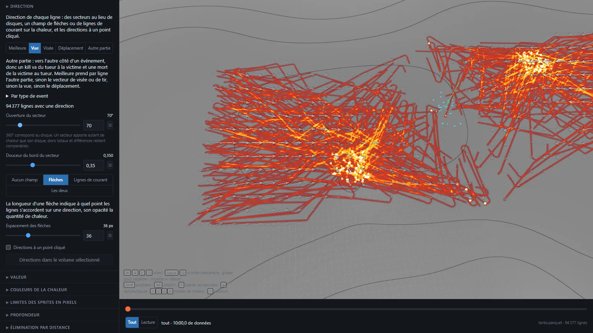

# Chaleur directionnelle

La chaleur simple dit **où** les choses se passent. La chaleur directionnelle dit aussi **dans quel sens** : dans quelle direction les gens regardaient, visaient, se déplaçaient, ou où se trouvait l’autre camp d’un combat.

Un sprite normal est un disque complet (360 degrés). Avec une **Ouverture du secteur** de 70 degrés, le même sprite devient un secteur étroit qui pointe dans le sens où la ligne était tournée, et il ajoute la même chaleur totale.

## Comment l’utiliser {#how-to-use-it}

1. Chargez des données qui contiennent une direction (voir [Ce qui donne une direction à une ligne](#what-gives-a-row-a-direction)).
2. Choisissez **Chaleur**, **Différence** ou **Chaleur par équipe** dans la barre des modes.
3. Ouvrez la section **Direction** dans la barre latérale.
4. Choisissez une **source** (quelle direction utiliser), puis activez le dessin :
   - baissez **Ouverture du secteur** en dessous de 360° pour dessiner chaque ligne en secteur qui pointe dans son sens, au lieu d’un disque ;
   - choisissez un **Champ** pour dessiner des flèches ou des lignes de courant par-dessus la chaleur ;
   - cochez **Directions à un point cliqué** et cliquez sur la chaleur pour obtenir un graphique polaire de ce point.

La ligne d’état indique combien de lignes ont une direction venant de la source choisie.

## Réglages {#settings}

| Réglage | Par défaut | Ce qu’il fait |
|---|---|---|
| Source : **Meilleurs**, **Vue**, **Visée**, **Déplacement**, **Autre partie** | Meilleurs | La direction que reçoit chaque ligne. *Meilleurs* prend, pour chaque ligne, l’autre partie, sinon la visée, sinon la vue, sinon le déplacement. |
| **Par type d’événement** | comme ci-dessus | Une source différente pour chaque type d’événement, par exemple *Autre partie* pour les éliminations et *Vue* pour les positions. Affiché quand les données ont une colonne d’événement avec au plus 40 valeurs. |
| **Ouverture du secteur** | 360° | 360° est le disque normal (désactivé). Plus petit donne un secteur plus étroit. Un secteur ajoute autant de chaleur que son disque, si bien que les totaux et les différences restent comparables. |
| **Douceur du bord du secteur** | 0.35 | 0 est un secteur à bord net, 1 un éventail doux. |
| **Champ** : Aucun champ, Flèches, Lignes de courant, Les deux | Aucun champ | Flèches : la longueur d’une flèche dit à quel point les lignes de cet endroit s’accordent sur un sens, son opacité dit la quantité de chaleur présente. Les flèches n’apparaissent que là où il y a de la chaleur. |
| **Espacement des flèches** | 28 px | Distance entre les flèches à l’écran. |
| **Animer les lignes de courant** | activé | Les lignes de courant coulent quand c’est activé. |
| **Directions à un point cliqué** | désactivé | Cliquez sur la chaleur pour voir les directions à cet endroit (ci-dessous). |
| **Directions dans le volume sélectionné** | | Le même graphique pour tout ce qui se trouve dans le [volume](volumes.md) sélectionné. |

## Le graphique polaire en un point {#the-polar-chart-at-a-spot}

Avec **Directions à un point cliqué** activé, cliquez sur la chaleur. Les lignes proches de ce point (à 1.5 rayon de sprite près) sont rassemblées en une rose de 24 parts de 15° :

- les pétales **orange** : les directions sortantes (là où pointent les lignes) ;
- les pétales **bleus** : les directions entrantes (d’où elles viennent) ;
- l’**aire** d’un pétale grandit avec son nombre ; une flèche montre la direction principale ;
- les lignes sous le graphique donnent le relèvement principal, à quel point les lignes s’accordent (R, de 0 à 1), la dispersion en degrés et le nombre de lignes.

0° est en haut du graphique, c’est-à-dire le -Z du monde (le nord pour les enregistrements Tacview). Le point est aussi marqué dans la vue 3D par une flèche et un anneau.

## Ce qui donne une direction à une ligne {#what-gives-a-row-a-direction}

| Source | Ce qu’il faut dans les données |
|---|---|
| Vue | une colonne de lacet (mappée comme direction du regard) : `yaw`, `heading`, `azimuth`, `view_yaw`, `rot_z` |
| Visée | des couples de nombres comme `aim_x`/`aim_y`, `shot_x`/`shot_y`, `fire_x`/`fire_y`, `hit_dir_x`/`hit_dir_y` (un `…_z` facultatif) |
| Déplacement | rien de plus : le pas depuis l’échantillon précédent de la même personne (10 s au plus avant, même session) |
| Autre partie | une colonne qui nomme l’autre camp d’un événement (`other`, `victim`, `target`, `killer`, `attacker`, `shooter`, `other_player`...) dont les valeurs sont des noms de personnes ; une élimination pointe du tueur vers la victime, une mort de la victime vers le tueur |

## Conseils {#tips}

- Les secteurs ont besoin d’une certaine taille à l’écran ; en dessous de quelques pixels, ils sont à nouveau dessinés en disques.
- Utilisez *Autre partie* sur les lignes d’éliminations pour voir **d’où** les combats ont été gagnés, et *Vue* sur les lignes de position pour voir **où les gens regardent**.
- Avec **Différence**, les secteurs des deux camps pointent dans leur propre direction, si bien que les lignes de tir disputées ressortent.
