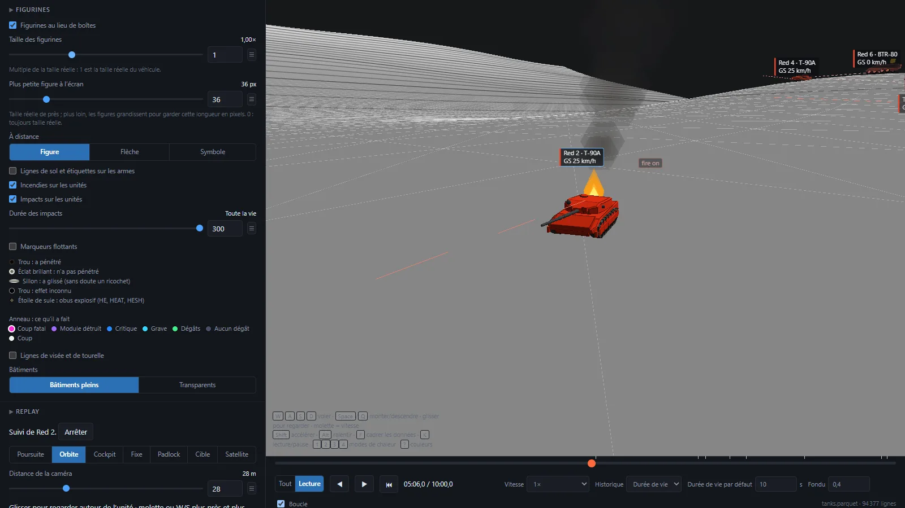

# Figurines

Une **figurine** est un petit modèle 3D de ce qu'est réellement une unité : un char, un avion à réaction, un navire, un soldat. Le [replay](match-replay.md) dessine chaque unité sous forme de sa figurine à taille réelle, au lieu d'une simple boîte.

Il existe environ 2 000 véhicules, avions, navires, armes et soldats nommés, tous construits par la visionneuse elle-même.

## Ce que contient le catalogue {#what-is-in-the-catalogue}

| Domaine | Exemples |
|---|---|
| Personnes | soldat debout, accroupi, couché ; tireur d'élite, antichar, médecin, équipage |
| Terrestre | chars, véhicules de combat d'infanterie, défense aérienne, artillerie, camions et voitures, trains et tramways |
| Air | chasseurs, avions d'attaque, bombardiers, avions de transport, hélicoptères, des biplans aux avions à réaction modernes |
| Mer | navires de guerre par classe, porte-avions, sous-marins, bateaux, navires marchands |
| Armes | missiles, roquettes, bombes, torpilles, leurres et paillettes |
| Marqueurs | grenades fumigènes, éclairantes et incendiaires, bombes posées, drapeaux, spawns, points de passage |

## Comment les figurines sont fabriquées {#how-the-figures-are-made}

- **Construites à partir de dimensions publiées.** La plupart des figurines sont fabriquées par le constructeur de figurines de la visionneuse à partir de chiffres publics : longueur, largeur, hauteur, roues de roulement, tourelle et canon, ailes et dérive. Leur forme est ensuite ajustée à partir de photographies publiques, de plans et de dimensions publiées. Les modèles d'aucun jeu ne sont utilisés.
- **Modèles libres.** Quelques figurines utilisent des modèles 3D libres (CC0 ou CC BY) lorsque ceux-ci sont plus fidèles, parfois combinés à la coque construite. Les auteurs des œuvres CC BY sont crédités sur [Crédits des figures](figure-credits.md) ; les œuvres CC0 ne demandent aucun crédit et n'y sont pas listées.
- Chaque figurine a une version complète, une version simplifiée et une version lointaine (niveaux de détail, LOD), afin que des milliers puissent être dessinées en même temps.

## La figurine d'une unité {#which-figure-a-unit-gets}

La visionneuse regarde les colonnes propres aux données :

1. **Noms** - les colonnes appelées *Name*, *Vehicle*, *Unit*, *Unit type*, *Model*, *Aircraft*, *Plane*, *Tank*, *Ship*, *Craft*, *Loadout*, *Kit* ou *Figure* - sont comparées au catalogue : exactement, grâce à environ 4 000 alias (identifiants d'unités de plusieurs jeux), par le plus long début connu (`F-16C_50` est le F-16C), ou par le plus court nom de figurine qui commence par ce texte.
2. Un nom dont la figurine ne correspond pas au **type** de l'unité n'est pas utilisé (un camion appelé *Typhoon* n'est pas le chasseur).
3. **Types** - les colonnes appelées *Type*, *Class*, *Kind*, *Category*, *Icon*, *Role* ou *Domain* - donnent une figurine de classe : étiquettes Tacview (`Air+FixedWing`, `Ground+Heavy+Armor+Vehicle+Tank`, `Sea+Watercraft+Warship`, `Weapon+Missile`), icônes de carte, ou simples mots (tank, helicopter, infantry).
4. Les données sans l'un ni l'autre sont des données de personnes : chacun est un soldat.

Le moyen le plus simple d'obtenir les bonnes figurines est donc une colonne `vehicle` avec les vrais noms, ou une colonne `type` avec les étiquettes Tacview.

**Mon unité apparaît comme une boîte ou un soldat.** Ajoutez une colonne `vehicle` avec le vrai nom, ou une colonne `type` avec une étiquette Tacview. Survolez l'unité pour voir quel nom a été reconnu. Des données qui ont de telles colonnes mais ne disent rien d'une unité la laissent en boîte ; les données sans l'une ni l'autre sont dessinées en soldats.

## Réglages {#settings}

La section **Figurines** de la barre latérale du replay règle la taille, la plus petite taille à l'écran, ce que deviennent les unités lointaines (figurine, flèche, symbole), et les effets dessinés sur elles. Voir [Replay de match](match-replay.md#figures). Fumée, feu et autres effets temporisés : [Figurines dans la superposition](figure-replay.md).

## Un paquet local facultatif de figurines {#an-optional-local-figure-pack}

Vous pouvez conserver sur votre propre machine un paquet facultatif de vos propres figurines. Ses figurines remplacent celles du catalogue portant les mêmes noms. Il ne fait jamais partie du dépôt ni d'une version publiée ; sans lui, rien ne change.
