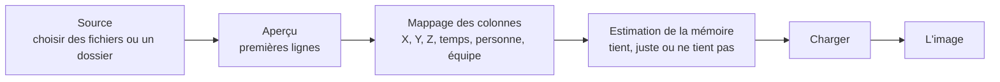

# Importer des données

Avant que 3DHeat puisse dessiner quoi que ce soit, il lui faut un tableau : chaque ligne indique où se trouvait quelque chose et, si vous le savez, quand et qui. Cette section montre comment un fichier devient une image. Pas encore de données ? Essayez les [données de démonstration](demo-data.md).

**À faire maintenant :**

1. Dans la barre latérale Carte de chaleur, ouvrez **Source** et appuyez sur **Fichiers…** (ou déposez un fichier ou un dossier dans la zone de dépôt).
2. Regardez **Mappage des colonnes** : les cases sont généralement déjà remplies.
3. Vérifiez que **Estimation de la mémoire** indique *tient*.
4. Appuyez sur **Charger**.

Tout ce qu'affiche l'onglet Carte de chaleur provient d'un seul **jeu de données** : un tableau de lignes, chacune avec une position et, facultativement, un temps, une personne, un groupe, une session, une direction de regard et autant de colonnes supplémentaires conservées pour le filtrage. Cette section explique comment un jeu de données est créé.

## Le chemin des fichiers à l'image {#the-path-from-files-to-picture}

1. **Sélectionner les fichiers** dans le panneau **Source** - un fichier, plusieurs, une arborescence de dossiers, ou par dépôt. Parquet, CSV, Tacview, traces GPS et d'autres sont acceptés ; la liste complète se trouve dans [Formats de données](data-formats.md#files). Voir [Charger des fichiers](loading-files.md).
2. **Aperçu.** Le premier fichier de la sélection est ouvert : ses noms de colonnes, ses 50 premières lignes, les colonnes qui semblent numériques et (Parquet) le type logique de chaque colonne ainsi que les instructions de lecture propres au fichier, l'entrée `heat3d` du pied de fichier.
3. **Mappage automatique.** Les colonnes sont attribuées à des rôles - X, Y, Z, temps, personne, session, groupe, direction de regard - et quelques-unes sont conservées pour le filtrage. Chaque supposition est affichée dans le panneau **Mappage des colonnes** et peut être modifiée. Voir [Mappage des colonnes](column-mapping.md) et [Axes, unités et temps](axes-units-and-time.md).
4. **Comptage.** Le nombre de lignes de chaque fichier est lu (exactement à partir des pieds de fichiers Parquet, estimé pour le CSV), de sorte que le panneau puisse indiquer avant tout chargement la quantité de mémoire nécessaire et si elle tient. Sinon, il propose de charger une ligne sur *N*. Voir [Mémoire et budgets](memory-and-budgets.md).
5. **Charger.** Un worker en arrière-plan analyse uniquement les colonnes mappées de chaque fichier - plusieurs fichiers à la fois, jusqu'au budget des [threads d'analyse](memory-and-budgets.md#parser-threads) - et fusionne le tout, dans l'ordre de la sélection, en un seul jeu de données : un dictionnaire commun de personnes, de groupes et de sessions pour tous les fichiers, une origine de temps commune, toutes les lignes triées par temps. Voir [Sessions, personnes et groupes](sessions-persons-groups.md).
6. **Envoi.** Le fil principal annonce « Envoi de N lignes vers le GPU » pour une image, puis range les lignes dans la mémoire GPU dans le cadre du budget GPU. Voir [Occupation de la mémoire GPU](gpu-memory.md).
7. **Première image.** La caméra cadre les données, le rayon des sprites et la saturation sont réglés d'après l'étendue des données et leur nombre de lignes, et après 8 images rendues la saturation est mesurée à partir de l'image elle-même ([Couleur et exposition](colour-and-exposure.md)).

## Exigences, vérifiées avant un chargement {#requirements-checked-before-a-load}

| Besoin | Ce qui se passe sans lui |
|---|---|
| **Au moins deux de X / Y / Z** | Le chargement est refusé. Avec exactement deux, le troisième axe vaut 0 et les données sont dessinées comme un plan plat dans la scène 3D, ce que veut une carte de chaleur vue du dessus. |
| Une colonne de temps | Facultative. Sans elle, la chronologie est désactivée, la vue reste en mode **Tout** et la barre latérale l'indique. |
| Une colonne de personne | Facultative. Nécessaire pour la [superposition de figurines](box-replay.md) (une figurine par personne), la [chaleur linéaire](line-heat.md) (le trajet suivi par chaque personne), l'interpolation, les traces et l'historique de **Durée de vie**. |
| Une colonne de groupe | Facultative. Nécessaire pour la [chaleur par équipe](team-heat.md) et pour le mode [différence](difference.md) (au moins deux groupes). |

Un mode que les données chargées ne peuvent pas prendre en charge est grisé dans la barre des modes ; le survol indique pourquoi.

## Sans vos propres données {#without-your-own-data}

Le panneau **Jeu de données** (sous **Source**) dispose d'un [générateur synthétique](synthetic-generator.md) qui produit un jeu de données de la forme d'un jeu de type battle royale, de la taille que vous voulez : pratique pour essayer la visionneuse et pour tester ce qu'une machine peut supporter.

## Pages de cette section {#pages-in-this-section}

- [Charger des fichiers](loading-files.md) - sélecteurs, dossiers, glisser-déposer, fusion de plusieurs fichiers, règle des fichiers de mouvement, progression et annulation
- [Mappage des colonnes](column-mapping.md) - chaque champ du panneau de mappage, comment le mappage automatique devine, les indices `heat3d`
- [Axes, unités et temps](axes-units-and-time.md) - axe vertical, inversions, échelle des unités, unités de temps, direction de regard
- [Sessions, personnes et groupes](sessions-persons-groups.md) - ce que fait chacun, les limites, les noms partagés, la taille des entités, le panneau Jeu de données
- [Générateur synthétique](synthetic-generator.md)
- [Mémoire et budgets](memory-and-budgets.md) - le modèle d'empreinte, la vérification de l'ajustement, la décimation, le plafond de tri, les budgets de ressources
