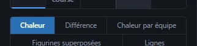

# Modes de chaleur

Chaque point ajoute une petite lueur, les lueurs s'accumulent, et l'amas est peint avec des couleurs. Les modes sont cinq façons de le peindre, et chacune répond à une question.

La barre des modes, en haut de la barre latérale de l'onglet Carte de chaleur, choisit la façon dont le [jeu de données](glossary.md) est dessiné. Les touches 1 à 4 choisissent Chaleur, Différence, Chaleur par équipe et Lignes. Les Figurines superposées n'ont pas de touche.

| Mode | Question à laquelle il répond |
|---|---|
| **Chaleur** | Où cela s'est-il produit, et en quelle quantité ? |
| **Différence** | Quel camp en a fait le plus ? |
| **Chaleur par équipe** | À qui était-ce ? |
| **Lignes** | Par où les gens sont-ils passés ? |
| **Figurines superposées** | Qui était où, et quand ? |

| Mode (libellé de la barre) | Touche | Ce qu'il dessine | Nécessite |
|---|---|---|---|
| **Chaleur** | 1 | Densité additive : chaque ligne visible ajoute un sprite radial face à la caméra. [Chaleur](heat.md) | un jeu de données |
| **Différence** | 2 | Densité signée : une population ajoute, une autre retranche. [Différence](difference.md) | deux camps : au moins deux groupes, ou une répartition sur une colonne conservée |
| **Chaleur par équipe** | 3 | Densité colorée par groupe : une teinte par groupe, mélangée là où les groupes se recouvrent. [Chaleur par équipe](team-heat.md) | une colonne de groupe |
| **Figurines superposées** | - | Une figurine (ou une boîte) par personne, qui se déplace le long de la chronologie : le replay. [Figurines superposées](box-replay.md), [Replay de match](match-replay.md) | une colonne de personne |
| **Lignes** | 4 | Chaleur linéaire : une ligne de chaque échantillon d'une personne jusqu'à son suivant, la chaleur s'atténuant sur les côtés. [Chaleur linéaire](line-heat.md) | une colonne de personne et une colonne de temps |

Un mode que les données ne peuvent pas prendre en charge est grisé, et son info-bulle en donne la raison, par exemple *Indisponible - le mode Différence exige deux groupes ou une colonne conservée pour répartir ; ces données n'ont qu'un groupe.* Lorsqu'un nouveau jeu de données ne peut pas prendre en charge le mode en cours, la vue revient à **Chaleur**.

Les touches 1 à 4 sont vérifiées de la même façon par rapport aux données : une touche correspondant à un mode grisé ne fait rien.

## Les panneaux affichés par chaque mode {#which-panels-each-mode-shows}

| Panneau | Chaleur | Différence | Chaleur par équipe | Figurines superposées | Lignes |
|---|---|---|---|---|---|
| Parcours ([chaleur linéaire](line-heat.md)) | | | | | oui |
| Forme de la chaleur (avec **Suivre la vue** et **Même densité à tout niveau de zoom**), Couleurs de la chaleur, Bornes en pixels des sprites, Profondeur, Élimination par distance | oui | oui | oui | | oui |
| Direction ([chaleur directionnelle](directional-heat.md)), Valeur ([pondération des valeurs](value-weighting.md)) | oui | oui | oui | | oui |
| Vue des équipes ([figurines superposées](box-replay.md)) | | | | oui | |
| Répartition différentielle ([différence](difference.md)) | | oui | | | |
| [Équipes](teams-list.md), [Entités](entities.md), [Filtres](filters.md), Arrière-plan / niveau, [Coupe](slice.md), [Mesure](measure.md), Trajectoire de caméra et rendu, Performances, Caméra et scène | oui | oui | oui | oui | oui |

## Ce que partagent tous les modes de chaleur {#what-every-heat-mode-shares}

Les quatre modes de chaleur (tous sauf les figurines superposées) reposent sur la même mécanique avec des entrées différentes ([`engine.ts`](https://github.com/Holdi601/3DHeat/blob/main/src/render/engine.ts)) :

1. **Quelles lignes.** La fenêtre de la [chronologie](timeline.md) choisit une plage continue de lignes triées par temps ; les [filtres](filters.md), la visibilité des groupes, la répartition différentielle, l'[élimination par distance](depth-and-culling.md#distance-culling) et la [coupe](slice.md) décident pour chaque ligne, dans le shader de sommets, si et avec quelle intensité elle contribue.
2. **Projection des sprites (splatting).** Chaque ligne contributive est dessinée comme un sprite (ou, en mode Lignes, comme un segment) dans une **cible de chaleur** à virgule flottante, en y ajoutant sa valeur de rampe. Un échantillon stratifié des lignes est dessiné lorsqu'il y en a plus qu'une image ne peut en supporter, pondéré pour compenser. Voir [Échantillonnage et budgets](sampling-and-budgets.md).
3. **Accumulation.** Tant que rien ne change, les images sont fusionnées jusqu'à ce que chaque ligne ait contribué exactement une fois. Voir [Accumulation](accumulation.md).
4. **Composition.** La valeur accumulée en chaque pixel est divisée par le **point de saturation**, mise en forme par la **réponse à la densité**, relevée par la **chaleur minimale**, puis cherchée dans la **rampe de couleurs**, dont l'alpha la mélange à la scène. Voir [Couleur et exposition](colour-and-exposure.md).

Tout ce qui figure à l'étape 4 est appliqué au moment de la composition : faire glisser ces commandes ne relance donc jamais l'accumulation ; ce qui touche aux étapes 1 et 2 la relance.

## Pages de cette section {#pages-in-this-section}

- [Chaleur](heat.md) - le mode chaleur simple, et l'aperçu de ses panneaux
  - [Forme des sprites](sprite-shape.md) - rayon, intensités, atténuation, éditeur de courbe, bornes en pixels, aplatissement
  - [Couleur et exposition](colour-and-exposure.md) - éditeur de rampe, point de saturation, exposition automatique, chaleur minimale, réponse à la densité
  - [Profondeur et élimination des faces](depth-and-culling.md) - occultation par le niveau, masquage derrière le terrain, élimination par distance
- [Différence](difference.md) - la répartition différentielle
- [Chaleur par équipe](team-heat.md)
- [Chaleur linéaire](line-heat.md) - trajets
- [Figurines superposées](box-replay.md) - le mode replay (le fichier s'appelle encore box replay)
- [Chaleur directionnelle](directional-heat.md)
- [Pondération des valeurs](value-weighting.md)
