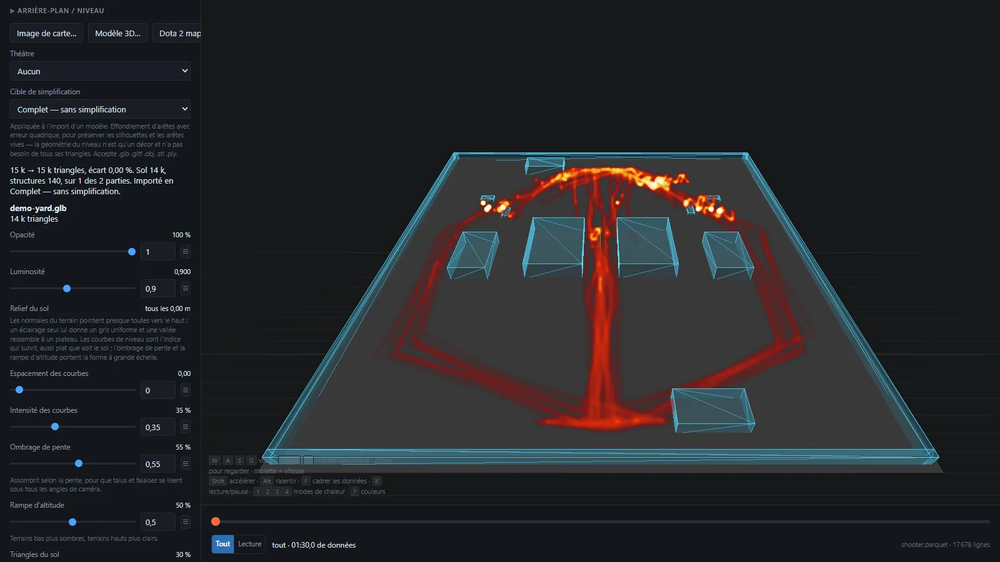
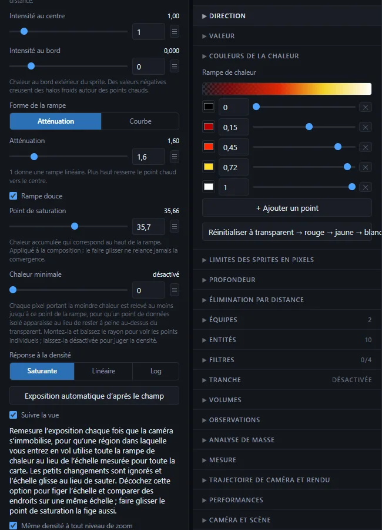

# Chaleur

La chaleur colore les endroits où il s'est passé beaucoup de choses : rouge là où cela s'est produit un peu, blanc incandescent là où cela s'est produit beaucoup. Elle répond à la question « où cela arrive-t-il, et en quelle quantité ».

**Chaleur** (touche 1) est le mode par défaut. Chaque [ligne](glossary.md) visible apporte un [sprite](glossary.md) rond face à la caméra ; les sprites qui se recouvrent s'additionnent dans un tampon à virgule flottante ; la somme est reportée sur une rampe de couleurs - par défaut transparent → rouge → jaune → blanc - puis dessinée par-dessus la scène.

L'image montre la chaleur d'une manche de tireur sur un niveau avec des bâtiments : les points chauds se trouvent dans les pièces et dans les escaliers, pas seulement au sol.

## Comment l'utiliser {#how-to-use-it}

1. Chargez des données et appuyez sur `1` (ou choisissez **Chaleur** dans la barre des modes).
2. Si tout est blanc ou vide, appuyez sur **Exposition automatique d’après le champ** dans la section **Forme de la chaleur**.
3. Modifiez **Rayon des sprites** jusqu'à ce que les points voisins se fondent en bandes : plus petit, on voit des taches isolées ; plus grand, on voit des zones.
4. Ouvrez **Couleurs de la chaleur** pour changer les couleurs, ou **Profondeur** pour laisser les collines et les murs masquer la chaleur derrière eux.

Les mêmes panneaux façonnent la [Différence](difference.md), la [Chaleur par équipe](team-heat.md) et la [Chaleur linéaire](line-heat.md) ; elles diffèrent par ce qui est ajouté (signé, coloré ou le long de lignes), non par la manière.

## Les panneaux et leurs valeurs par défaut {#the-panels-and-their-defaults}

Chaque commande ci-dessous correspond à un paramètre de shader : la modifier ne coûte donc rien d'autre qu'un nouveau dessin. Les curseurs ont une case de saisie à côté et une poignée de glissement (la petite prise à droite : glisser vers le haut ou le bas, plus loin va plus vite, Maj pour le réglage fin) ; lorsque la piste d'un curseur s'arrête avant une vraie limite, la poignée peut la dépasser jusqu'au *plafond de glissement* indiqué ici. Les valeurs marquées *au chargement* sont recalculées pour chaque nouveau jeu de données.

### Forme de la chaleur (ouvert) {#heat-shape-open}

| Commande | Par défaut | Plage (plafond de glissement) | Détails |
|---|---|---|---|
| **Rayon des sprites** | 6 m ; au chargement étendue / 120 | 0,05-2000 m, logarithmique (50 000) | [Forme des sprites](sprite-shape.md#sprite-radius) |
| **Intensité au centre** | 1 | 0-10 (1000) | [Forme des sprites](sprite-shape.md#centre-and-edge-intensity) |
| **Intensité au bord** | 0 | -2-10 (1000) | [Forme des sprites](sprite-shape.md#centre-and-edge-intensity) |
| **Forme de la rampe** | *Atténuation* | *Atténuation* / *Courbe* | [Forme des sprites](sprite-shape.md#ramp-shape-falloff-or-curve) |
| **Atténuation** (Atténuation seulement) | 1,6 | 0,1-8 (64) | [Forme des sprites](sprite-shape.md#falloff) |
| **Rampe douce** (Atténuation seulement) | activé | | [Forme des sprites](sprite-shape.md#falloff) |
| Éditeur de courbe (Courbe seulement) | préréglage *Lisse* | | [Forme des sprites](sprite-shape.md#the-curve-editor) |
| **Point de saturation** | 24 ; au chargement une estimation, puis mesurée | 0,1-4000, logarithmique (10 000 000) | [Couleur et exposition](colour-and-exposure.md#saturation-point) |
| **Chaleur minimale** | désactivée (0) | 0-100 % | [Couleur et exposition](colour-and-exposure.md#minimum-heat) |
| **Réponse à la densité** | *Saturante* | *Saturante* / *Linéaire* / *Log* | [Couleur et exposition](colour-and-exposure.md#density-response) |
| **Exposition automatique d’après le champ** | | bouton | [Couleur et exposition](colour-and-exposure.md#auto-exposure) |
| **Suivre la vue** | activé | | Mesure de nouveau l'exposition chaque fois que la caméra s'immobilise, de sorte qu'une région dans laquelle vous volez utilise toute la rampe de couleurs. Les petits changements sont ignorés et l'échelle glisse en douceur. Décochez-la, ou faites glisser **Point de saturation**, pour figer l'échelle et comparer des lieux sur une même échelle. [Couleur et exposition](colour-and-exposure.md#follow-the-view) |
| **Même densité à tout niveau de zoom** | activé | | Une couleur représente le même nombre de lignes par surface au sol, quelle que soit la proximité. Un sprite que les bornes en pixels agrandissent (au loin) ou réduisent (de près) conserve la chaleur qu'il apporterait à sa taille réelle, de sorte qu'une image exposée de loin ne s'estompe pas quand on vole vers elle. Désactivée, un sprite borné apporte son poids entier à sa taille bornée. [Forme des sprites](sprite-shape.md#pixel-clamps) |
| **Aplatir sur le plan du sol** | désactivé | | [Forme des sprites](sprite-shape.md#flatten-onto-ground-plane) |

### Couleurs de la chaleur (fermé) {#heat-colours-closed}

| Commande | Par défaut | Détails |
|---|---|---|
| Pastilles de groupe et **Séparation des couleurs** (Chaleur par équipe seulement) | 1,4 | [Chaleur par équipe](team-heat.md) |
| Éditeur de **Rampe de chaleur** (*Positive (équipes additives)* en Différence, *Rampe d’opacité* en Chaleur par équipe) | transparent → rouge → jaune → blanc | [Couleur et exposition](colour-and-exposure.md#the-ramp-editor) |
| **Réinitialiser à transparent → rouge → jaune → blanc** | | |
| Rampe **Négative (équipes soustractives)** (Différence seulement) | transparent → vert → bleu → violet | [Différence](difference.md#colours) |

### Bornes en pixels des sprites (fermé) {#sprite-pixel-clamps-closed}

| Commande | Par défaut | Plage (plafond de glissement) | Détails |
|---|---|---|---|
| **Rayon min. en pixels** | 1 px | 0-16 (512) | [Forme des sprites](sprite-shape.md#pixel-clamps) |
| **Rayon max. en pixels** | 96 px | 2-1024, logarithmique (8192) | [Forme des sprites](sprite-shape.md#pixel-clamps) |

### Profondeur (ouvert) {#depth-open}

| Commande | Par défaut | Détails |
|---|---|---|
| **Masquer derrière le terrain** | activé | [Profondeur et élimination des faces](depth-and-culling.md#hide-behind-terrain) |
| **Masqué derrière la géométrie** | 0,8 (*80 % plus sombre*) | [Profondeur et élimination des faces](depth-and-culling.md#hidden-behind-geometry) |

### Élimination par distance (fermé) {#distance-culling-closed}

| Commande | Par défaut | Plage (plafond de glissement) | Détails |
|---|---|---|---|
| **Proche** | désactivé (0) | 0,5-5000 m, logarithmique, bas de la piste = désactivé (200 000) | [Profondeur et élimination des faces](depth-and-culling.md#distance-culling) |
| **Lointain** | désactivé (0) | 1-200 000 m, logarithmique, bas = désactivé (10 000 000) | [Profondeur et élimination des faces](depth-and-culling.md#distance-culling) |
| **Couper selon un plan** | activé | | [Profondeur et élimination des faces](depth-and-culling.md#distance-culling) |
| **Couper aussi le niveau** | activé | | [Profondeur et élimination des faces](depth-and-culling.md#distance-culling) |

Touches : `[` et `]` rapprochent et éloignent la borne lointaine, `\` la bascule ([Profondeur et élimination des faces](depth-and-culling.md#keyboard)).

### Direction et Valeur {#direction-and-value}

Deux autres sections se trouvent sous Forme de la chaleur. **Direction** dessine chaque ligne sous forme de secteur et ajoute des flèches : voir [Chaleur directionnelle](directional-heat.md). **Valeur** pondère la chaleur selon ce que chaque ligne a coûté ou rapporté : voir [Pondération des valeurs](value-weighting.md).

## Ce qui est enregistré {#what-is-saved}

Les réglages de chaleur ci-dessus ne sont pas conservés d'une session à l'autre : recharger la page rétablit les valeurs par défaut. Deux éléments sont conservés dans le navigateur : la dernière vitesse de lecture (`heat3d.speed`, voir [Chronologie](timeline.md)) et les réglages des figurines lointaines de la [superposition de figurines](box-replay.md) (style des symboles, taille, marques de coups, etc.). Il en va de même pour la langue, les [axes du monde inversés](camera.md#invert-world-axis), les noms de voitures mémorisés par l'onglet course et la [bibliothèque de niveaux](level-library.md). La liste complète figure dans [Réglages enregistrés](ref-settings-storage.md).
