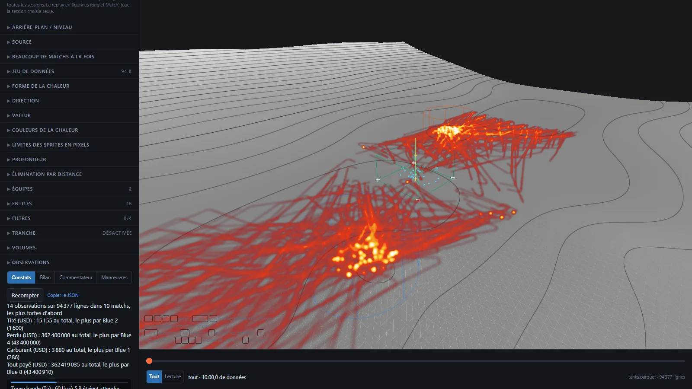
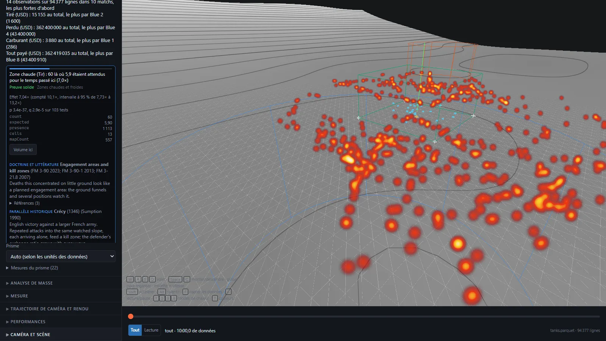
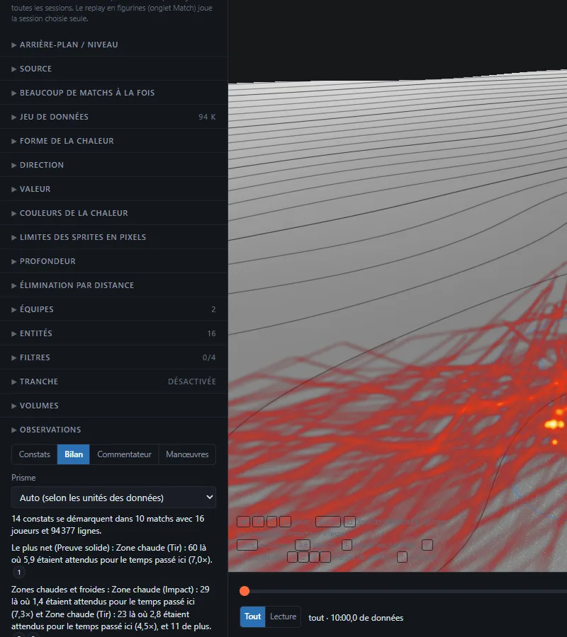
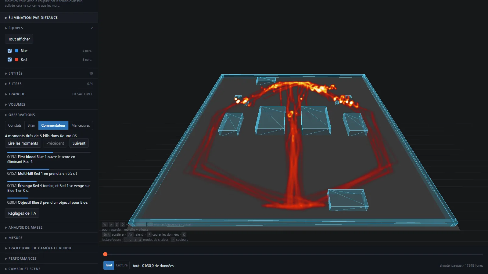

# Observations

Les **Observations** parcourent les données chargées à la recherche de ce qui ressort - les bonnes positions, les zones mortelles, les pièges de réapparition, les points de goulot, les joueurs très au-dessus de leurs pairs - et vous le disent, du plus fort au plus faible, avec les preuves. Servez-vous-en pour comprendre en une minute où un match a été gagné ou perdu. Elles peuvent ensuite rédiger un bilan et, sur un seul replay, jouer le rôle d'un commentateur qui saute aux grands moments.

Tout est compté dans votre navigateur. Rien ne quitte votre ordinateur, sauf si vous activez une IA externe (voir [IA externe](#external-ai)).

La section **Observations** se trouve dans la barre latérale des onglets Carte de chaleur et Match. Elle comporte trois onglets : **Constats**, **Bilan** et **Commentateur**.

## Constats {#findings}

1. Chargez des données et ouvrez **Observations**. Appuyez sur **Trouver des observations** (« Comptage… n% » indique la progression).
2. Lisez la liste. Chaque constat a une barre de force, une phrase, la qualité des preuves (*Preuves solides*, *Bonnes preuves* ou *Quelques preuves*), le détecteur qui l'a trouvé, et la classe de véhicule lorsque cela compte.
3. **Cliquez sur un constat** : la visionneuse applique ses filtres, fait voler la caméra jusqu'au lieu, saute au moment, et ouvre le détail : l'effet avec son intervalle à 95 %, les valeurs p et q, les preuves comptées, et **Volume ici**, qui trace un [volume](volumes.md) autour du lieu.
4. **Restaurer les filtres** remet vos filtres en place. **Copier le JSON** copie le rapport entier.

Le comptage utilise les filtres en cours, les groupes masqués et le match choisi sur toute la plage temporelle. Si vous modifiez ensuite les filtres, une note le signale ; appuyez sur **Recompter**.

Les lignes en haut de la liste (par exemple les totaux d'argent) résument l'ensemble des données avant les constats.

### Les détecteurs {#the-detectors}

| Détecteur | Ce qu'il trouve | Nécessite dans les données |
|---|---|---|
| **Positions de force** | Lieux où le rapport éliminations/morts est bien meilleur que sur le reste de la carte, et *terrain sûr* où peu de joueurs meurent par rapport au temps passé | événements d'élimination et de mort |
| **Zones chaudes et froides** | Lieux où un type d'événement (tirs, impacts, captures ...) survient beaucoup plus ou beaucoup moins souvent que le temps passé sur place ne le laisse prévoir | une colonne d'événements |
| **Terrain ouvert et couvert** | Morts en terrain découvert face à une géométrie de niveau proche, et lenteur face à un mouvement rapide | morts ; un niveau 3D pour la partie géométrie |
| **Spawns** | Spawns forts, pièges de réapparition, spawns sûrs, temps avant le premier contact | temps et personnes |
| **Classe par lieu** | Une classe de véhicule, ou des joueurs contre l'IA, qui font nettement mieux ou moins bien dans une zone | éliminations plus une colonne de classe de véhicule ou joueur/IA |
| **Joueurs** | Joueurs qui éliminent ou meurent beaucoup plus ou moins que les autres de la même classe | personnes et éliminations |
| **Goulets et flancs** | Points de goulot (bien plus de passages que le terrain autour) et itinéraires de flanc (rarement empruntés, mais menant à des éliminations) | personnes |
| **Valeur** | *Terrain coûteux* et *Terrain rentable* | [colonnes de valeur](value-weighting.md) |
| **Ce qui a décidé les manches** | Ce qui a séparé les manches gagnées des manches perdues, et les joueurs qui ont ajouté ou coûté le plus de probabilité de victoire (voir [Qui a gagné](#who-won-what-decided-the-rounds)) | manches, frags et morts, et les [colonnes de résultat](data-formats.md#outcome-columns) (`won`) |

Les détecteurs qui ne peuvent pas tourner sur les données sont listés en bas avec la raison.

### Comment les constats sont classés {#how-findings-are-ranked}

Chaque lieu ou groupe est testé par rapport au reste de la carte (tests binomiaux exacts ou tests de taux). Le taux de fausses découvertes est maintenu à 5 % (Benjamini-Hochberg). Le hasard peut ressembler à un motif ; cela garde les fausses alertes basses : parmi les constats affichés, environ un sur vingt devrait être dû au hasard au plus. Les effets issus de peu d'événements sont ramenés vers « aucun effet » avant le classement. Au plus 60 constats sont listés, et chaque détecteur obtient quelques lieux en haut de liste.

### Qui a gagné : ce qui a décidé les manches {#who-won-what-decided-the-rounds}

Là où les données disent qui a gagné chaque manche (la [colonne de résultat](data-formats.md#outcome-columns) `won` : CS2, Rainbow Six Siege, War Thunder ...), le résultat est le sujet des Observations. Pour chaque camp, elles séparent les manches selon ce qui s'y est passé et comparent les taux de victoire :

| Facteur | Les manches du camp avec lui | ... et sans lui |
|---|---|---|
| Duel d'ouverture | il a fait le premier frag | il est mort en premier |
| Achat | son achat était meilleur que celui de l'autre camp | moins bon |
| Première mort échangée | sa première mort a été échangée en moins de 5 s | pas échangée |
| Pose | il a posé | pas de pose |
| Utilitaires | plus de grenades que dans sa manche habituelle | moins |
| Contact précoce | le premier duel est venu avant le temps médian du match | plus tard |
| Un lieu tenu | un joueur s'est tenu au lieu 5 s ou plus | personne |
| Un lieu atteint tôt | un joueur y est arrivé dans les 25 premières s (la route) | personne |

Chaque comparaison est une différence de deux taux de victoire avec son intervalle à 95 % (Newcombe), le p exact de Fisher, et un q sur tous les facteurs essayés (Benjamini-Hochberg). Un bras de moins de 8 manches est marqué *peu de manches*. Ceux qui passent sous le taux de fausses découvertes de 5 % deviennent des constats ; les plus forts se classent au-dessus de ceux des autres détecteurs (un constat de résultat pèse 1,35 fois un constat de même effet et de mêmes preuves).

Un exemple inventé sur 40 manches :

> **T** a gagné 79 % des 19 manches où il tenait **Mid**, contre 24 % des 21 sans (55 points, 95 % de 26 à 74) - q 0,004.

Elles suivent aussi la **probabilité de victoire** de la manche - la chance de chaque camp à chaque instant, d'après les joueurs en vie, la pose et le chrono : ajustée aux manches quand il y en a 30 ou plus, sinon un modèle a priori fixe (et le texte dit lequel). On en tire les **tournants** (les frags et les poses qui ont le plus fait bouger la chance) et la **probabilité de victoire ajoutée** de chaque joueur : les frags et les poses qu'il a faits comptent pour lui, ses morts contre lui, en manches sur le match, une manche en moyenne avec son intervalle, testée contre zéro. Les lieux reçoivent le même bilan : quel camp a le plus gagné dans les duels livrés là.

Les données ont besoin de manches, de frags et de morts avec les deux camps, et de la colonne `won` ; de lieux nommés (`place`) pour les lieux tenus, d'une colonne `buy` pour l'achat.

## Bilan {#debrief}

L'onglet **Bilan** rédige les constats sous forme de court texte : une introduction, le constat le plus net, un pour la tactique, un pour l'équilibrage, puis - là où les données disent qui a gagné - ce qui a décidé les manches, le reste regroupé par détecteur, et le nombre de constats reposant sur des preuves plus faibles.

Ce qui a décidé les manches tient en quatre paragraphes : le score et l'origine des probabilités de victoire ; les facteurs les plus forts avec leurs chiffres, leur intervalle et leur q (quand aucun ne passe le taux de fausses découvertes, le texte dit *rien de tout cela n'est encore sûr*, et nomme quand même le plus fort) ; les trois plus grands tournants ; et les joueurs qui ont ajouté et coûté le plus de probabilité de victoire, avec les lieux qui ont le plus gagné. Un exemple inventé :

> T a gagné 23 et CT a gagné 17 des 40 manches au résultat connu (T : 58 %, 95 % de 42 % à 72 %). Les probabilités de victoire viennent d'un modèle ajusté à ces manches.
>
> Ce qui a séparé les manches gagnées des perdues : T a gagné 79 % des 19 manches où il tenait Mid, contre 24 % des 21 sans (55 points, 95 % de 26 à 74) (q 0,004), ...
>
> Tournants : manche 17 à 48 s, un frag de CT à B site a fait passer sa chance de 31 % à 58 %, et il a pris la manche, ...

Chaque paragraphe a des boutons numérotés qui montrent ses constats. **Copier le texte** le copie.

Le narrateur intégré fonctionne hors ligne, dans votre langue. Le sélecteur **Prisme** au-dessus (voir [Le prisme de connaissances](knowledge.md)) décide des ouvrages cités par les paragraphes.

### IA externe {#external-ai}

**Réglages de l'IA** permet à un modèle d'IA de votre choix de rédiger le bilan à la place :

| Réglage | Signification |
|---|---|
| **Fournisseur** | Anthropic (Claude), OpenAI (ChatGPT), OpenRouter, Ollama (local), LM Studio (local), serveur llama.cpp (local), ou tout point d'accès compatible OpenAI |
| **URL de base**, **Modèle** | Renseignés par le fournisseur ; **Lister les modèles** interroge le serveur |
| **Clé API** | Envoyée uniquement à l'URL de base. Jamais journalisée, jamais enregistrée dans les vues, exports ou fichiers `.3dheat`. La plupart des serveurs locaux n'en demandent aucune. |
| **Mémoriser la clé dans ce navigateur** | Désactivé par défaut : la clé est oubliée à la fermeture de la page |
| **Utiliser une IA externe** | Désactivé par défaut |
| **Envoyer les noms des joueurs** | Désactivé par défaut : les joueurs sont envoyés sous les noms P1, P2 ... |

Saisissez ensuite une question facultative et appuyez sur **Rédiger avec l'IA**. Seuls les constats et leurs chiffres sont envoyés - jamais les lignes de vos données. La réponse s'affiche au fil de l'écriture ; les constats cités deviennent des boutons. Là où les données disent qui a gagné, le modèle doit commencer par ce qui a décidé les manches, avec l'intervalle et le q de chaque chiffre, et dire quand un facteur repose sur peu de manches ou quand les probabilités de victoire viennent du modèle a priori.

## Commentateur {#caster}

Pour **un seul match** (choisissez-en un si plusieurs sont chargés), le **Commentateur** trouve les moments qui méritent d'être regardés : premier sang, multi-éliminations, échanges, situations désespérées remportées, bascules d'objectifs, retournements, joueurs qui se démarquent, tirs à longue distance, et **tournants** - les frags qui ont le plus fait bouger la chance d'un camp de gagner la manche (d'après les joueurs restés en vie de chaque côté, dans les manches sans réapparition).

Là où les données disent qui a gagné chaque manche, chaque moment le dit : *« Anna abat Ben : la chance de T de gagner la manche passe de 38 % à 62 % - et ils prennent la manche. »* Un moment du camp qui a fini par gagner compte davantage quand le commentateur choisit ceux à garder, et un retournement se compte en manches gagnées.

- Cliquez sur un moment : la vue passe au replay, saute juste avant, y vole et suit le joueur.
- **Lire les moments** lit chacun jusqu'à sa fin puis passe au suivant ; **Précédent** / **Suivant** parcourent la liste.
- Avec une IA externe activée, **Commentaire par l'IA** rédige un commentaire à partir de la liste des moments (types, heures, noms ou pseudonymes, équipes, classes, distances).

Il exige des personnes et des événements d'élimination/mort (ou de capture) ; une colonne `other`/`victim` rend possibles les échanges et les tirs à longue distance.

## Le prisme de connaissances {#knowledge-lens}

Un constat peut être lu à travers un **prisme** de connaissances établies : doctrine militaire, combat aérien et naval, opérations urbaines, conception de jeux et esport (ou *Auto*, choisi d'après les unités des données). Un constat ouvert affiche alors l'entrée de **doctrine et de littérature** la plus proche et un **parallèle historique**, avec des références, et **Mesures du prisme** calcule à partir de cette littérature des mesures sur les données (ajustements de Lanchester, rapports d'échange, rapports de forces, champs de tir, terrain clé, échanges, initiative). Le bilan et l'invite de l'IA les incluent. Tout ce qui s'y rapporte : [Le prisme de connaissances](knowledge.md).

Les mesures du prisme mesurent aussi la façon dont les joueurs se comportent en foule et en groupe - alignement et tournoiement, guidage des trajets, voies et sentiers, encombrement, meneurs et suiveurs, traînards, point de rupture sous les pertes, risque après une vie perdue, séries, accord sur les achats et réponse aux tirs reçus - chacun face à son propre modèle nul : [Comportement collectif](collective-behaviour.md).

## Les données qui permettent les observations {#data-that-makes-insights-work}

- des positions avec une colonne de **temps**, une colonne de **personne** et une colonne d'**équipe** ;
- une colonne d'**événements** avec les éliminations et les morts (`kill`, `death`), et d'autres (`hit`, `fire`, `capture` ...) ;
- une colonne d'**autre partie** (`other`, `victim`) pour les échanges et les directions ;
- une colonne de **véhicule** ou de **type** pour les classes ; une colonne `ai` pour les joueurs contre l'IA ;
- une colonne de **session** / **match** / **manche** lorsqu'il y a plusieurs matchs.

Les [données de démonstration](demo-data.md) contiennent toutes ces colonnes.
