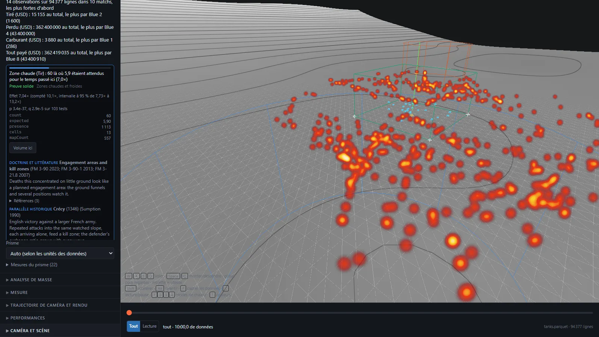

# Le prisme de connaissances

Quand [Observations](insights.md) trouve quelque chose, cette partie l'explique avec des idées de l'histoire militaire, de la conception de jeu et de l'analyse sportive, et nomme le livre ou l'article d'où elles viennent. Servez-vous-en pour comprendre *pourquoi* un schéma compte, et pas seulement qu'il existe.

## Essayez {#try-it}

1. Chargez des données et ouvrez **Observations**, puis appuyez sur **Trouver des observations**.
2. Cliquez sur une constatation pour l'ouvrir.
3. Lisez **Doctrine et littérature** et **Parallèle historique** ; les références complètes sont repliées dessous.
4. Changez le **Prisme** (par exemple en *Doctrine militaire*) pour lire la même constatation à travers un autre corpus de littérature.

## Comment cela fonctionne {#how-it-works}

Le panneau Observations juge ses constatations comme le ferait un analyste professionnel : à travers la doctrine militaire et la recherche opérationnelle, les engagements historiques, et la littérature sur la conception de jeu, la conception de niveaux et l'analyse de données. Il le fait hors ligne, à partir d'une base de connaissances choisie dans la visionneuse, et remet la même matière à un modèle externe quand c'est lui qui rédige le bilan.

## Ce que montre le panneau {#what-the-panel-shows}

- **Prisme** choisit le corpus de littérature à travers lequel les constatations sont lues : *Auto* (choisi d'après les types d'unités présentes dans les données : avions, navires, véhicules terrestres, infanterie), *Doctrine militaire*, *Combat aérien*, *Naval*, *Combat urbain*, *Conception de jeu et équilibrage*, *Esport*. Les entrées hors du prisme choisi sont laissées de côté.
- Chaque constatation ouverte montre son entrée la plus proche de **doctrine et littérature** et son **parallèle historique** le plus proche, avec les références complètes repliées dessous.
- **Mesures du prisme** liste les mesures de l'analyse opérationnelle calculées sur les mêmes lignes (ci-dessous), chacune avec sa signification et sa littérature.
- Le **Bilan** ajoute des lignes pour les principales constatations et les mesures du prisme : « Doctrine et littérature : ... » et « Parallèle historique : ... », chacune avec ses citations auteur-année et les références repliées dessous.
- **Rédiger avec l'IA** envoie les entrées les plus pertinentes (résumé, leçon, les constatations auxquelles elles se rapportent, références complètes) avec le rapport, et demande au modèle de les citer par identifiant — `{concept.lanchester-square}` — et de n'utiliser aucune autre source.

Les libellés sont traduits ; le savoir lui-même est en anglais.

## Mesures du prisme {#lens-metrics}

Calculées dans le worker d'observations, au même passage sur les lignes que les détecteurs (`src/insights/lensMetrics.ts`). Chacune est laissée de côté quand les données ne peuvent pas la porter.

| Mesure | Ce qu'elle mesure | Besoins |
|---|---|---|
| Ajustement de Lanchester | Les pertes de chaque camp par tranche de 20 s, régressées sur les forces vivantes des deux camps (Poisson, erreurs de quasi-vraisemblance) ; les exposants sur la force ennemie et la force propre, testés contre la loi carrée (tir ajusté) et la loi linéaire (tir de zone) | temps, équipes, éliminations et morts |
| Rapport d'échange | Éliminations par mort, par camp et par lieu ; la part des morts sur le lieu le plus meurtrier qui tient 5 % du temps passé, comparée à la part que donne le seul hasard avec autant de morts ; indice de Gini des morts selon le temps ; I de Moran des taux de mort | éliminations et morts |
| Rapport de force local | Unités amies et ennemies vivantes à portée d'engagement de chaque élimination (portée tirée des données : deux fois la distance médiane à l'ennemi le plus proche) ; la part des éliminations du camp localement supérieur, et son excès sur ce que les seuls nombres prédisent | temps, équipes, personnes |
| Champs de tir | Surfaces visibles depuis les lieux d'élimination les plus fréquentés, sur une surface d'obstruction 2,5D (la géométrie du niveau jusqu'à la hauteur des murs, ou le sol parcouru), comparées au lieu moyen, et la corrélation de rang entre la vue et la part des éliminations | positions ; un niveau chargé la rend plus précise ; pas pour l'air |
| État d'énergie | Énergie spécifique (hauteur plus la hauteur que la vitesse peut acheter) des tueurs et des victimes aériens, comparée par la statistique de Mann-Whitney | classes d'avions, temps, altitude |
| Terrain clé | À quelle fréquence chaque lieu fait partie des trois lieux d'élimination les plus fréquentés d'un match | plusieurs matchs |
| Soutien mutuel (échanges) | Morts auxquelles un coéquipier répond par une élimination, à portée d'engagement et dans les 5 s | temps, équipes |
| Premier coup | Engagements — éliminations regroupées par match, par 20 s de calme et par trois portées d'engagement — gagnés par le camp qui a marqué le premier | temps, équipes |
| Modèle de salve | L'équation de salve de Hughes ajustée sur des périodes de 20 s de navires au contact : navires mis hors de combat par navire attaquant, et sauvés par navire défenseur ; un ajustement de Lanchester sur les seuls navires | classes de navires, temps, équipes |
| Efficacité au combat | Éliminations par heure-unité en action de chaque camp et le rapport des deux plus grandes (une valeur d'efficacité au combat au sens de Dupuy) avec son intervalle à 95 %, et la part d'éliminations de chaque camp à nombres locaux égaux | temps, équipes |
| Portées d'engagement | Distance à l'ennemi le plus proche lors des éliminations, des lancements et du premier tir de chaque vie (détection jusqu'à l'engagement), par type d'unité | temps, équipes ; lancements quand les données en ont |
| Chaîne de destruction | Secondes entre le dernier lancement du tueur et l'élimination, et entre son premier tir du combat et l'élimination | temps ; lancements ou événements de tir |
| Concentration ou dispersion | Dans chaque période de 20 s, l'étalement des deux plus grands camps et la part des éliminations prise par le plus serré | temps, équipes |
| Sorties | Par camp : sorties (décollages, ou apparitions d'avions), atterrissages, avions perdus et éliminations par avion ; taux de perte et éliminations par sortie | classes d'avions ; décollages ou apparitions |

Les données avec des manches ajoutent les mesures de combat rapproché et d'esport — probabilité de gagner la manche, valeur des actions, duels d'ouverture, échanges, joueur qui sort contre joueur qui tient, visée, feux croisés, utilitaires, avantage numérique, clutches, mises en place, après la pose, entonnoirs mortels et impact du joueur : voir [Combat rapproché et manches](close-quarters.md).

Les pistes et les équipes ajoutent les mesures de comportement collectif de la science des foules, du mouvement collectif, de l'économie comportementale et de la psychologie militaire — alignement et tournoiement, conduite en troupeau le long des routes, couloirs et traînées, encombrement, meneurs et suiveurs, traînards, point de rupture, risque après des pertes, séries, accord d'achat et suppression, chacune face à son propre modèle nul : voir [Comportement collectif](collective-behaviour.md).

Les armes, leurres et bâtiments ne sont pas comptés comme unités. Quand les lignes d'armes nomment leur unité de lancement (une colonne `Shooter` ou `Launcher`, comme les données issues de Tacview), le lancement est imputé à cette unité, retrouvée par son nom ou son identifiant d'objet.

## Comment les constatations rencontrent la littérature {#how-findings-meet-the-literature}

Les entrées et les constatations se rencontrent par une **taxonomie de schémas** (`src/insights/knowledge/patterns.ts`) : concentration, supériorité locale, tir ajusté et tir de zone, goulets, zones de feu, champs de tir, contre-pente, prise de flanc, soutien mutuel, avantage d'énergie, pression de l'apparition, équilibre, et ainsi de suite. Chaque sorte de détecteur et chaque mesure du prisme indique les schémas que ses chiffres montrent (`src/insights/lens.ts`) ; chaque entrée de connaissance indique les schémas auxquels elle se rapporte, avec un poids. La pertinence d'une entrée pour une constatation est le recouvrement pondéré, mis à l'échelle par la justesse du domaine de l'entrée (terre, air, mer, urbain) pour les données et par la force propre de la constatation. La justification affichée est la chiffre de la constatation en une phrase, suivie de la leçon de l'entrée.

## Catalogue {#catalogue}

Chaque schéma, concept, méthode, cas historique, principe de conception et étude, avec la bibliographie : voir le [Catalogue des connaissances](knowledge-catalogue.md).

## Pour les développeurs {#for-developers}

### Ajouter des entrées {#adding-entries}

1. Choisissez le fichier selon le type : `concepts.ts` et `concepts-more.ts`, `methods.ts`, `cases.ts`, `cases-land.ts`, `cases-air-sea.ts`, `cases-esports.ts`, `design.ts` (principes de conception) ou `studies.ts` dans `src/insights/knowledge/`.
2. Donnez-lui un nouvel identifiant `<type>.<slug>` (ne réutilisez jamais un identifiant), ses prismes, ses domaines, et les schémas auxquels il se rapporte avec des poids de 0 à 1. N'ajoutez un schéma à `patterns.ts` que lorsqu'une constatation peut le montrer, et reliez-le depuis une constatation ou une mesure dans `lens.ts`.
3. Écrivez le résumé et la leçon **avec vos propres mots**. Les citations seulement tirées d'œuvres du domaine public (`pd: true` dans la référence), et courtes.
4. Citez : ajoutez tout nouvel ouvrage à `refs.ts` avec auteurs, année, titre et éditeur (revue avec volume et pages) ; une URL ou un DOI quand il existe une trace publique.
5. Lancez `npx vitest run src/insights/lens.test.ts` (identifiants uniques, schémas connus, références résolues, citations du domaine public, cas avec date et issue) et `node tools/knowledge-doc.mjs` pour mettre à jour le [catalogue](knowledge-catalogue.md).
