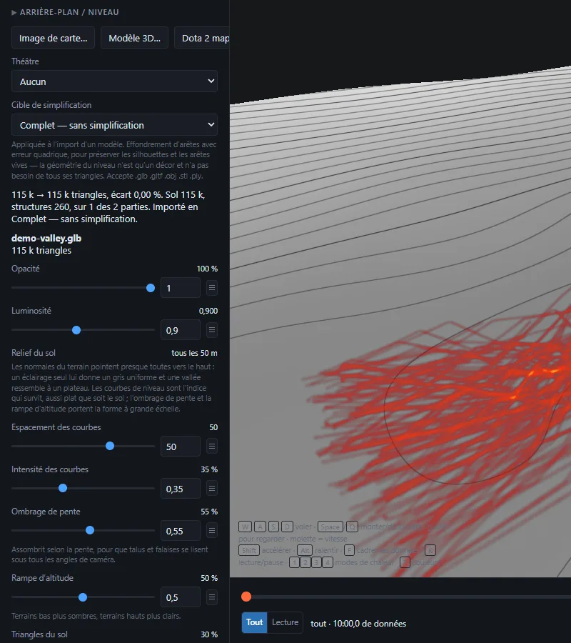

# Niveaux et géométrie de fond

Un niveau est le lieu 3D où s’est déroulé le jeu : une carte, une ville, un circuit. Placez-en un derrière vos données et vous voyez *où* se trouve la chaleur. Le panneau **Arrière-plan / niveau** (voir le [Glossaire](glossary.md) pour « niveau ») vous donne trois sortes de contexte :

- une **image de carte**, géoréférencée par deux ancres - voir [Images de carte](map-images.md) ;
- un **niveau 3D** - `.glb`, `.gltf`, `.obj`, `.stl` ou `.ply` - découpé en sol, structures et eau, et simplifié à l’import - voir [Niveaux 3D](model-levels.md) et [Apparence du niveau](level-appearance.md) ;
- un **décor du monde réel** - pour un enregistrement qui indique où il se trouve sur la Terre (un fichier Tacview ACMI) : le vrai relief, les routes, l’eau, les aérodromes et les bâtiments, téléchargés depuis des données ouvertes - voir [Décor du monde réel](world-backdrop.md).

Sans rien de chargé, la scène est sombre avec une grille et des axes colorés (**Grille** et **Axes** dans [Caméra et scène](camera.md)), et le panneau dit *Rien de chargé - la scène montre une grille et des axes. Ajoutez une image de carte ou un maillage de niveau pour donner un contexte à la chaleur.*

Le niveau est partagé par les trois onglets : un parcours chargé dans l’onglet Analyse de course est le même niveau que celui que montre la carte de chaleur.

## Mettre un niveau derrière vos données {#put-a-level-behind-your-data}

1. Chargez d’abord vos données ([Importer des données](getting-data-in.md)), pour que le niveau soit ajusté à elles.
2. Ouvrez **Arrière-plan / niveau** dans la barre latérale.
3. Appuyez sur **Image de carte…** pour une image ou sur **Modèle 3D…** pour un niveau 3D, et choisissez le fichier. Pour un enregistrement du monde réel, utilisez plutôt **Décor du monde réel** ou **Théâtre**.
4. Attendez que la ligne de progression se termine. Un gros modèle est d’abord simplifié (voir **Cible de simplification** plus bas).
5. Appuyez sur **F** dans la vue pour tout cadrer. Réglez **Opacité** et **Luminosité** jusqu’à ce que la chaleur ressorte du niveau.
6. Appuyez sur **Enregistrer dans la bibliothèque** si vous comptez réutiliser le niveau ([Bibliothèque de niveaux](level-library.md)).

## Ce que fait un niveau pour la chaleur {#what-a-level-does-for-the-heat}

- Il **occulte** : les points de donnée qui se trouvent derrière lui sont assombris surface par surface, et les points situés derrière le terrain sont masqués ([Profondeur et élimination des faces](depth-and-culling.md)). Sans niveau, il n’y a aucune occlusion.
- Il est **coupé** par la [Coupe](slice.md) et, avec *Couper aussi le niveau*, par l’[élimination par distance](depth-and-culling.md#distance-culling), en même temps que la chaleur.
- C’est la seule chose, avec la grille et les boîtes, que la [profondeur de champ](camera.md#depth-of-field) floute.
- Un niveau 3D **élargit le plan lointain de la caméra** quand il est plus grand que les données : le proche et le lointain sont calibrés à partir du jeu de données, et une carte exportée large de plusieurs kilomètres resterait sinon entièrement derrière le plan lointain, laissant une vue vide. Le plan lointain devient 3 × l’étendue horizontale du niveau quand celle-ci est plus grande, le plan proche le suit (au moins lointain / 100 000) pour garder la précision de profondeur dont dépend l’occlusion, et la vitesse de vol est relevée à au moins étendue / 12. Il n’est jamais rétréci, seulement élargi.

## Le panneau, de haut en bas {#the-panel-top-to-bottom}

| Partie | Détails |
|---|---|
| **Image de carte…**, **Modèle 3D…** | Charge l’un ; il remplace le niveau actuel. |
| **Décor du monde réel**, **Oublier les tuiles** | Seulement pour un jeu de données avec une référence géographique : construit le vrai lieu sous les données comme niveau, ou supprime les tuiles téléchargées. [Décor du monde réel](world-backdrop.md) |
| **Cible de simplification** | Le budget de triangles pour le prochain import de modèle : *Complet - pas de simplification* (par défaut), *Élevé - 8M*, *Moyen - 3M*, *Bas - 800k*, *Silhouette - 100k*. [Niveaux 3D](model-levels.md#simplification) |
| Progression et **Annuler** | Pendant le décodage ou l’import. |
| Note d’import | Triangles avant et après, la répartition sol / structures / eau, le niveau de détail utilisé. |
| Nom et taille | `largeur×hauteur px · x × z m/px` pour une image, `N triangles (sur M)` pour un modèle. |
| **Opacité**, **Luminosité** | Pour les deux types. |
| Commandes de l’image | **Désaturer**, **Inverser nord/sud**, **Placement** (deux ancres), **Ajuster aux limites des données**, **Altitude**. [Images de carte](map-images.md) |
| Commandes du modèle | Relief du sol, eau, triangles du sol, fil de fer, texture, couleur capturée, structures, classification des parties. [Apparence du niveau](level-appearance.md) |
| **Enregistrer dans la bibliothèque**, **Retirer** | [Bibliothèque de niveaux](level-library.md) ; Retirer décharge le niveau. |
| **Bibliothèque** | Les niveaux gardés dans ce navigateur. [Bibliothèque de niveaux](level-library.md) |

## Pages de cette section {#pages-in-this-section}

- [Images de carte](map-images.md)
- [Niveaux 3D](model-levels.md) - formats, parties, classification, simplification, textures
- [Apparence du niveau](level-appearance.md) - chaque commande d’un niveau 3D
- [Bibliothèque de niveaux](level-library.md)
- [Décor du monde réel](world-backdrop.md) - le vrai monde sous un enregistrement, à partir de données ouvertes

La façon de sortir des niveaux des jeux et des moteurs relève des outils d’export séparés (voir le [README](https://github.com/Holdi601/3DHeat/blob/main/README.md) du dépôt) ; le contrat vers lequel ils écrivent est résumé dans [Niveaux 3D](model-levels.md#the-exporter-contract).
