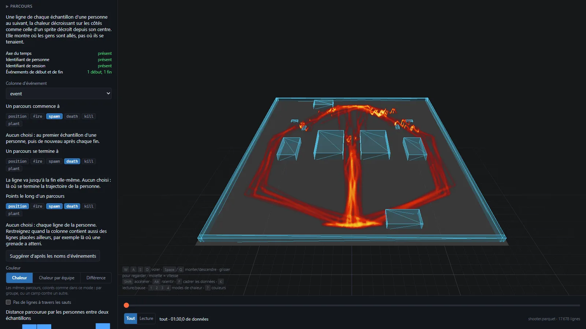

# Chaleur par lignes

La chaleur montre où les gens se tenaient. Les lignes montrent les chemins qu'ils ont parcourus.

**Lignes** (touche 4) est la chaleur par lignes : une ligne relie chaque échantillon d'une [personne](glossary.md) au suivant, étalée avec la même décroissance qu'un [sprite](glossary.md) — en travers de la ligne au lieu d'autour d'un point. Elle montre où les gens *sont allés* plutôt que où ils se tenaient : un couloir parcouru une seule fois se voit autant qu'une pièce où l'on a campé, et les échantillons espacés d'un joueur rapide se relient en un parcours continu au lieu d'une traînée pointillée. Elle a besoin d'une colonne de personne et d'une colonne de temps.

## Comment l'utiliser {#how-to-use-it}

1. Appuyez sur `4` (ou choisissez **Lignes** dans la barre des modes).
2. Ouvrez **Parcours** et vérifiez la liste verte : l'axe du temps et l'identifiant de personne doivent être présents.
3. Appuyez sur **Suggérer d’après les noms d’événements** pour remplir où commencent et finissent les parcours.
4. Lisez la ligne de statistiques : « N parcours, M d'entre eux allant jusqu'à une fin ».
5. Si les lignes traversent la carte d'un bond, réglez **Pas le plus long** (voir [La limite des sauts](#the-jump-limit)).

Une ligne n'a de sens qu'entre un début et une fin : le panneau **Parcours** dit donc ce qui borne un parcours. Tout ce qui se trouve à partir de [Les règles d'un parcours](#the-rules-of-a-route) est du détail que vous pouvez passer.

## Le panneau Parcours {#the-routes-panel}

Affiché au-dessus des panneaux de chaleur en mode Lignes.

### Ce que contiennent les données {#what-the-data-has}

Une liste de contrôle, verte quand l'élément est présent, ambre quand il ne l'est pas :

| Ligne | États |
|---|---|
| **Axe du temps** | *présent* / *manquant - nécessaire* |
| **Identifiant de personne** | *présent* / *manquant - nécessaire* |
| **Identifiant de session** | *présent* / *aucun - toutes les lignes sont une seule session* |
| **Événements de début et de fin** | *N débuts, M fins* / *aucun choisi - parcours entiers* (vert seulement avec une colonne d'événements et au moins un début et une fin) |

### Commandes {#controls}

| Commande | Signification |
|---|---|
| **Colonne d’événement** | Une colonne de catégorie dont les valeurs sont des événements (apparition, mort, position, ...). *Aucune - parcours entiers* : le trajet de chaque personne dans chaque session est un parcours, coupé là où le trajet a un trou. Seules les colonnes gardées pour le filtrage au chargement sont proposées. |
| **Un parcours commence à** | Les valeurs d'événement qui commencent un parcours (apparition, réapparition, déploiement). Aucune choisie : un parcours commence au premier échantillon d'une personne, et de nouveau après chaque fin. |
| **Un parcours se termine à** | Les valeurs d'événement qui terminent un parcours (mort, extraction, téléportation). La ligne va jusqu'à la ligne de fin elle-même. Aucune choisie : un parcours se termine où le trajet de la personne se termine. |
| **Points le long d’un parcours** | Les valeurs d'événement dont les lignes se trouvent le long du parcours. Aucune choisie : chaque ligne de la personne. Restreignez-la quand la colonne contient aussi des lignes placées ailleurs, par exemple l'endroit où une grenade a atterri. |
| **Suggérer d’après les noms d’événements** | Remplit les trois listes d'après les noms des valeurs (ci-dessous). |
| **Couleur** | *Chaleur*, *Chaleur par équipe* ou *Différence*. Les mêmes parcours dans la couleur de ce mode : chaque groupe dans sa propre teinte, ou un camp contre l'autre, avec la liste des groupes, la répartition et les échelles qui fonctionnent comme dans ces modes. Par défaut *Chaleur*. La chaleur par équipe et la différence demandent une colonne de groupe. |
| **Pas de lignes à travers les sauts** / **Pas le plus long** | Un échantillon suivant d'une personne plus éloigné que cette valeur est une réapparition, une téléportation ou une chute, et non un endroit où elle est allée : aucune ligne ne relie les deux. Rempli au chargement quand les données montrent un écart net (ci-dessous), et désactivé sinon. Fonctionne avec ou sans colonne d'événements. |
| Ligne de statistiques | `N parcours, M d'entre eux allant jusqu'à une fin, K segments`, mise à jour plusieurs fois par seconde. |

Chaque liste est une rangée de puces à bascule, une par valeur, la plus fréquente en premier ; passer la souris sur une puce affiche son nombre de lignes. 120 valeurs au maximum sont proposées (*N autres valeurs non affichées*).

Choisir une autre colonne d'événements applique la suggestion quand elle désigne cette même colonne, et commence avec des listes vides sinon.

### La suggestion {#the-suggestion}

À chaque chargement, et sur **Suggérer d’après les noms d’événements** ([`suggestLineSettings`](https://github.com/Holdi601/3DHeat/blob/main/src/data/lines.ts)) :

- **Colonne d'événements :** la première colonne de catégorie retenue nommée `event`, `eventname` ou `eventtype` ; sinon `kind`, `type` ou `action` ; sinon toute colonne contenant *event*, *kind*, *action* ou *type*.
- **Débuts :** les valeurs contenant *spawn, deploy, join, enter, start, begin, respawn, revive, land/landed/landing, drop* — sauf si elles correspondent aussi à un mot de fin.
- **Fins :** les valeurs contenant *death, died, dead, kill/killed, eliminat…, extract, evac, teleport, leave, left, disconnect, quit, exit, end, finish, downed* — sauf les valeurs `kill` et `kills` (un kill est ce que fait le tueur, pas la fin de son parcours).
- **Points :** les valeurs qui sont exactement *position, location, player location, move, movement, tick, sample* ou *pos* ; quand l'une d'elles est trouvée, les débuts et les fins sont aussi ajoutés aux points. Quand aucune n'est trouvée, les points restent vides (chaque ligne).

### La limite des sauts {#the-jump-limit}

Là où les gens sautent, les longueurs des pas se répartissent en deux groupes presque sans rien entre eux : ce qu'une personne parcourt entre deux échantillons, et la largeur de la carte. Au chargement ([`suggestMaxJump`](https://github.com/Holdi601/3DHeat/blob/main/src/data/lines.ts)), les pas sont comptés par doublement de leur longueur au carré, jusqu'à 16 millions, et la limite se place au milieu de la première plage au-dessus de la médiane qui fait au moins un doublement de longueur de large, qui contient moins de 0,02 % des pas par classe, et au-delà de laquelle il y a des pas. Sans une telle plage, rien n'est coupé, car on ne saurait pas distinguer un saut d'une voiture rapide ; activer la limite à la main part alors d'un dixième de la diagonale des données.

Le graphique au-dessus de la limite montre la vraie longueur des pas, avec une ligne à la limite : les barres à droite de celle-ci ne sont pas dessinées. Les deux axes sont logarithmiques, car les sauts peuvent valoir un centième des pas et être mille fois plus longs. Passez la souris sur une barre pour sa plage et sa part ; cliquez sur le graphique pour placer la limite là. Dessous, la part des pas au-delà de la limite.

## Les règles d'un parcours {#the-rules-of-a-route}

Les lignes sont parcourues dans l'ordre du temps, personne par personne ([`buildLines`](https://github.com/Holdi601/3DHeat/blob/main/src/data/lines.ts)) :

1. Les lignes d'un [nom partagé](sessions-persons-groups.md#names-worn-by-several-things-at-once) sont entièrement ignorées.
2. Avec des points choisis, une ligne qui n'est ni un début, ni une fin, ni un point est ignorée.
3. Les lignes sont suivies par personne et par session, si bien qu'une personne dont les sessions s'entrelacent dans le temps a un parcours dans chacune. Un parcours est clos quand la ligne précédente n'a pas de successeur (sa [durée de vie](sessions-persons-groups.md#person) est « aucune ») — un parcours ne franchit jamais une limite de session ni un trou que le chargement a décidé comme sans échantillon suivant. Le parcours auquel appartient une ligne est calculé une fois et conservé, 4 octets par ligne, si bien que changer le pas le plus long ne refait pas cette partie.
4. Une ligne de **début** ferme tout parcours ouvert et en ouvre un nouveau à cet endroit.
5. Avec des débuts choisis, une ligne hors d'un parcours est ignorée. Sans débuts, toute ligne hors fin ouvre un parcours.
6. Toute autre ligne à l'intérieur d'un parcours ajoute un **segment** de la ligne précédente du parcours jusqu'à celle-ci.
7. Une ligne de **fin** qui prolonge un parcours le ferme après son segment ; ce parcours compte comme *allant jusqu'à une fin*.
8. Un pas plus long que le **Pas le plus long** ferme le parcours là où il était, et un nouveau parcours commence à l'autre bout, sauf si cette ligne est une fin. Aucune ligne n'est tracée à travers, et la ligne de statistiques le compte.

Chaque segment est stocké sur sa ligne de *fin*, si bien que les segments restent dans l'ordre du temps, et que la [chronologie](timeline.md), l'échantillonneur, les [filtres](filters.md), la visibilité des groupes et le signe de la différence fonctionnent sur eux comme sur les points. Un filtre s'applique donc à la ligne où le segment se termine.

## Lecture {#playback}

En mode **Tout**, chaque parcours est dessiné en entier. En mode **Lecture**, chaque personne est un point qui se déplace entre ses échantillons, en traçant son parcours derrière elle :

- un segment qui commence après la tête de lecture n'est pas dessiné ;
- le segment au milieu duquel se trouve la personne est dessiné jusqu'à sa position interpolée, avec un embout arrondi à la tête ;
- la chaleur s'estompe sur la **traîne** : avec l'historique *Cumulé*, la traîne est illimitée et tout le parcours déjà fait reste ; avec *Fenêtre*, elle s'estompe à rien sur la *Plage* (30 s par défaut). Avec *Durée de vie*, la traîne est aussi la *Plage*, et en mode Lignes la chronologie affiche la case *Plage* pour cet historique (à la place de *Durée de vie de repli* et *Fondu*, que la chaleur par lignes n'utilise pas).

Pendant la lecture, chaque image est dessinée entière et non cumulée, car les têtes bougent à chaque image et une moyenne glissante les étirerait en traînée.

## Pour les développeurs {#for-developers}

### Mémoire {#memory}

Les parcours sont construits sur le thread principal quand on entre en mode Lignes (ou quand les réglages des parcours changent) et libérés quand on le quitte : 5 octets par ligne en mémoire et 8 octets par ligne sur le GPU (le point de départ de chaque segment, quantifié sur 16 bits par axe dans la boîte englobante des données, et ses drapeaux).

### Comment une ligne est dessinée {#how-a-line-is-drawn}

Les deux moteurs dessinent chaque segment depuis sa ligne de fin avec **18 sommets** ([`lineHeatVs`](https://github.com/Holdi601/3DHeat/blob/main/src/render/webgl2/shaders.ts) et son jumeau WGSL) :

- La demi-largeur à chaque extrémité est le [rayon du sprite](sprite-shape.md#sprite-radius) à la distance de cette extrémité, avec les bornes en pixels appliquées. Une ligne plus étroite que 2,5 px est dessinée large de 2,5 px avec sa chaleur réduite en conséquence, si bien que les lignes fines ne disparaissent ni ne s'éclaircissent.
- La chaleur décroît **en travers** de la ligne avec la même rampe qu'un sprite — décroissance ou courbe, intensité au centre et au bord.
- Des embouts arrondis ne sont dessinés **que** là où un parcours commence ou finit, pour que les jointures entre segments successifs ne forment pas un chapelet de perles.
- La géométrie est construite en espace écran et interpolée linéairement là, si bien que la décroissance reste centrée sur la ligne quelle que soit sa profondeur. Un segment qui traverse le plan proche est coupé là au lieu d'être supprimé.

La chaleur par points et la chaleur par lignes déposent des quantités très différentes de chaleur par ligne ; la saturation est donc recalculée quand on passe de l'une à l'autre ([Couleur et exposition](colour-and-exposure.md#auto-exposure)).
