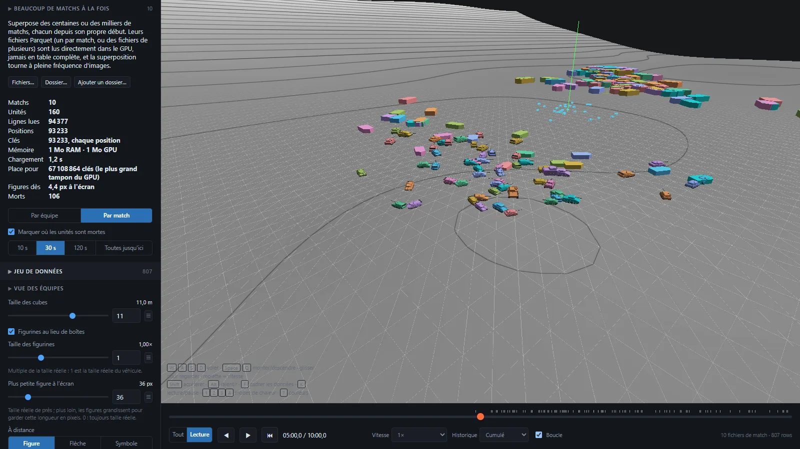

# Beaucoup de matchs à la fois

**Beaucoup de matchs à la fois** joue un grand nombre de matchs les uns sur les autres, pour voir où vont en général les joueurs de chaque match. Utilisez-le pour comparer des centaines ou des milliers de matchs sur une seule image.

Chaque match commence à son propre début, et ses unités se déplacent en figurines. Les fichiers vont directement dans la carte graphique, et aucune table complète n'est construite. La lecture est donc fluide là où un chargement normal manquerait de mémoire.

## Comment l'utiliser {#how-to-use-it}

1. Ouvrez **Beaucoup de matchs à la fois** dans la barre latérale de la Carte de chaleur.
2. Appuyez sur **Fichiers…** (choisissez plusieurs fichiers), **Dossier…** (un dossier et ses sous-dossiers) ou **Ajouter un dossier…** (ajoute à ce qui est chargé).
3. La visionneuse passe à la superposition de figurines et démarre au début. Appuyez sur **Lecture**.

Chaque fichier est un match (ou en contient plusieurs). Les fichiers Parquet et les conteneurs [`.3dheat`](container.md) fonctionnent. Un fichier a besoin d'une colonne de position, de temps et d'unité ; les colonnes de nom, de type et de camp sont gardées. Les autres fichiers, et les fichiers annexes des convertisseurs (vol, messages, événements, discussion, objectifs), sont ignorés. Pour une table normale, voir [Importer des données](getting-data-in.md).

## Réglages {#settings}

| Réglage | Ce qu'il fait |
|---|---|
| **Par équipe** / **Par match** | Colorer par camp, ou une couleur par match. |
| **Marquer où les unités sont mortes** | Une marque à l'endroit où chaque unité est morte, pendant 10 s, 30 s, 120 s, ou toutes jusqu'ici. |

Le panneau indique combien de matchs, d'unités, de lignes et de positions ont été lus, la mémoire utilisée et le temps de chargement. *Place pour* est le nombre de positions supplémentaires que la carte graphique peut encore accepter. *Figurines à partir de* est la taille à l'écran sous laquelle une unité est dessinée comme une petite flèche au lieu de sa figurine.

L'apparence des figurines utilise les mêmes commandes que le [replay de match](match-replay.md#figures) : **Taille des figurines**, **Plus petite figure à l’écran** et **À distance**.

## Astuces {#tips}

- Quand tout ne tiendrait pas en mémoire, les positions sont éclaircies (une seule position tous les quelques mètres est gardée), et le panneau le signale.
- Les modes de chaleur fonctionnent aussi sur les données de la superposition.
- Pour des statistiques sur des milliers de matchs sans les dessiner, voir [Analyse de masse](mass-analysis.md).
