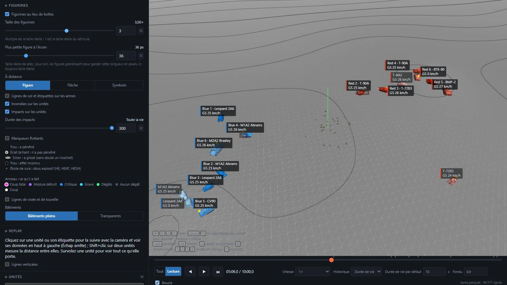
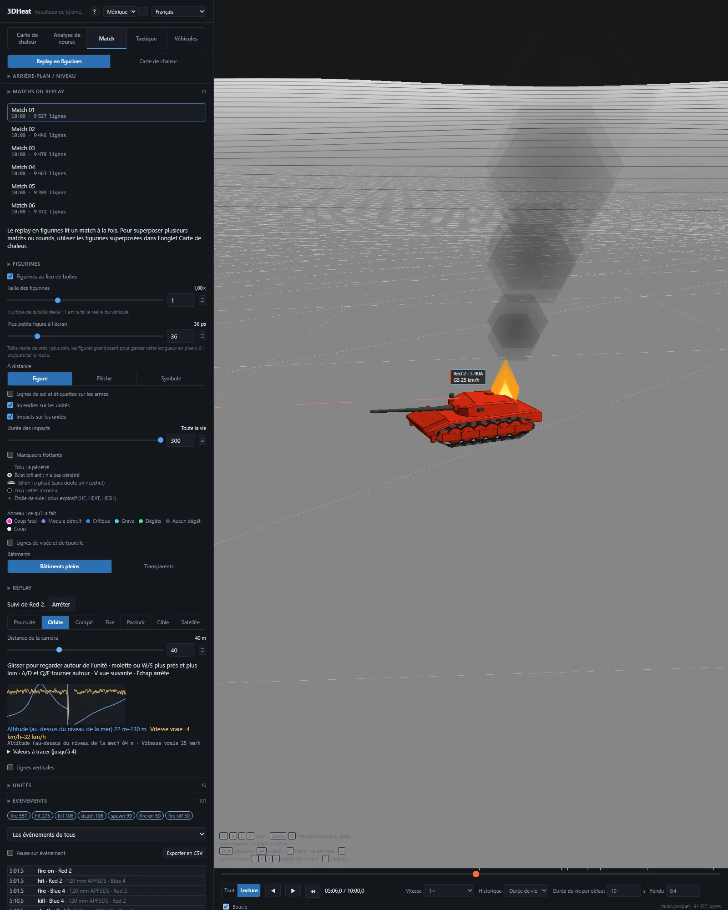
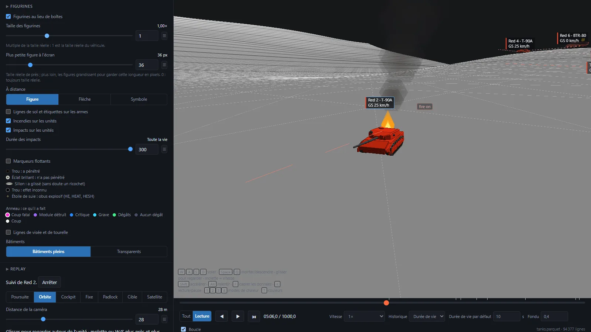
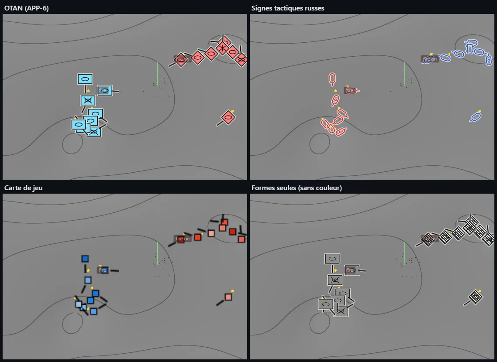
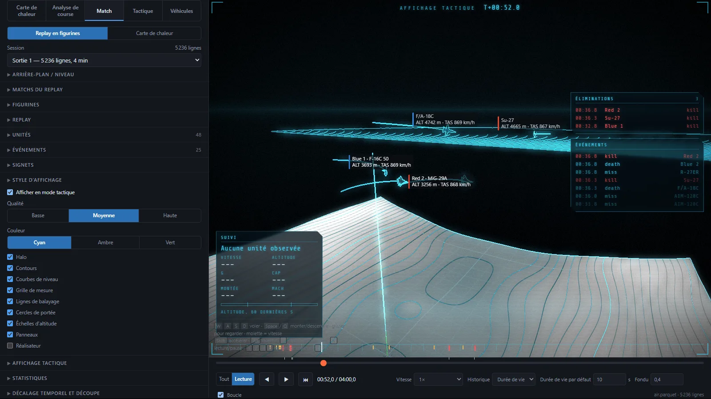
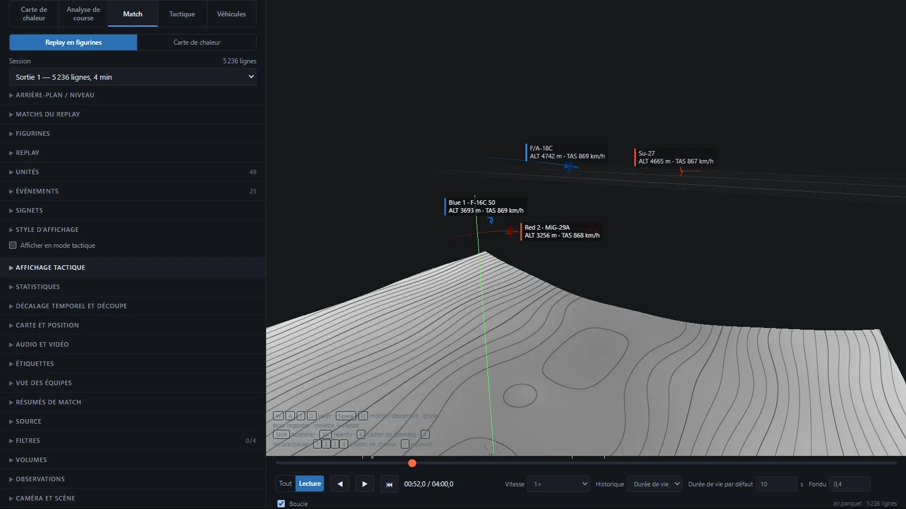

# Replay de match

Le replay est un film du match dans lequel chaque joueur est dessiné comme la chose qu'il conduisait. Servez-vous-en pour revoir un combat, suivre une unité et voir qui a touché qui.

Les tirs, les impacts, les incendies et les épaves sont dessinés sur les unités et les objectifs du niveau. Des caméras, des étiquettes et un affichage tactique vous aident à lire le combat. Vous connaissez Tacview ? [Parité avec Tacview](tacview-parity.md) indique où se trouve chacun de ses outils.

## Lancer un replay {#start-a-replay}

1. Chargez un enregistrement avec **Source → Fichiers…** ou en le déposant dans le panneau Source (tout tableau avec une colonne **personne** et une colonne **temps**, un fichier Tacview, un replay converti, un match [`.3dheat`](container.md)). Voir [Importer des données](getting-data-in.md).
2. Ouvrez l'onglet **Match** et choisissez **Replay en figurines**, ou choisissez **Figurines superposées** dans la barre des modes de l'onglet Carte de chaleur.
3. Sous **Matchs du replay**, choisissez un match, tous à la fois, ou plusieurs.
4. Appuyez sur **Lecture** sur la chronologie (ou `K`). Faites glisser la chronologie pour sauter.

Les figurines remplacent les boîtes pour chaque unité dont le nom ou le type est connu (voir [Figurines](figures.md)). Les données sans colonne de nom ni de type sont dessinées en soldats.

## Figurines {#figures}

| Réglage (section **Figurines**) | Par défaut | Ce qu'il fait |
|---|---|---|
| **Figurines au lieu de boîtes** | activé | Désactivé, dessine de simples boîtes. |
| **Taille des figurines** (fois la taille réelle) | 1 | 1 correspond à la taille réelle ; de 0,25 à 20 fois (échelle logarithmique). Plus grand aide de loin. |
| **Plus petite figure à l’écran** | 36 px | Les figurines lointaines grandissent pour rester de cette taille, de 0 à 200 px ; 0 garde la taille réelle. |
| **À distance** : Figure, Flèche, Symbole | Figure | Ce que devient une unité lointaine. |
| **Symboles** | OTAN (APP-6) | Symboles OTAN (APP-6), signes tactiques russes, icônes de **Carte de jeu**, ou **Formes seules (sans couleur)**. |
| **Taille des symboles**, **Mon camp**, **Hostile / Neutre**, **Traits de cap** | 28 px (12 à 64), automatique, hostile, activé | L'apparence des symboles et le camp allié. |
| **Lignes verticales** | activé | Une ligne de chaque unité tombant droit au sol, pour lire les hauteurs en 3D. |
| **Lignes de sol et étiquettes sur les armes** | désactivé | Lignes jusqu'au sol et étiquettes sur les missiles et les bombes. |
| **Incendies sur les unités** | activé | Flammes depuis le moment où une unité prend feu jusqu'à ce qu'elle soit éteinte. |
| **Impacts sur les unités** | activé | Marques là où les tirs ont frappé (ci-dessous). **Durée des impacts** : de 1 à 300 secondes, ou **Toute la vie**. **Marqueurs flottants** : marques dessinées au-dessus de la surface. |
| **Lignes de visée et de tourelle** | désactivé | En pointillés : où le joueur regarde ; pleines : où pointe le canon. |
| **Bâtiments** | plein | Bâtiments pleins ou transparents, lorsque le niveau les dessine. |

### Symboles à distance {#symbols-at-a-distance}

Lorsqu'une unité serait plus petite que la **Plus petite figure à l’écran**, elle peut devenir un symbole qui reste lisible. La forme indique le type (par exemple une boîte aux coins arrondis avec une marque de chenille pour un blindé) ; la couleur indique le camp. Ouvrez le menu **Symboles** pour changer le style.

### Marques d'impact, épaves et incendies {#hit-marks-wrecks-and-fires}

- Les **marques d'impact** se posent sur la surface touchée par le tir, à l'échelle de la figurine. Leur aspect indique ce qui s'est passé : un trou (traversé), une éclaboussure lumineuse (non traversé), une entaille (ricochet), une étoile de suie (obus explosif). Un anneau coloré indique l'effet : tir mortel, module détruit, critique, grave, dégâts, sans dégât, impact. Survolez une marque pour le nom du projectile.
- Une unité détruite est dessinée **carbonisée** en épave, de sa mort jusqu'à sa réapparition ou sa suppression ; son symbole est barré.
- Les **incendies** brûlent sur une unité depuis le moment où elle prend feu jusqu'à ce qu'elle soit éteinte.
- Les **tourelles** se tournent vers l'endroit où les données indiquent que pointe le canon (ou, à défaut, vers l'endroit que regarde le joueur).

### Armes, leurres et traceurs {#weapons-decoys-and-tracers}

Avec **Armes, tirs et coups au but** activé (section Vue des équipes) : les missiles, roquettes, bombes et torpilles volent en figurines propres avec une traînée de fumée ; les balles et obus sont des traceurs ; les impacts et explosions clignotent. Un traceur dessiné **en pointillés** a été déduit d'un impact, car les données ne contenaient pas le tir. Les leurres et les paillettes sont dessinés comme des leurres ; ils sont masqués de la liste des unités sauf si *Leurres et obus* est coché.

## Caméras {#cameras}

Cliquez sur une unité ou son étiquette pour la **suivre** ; la section **Replay** propose **Poursuite**, **Orbite**, **Cockpit** (avec un affichage tête haute, `H`), **Fixe**, **Padlock**, **Cible** et **Satellite**. `V` les fait défiler, **Distance de la caméra** règle l'éloignement. Échap arrête.

- **Vue à deux unités** : choisissez une **Cible** (ou Ctrl/Alt-clic sur une unité) pour la regarder depuis celle que vous suivez ; **Échanger** les inverse.
- **Mesure** : Maj-clic sur deux unités pour le relèvement, la distance et la différence de hauteur entre elles.
- **Carte 2D** (`M`) : vue en coin ou plein écran, avec traînées et noms.
- **Signets** (`B`) : enregistrez l'instant et la caméra ; les éliminations, morts et marques propres à l'enregistrement sont aussi listés.
- **Événements** : chaque événement dans l'ordre chronologique ; un clic y saute. `Page précédente` / `Page suivante` sautent d'événement en événement ; **Pause sur événement** s'arrête à chacun.

## Affichage tactique {#tactical-display}

La section **Affichage tactique** dessine, pour aucune unité, les unités sélectionnées, toutes, ou un seul type (aéronefs, terrestres, navires, armes) : vecteurs de vitesse et trajectoire à venir, lignes de nez et de portance, cônes radar, verrouillages, liaisons de données, zones et lignes d'engagement, lignes de visée, là où les joueurs regardent (cônes de vue), visée des tourelles, et la caméra enregistrée.

### Style d'affichage {#display-style}

`T` (ou la bascule **Afficher en mode tactique**) fait passer à un aspect d'écran radar : lueur, contours, courbes de niveau, grille de mesure, lignes de balayage, anneaux de portée, échelles d'altitude, panneaux d'éliminations et d'événements, et un **Réalisateur** qui déplace la caméra vers les événements de lui-même.

## Objectifs {#objectives}

Lorsqu'un match est livré avec ses objectifs, la section **Objectifs** les dessine sur le niveau : zones de capture (avec propriétaire et progression de la capture), spawns, aérodromes, zones et cibles de bombardement, chaque couche pouvant être activée ou désactivée, avec étiquettes. Ils sont visibles à travers le sol. Lorsque plusieurs modes de jeu sont chargés, **Mode** filtre les matchs par mode. Les objectifs proviennent du fichier de match d'un convertisseur placé à côté de l'enregistrement ou à l'intérieur d'un conteneur [`.3dheat`](container.md).

## Étiquettes et statistiques {#labels-and-statistics}

- **Étiquettes** : règles par type (**Sélectionnées**, **Aéronefs**, **Terrestres**, **Navires**, **Armes**, **IA**) : affichées ou non, quelles valeurs, et une **Priorité** pour savoir qui obtient la place lorsque les étiquettes se chevauchent. **Écarter les étiquettes** déplace une étiquette à côté de son unité lorsqu'elle en couvrirait une autre, et la retire là où il n'y a pas de place. **Taille des étiquettes** va de 60 à 250 %. **Revenir au nom, véhicule, altitude et vitesse** rétablit les règles.
  - Les unités terrestres commencent avec le nom, le véhicule et la vitesse.
  - Les aéronefs commencent avec le nom, le véhicule, l'altitude et la vitesse.
  - Les navires commencent avec le nom, le véhicule, la vitesse et le cap.
  - Survolez une unité pour voir chaque valeur qu'elle a.
- **Statistiques** : par équipe et par unité : éliminations, morts, tirs, impacts, taux d'impact, décollages, atterrissages, temps en vol, vitesse maximale, hauteur et facteur G, distance. Export CSV.
- **Graphiques** : les valeurs d'une unité au fil du temps, deux unités comparées, ou une valeur face à une autre.

## Beaucoup de matchs à la fois {#many-matches-at-once}

Pour superposer des centaines ou des milliers de matchs, voir [Beaucoup de matchs à la fois](many-matches.md). Détails des figurines (fumée, feu, autres effets temporisés) : [Figurines dans la superposition](figure-replay.md). Liste des fonctions Tacview : [Parité avec Tacview](tacview-parity.md), une page enfant de celle-ci.
