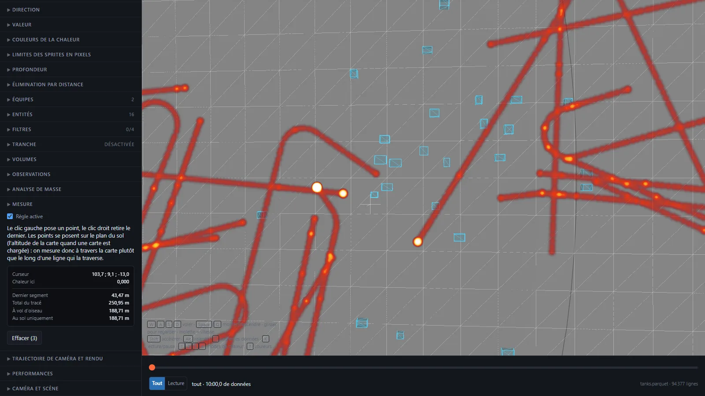

# Mesure

**Mesure** transforme la souris en règle et vous indique l'affluence de l'endroit sous le curseur. Utilisez-la pour savoir à quelle distance se trouvent deux lieux, ou combien de trafic passe par un endroit.

## Essayer {#try-it}

1. Ouvrez **Mesure** dans la barre latérale et cochez **Règle active**.
2. Cliquez avec le bouton gauche sur trois endroits de la carte. Chaque clic pose un point.
3. Lisez **Total du tracé** (la longueur de tout le chemin) et **Dernier segment** (le dernier trajet).
4. Cliquez avec le bouton droit pour retirer le dernier point, ou appuyez sur **Effacer (3)** pour tout retirer.

| Action | Effet |
|---|---|
| Clic gauche | Pose un point là où le curseur rencontre le plan du sol. Un clic qui a bougé de plus de 4 pixels entre l'appui et le relâchement est un glissement de caméra, pas un point. |
| Clic droit | Retire le dernier point. |
| Déplacement | La position du curseur et la chaleur sous lui se mettent à jour en direct. |

La caméra continue de fonctionner pendant que la règle est active : glisser fait toujours regarder autour, et les touches font toujours voler. Pendant que la règle est active, elle reçoit tous les clics ; [choisir un point en cliquant](camera.md#click-to-pick) attend donc qu'elle soit désactivée.

**Le plan du sol** est l'altitude de l'[image de carte](map-images.md) quand une image de carte est chargée, sinon le Y le plus bas du jeu de données (0 sans image). Les points s'y posent, donc la règle mesure en travers de la carte, et non le long d'une ligne qui la traverse. Avec un niveau 3D, le plan reste le Y le plus bas du jeu de données, et non la surface du niveau. Pour un point sur la vraie surface, désactivez la règle et cliquez dessus ([choisir un point en cliquant](camera.md#click-to-pick)) : cela lit les coordonnées sur les triangles du niveau lui-même.

## Affichages {#readouts}

| Ligne | Signification |
|---|---|
| **Curseur** | X, Y, Z du monde du point sous le curseur, sur le plan. |
| **Chaleur ici** | La quantité de chaleur sous le pixel du curseur. Un nombre plus grand signifie plus de trafic à cet endroit. C'est la valeur que reçoit la rampe de couleur avant que le point de saturation ne la divise. On peut donc la comparer au [point de saturation](colour-and-exposure.md#saturation-point). |
| **Dernier segment** | Distance entre le dernier point et le curseur (ou entre les deux derniers points). |
| **Total du tracé** | Longueur de la ligne brisée qui passe par chaque point et par le curseur. |
| **À vol d’oiseau** | Distance 3D entre le premier point et le curseur (ou le dernier point). |
| **Au sol uniquement** | La même, sur X et Z seulement. |
| **Effacer (N)** | Retire tous les points. |

Les distances sont affichées en centimètres en dessous de 1 unité, en mètres en dessous de 1 000, en kilomètres au-delà, en supposant qu'une unité du monde est un mètre ([Axes, unités et temps](axes-units-and-time.md#unit-scale)). Les coordonnées sont celles du monde, y compris quand un axe est [inversé pour l'affichage](camera.md#invert-world-axis).

Les points et la ligne qui les relie sont dessinés en surimpression dans la vue, à une taille calculée d'après l'espacement de la grille. Les points de la règle ne sont pas enregistrés dans les vues ; ils restent quand vous chargez d'autres données.

## Pour les développeurs {#for-developers}

**Chaleur ici** est lue sur le GPU au plus toutes les 120 ms, car une relecture d'un seul pixel bloque le pipeline. Elle emprunte le même chemin que `engine.readHeatProbe()` : elle est divisée par le gain avec lequel l'image a été écrite. Sur le chemin d'accumulation en demi-précision (`?heat=f16`), elle est donc dans les mêmes unités que sur une cible 32 bits ([Accumulation en demi-précision](half-float-accumulation.md)).
