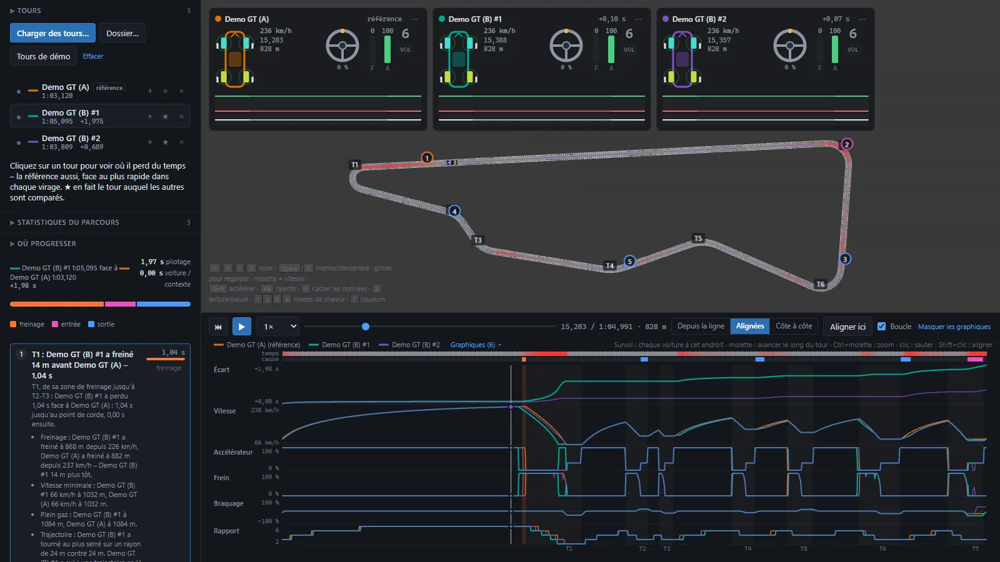

# Analyse de course

Vous avez roulé deux fois le même circuit. L'onglet **Analyse de course** joue les deux trajets ensemble en 3D, montre où un tour était plus lent et vous dit pourquoi. Pas encore de tours ? Appuyez sur **Tours de démo**.

L'onglet compare deux tours ou plus d'un même parcours. Il partage le canevas, la caméra et le modèle de circuit chargé (**Arrière-plan / niveau**) avec la carte de chaleur ; tout le reste lui est propre : sa propre barre latérale et sa propre barre sous la vue. Des mots comme *tour*, *référence* et *corde* sont dans le [glossaire](glossary.md).

Cette page est le plan de l'onglet. Chaque partie a sa propre page :

| Page | Ce qu'elle couvre |
|---|---|
| [Charger des tours](race-loading-laps.md) | chaque format de fichier, dossiers et parcours, noms de voitures, tours de démo, la liste des tours, la référence et le point de mise au point |
| [Replay et scène 3D](race-replay-and-scene.md) | la barre de transport, les trois modes de replay, l'alignement des voitures, la caméra de poursuite, les lignes, les cartes, les voitures, les étiquettes, les mondes miroirs |
| [Graphiques et HUD](race-charts-and-hud.md) | les graphiques de distance, le choix des graphiques, le survol et le zoom, les cartes des voitures, le tableau des voies |
| [Événements de contrôle des voitures](race-control-events.md) | blocages, patinage, survirage, tête-à-queue, sous-virage, impacts, accidents, ABS/TC, frein à main, air — comment chacun est détecté, avec chaque seuil |
| [Analyse virage par virage](race-corner-analysis.md) | l'alignement par distance, les virages et les segments, le bilan de temps d'un virage, chaque cause et l'ordre dans lequel elles sont essayées, la forme de la trajectoire et le conseil |
| [Profils des voitures et comparaison](race-car-profiles.md) | ce que sait faire chaque voiture, mesuré sur ses tours ; *Voitures comparées* ; ce que la voiture décide dans chaque virage |
| [Statistiques du parcours](race-course-statistics.md) | beaucoup de tours d'un même parcours : erreurs par virage et par sorte, la carte des erreurs, l'export vers la carte de chaleur, les limites de performance |
| [Analytique de course : la méthode](race-analytics.md) | la recherche derrière les règles, avec les sources |
| [Autres jeux de course](other-games.md) | ce que fait la visionneuse avec les tours de chaque jeu : glissement et dérive calculés là où un jeu ne les envoie pas, mondes miroirs, les voies supplémentaires |

## L'écran {#the-screen}

**Barre latérale**, de haut en bas (les sections peuvent être repliées) :

1. **Tours** — charger, lister, afficher/masquer, référence, mise au point, poursuite.
   Voir [Charger des tours](race-loading-laps.md).
2. **Statistiques du parcours** — seulement à partir de trois tours chargés.
   Voir [Statistiques du parcours](race-course-statistics.md).
3. **Où progresser** — les constatations du tour mis au point, virage par virage.
   Voir [Analyse virage par virage](race-corner-analysis.md).
4. **Virage par virage** (ou *Virage par virage - classe X* avec plusieurs classes) — le tour le plus rapide dans chaque virage et sa trajectoire. Affiché avec deux tours ou plus.
5. **Contrôle de la voiture** — les blocages, glissements, poussées et impacts du tour mis au point.
   Voir [Événements de contrôle des voitures](race-control-events.md).
6. **Voitures comparées** (ou **La voiture** avec une seule voiture) — voir [Profils des voitures et comparaison](race-car-profiles.md).
7. **Vue** — quelle carte est peinte sur la piste et ce qui est dessiné.
   Voir [Replay et scène 3D](race-replay-and-scene.md).
8. Les panneaux communs **Niveau** et **Caméra et scène** (modèle du parcours, inversion d'axes, caméra) — documentés avec la carte de chaleur et la [Caméra](camera.md).

**La vue** montre le parcours, les lignes roulées, la carte, les voitures, les étiquettes épinglées à la piste, et jusqu'à six cartes de voiture en haut à gauche (voir [Graphiques et HUD](race-charts-and-hud.md)). Sans tour chargé, elle affiche « Aucun tour chargé - déposez ici deux fichiers de tours ou plus, ou chargez les tours de démo depuis la barre latérale. »

**La barre sous la vue** contient le transport du replay et, sauf si elle est masquée, les graphiques de distance.

## Démarrage rapide {#quick-start}

1. Ouvrez l'onglet **Analyse de course** (à côté de **Carte de chaleur** en haut de la barre latérale).
2. Faites entrer des tours. Appuyez sur **Tours de démo** pour voir ce que fait l'onglet avec trois tours fictifs. Pour vos propres tours, enregistrez-les d'abord ([formats de fichiers et enregistreurs](race-loading-laps.md#file-formats)), puis appuyez sur **Charger des tours…** ou **Dossier…**, ou déposez des fichiers ou des dossiers sur la vue.
3. Le tour complet le plus rapide devient la référence ; le tour le plus lent parmi les autres est mis au point. Cliquez sur n'importe quel tour de la liste pour le mettre au point ; ★ en fait la référence.
4. Lisez **Où progresser**. Cliquez sur une constatation : les voitures sont alignées 40 m avant elle, la caméra la cadre, le replay la traverse et les mesures s'ouvrent.
5. Survolez les graphiques pour amener chaque voiture à ce mètre ; Maj+clic pour les aligner là.

## Clavier {#keyboard}

Pendant que l'onglet Course est ouvert :

| Touche | Effet |
|---|---|
| **K** | lecture / pause du replay |
| **Début** (Home) | retour au début du replay |
| touches numériques | rien (dans la carte de chaleur, elles changent de mode) |

Les touches saisies dans un champ de texte ou une liste déroulante sont ignorées. Les touches de caméra fonctionnent comme dans la carte de chaleur (**W A S D**, **Espace** pour monter, **Q** pour descendre, **Maj** pour aller plus vite, **Alt** pour aller plus lentement, souris pour regarder ; tout est dans [Caméra](camera.md)) ; **F** cadre les tours chargés (comme le fait le chargement des tours).

## Beaucoup de tours {#many-laps}

- Tous les tours chargés sont analysés et comptés ; une dizaine prennent une ou deux secondes.
- Au-delà de **8** tours (`SHOW_ALL_UP_TO`), les tours ajoutés ne sont dessinés que s'ils sont la référence, le tour mis au point, ou le meilleur tour de la classe du tour mis au point. *Tout afficher* / *Seulement ceux examinés* permettent de changer.
- Au-delà de **10** voitures visibles (`PLAIN_PAST`), les tours non examinés (ni le point, ni la voiture poursuivie, ni la référence) sont dessinés avec des lignes allégées à un point tous les 6 m au lieu de 1,5 m, et des voitures simples.
- Les graphiques dessinent au plus **8** tours ; le HUD affiche au plus **6** cartes.
- Les statistiques du parcours apparaissent à partir de **3** tours.

Détails : [Statistiques du parcours](race-course-statistics.md#performance-with-many-laps).

## Réglages d'affichage par défaut {#default-view-settings}

| Réglage | Par défaut |
|---|---|
| Carte | Carte des temps |
| Lignes roulées, Voitures, Pneus et suspension, Étiquettes, Piste d'après les tours | activé |
| Toutes les valeurs sur les cartes | désactivé |
| Taille des voitures | 1× |
| Graphiques | affichés |
| Mode de replay | Depuis la ligne |
| Vitesse du replay | 1× |
| Boucle | activé |

Rien de cela n'est enregistré ; un rechargement repart des valeurs par défaut. Ce que le navigateur retient : la langue, et les noms de voitures appris depuis les fichiers de tours (voir [Charger des tours](race-loading-laps.md#car-names)).

## Pour les développeurs {#for-developers}

### Ce qui se passe quand des tours sont chargés {#what-happens-when-laps-are-loaded}

Chaque fois que l'ensemble des tours, la référence ou la langue change, toute l'analyse est refaite (`analyse` dans [`src/race/analysis.ts`](https://github.com/Holdi601/3DHeat/blob/main/src/race/analysis.ts)) :

1. Des voies dérivées sont ajoutées à chaque tour là où le jeu ne les envoie pas : angle de dérive, glissement des roues d'après leur vitesse, en l'air, sol meuble, vitesse de lacet ([`derive.ts`](https://github.com/Holdi601/3DHeat/blob/main/src/race/derive.ts)).
2. La référence est choisie et chaque tour est projeté sur son tracé et rééchantillonné tous les 2 m ([`align.ts`](https://github.com/Holdi601/3DHeat/blob/main/src/race/align.ts)).
3. On détermine à partir des tours si le monde du jeu est en miroir ([`handedness.ts`](https://github.com/Holdi601/3DHeat/blob/main/src/race/handedness.ts)).
4. Les virages sont trouvés sur la référence et regroupés en segments, d'une zone de freinage à la suivante ([`segments.ts`](https://github.com/Holdi601/3DHeat/blob/main/src/race/segments.ts)).
5. Par voiture : son enveloppe (adhérence, freinage, couple selon la vitesse), son profil, ses courbes de pneus ([`envelope.ts`](https://github.com/Holdi601/3DHeat/blob/main/src/race/envelope.ts), [`profile.ts`](https://github.com/Holdi601/3DHeat/blob/main/src/race/profile.ts), [`control.ts`](https://github.com/Holdi601/3DHeat/blob/main/src/race/control.ts)).
6. Par tour et par segment : ce qu'il a fait (point de freinage, point le plus lent, pleins gaz, ...) et la trajectoire roulée ([`line.ts`](https://github.com/Holdi601/3DHeat/blob/main/src/race/line.ts)).
7. Par tour : ses événements de contrôle de la voiture, chacun posé face au tour auquel il est comparé à cet endroit.
8. Par tour et par segment : le bilan de temps face à son tour de comparaison, et la constatation en mots.
9. La carte des temps et la carte des causes par tour.

Les textes sont produits dans la langue courante ; changer de langue relance l'analyse (et renomme les tours de démo). Un échec de l'analyse s'affiche sous les boutons **Tours** comme une erreur, et les tours restent chargés.

### Fichiers sources {#source-files}

| Fichier | Rôle |
|---|---|
| `src/race/adapters.ts`, `ibt.ts` | lecture des fichiers de tours |
| `src/race/lap.ts`, `carNames.ts`, `synthetic.ts` | le type de tour, les noms, les tours de démo |
| `src/race/derive.ts`, `handedness.ts` | voies dérivées, mondes miroirs |
| `src/race/align.ts`, `segments.ts`, `line.ts` | axe de distance, virages, lignes |
| `src/race/analysis.ts` | virages comparés, causes, constatations |
| `src/race/envelope.ts`, `profile.ts` | ce que sait faire une voiture |
| `src/race/control.ts`, `impacts.ts` | contrôle de la voiture, impacts et accidents |
| `src/race/stats.ts` | beaucoup de tours |
| `src/race/replay.ts`, `scene.ts`, `glyph.ts`, `geometry.ts` | replay et dessin |
| `src/race/schema.ts`, `graphs.ts` | le tableau des voies, les lignes des graphiques |
| `src/ui/race/*` | la barre latérale, les graphiques, le HUD, les étiquettes |
| `src/state/raceStore.ts` | l'état de l'onglet et l'horloge du replay |
