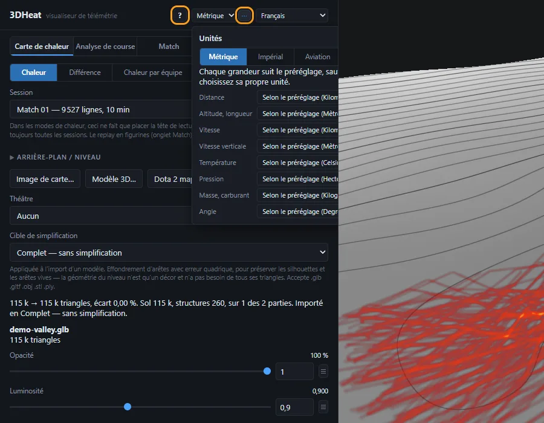
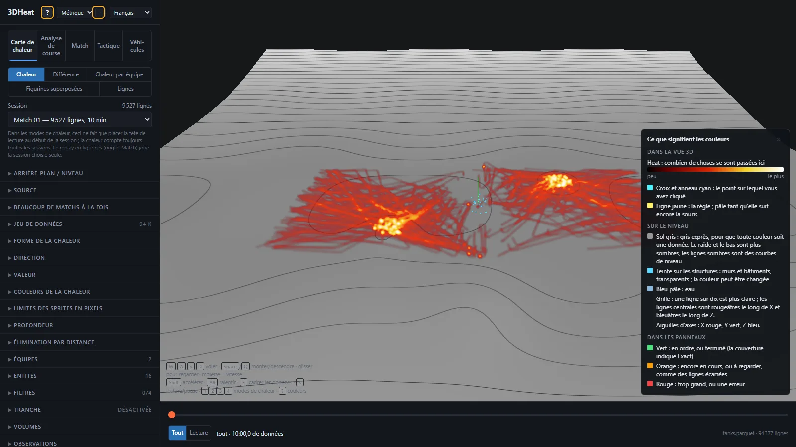
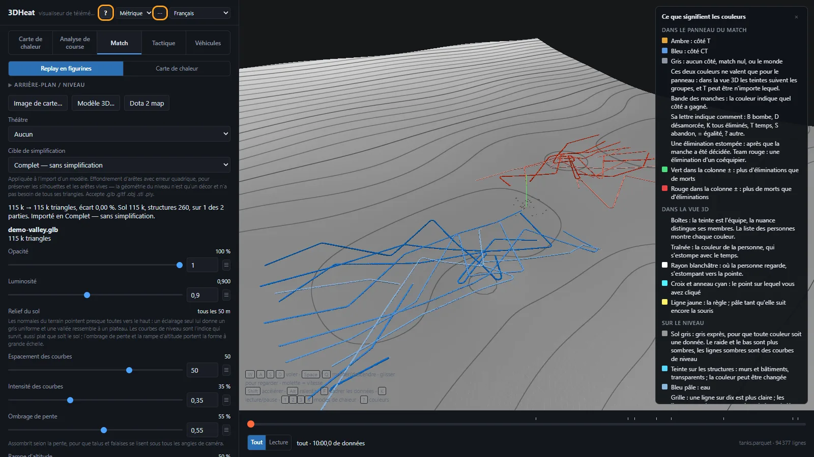

# Réglages, unités et touches

Les petites commandes en haut de la barre latérale changent la façon dont la visionneuse vous parle : la langue, les unités (mètres ou pieds, km/h ou nœuds) et un mode d'aide qui explique les couleurs. Vos choix sont retenus dans votre navigateur.

## L'en-tête {#the-header}

En haut de la barre latérale :

| Commande | Ce qu'elle fait |
|---|---|
| **?** | Mode d'aide : ce que signifie chaque couleur (aussi `?` ou `F1`) |
| Menu **Unités** | Métrique, Impérial, Aviation ou Nautique |
| Bouton **...** à côté de **Unités** | Ouvre « Choisir une unité pour chaque grandeur » : une liste déroulante par grandeur |
| Menu **Langue** | La langue de la visionneuse : [40 langues](languages.md), ou celle du navigateur |

Les nombres que vous tapez dans une case peuvent utiliser un point ou une virgule (`0.35` ou `0,35`). La visionneuse lit les deux, et affiche les nombres comme les écrit la langue de la visionneuse.

## Unités {#units}

1. Choisissez un préréglage dans le menu **Unités**. Toutes les grandeurs changent ensemble.
2. Pour ne changer qu'une grandeur, cliquez sur le bouton **...** à côté d'elle et choisissez une unité pour cette grandeur. Le menu affiche alors un `*` après le préréglage.
3. Une grandeur que vous n'avez pas réglée suit le préréglage. Choisissez « Comme le préréglage » pour revenir en arrière.

| Grandeur | Métrique (défaut) | Impérial | Aviation | Nautique |
|---|---|---|---|---|
| Distance | km | mi | NM | NM |
| Altitude, longueur | m | ft | ft | m |
| Vitesse | km/h | mph | kt | kt |
| Vitesse verticale | m/s | ft/min | ft/min | m/s |
| Température | °C | °F | °C | °C |
| Pression | hPa | inHg | hPa | hPa |
| Masse, carburant | kg, l | lb, gal | lb, gal | t, m³ |
| Angle | degrés | degrés | degrés | degrés |

Autres unités au choix pour une grandeur : distance km, mi, NM ; vitesse km/h, m/s, kt, mph ; vitesse verticale m/s, ft/min, m/min ; température °C, °F, K ; pression hPa, inHg, mmHg, psi ; masse kg, lb, t ; angle degrés ou mils OTAN (6 400 pour un tour complet). Les unités sont les mêmes partout dans la visionneuse : étiquettes, fiches, graphiques, statistiques.

## Mode d'aide {#help-mode}

Appuyez sur `?` ou `F1`, ou cliquez sur le bouton **?**. Il affiche *Ce que signifient les couleurs* : les légendes de la vue 3D, des rampes de chaleur, des couleurs des équipes, des couleurs du niveau, des couleurs d'état des panneaux, du panneau de match et de la vue d'analyse de course. Il reste actif jusqu'à ce que vous le désactiviez. Dans l'onglet **Match**, il explique aussi les couleurs du panneau de match.

## Ce que le navigateur retient {#what-the-browser-remembers}

Ces réglages sont gardés dans votre navigateur d'une visite à l'autre (rien n'est envoyé ailleurs) :

- la langue, les unités et le mode d'aide ;
- les réglages de figurine, de symbole, d'étiquette, de caméra et d'affichage tactique du replay ;
- la vitesse de lecture et le miroir ;
- les signets par enregistrement, les volumes par jeu de données, les couches d'objectifs ;
- les réglages d'IA externe (la clé seulement si vous cochez *Mémoriser*).

Les réglages de chaleur, les filtres et le mode repartent de zéro à chaque chargement. La liste complète, générée : [Réglages enregistrés](ref-settings-storage.md).

## Touches que la visionneuse garde du navigateur {#keys-the-viewer-keeps-from-the-browser}

Une session avec de grandes données prend du temps à charger. La visionneuse empêche donc le navigateur de la jeter par accident :

- `Ctrl`/`Cmd` + les lettres qui imprimeraient, enregistreraient, ouvriraient, rechargeraient, fermeraient ou ouvriraient de nouvelles fenêtres ne font rien hors des cases de texte ; `F1`, `F3`, `F5`, `F6` et `F7` ne font rien non plus.
- Fermer ou recharger l'onglet avec des données ou un niveau chargés demande d'abord confirmation.
- En plein écran, la visionneuse verrouille les touches qu'elle utilise (W, T, N, S, R, P, Q, Échap), pour que le navigateur ne les prenne pas.

La liste exacte : [Touches du navigateur](ref-browser-keys.md). Toutes les touches propres à la visionneuse : [Référence clavier et souris](keyboard-reference.md).
