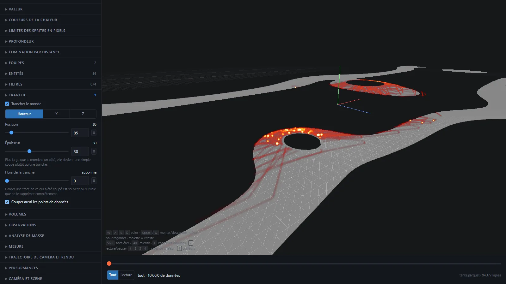

# Coupe

**Coupe** coupe le monde comme une tranche de gâteau, pour voir à l'intérieur des bâtiments. Utilisez-la quand des murs cachent la chaleur intéressante, par exemple pour voir un seul étage d'un bâtiment.

## Essayer {#try-it}

1. Chargez un niveau et des données, puis ouvrez **Coupe**.
2. Cochez **Trancher le monde**. L'axe est **Hauteur**.
3. Faites glisser **Position** vers le haut et vers le bas : la tranche traverse le niveau.
4. Mettez **Épaisseur** fine pour un plan d'étage, ou large pour « tout ce qui est en dessous de ce point ».
5. Gardez **Hors de la tranche** à 0 pour retirer le reste, ou montez-le pour garder une trace discrète.



La tranche coupe **la géométrie du niveau et les points de données ensemble**. Couper seulement le niveau laisserait la chaleur flotter là où se trouvait son bâtiment. C'est le pendant de [l'occlusion par profondeur](depth-and-culling.md) : une fois que le niveau cache correctement ce qui se trouve derrière lui, l'intérieur d'un bâtiment est caché lui aussi. Le panneau s'affiche quand il y a quelque chose à couper (un jeu de données ou un niveau 3D). Son en-tête montre l'axe quand la coupe est active, *désactivé* sinon.

```
vue de côté       Position = où se trouve la tranche
 ----------       Épaisseur = la hauteur de la tranche
 | étage 3 |
 |=========|  <--- tranche (gardée)
 | étage 2 |  <--- hors tranche : retiré (ou discret)
 | étage 1 |
 ----------
```

## Commandes {#controls}

| Commande | Défaut | Sens |
|---|---|---|
| **Trancher le monde** | désactivé | Active la tranche. Tant que la position est encore à sa valeur initiale de 0 et l'épaisseur à sa valeur initiale de 500, l'activation les place au milieu de l'axe et à 15 % de son étendue. |
| Axe | **Hauteur** | *Hauteur* (Y), *X* ou *Z*. Changer d'axe place la tranche au milieu du nouvel axe. |
| **Position** | le milieu | Centre de la tranche, en unités du monde, sur l'étendue de l'axe (500 pas). |
| **Épaisseur** | 15 % de l'étendue | De 1/500 de l'étendue à deux fois l'étendue, par pas logarithmiques. Affiche *au-delà du monde* une fois aussi large que l'étendue : un côté dépasse alors le monde, et c'est une simple coupe plutôt qu'une tranche. |
| **Hors de la tranche** | 0, *retiré* | Part de ce qui se trouve à l'extérieur qui reste visible, de 0 à 100 %. Une trace discrète de ce qui a été coupé est souvent plus lisible que sa suppression totale. |
| **Couper aussi les points de données** | activé | Désactivé, la chaleur reste entière, donc elle se voit à travers la coupe. C'est utile pour voir ce qui se trouve au-dessus et au-dessous de la tranche. |

L'étendue d'un axe est celle du niveau 3D quand un niveau est chargé, sinon celle du jeu de données.

La coupe est indépendante de [l'élimination par distance](depth-and-culling.md#distance-culling), qui coupe le long de la direction de vue et non d'un axe du monde ; les deux se combinent. Tout changement d'un réglage de coupe redémarre l'accumulation de chaleur.

## Pour les développeurs {#for-developers}

La tranche est testée sur la position du monde de chaque ligne dans le shader de sommet : une ligne hors de la tranche voit sa contribution multipliée par la valeur *Hors de la tranche*. À 0, elle est donc rejetée avant qu'un fragment ne soit dessiné. Les shaders du niveau appliquent le même test à chaque fragment du sol, des structures et de l'eau.
