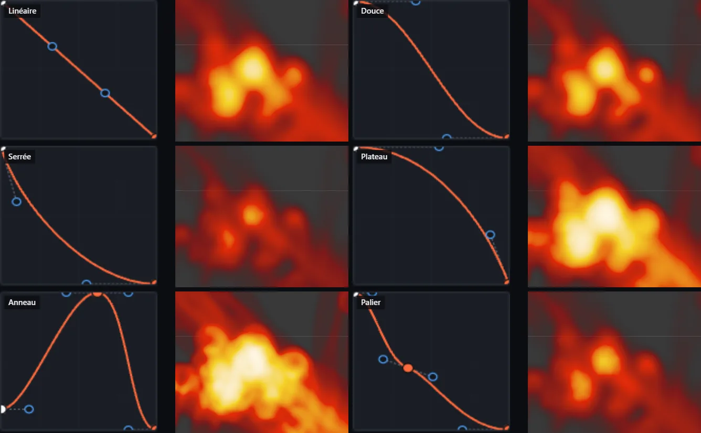

# Forme des sprites

Chaque ligne est dessinée comme un sprite rond qui fait toujours face à la caméra. Sa taille et le profil allant de son centre à son bord - la **rampe** - décident si un point chaud se lit comme un point serré, un nuage doux, un disque ou un anneau. Ces commandes se trouvent dans les sections **Forme de la chaleur** et **Limites des sprites en pixels** de la barre latérale, et s’appliquent à [Chaleur](heat.md), [Différence](difference.md), [Chaleur par équipe](team-heat.md) et, comme demi-largeur d’une ligne, à [Chaleur linéaire](line-heat.md).

Modifier l’une d’elles relance l’accumulation (le champ doit être redessiné avec la nouvelle forme).

Imaginez chaque point comme une tache de lumière floue. Une petite tache montre des points isolés ; une grande tache fond les voisins en un nuage. La forme décide de la douceur du bord.



## Rayon du sprite {#sprite-radius}

Le rayon du sprite en **unités du monde** (étiquetées en mètres). Par défaut 6, et à chaque chargement, l’étendue horizontale des données / 120 - assez grand pour que des échantillons voisins le long d’un trajet se fondent en bande au lieu de se lire comme un trait fin. Curseur logarithmique de 0.05 à 2000, la poignée peut aller jusqu’à 50 000.


Les objets lointains paraissent plus petits, donc un sprite rétrécit à l’écran avec la distance. En projection parallèle, il a la même taille partout ; c’est en partie pourquoi la vue parallèle est la bonne pour comparer des points chauds ([Caméra](camera.md#projection)).

## Limites en pixels {#pixel-clamps}

Les **Limites des sprites en pixels** (fermées par défaut) bornent le rayon à l’écran après la conversion ci-dessus.

| Commande | Par défaut | Plage (curseur) | Pourquoi |
|---|---|---|---|
| **Rayon min. en pixels** | 1 px | 0-16 (512) | Empêche les données lointaines de disparaître en dessous d’un pixel. |
| **Rayon max. en pixels** | 96 px | 2-1024, logarithmique (8192) | Le garde-fou de surdessin. Un sprite qui couvre N pixels coûte N opérations de fusion ; un rayon sans limite, près de la caméra, transforme donc une image rapide en image lente. Au-delà de la hauteur de la vue, il ne borne plus rien. |

**Même densité à tout niveau de zoom** (dans la section Forme de la chaleur, activé par défaut) travaille avec les limites. Un sprite qu’une limite agrandit (au loin) ou rétrécit (de près) garde la chaleur que lui donnerait sa taille réelle, si bien qu’une couleur veut dire le même nombre de lignes par surface de sol à tout niveau de zoom. Désactivé, un sprite limité ajoute son poids entier à sa taille limitée, et l’image change quand vous volez vers lui.

## Intensité au centre et au bord {#centre-and-edge-intensity}

La chaleur qu’un sprite ajoute en son centre exact (**Intensité au centre**, par défaut 1, 0-10, curseur 1000) et sur son bord (**Intensité au bord**, par défaut 0, -2-10, curseur 1000). La valeur de rampe *t* (1 au centre, 0 au bord, façonnée par l’atténuation ou la courbe ci-dessous) fait la transition entre les deux (la formule est sous [Pour les développeurs](#for-developers)).

Une **intensité de bord négative** fait que le bord soustrait, ce qui creuse un halo froid autour de chaque point chaud et sépare nettement les amas les uns des autres. La visibilité inclut [l’occlusion](depth-and-culling.md) et la [coupe](slice.md) ; le fondu est le fondu de [Durée de vie](timeline.md#history) ; le signe vaut ±1 dans [Différence](difference.md).

## Forme de la rampe : Atténuation ou Courbe {#ramp-shape-falloff-or-curve}

**Forme de la rampe** choisit entre deux façons de façonner *t* à travers le sprite. Avec *d* la distance du centre (0) au bord (1) :

### Atténuation {#falloff}

Affichée quand *Atténuation* est choisie (par défaut).

- **Atténuation** (par défaut 1.6, 0.1-8, curseur 64) : `t = (1 - d) ^ atténuation`. 1 est une rampe linéaire droite ; une valeur plus haute ramène la chaleur vers le centre et resserre le point chaud ; en dessous de 1, elle l’aplatit en disque.
- **Rampe douce** (par défaut activée) : applique une courbe en S (smoothstep) à *t*, si bien que le sprite se fond à son bord au lieu de finir sur un bord visible.

### L’éditeur de courbe {#the-curve-editor}

Affiché quand *Courbe* est choisie. Une coupe transversale réelle d’un sprite : la distance du centre à travers (*centre* à gauche, *bord* à droite), chaleur vers le haut. La courbe est un Bézier cubique par morceaux passant par des points de contrôle, chacun avec deux poignées.

| Action | Effet |
|---|---|
| Double-clic sur le graphe | Ajoute un point à cette distance (gardé entre 0.02 et 0.98), sur la courbe et avec la pente de la courbe à cet endroit, si bien que l’ajout ne change rien tant que vous ne le faites pas glisser. |
| Glisser un point | Le déplace. Les hauteurs restent entre 0 et 1. |
| Glisser un petit cercle | Courbe le segment à côté de lui (déplace cette poignée). |
| Alt-clic ou clic droit sur un point | Le supprime. Les deux extrémités ne peuvent pas être supprimées. |
| Un bouton de préréglage | Remplace la courbe par le préréglage. |

Les extrémités sont fixées au centre et au bord ; leur hauteur reste à votre choix.

**Préréglages** ([`curve.ts`](https://github.com/Holdi601/3DHeat/blob/main/src/state/curve.ts)) :

| Préréglage | Forme | Usage |
|---|---|---|
| **Linéaire** | Droite de 1 à 0 | Identique à *Atténuation* 1 avec *Rampe douce* désactivée. |
| **Douce** | Courbe en S | La courbe par défaut ; ce que donne *Rampe douce* à atténuation 1. |
| **Serrée** | Un cœur raide, une longue jupe faible | Données clairsemées. |
| **Plateau** | Plat, puis une chute rapide | Se lit comme un disque plutôt que comme une tache. |
| **Anneau** | 0.15 au centre, 1 à 62 % du rayon, 0 au bord | Un sprite creux : montre où passent les trajets plutôt que où ils s’arrêtent. |
| **Palier** | Chute en deux temps, 0.45 à 35 % | Sépare un cœur dense de ce qui l’entoure. |

## Aplatir sur le plan du sol {#flatten-onto-ground-plane}

**Aplatir sur le plan du sol** (désactivé par défaut) ignore la hauteur de chaque ligne et dessine toute la chaleur à une seule hauteur - le Y le plus bas des données - la carte de chaleur 2D classique. Activée, l’occlusion par profondeur et *Masquer derrière le terrain* sont désactivées (chaque point se trouverait exactement sur la surface contre laquelle il est testé), et la section Profondeur le signale.

## Pour les développeurs {#for-developers}

### Formules {#formulas}

Rayon à l’écran en pixels : `rayon × P[1][1] / w × hauteur de la vue / 2`, où `P` est la matrice de projection et `w` la profondeur de vue du point.

La chaleur qu’ajoute un sprite :

```
heat added = mix(edge, centre, t) × sample weight × sign × fade × visibility
```

### La courbe {#the-curve}

Les poignées sont bornées horizontalement à leur propre segment, si bien que la courbe est toujours une fonction de la distance : glisser une poignée loin au-delà du point suivant l’aplatit contre lui au lieu de replier la courbe, ce qui ferait dépendre le résultat de la racine trouvée par un solveur.

### Comment la courbe est dessinée {#how-the-curve-is-drawn}

La courbe est cuite dans une table de 256 entrées à chaque changement, envoyée comme texture flottante de 16 bits, et échantillonnée par fragment avec un filtrage linéaire et un retrait d’un demi-texel pour que les deux bouts restent exacts. Résoudre un Bézier pour x demande des itérations, ce qui n’a pas sa place dans le shader le plus sollicité du programme, et une lecture de table coûte aussi moins cher que le `pow()` qu’utilise l’atténuation. 16 bits plutôt que 8, car 8 bits font apparaître des bandes dès que des milliers de sprites se sont additionnés ; le flottant demi-précision de 16 bits est filtrable dans le WebGL2 de base, là où le 32 bits demande une extension.
